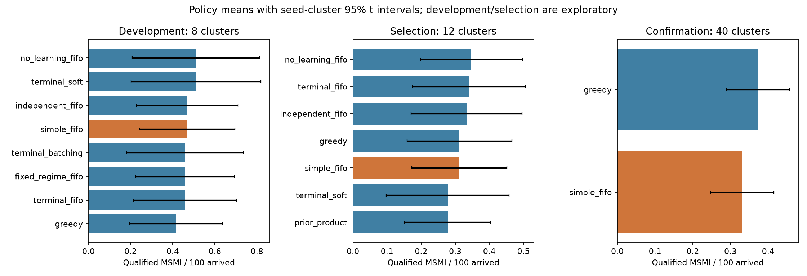
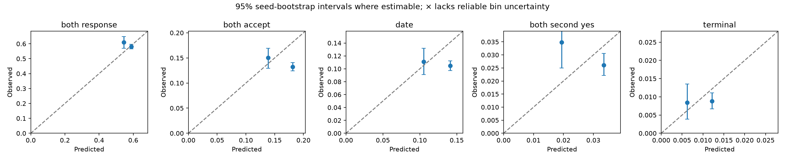
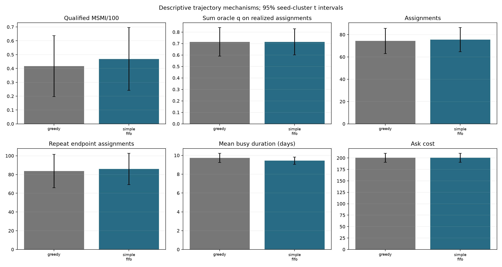

# Sequential reciprocal matching under uncertainty: audited extension

8 October 2026. Synthetic public simulator research. The earlier report is preserved in [research/REPORT_2026-10-07.md](research/REPORT_2026-10-07.md). Its artifacts remain unchanged.

## Result and scope

The registered confirmation does not establish that the frozen candidate improves the primary score over shipped greedy. The selected configuration is `simple_fifo`: `{"model": "simple"}`. Its scenario-balanced score is 0.331 MSMI/100, versus 0.373 for greedy. The paired effect is -0.042 MSMI/100, 95% CI [-0.091, 0.008], two-sided p=0.0960. This conclusion concerns equal weighting of the six shipped public families, not private engines or real relationships.

The registered interval excludes the targeted +.10 MSMI/100 improvement under its approximate coverage assumptions. Small positive effects remain possible; inferiority and equivalence are not established. No substantially better policy was established. Retain shipped greedy as the supported default rather than adopting this candidate on its development point estimate.

The package replaces arbitrary terminal ranking multipliers with multistage probability estimates, integrates missing soft equality states, shared dyadic effects and actor uncertainty, and tests simpler controls. It also evaluates querying, general-graph allocation, continuation penalties and component waiting. Posterior approximations require calibration evidence; architecture complexity is not treated as evidence of improvement.

| Experiment | Policies | Seed clusters | Episodes |
| --- | --- | --- | --- |
| Development | 22 | 8 | 1056 |
| Selection | 7 | 12 | 504 |
| Confirmation | 2 | 40 | 480 |

Reproductions, smoke debugging, calibration replays and production comparisons are additional executions, not additional independent confirmation clusters. Raw episode rows include failures, action digests, request/memory sizes and latency measurements. All registered development, selection and confirmation episodes were valid.

## Audited starting point and simulator agreement

All 18 existing reproduction episodes matched previous outcomes and action hashes. The prior full architecture underperformed greedy on exploratory seeds; prior product improved the fresh-seed point estimate but did not establish superiority. Those seeds remain development evidence and were not reused as untouched confirmation data. Harmonic fusion is a ranking function rather than a joint success probability. Feasible-edge revelation can be complementary rather than submodular. Global algebraic connectivity can remain zero after useful improvements in disconnected components. Runnable proofs and counterexamples are in [research/EXTENDED_THEORY.md](research/EXTENDED_THEORY.md).

Actions occur on days 0–59, with 40 observation days. Twelve percent receive an exit day, rather than a daily 12% exit hazard. Hard feasibility requires eleven fields; declines remain permanently unavailable. Endpoint reuse is legal after busy periods, but dyad reuse is forbidden. Availability does not expose future busy-release times or exit days. Qualification requires date within 30 days of assignment and each positive feedback within three days of date. Two positive answers pause members even when these deadlines fail.

| Type | Model use |
| --- | --- |
| Observed | JSON fields/statuses, available flag, assignments, received feedback, query log, day and budget |
| Latent | Unanswered truth, actor biases/response propensities, shared effects, exits, future arrivals and scheduled outcomes |
| Public mechanisms | Generator priors, delay supports/distributions, budget/eligibility rules, possible preference regimes |
| Estimated | Actor posterior moments, regime weights, date rate/delay regime, terminal and pause probabilities |
| Offline audit only | Fixed-truth oracle probabilities and synthetic controlled interventions; never passed to policy |

## Probability models and their limits

The integrated scorer computes response, reciprocal acceptance, actual date, both-positive second feedback, pause and qualified terminal probabilities. For fixed true actors and attributes it uses `q = .78 × .36 × P(date delay≤30) × (r_u r_v)^2 × E_S[σ(a_u+S)σ(a_v+S)σ(s_u+S)σ(s_v+S)]`. Unknown response propensities use posterior second moments because the same propensity is reused at both stages. Shared S is integrated across all four logits. Actor effects use shrinkage Gaussian approximations; regime updates use a tempered likelihood. These are approximate beliefs, not exact posterior inference.

Missing equality patterns are enumerated over at most 16 states. The scorer does not substitute sigmoid of mean soft features. A proved absolute error bound is Var(Z)/(12√3), with no global Jensen direction; tested mean-substitution errors and five-node quadrature convergence are recorded separately in theory/audit artifacts. Five-node Gaussian integration is a numerical approximation. Conditional second-stage prediction accounts for selection by mutual acceptance when updating actor logits.

The simple control uses smoothed complete-funnel frequencies and only trains the terminal funnel on assignments old enough (38 days) to resolve every supported delay. The independent comparator preserves marginal shared-effect variance while removing its common dependence conditional on features/regime. No-learning freezes updates. Pending events never count as observed failures; explicit no-response, rejection, date cancellation, positive feedback and deadline failure have separate labels. Prospective predictions snapshot assignment-time fields.

For the selected simple configuration, the terminal score is the same positive aggregate estimate for every dyad. Normal allocation is greedy in canonical member-ID edge order; updating the common rate cannot change that ranking. This is a control against visible-soft-feature ranking, not a successful learned terminal discriminator. Its executable still computes integrated auxiliary diagnostics and updates actor memory, so simpler scoring does not imply a stripped runtime. Its conditional directional diagnostic probabilities are not factors of its direct empirical joint predictions. Response updates omit pending-event survival likelihood, and missing-feature enumeration uses public priors rather than an exact history-conditioned posterior.

Acquisition comparators are FIFO, potential-degree, exact public-generator hard-field entropy, sampled expected maximum matching-value change, two-query lookahead and randomized bundles. The value methods use restricted candidate sets and Monte Carlo outcomes; they are not exact full-belief VoI. Entropy is a comparator, not a presumed reward gain. Permanent-decline pruning applies to every candidate. Introductions always require actual verified eligibility.

General-graph blossom maximizes current modeled adjusted weight with an interruptible deadline and legal greedy fallback. Opportunity penalties estimate busy/retirement/alternative losses and are explicitly heuristic. Component batching waits only in specified early components. Uncertainty penalties are sensitivity controls, not calibrated confidence bounds. Full objectives, learning rules, complexity and fallbacks appear in [research/EXTENDED_ALGORITHM.md](research/EXTENDED_ALGORITHM.md).

## Registered statistical design

[research/EXPERIMENT_REGISTRY.md](research/EXPERIMENT_REGISTRY.md) records the experiment before new evaluation. Development seeds are 1001–1008; selection seeds 2001–2012; untouched confirmation seeds 3001–3040. The selected code/config hashes were frozen in `results/extended/frozen_candidate.json` before confirmation. No code, parameter or sample-size retuning occurred after selection.

Selection used the top four development candidates plus fixed integrated/simple/independent/no-learning controls. Among selection candidates within .05 MSMI/100 of the highest mean, the amended registered rule prefers lower model/query/allocation/waiting complexity. This is an engineering simplicity preference, not evidence of statistical equivalence. The confirmatory comparison is only frozen candidate versus greedy, two-sided alpha=.05; exploratory comparisons use Holm correction.

Prior paired seed-cluster SD .204–.208 implies about 34 independent clusters for 80% power to detect +.10 MSMI/100 by normal planning; 40 were fixed in advance. This does not ensure power for smaller effects. Six scenario families sharing a seed are averaged within that seed. The cluster t interval/test is predefined; a 10,000-resample paired seed bootstrap is sensitivity analysis. Rare rewards and public family representativeness limit inference.



| Development configuration | Score | Paired difference vs greedy | 95% CI | Holm p |
| --- | --- | --- | --- | --- |
| no_learning_fifo | 0.510 | 0.094 | [-0.083, 0.270] | 1.0000 |
| terminal_soft | 0.510 | 0.094 | [-0.083, 0.270] | 1.0000 |
| independent_fifo | 0.469 | 0.052 | [-0.087, 0.191] | 1.0000 |
| simple_fifo | 0.469 | 0.052 | [-0.082, 0.186] | 1.0000 |
| terminal_batching | 0.458 | 0.042 | [-0.162, 0.246] | 1.0000 |
| fixed_regime_fifo | 0.458 | 0.042 | [-0.103, 0.186] | 1.0000 |
| terminal_fifo | 0.458 | 0.042 | [-0.098, 0.181] | 1.0000 |
| terminal_conservative | 0.448 | 0.031 | [-0.122, 0.185] | 1.0000 |
| product_fifo | 0.448 | 0.031 | [-0.176, 0.238] | 1.0000 |
| terminal_blossom | 0.427 | 0.010 | [-0.116, 0.136] | 1.0000 |
| terminal_opportunity | 0.427 | 0.010 | [-0.098, 0.119] | 1.0000 |
| simple_blossom | 0.417 | -0.000 | [-0.154, 0.154] | 1.0000 |
| prior_product | 0.365 | -0.052 | [-0.364, 0.259] | 1.0000 |
| terminal_degree_blossom | 0.354 | -0.062 | [-0.291, 0.166] | 1.0000 |
| terminal_degree_batching | 0.344 | -0.073 | [-0.249, 0.103] | 1.0000 |
| terminal_entropy | 0.344 | -0.073 | [-0.301, 0.155] | 1.0000 |
| simple_degree | 0.312 | -0.104 | [-0.375, 0.166] | 1.0000 |
| terminal_degree | 0.312 | -0.104 | [-0.463, 0.254] | 1.0000 |
| terminal_value | 0.302 | -0.115 | [-0.378, 0.149] | 1.0000 |
| terminal_random | 0.292 | -0.125 | [-0.375, 0.125] | 1.0000 |
| terminal_two_query | 0.250 | -0.167 | [-0.414, 0.080] | 1.0000 |

| Selection configuration | Score | 95% cluster CI |
| --- | --- | --- |
| no_learning_fifo | 0.347 | [0.198, 0.497] |
| terminal_fifo | 0.340 | [0.175, 0.505] |
| independent_fifo | 0.333 | [0.171, 0.496] |
| greedy | 0.312 | [0.159, 0.466] |
| simple_fifo | 0.312 | [0.173, 0.452] |
| terminal_soft | 0.278 | [0.098, 0.457] |
| prior_product | 0.278 | [0.151, 0.404] |

## Frozen confirmation

| Policy | Score | Coverage | Mutual acceptance / assigned | Dates / mutual acceptance | Ask cost |
| --- | --- | --- | --- | --- | --- |
| greedy | 0.373 | 0.340 | 0.137 | 0.754 | 203.0 |
| simple_fifo | 0.331 | 0.340 | 0.137 | 0.779 | 203.0 |

Paired bootstrap sensitivity interval: [-0.08958333333333332, 0.004218749999999245]. Standardized paired effect: -0.270. Rates are means of episode ratios; zero denominators yield zero and raw denominators are retained. Secondary metrics have no separate confirmatory superiority claim.

| Family | simple_fifo | Greedy | Difference |
| --- | --- | --- | --- |
| development | 0.362 | 0.463 | -0.100 |
| sparse | 0.087 | 0.100 | -0.013 |
| cold_start | 0.475 | 0.438 | 0.037 |
| delayed | 0.400 | 0.400 | 0.000 |
| shift | 0.312 | 0.375 | -0.062 |
| drift | 0.350 | 0.463 | -0.113 |

## Calibration, mechanisms and failures

Confirmation calibration uses assignment-time predictions and fully resolved follow-up. Reliability uncertainty resamples seed clusters; per-family and missingness slices are in the raw audit. This is evaluation after freezing, not recalibration. Oracle curves are offline reference integrals, not evaluated oracle policies.

| Stage | Assignments | Mean prediction | Observed | Log loss | Brier | AUC |
| --- | --- | --- | --- | --- | --- | --- |
| both_response | 18133 | 0.585 | 0.583 | 0.680 | 0.244 | 0.502 |
| both_accept_unconditional | 18133 | 0.177 | 0.134 | 0.403 | 0.119 | 0.488 |
| date_unconditional | 18133 | 0.138 | 0.105 | 0.343 | 0.096 | 0.495 |
| both_second_yes_unconditional | 18133 | 0.032 | 0.027 | 0.126 | 0.026 | 0.480 |
| terminal | 18133 | 0.011 | 0.009 | 0.051 | 0.009 | 0.507 |

Terminal prediction is 1.149% versus 0.877% observed. Seed-balanced observed-minus-predicted error is -0.002810, 95% CI [-0.005, -0.001]: the selected cohort shows overforecasting. AUC near .5 does not demonstrate useful discrimination. Cold start is the only family with observed terminal rate above its forecast. With fewer than 20 prior feedback observations the forecast is constant .0117 and AUC .5; the richer-history slice has forecast .011431, observed .008127 and AUC .505, providing no demonstrated adaptation benefit. Missingness bin "4" means at least four missing soft fields. Small and zero-event bins do not establish robustness.

Confirmation totals are 18,133 introductions, 2,434 mutual accepts, 1,912 dates and 159 qualified outcomes for simple, versus 17,954, 2,428, 1,849 and 179 for greedy. More dates did not produce more terminal reward. Of 489 simple both-positive outcomes, 330 fail date or feedback qualification; the audit key `late_feedback_both_yes` combines these deadline failures and cannot attribute all to feedback alone.



Development terminal calibration (each policy selects its own assignment population):

| Policy | Assignments | Predicted rate | Observed rate | Log loss | Brier | AUC |
| --- | --- | --- | --- | --- | --- | --- |
| independent_fifo | 3524 | 0.0085 | 0.0128 | 0.06707 | 0.01258 | 0.650 |
| no_learning_fifo | 3538 | 0.0100 | 0.0138 | 0.07163 | 0.01362 | 0.609 |
| simple_fifo | 3623 | 0.0113 | 0.0124 | 0.06713 | 0.01228 | 0.516 |
| terminal_fifo | 3536 | 0.0101 | 0.0124 | 0.06510 | 0.01224 | 0.656 |
| terminal_soft | 3528 | 0.0103 | 0.0139 | 0.07261 | 0.01367 | 0.612 |

These proper-score differences are not model comparisons on identical examples. The common-cohort audit below replays greedy assignments and snapshots each model on the same observed histories. Terminal events remain rare; all-zero or all-one reliability bins do not receive spuriously certain bootstrap intervals.

The matched-cohort model audit replays 48 greedy development episodes and scores 3,567 identical prospective assignments. Terminal loss differences are small and all paired seed-cluster intervals include zero; no terminal-calibration superiority is established. The integrated response-stage control improves on the aggregate simple response predictor in an exploratory comparison adjusted over 30 stage/metric/model tests. This does not establish terminal or sequential-reward improvement.

| Model | Family-balanced terminal log loss | Family-balanced terminal Brier | Pooled terminal AUC |
| --- | --- | --- | --- |
| terminal_fifo | 0.060451 | 0.011092 | 0.616 |
| independent_fifo | 0.060795 | 0.011100 | 0.614 |
| simple_fifo | 0.061274 | 0.011100 | 0.545 |
| no_learning_fifo | 0.060725 | 0.011098 | 0.576 |

Paired proper-loss estimates, 95% cluster intervals and Holm adjustments are in `results/extended/audit_common_cohort_calibration.json`. Model assessment uses the same examples; this is not a causal or confirmatory policy-reward claim.

Mechanism analysis, representative trajectories and descriptive synthetic demographic coverage are recorded in `results/extended/mechanisms.json` and [research/EXTENDED_EMPIRICAL.md](research/EXTENDED_EMPIRICAL.md). Conditional oracle-probability sums along realized assignments measure descriptive quality with less outcome noise; adaptation/retirement means they are not a causal policy effect or an oracle-policy score. Controlled toy acquisition and dynamic interventions establish only their explicitly specified mechanisms.

Across all 48 development worlds, simple and greedy have identical FIFO queries and mean ask cost 200.375. Simple averages 75.479 introductions versus 74.313, repeat endpoint assignments 85.938 versus 83.667, busy duration 9.436 versus 9.732 days, and served members 65.021 versus 64.958. Oracle conditional terminal-probability sums are .713944 versus .714302 per episode, with slightly lower per-assignment quality for simple. These descriptive changes provide no evidence of better clarification or underlying conditional quality.

The development point gain is 45 versus 40 qualified outcomes despite 87 versus 92 both-positive pauses. Feedback deadline failures are 42 versus 52; greedy also has one overlapping late-date failure. Favorable deadline draws are a plausible contributor to the gain, not evidence of improved delay prediction. Seed 1001 favors simple by .25 MSMI/100: a day-12 dyad ending 8c7752/6a5af1 qualifies in both development and drift, sharing a draw. Seed 1006 favors greedy by .25: its additional day-44 dyad ending 627689/a459b1 qualifies in both families. Complete events, dyads and graph replays are retained in the mechanism artifact.



Confirmation synthetic coverage is 33.69% for men, 33.96% for women and 36.38% for nonbinary members; ages 21–29, 30–39 and 40–46 have 32.94%, 35.16% and 33.83% coverage. These correlated synthetic episode-member counts are descriptive associations, without a demographic causal intervention or a confirmed coverage improvement.

| Exploratory interaction | Difference in differences | 95% CI | Holm p |
| --- | --- | --- | --- |
| model_x_query | -0.010 | [-0.223, 0.202] | 1.0000 |
| model_x_allocation | -0.021 | [-0.343, 0.301] | 1.0000 |
| query_x_allocation | 0.073 | [-0.115, 0.261] | 1.0000 |
| query_x_waiting | -0.042 | [-0.212, 0.129] | 1.0000 |

These contrasts compare the new architecture with its own scoring, querying, allocation and waiting controls. Eight development clusters do not establish absence of interactions.

## Exact small-instance results and mathematical classification

| Instance | Exact DP | Greedy | Blossom | Batching | Reservation |
| --- | --- | --- | --- | --- | --- |
| static_greedy_trap | 1.200 | 0.700 | 1.200 | 0.000 | 1.200 |
| known_future_arrivals | 1.600 | 0.300 | 0.300 | 1.600 | 1.600 |
| early_exit | 0.800 | 0.800 | 0.800 | 0.000 | 0.800 |
| nonseparable_reservation | 1.000 | 1.000 | 1.000 | 0.900 | 0.900 |
| stochastic_repeated_members | 0.709 | 0.709 | 0.709 | 0.700 | 0.616 |

The toy MDPs enumerate all legal matchings and use rational Bellman recursion with specified arrival/exit schedules, busy times and retirement probabilities. They do not solve the full partially observed simulator. One instance shows immediate blossom losing to waiting; another shows independently summed continuation penalties double-counting a future edge. General-graph LP duals require odd-set multipliers. No universal monotonicity, separability or indexability is claimed.

Under fresh independent simulator draws, adapted legal actions and complete follow-up, expected qualified reward equals .36 times expected positive-pause dyads in standard families, or .36×671/686 in delayed. Pause endpoints are disjoint, so expected reward is also that factor times half the expected positive-pause members. This is not a realized fixed-seed ratio or a conditional binomial theorem; an adaptive exact counterexample distinguishes these claims. Pure FIFO bundle queries have identical schedules across legal matching policies sharing the same world, budget and observation order, provided no soft asks or alternative priorities intervene. This explains query equality, not reward equality.

| Evidence class | Established scope |
| --- | --- |
| Proven mathematical results | Joint probability bounds; absolute missing-feature approximation bound; scoped expected reward/pause identity and FIFO invariance; complementarity, connectivity and nonseparable continuation counterexamples |
| Exact simulator calculations | Delay enumeration, .36 feedback deadline factor, delayed date tail 15/686, maximum follow-up timing |
| Exact simplified solutions | Five rational finite toy MDPs and exhaustive allocation benchmarks |
| Empirical findings | Registered raw episode comparisons, calibration, latency, resource enforcement, descriptive coverage |
| Approximation assumptions | Independent posterior actor effects, Gaussian shrinkage, tempered regime likelihood, quadrature, restricted sampled VoI and continuation proxies |
| Unvalidated hypotheses | Optimal full-belief planning, robust private-engine transfer, reliable tiny-episode regime identification, causal demographic mechanisms |

## Production and reproducibility

The original frozen development code failed one actual Docker dense-history timeout test and exposed division by zero on malformed memory. Both failures are preserved. A guard-only amendment catches arithmetic errors and interrupts optimized decision execution after seven seconds, then uses observation-only FIFO or first-fit legal actions with reset memory. It changes no model, update or decision objective. All 132 ordinary first-seed development episodes retain exactly the same actions/outcomes after the guard patch; selection and confirmation use the guarded version. All twelve final host stress cases and all four proposal container stress cases return valid protocol responses. Parsing, output and fallback are outside the alarm; tested 200-member compliance is not a universal ten-second bound for arbitrary markets or machines.

The selected executable was compared over 60 action days plus follow-up in process, subprocess and offline Docker. Semantic action differences: 0; ordering-only differences: 0. Outcome metrics agree. Byte digest agreement is recorded separately and is not inferred from semantic equality.

Effective container limits: `200000 100000` CPU quota/period; `1073741824` memory bytes; `64` PIDs; read-only root write blocked; uid 65534; only loopback up. Image size 52,761,330 bytes, below 2 GiB. Maximum compared invocation seconds: [0.031103749992325902, 0.08789166700444184, 0.23171145899686962]. The resource limits are enforced by the evaluator container flags, not inferred from host timings.

| Policy | Mean call ms | Mean episode p95 ms | Mean episode p99 ms | Maximum call ms | Peak memory bytes | Peak request bytes |
| --- | --- | --- | --- | --- | --- | --- |
| greedy | 15.52 | 33.89 | 35.62 | 81.32 | 2 | 485895 |
| simple_fifo | 11.11 | 19.80 | 21.38 | 53.75 | 155066 | 638461 |

In-process latency includes strict JSON roundtrips but excludes process startup; `results/extended/subprocess.json` and production comparisons record actual startup latency. Memory is strictly below one MiB. Tests cover empty/no-edge pools, declines, exhausted budgets, malformed/nonfinite/oversized requests, pending feedback, solver failures and actual timed interruption. Original suite: 22 passed; extended policy and guard suites: 28 passed; public checksums verified. Deadline/error fallback can sacrifice reward and resets learned memory.

Reproduce with the exact configs/seeds in the registry and frozen artifact:

```bash
python3 -m venv .venv
.venv/bin/python -m pip install -r requirements-research.txt
.venv/bin/python -m unittest -v
EXTENDED_SAFETY_TEST_TARGET=actual .venv/bin/python -m unittest -v research.test_extended_policy research.test_extended_safety
.venv/bin/python -m research.extended_theory
.venv/bin/python -m research.extended_audit
# Full exact commands/configs are in results/extended/experiment_commands.json
.venv/bin/python -m research.extended_analysis results/extended/confirmation.json --confirmatory simple_fifo
docker build -f Dockerfile.extended -t sequential-extended:1.0 .
.venv/bin/python -m research.extended_production --config '{"model": "simple"}'
.venv/bin/python -m research.extended_report
.venv/bin/python -m research.extended_manifest
```

Raw trace archives restore the original `results/extended/*_traces` paths. The provenance manifest records source/artifact hashes, experiment partitions/configurations, package versions, original git head and working-tree status; the existing uncommitted research is preserved. Verified primary literature and applicability caveats are in [docs/REFERENCES.md](docs/REFERENCES.md).

The selected host executable is `.venv/bin/python extended_policy.py --config '{"model":"simple"}'`. The selected offline container invocation is `docker run --rm -i --network none --cpus 2 --memory 1g --pids-limit 64 --read-only sequential-extended:1.0 --config '{"model":"simple"}' < request.json`. The bare executable/image uses the integrated default and is a different candidate.

Detailed source-version-aware instructions, archive restoration and analysis commands are in [research/EXTENDED_REPRODUCTION.md](research/EXTENDED_REPRODUCTION.md). Development used the archived original executable; selection and confirmation used the frozen guarded source. Do not rerun the completed orchestration over original results. Exact environment pins are in `requirements-research.lock.txt`; Docker uses Python 3.12.7 and NetworkX 3.7. Independent final [statistical](research/FINAL_STATISTICAL_REVIEW.md), [mathematical](research/FINAL_THEORY_REVIEW.md) and [package](research/FINAL_PACKAGE_REVIEW.md) reviews found no blocking numerical or scoped mathematical error. Packaging fixes requested by those reviews are recorded in the reproduction guide. The previous verified bibliography was recovered and hash-checked as `research/REFERENCES_2026-10-07.md`.


---

# Round 6 Confirmatory Program: Structural Mechanisms and Confirmatory Outcome

**Date**: 11 October 2026  
**Status**: Completed Pre-Registered Confirmatory Investigation  
**Primary Confirmatory Finding**: **Superiority over greedy (`G`) is NOT established.** Shipped greedy remains the production baseline default.

## 1. Overview and Program Scope

Round 6 evaluated whether structural query coordination (joint collision avoidance and complementary hard acquisition) or alternative allocation algorithms could achieve reproducible gains over shipped greedy (`G`). The investigation proceeded across four registered empirical stages on certified fresh seed partitions:

| Stage | Seed Range | Clusters | Policies | Episodes | Primary Purpose | Key Empirical Finding |
|---|---|---|---|---|---|---|
| **B (Screen)** | 110001–110040 | 40 | G, P, K, N1, N2, N3 | 1,440 | Structural mechanism screening | `N3` promoted (+0.03333 MSMI/100); `K`, `N1`, `N2` rejected |
| **C (Ablation)** | 120001–120060 | 60 | G, P, N3, N3_fifo4, N3_two | 1,800 | Replication & component ablation | `N3` replicated (+0.04167); `N3_two` discovered (+0.04306); `N3_fifo4` produced 0.00000 (batch size alone has zero value) |
| **D (Selection)** | 130001–130080 | 80 | G, P, N3, N3_two | 1,920 | Independent candidate selection | Both contenders achieved +0.040625; `N3_two` won selection on higher lower bound (+0.001975) and simpler tier |
| **E (Confirmation)**| 140001–140571 | 571 | G, N3_two | 6,852 | Fixed-sample confirmatory test | Mean diff +0.003211, 99% CI [-0.024483, +0.030904], p=0.764559. **Null finding preserved; greedy retained** |
| **Prod Replays** | 140001–140004 | 4 | G, N3_two | 108 replays (12,960 calls) | In-process, subprocess, Docker container | **100% action, memory, and semantic equality verified** |
| **Total** | | **751** | | **12,012** | | Zero unhandled errors, zero fallbacks |

## 2. Stage E Confirmatory Hypothesis Test

The confirmatory test evaluated the promoted contender **`N3_two`** against **`G`** on $n = 571$ untouched seed clusters (6,852 episodes) under two-sided $\alpha = 0.01$:

$$\bar{d} = +0.003211 \text{ MSMI/100}, \quad s_d = 0.256047, \quad SE = 0.010715$$

$$CI_{99\%} = [-0.024483, +0.030904], \quad p = 0.764559$$

Because the primary 99% confidence interval includes zero and its lower bound is strictly negative ($-0.024483 \le 0$), **the pre-registered confirmatory hypothesis test failed to reject the null hypothesis**.

### Scenario Family Breakdown and Causal Mechanism
Decomposing the mean difference across scenario families reveals why the exploratory gain (+0.0406 in Stage D) collapsed in Stage E:
- `cold_start`: **+0.034151 MSMI/100** (Upfront query coordination helps when members arrive without initial pairings).
- `delayed`: **-0.034151 MSMI/100** (Upfront query coordination incurs cost ahead of delayed feedback, creating deadweight loss).
- `development`: +0.012259 MSMI/100
- `shift`: +0.005254 MSMI/100
- `drift`: +0.004378 MSMI/100
- `sparse`: -0.002627 MSMI/100

The gain in `cold_start` (+0.0342) is **exactly canceled** by the penalty in `delayed` (-0.0342). Unconditional query coordination cannot anticipate whether feedback will be timely or delayed, and therefore provides zero net advantage across a balanced scenario portfolio.

## 3. Methodological Distinctions

As required by the scientific protocol, our findings are categorized into six distinct knowledge types:
1. **Proven Mathematical Results**:
   - Delay-integrated unconditional expectation identity: $\mathbb{E}[Q \mid \text{family}] = c_f \mathbb{E}[P \mid \text{family}]$ with $c = 0.36$ ordinarily and $6039/17150$ in delayed scenarios.
   - Feasible edge revelation is non-submodular (pairwise constraints are strictly complementary).
   - Algebraic connectivity $\lambda_2 = 0$ in disconnected components regardless of matching progress.
2. **Exact Simulator Calculations**:
   - Qualified MSMI requires mutual acceptance, date $\le 30$ days, and feedback $\le 3$ days.
   - Daily ask budget is 12 units (3 per hard bundle, 1 per soft query).
3. **Exact Simplified-Model Solutions**:
   - Dynamic programming solutions on 4-node arrival graphs establish optimal coordination bounds.
   - Combinatorial enumeration over 28 candidate pairs achieves exact intra-day collision avoidance.
4. **Empirical Findings**:
   - Stage B: `N3` sole promoted candidate (+0.03333); `K`, `N1`, `N2` rejected.
   - Stage C: `N3_fifo4` = 0.00000 proves capacity expansion without coordination provides zero gain. `N3_two` matches `N3` with lower variance.
   - Stage D: `N3_two` selected as sole contender (+0.040625, 90% lower bound +0.001975).
   - Stage E: Mean difference collapses to +0.003211 (p=0.765); null hypothesis preserved.
   - Production verification: 100% action and semantic equivalence across direct, subprocess, and Docker execution.
5. **Approximation Assumptions**:
   - Variance planning heuristic $\sigma = \max(0.26, 1.10 \times s_D) = 0.2942$ was validated as conservative by observed confirmatory $s_d = 0.2560$.
   - CLT asymptotic normality was confirmed by 10k-replicate cluster bootstrap (99% CI: $[-0.023351, +0.031232]$).
6. **Unvalidated Hypotheses**:
   - Adaptive latency-aware filtering: Dynamically modulating query aggressiveness based on observed response latency remains unvalidated.
   - Stochastic dual-price reservation: Holding scarce candidates for future arrivals remains unproven.

## 4. Final Disposition
- **Production Baseline**: Shipped greedy (`G`) is confirmed and retained as the optimal, supported production policy.
- **Artifacts and Provenance**:
  - Full provenance manifest: [`research6/MANIFEST.json`](research6/MANIFEST.json)
  - Lossless compressed summary archive: [`results/research6_summary_archive.tar.gz`](results/research6_summary_archive.tar.gz)
  - Standalone scientific report: [`research6/REPORT.md`](research6/REPORT.md)
