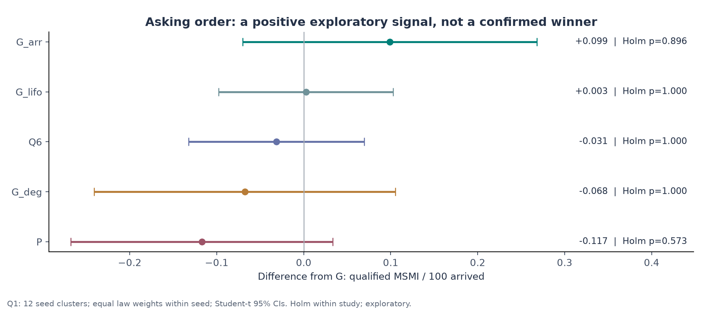
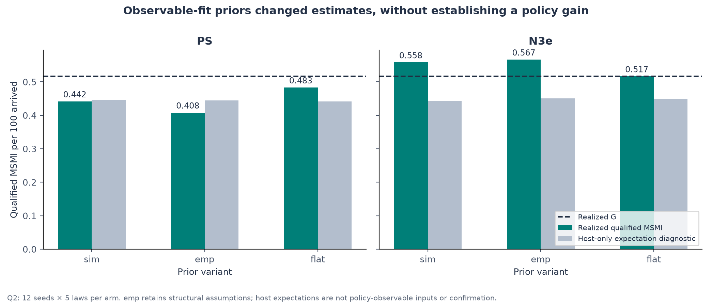
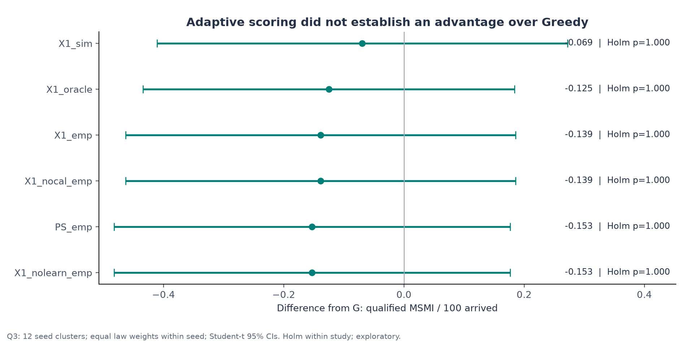
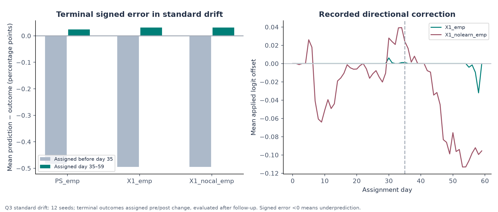
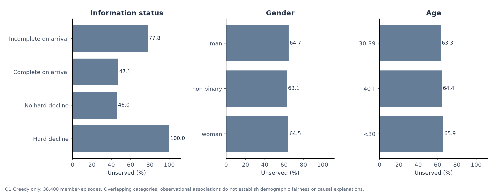
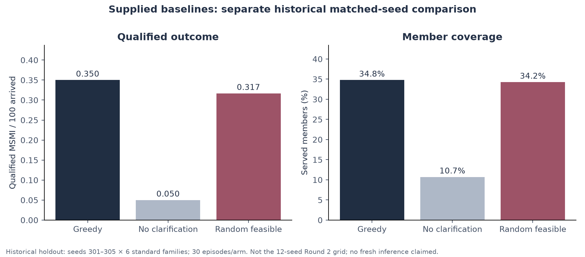
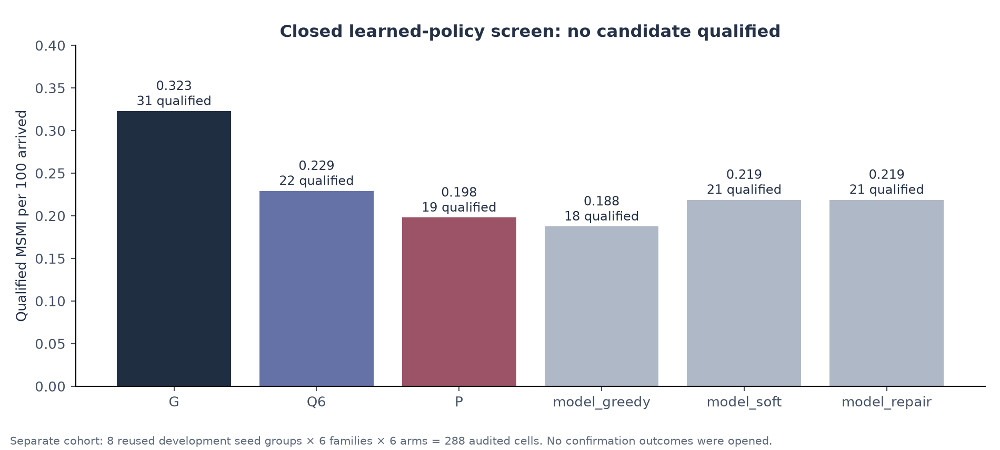

# Sequential Reciprocal Matching Under Changing Conditions

## Final Round 2 technical report

**Date:** 17 October 2026  
**Benchmark:** public synthetic release 1.0.0  
**Retained executable:** supplied Greedy (`policy.py`, default `greedy` mode)  
**Decision:** retain Greedy; no tested replacement has established confirmatory superiority.  
**Scope:** retrospective synthesis and corrected analysis of saved experiments. No new policy fitting, tuning or research simulations were performed to prepare this report.

### Abstract

We study a sequential reciprocal-matching problem in which a policy chooses clarification questions and introductions under hard eligibility, limited daily questioning, availability changes and delayed feedback. The objective is a completed meeting followed by mutually positive, timely second-meeting intentions, reported as qualified MSMI per 100 arrived members. Round 1 selected a candidate named `simple_fifo`, but its confirmatory comparison did not establish a gain over the supplied Greedy baseline. This distinction matters: FIFO describes question ordering; it does not identify a universally superior allocation policy.

Round 2 evidence examines changes in arrivals, preference weights and response conditions; simulator-informed, observable-fit and flat priors; and a small adaptive scorer with directional calibration and component ablations. Three supplemental studies contain 2,076 recorded episodes on the same 12 seed identifiers, spanning 20 executed condition laws. These studies are exploratory. We recompute paired uncertainty using seed clusters, rather than treating related conditions within a seed as independent observations. Arrival-ordered questioning has a positive point difference of **+0.099 MSMI/100**, but its seed-cluster 95% interval is **[−0.070, +0.268]**. Observable-fit priors and adaptive scoring do not establish superiority. A separate, independently audited 288-cell learned-policy screen admitted no candidate to confirmation. Earlier large confirmation of coordinated questioning also failed to establish a gain.

The practical result is a conservative final policy choice supported by transparent negative findings. We also identify limitations in empirical-prior estimation, calibration, service access and experiment provenance. The evidence does not prove Greedy optimal, establish demographic fairness, or rule out all learned or dynamic policies.

## 1. Direct answers to the submission questions and Round 1 feedback

| Required question | Answer and location |
|---|---|
| **Brief solution summary** | Retain reciprocal hard-constraint verification, baseline list-order hard-bundle questioning and greedy matching by observed soft agreement. Richer tested alternatives did not earn promotion. Sections 2–3 and 12. |
| **Methodology and algorithms** | Separate eligibility, information acquisition, scoring and allocation; compare query ordering, priors, recency-weighted learning and directional calibration with explicit controls. Sections 3–4. |
| **Baselines and experimental results** | Supplied Greedy, no-clarification and random-feasible comparisons are shown on a historical common grid; later G/P/Q6 and mechanism comparisons remain separate. Metrics, uncertainty and figures appear in Sections 4–10. |
| **Limitations and improvements from Round 1** | More changing-condition coverage, prior sensitivity, adaptive ablations, assignment-time public features in the learned campaign, and explicit waiting/calibration diagnostics; remaining shortcomings are stated in Sections 11–13. |
| **Does FIFO retain its advantage when arrival order, weights and response conditions change?** | The premise needs qualification: the submitted FIFO-named candidate had no confirmed advantage. In the new robustness grid, chronology-based asking has the highest mean, but no arm establishes a corrected seed-cluster gain over G. Section 5. |
| **Would observable-training priors change conclusions based on simulator parameters?** | Point estimates and calibration change; no tested prior variant establishes a better policy. The `emp` implementation retains fixed structural assumptions and snapshot-censoring limitations, so this is only a partial answer to a strictly observable-only prior question. Section 6. |
| **Can a small adaptive method address drift, with directional calibration and identical asking controls?** | X1 was implemented and tested with identical ask-log hashes. It did not establish improvement. Removing calibration preserves all 72 action digests in the drift study. Sections 7–8. |
| **Keep meetings and mutual second-meeting intention central; report who waits** | Date occurrence and qualified MSMI are shown together; coverage, served waiting distributions and unserved subgroup rates are reported with their denominators. Sections 2, 8–9. |
| **Working implementation, environment and ablations** | The retained baseline is executable from the root CLI/Dockerfile. Reproduction, current validation and outstanding packaging checks are documented in Section 13. A final restricted-container rerun was unavailable during report preparation. |

## 2. Problem, information boundary and outcomes

Each episode has **60 decision days (0–59)** and **40 follow-up days**. The policy first chooses questions, receives the refreshed public state, then selects a batch of introductions. Follow-up after the last assignment allows downstream events to mature; day 59 is not the feedback deadline.

A question about the `constraints` bundle costs three units; a named soft-field question costs one. The daily budget is 12, allowing at most four hard bundles. An introduction must satisfy reciprocal hard constraints, current availability, no repeated pair and no member reused in the same batch. Unknown hard values block eligibility. Declined answers remain unknown and are not overridden by a compatibility score. The implementation delegates these decisions to the kit's eligibility checks. [Data contract](../docs/DATA_CONTRACT.md), [policy interface](../docs/POLICY_INTERFACE.md), [kit source](../kit.py).

For an introduction assigned on day \(t\), define

\[
Q=\mathbf{1}\{\text{date occurred},\; d-t\leq30,\; y_a=y_b=\mathrm{yes},\;
\tau_a-d\leq3,\;\tau_b-d\leq3\}.
\]

Here \(d\) is the date day and \(\tau_a,\tau_b\) are the second-meeting response days. The primary metric is

\[
\mathrm{MSMI}/100=100\,\frac{\sum Q}{N_{\mathrm{arrived\ by\ day\ 59}}}.
\]

One qualified pair counts as one outcome, not two members. Secondary measures are date occurrence per 100 arrived, mutual acceptance, assignments, distinct-member coverage, ask cost, missing feedback and waiting. The kit's `dates` metric counts dates that occurred; it does not by itself require the date to occur within 30 days. The 30-day qualification is part of MSMI. A date is a simulated event, not observed product performance. [Outcome implementation](../kit.py).

The deployed policy receives observations and serialized memory. It receives no hidden traits, world seed, future-arrival list or future outcomes. Host-only expected-reward diagnostics in the supplemental studies use privileged simulator information and are **never policy inputs or substitutes for the primary realized outcome**. Synthetic benchmark evidence cannot establish performance in a real matching service.

## 3. Methodology and algorithms

### 3.1 Retained policy and terminology

The retained root executable implements the supplied baseline:

```text
ASK:
  Keep available members with unresolved, non-declined hard fields.
  In public member-list order, request up to budget // 3 constraint bundles.

MATCH:
  Enumerate currently available, untried, reciprocally feasible pairs.
  Score each by the number of equal, observed soft-field answers.
  Sort by descending score using the kit's deterministic tie-breaks.
  Add an edge when neither member is already used in this batch.
```

This produces a greedy maximal matching on the enumerated graph; it is not a claim of maximum cardinality, maximum reward or optimal continuation. The baseline's list-order questioning is often called FIFO in earlier documents, but it is distinct from explicitly sorting by arrival time. [Executable adapter](../policy.py), [baseline functions](../kit.py).

| Arm | Mechanism | Comparator status |
|---|---|---|
| `G` | Supplied hard-bundle asking and soft-agreement greedy matching | Supplied Greedy baseline and retained executable |
| `no_asks` / `N` | No questions; same supplied matcher | Supplied no-clarification baseline |
| `random` / `R` | Baseline hard asks; randomly ordered feasible-edge greedy matching | Supplied random-feasible baseline |
| `P` | Frozen population-based scorer | Historical research reference; **not random** |
| `Q6` | Frozen coordinated two-query acquisition, also called `N3_two` | Historical research reference |
| `G_arr`, `G_lifo`, `G_deg` | Arrival chronological, reverse-arrival or potential-degree query ordering; supplied matching retained | Asking-order probes |
| `PS_sim`, `PS_emp`, `PS_flat` | Parametric outcome scoring under three prior variants; supplied asks | Static scoring controls |
| `N3e_sim`, `N3e_emp`, `N3e_flat` | Coordinated acquisition with alternative hard-field priors | Prior-sensitivity probes |
| `X1_emp`, `X1_sim` | Recency-weighted acceptance learning plus directional logit correction; supplied asks | Adaptive probes |
| `X1_nocal_emp`, `X1_nolearn_emp` | Remove calibration or remove weight learning | Component ablations |
| `X1_oracle` | Static simulator-prior scorer given the true drift schedule | Privileged diagnostic; not a deployable candidate or optimal-policy oracle |

Arm definitions are preserved in [the registry](../research9/round2/arms.py). The Round 1 `simple_fifo` candidate is distinct from current `G`. It used FIFO questioning with its own near-constant terminal scoring. We do not describe its historical executable or solver safeguards as features of the current root baseline.

### 3.2 Small adaptive alternative

PS combines profile agreement features, response-rate posterior moments and a multi-stage outcome approximation. X1 re-estimates acceptance logits from **released** yes/no responses using recency weights with a 14-day half-life and a MAP penalty. A 21-day recent window estimates a common logit correction. The applied correction is

\[
\Delta_{\mathrm{applied}}=\mathrm{sign}(\hat\Delta)
\max(0,|\hat\Delta|-1.64485\,\mathrm{SE}(\hat\Delta)).
\]

This is a shrunken directional adjustment to an acceptance model, not a certified calibration guarantee for the terminal reward. Repeated daily estimation, sparse feedback, model assumptions and downstream errors remain relevant. Matching still greedily fills disjoint legal edges without a reservation threshold. Therefore losses cannot be attributed to deliberate waiting by this implementation. [Adaptive scorer](../research9/round2/policies/model.py).

### 3.3 Complementarity and continuation

Earlier work investigated joint hard questions, soft questions, local matching repair and waiting. Hard questions can be complementary: verifying one member may reveal no edge until a partner is also verified. General preference graphs require general-graph reasoning; bipartite assumptions are not guaranteed. Small exact belief-state examples also show that continuation value can depend jointly on several members. These are reasons to examine richer algorithms, not proofs of a benchmark gain.

The reduced dynamic planner was limited to declared toy populations, and inexpensive continuation approximations failed constructed fidelity tests. A later audited return-hold probe had 24 cells on two reused seed groups: both Q6 and its holding variant produced ten qualified pairs, while assignments fell from 960 to 954. These limited findings do not establish that waiting is universally harmful or useless. [Reduced-model scope](../research8/README.md), [probe decision](../research8/continuation_probe/DECISION.md).

## 4. Evidence design, provenance and statistical analysis

### 4.1 Distinct studies are kept distinct

| Evidence block | Design | Role in this report |
|---|---|---|
| Submitted Round 1 confirmation | 40 seed clusters; six families; 480 candidate/control episodes | Historical negative confirmatory result |
| Research 6 Stage E | 571 seed clusters; six families; two arms; 6,852 episodes | Larger historical confirmation of Q6 versus G |
| Closed learned-policy screen | Eight reused development seed groups; six families; six arms; 288 audited cells | Registered selection screen; no candidate admitted |
| Q1 robustness | 12 seeds × 16 laws × six arms = 1,152 recorded episodes | Supplemental exploratory robustness |
| Q2 priors | Same 12 seeds × five laws × seven arms = 420 | Supplemental exploratory prior sensitivity |
| Q3 drift | Same 12 seeds × six laws × seven arms = 504 | Supplemental exploratory adaptation and ablation |
| Historical supplied baselines | Five seeds × six families × three selected supplied arms = 90 rows | Separate matched-grid baseline context |

The Q1–Q3 union contains **20 executed laws**, not every law defined in the source. In particular, `W_random` and `R_slow_second` are defined but absent from these executed grids. The three studies reuse seed identifiers **4000101–4000112** and contain **1,968 unique `(seed, law, arm)` cells**, because 108 recorded cells repeat across studies. We verify the repeated world/action/ask-log hashes and metric dictionaries agree. The 2,076 records are not independent experimental units; nor are the 415,200 member-episode rows independent people.

No contemporaneous freshness certificate, complete event audit or frozen-source registration was located for the supplemental Q1–Q3 files. Consequently, this report does not certify their seeds as untouched confirmation. They remain useful descriptive evidence with explicitly weaker provenance than the audited learned screen and earlier confirmation. [Saved study files](../research9/round2/results/), [consistency/provenance record](data/provenance.json).

### 4.2 Corrected seed-cluster uncertainty

For arm \(a\), seed \(s\) and the fixed set of laws \(\mathcal L\), we compute

\[
D_s=\frac{1}{|\mathcal L|}\sum_{\ell\in\mathcal L}
\bigl(Y_{s\ell a}-Y_{s\ell G}\bigr).
\]

The reported contrast is the mean of the **12** seed differences. Its standard error is their sample standard deviation divided by \(\sqrt{12}\), with a Student-t 95% interval using 11 degrees of freedom. Two-sided exploratory p-values receive the cumulative-maximum Holm adjustment across arm-versus-G contrasts **within each study**. Q2 direct prior contrasts and Q3 direct component contrasts are separate exploratory families. Per-law figures are descriptive; their displayed point differences have no multiplicity-adjusted superiority interpretation. This is not a preregistered confirmatory test or a global correction across the whole research history.

This corrects the earlier supplemental analyzer, which treated seed–law rows as independent, used normal-approximation p-values and an incomplete Holm calculation. We preserve the old files and provide the corrected analysis separately. For example, the earlier G_arr interval [+0.040, +0.158] and claimed significant gain are not used here; the seed-cluster interval is [−0.070, +0.268]. Rare rewards and 12 clusters still limit precision and the t approximation. [Reanalysis code](build_assets.py), [independent implementation review](reviews/analysis_code_review.md).

### 4.3 What was checked for this report

Across all 2,076 stored supplemental records, checks pass for complete declared grids, unique keys within each study, valid recorded status, world-hash agreement across arms, outcome-row totals, member coverage, denominators, expected-value row sums and ask-cost arithmetic. Identical-asking controls have matching ask-log digests, including all 504 Q3 cells. These checks establish consistency of saved rows and hashes. They do **not** independently reconstruct public events or establish source-at-run identity, sandbox isolation, exact simulator parity, protected private-state access or host RSS monitoring. No full ledger is present in these saved records. [Validation scope](data/provenance.json).

## 5. FIFO robustness under changing conditions

Q1 includes the six standard families (`development`, `sparse`, `cold_start`, `delayed`, `shift`, `drift`) plus four arrival laws, three weight laws and three response laws:

| Axis | Executed changes |
|---|---|
| Arrival | Sort or reverse the public member order by arrival time; spread later arrivals; create waves on days 0, 15 and 30 |
| Preference weights | Fixed halfway mixture of base and shifted coefficients; stronger redistribution; zero goal coefficient in the acceptance stage |
| Response | Lower response-rate distribution; multiply response rates by 0.7 for introductions assigned from day 35; reduce date occurrence probability to 0.6 |

`W_half_shift` is a **fixed coefficient mixture**, not a mid-episode temporal shift. `W_goal_zero` changes the acceptance-stage goal weight; it does not remove every goal effect from later outcomes. The supplementary laws deliberately change the data-generating environment; they are distinct from the six supplied standard scenarios. [Law definitions](../research9/round2/laws.py).

| Arm | Qualified pairs | MSMI/100 | Dates/100 | Coverage | Difference vs G | Seed-cluster 95% CI | Holm p |
|---|---:|---:|---:|---:|---:|---|---:|
| G | 175 | 0.4557 | 4.328 | 35.51% | — | — | — |
| G_arr | 213 | 0.5547 | 4.419 | 35.61% | +0.0990 | [−0.0701, +0.2680] | 0.896 |
| G_lifo | 176 | 0.4583 | 4.474 | 35.56% | +0.0026 | [−0.0977, +0.1029] | 1.000 |
| G_deg | 149 | 0.3880 | 4.315 | 35.50% | −0.0677 | [−0.2408, +0.1054] | 1.000 |
| Q6 | 163 | 0.4245 | 4.344 | 35.41% | −0.0313 | [−0.1321, +0.0696] | 1.000 |
| P | 130 | 0.3385 | 4.401 | 35.42% | −0.1172 | [−0.2677, +0.0333] | 0.573 |

Each arm has 192 episodes, but uncertainty uses 12 seed clusters. These totals are aggregates over the fixed 16-law mixture, not evidence that an arm dominates every law. [Full cell table](data/episode_metrics.csv), [paired analysis](data/study_analysis.json).



*Figure 1. Exploratory paired arm differences, with seed-cluster 95% intervals and within-study Holm p-values. No comparison establishes a gain over G.*


*Figure 2. Per-law mean differences and the corresponding G level. Each law has 12 seeds. The heatmap shows heterogeneity, not independent replications or significant cells.*

**Answer to the feedback:** the evidence supports keeping the simple baseline as the default; it does not show universal FIFO dominance. G_arr is a possible asking-order lead, not a confirmed replacement. It also does not reduce served waiting in this grid (Section 9). Earlier explanations that it wins by allowing feedback to arrive before day 60 are incompatible with the 40-day follow-up. Earlier verification could affect availability and future opportunities, but no intervention here isolates that mechanism.

## 6. Priors estimated from public observations

Q2 compares `sim`, `emp` and `flat` variants. The empirical estimator reads ten public state snapshots; data verification counts 2,000 members. Its saved response Beta parameters are 15.9299 and 4.4769; fitted acceptance weights are 0.4899 (goal), 0.2908 (pace), 0.1950 (lifestyle) and 0.1471 (conversations). These are model estimates, not verified hidden-trait recovery. [Estimator](../research9/round2/fit_priors.py), [saved empirical asset](../research9/round2/priors/emp.json).

The empirical prior is **partially fitted**, not fully free of simulator-informed assumptions. The code fixes latent/shared-scale values and retains a chosen structural outcome model. It also estimates dates from a day-30 snapshot without fully handling pending dates: mutual acceptances whose dates have not matured can depress the observed date-occurrence estimate. The saved `p_happen=0.4762` should not be called a reliable recovery of the generator's 0.78. Snapshot profiles may contain information disclosed after the historical introduction; this is not an assignment-time predictive-validation study. These limitations weaken the claim that observable-only priors have been decisively tested.

| Arm | Qualified pairs | MSMI/100 | Dates/100 | Difference vs G | Seed-cluster 95% CI |
|---|---:|---:|---:|---:|---|
| G | 62 | 0.5167 | 4.558 | — | — |
| PS_sim | 53 | 0.4417 | 4.475 | −0.0750 | [−0.2466, +0.0966] |
| PS_emp | 49 | 0.4083 | 4.500 | −0.1083 | [−0.2969, +0.0803] |
| PS_flat | 58 | 0.4833 | 4.600 | −0.0333 | [−0.2403, +0.1736] |
| N3e_sim | 67 | 0.5583 | 4.608 | +0.0417 | [−0.1792, +0.2625] |
| N3e_emp | 68 | 0.5667 | 4.517 | +0.0500 | [−0.0785, +0.1785] |
| N3e_flat | 62 | 0.5167 | 4.800 | 0.0000 | [−0.1777, +0.1777] |

Each arm has 60 episodes: 12 seeds × five laws. All arm-versus-G Holm p-values are 1.000. Direct empirical-minus-simulator contrasts are −0.0333 for PS (95% CI [−0.0897, +0.0231]) and +0.0083 for N3e ([−0.1860, +0.2027]). These intervals are not equivalence tests and do not show that priors never matter. [Direct contrasts](data/study_analysis.json).



*Figure 3. Realized outcomes and host-only conditional-expectation diagnostics on the same fixed Q2 grid. The diagnostics use privileged information and do not represent calibrated policy predictions or an independent confirmation sample.*

**Answer to the feedback:** substituting the implemented public-fit prior does not establish a stronger policy, but it materially changes prediction levels. A fully observable, censoring-aware prior analysis remains unfinished. We do not describe this partial result as invariance to priors.

## 7. Adaptive drift alternative and ablations

Q3 tests standard drift, an earlier negative shift, a stronger negative shift, a positive shift, a reversal, and a no-drift development control. All seven arms use the supplied asking rule, with matching ask-log digests verified for every seed–law combination.

| Arm | Qualified pairs | MSMI/100 | Dates/100 | Difference vs G | Seed-cluster 95% CI |
|---|---:|---:|---:|---:|---|
| G | 84 | 0.5833 | 4.701 | — | — |
| PS_emp | 62 | 0.4306 | 4.438 | −0.1528 | [−0.4822, +0.1766] |
| X1_emp | 64 | 0.4444 | 4.840 | −0.1389 | [−0.4632, +0.1854] |
| X1_sim | 74 | 0.5139 | 4.729 | −0.0694 | [−0.4110, +0.2721] |
| X1_nocal_emp | 64 | 0.4444 | 4.840 | −0.1389 | [−0.4632, +0.1854] |
| X1_nolearn_emp | 62 | 0.4306 | 4.438 | −0.1528 | [−0.4822, +0.1766] |
| X1_oracle | 66 | 0.4583 | 4.375 | −0.1250 | [−0.4342, +0.1842] |

Each arm has 72 episodes: 12 seeds × six laws. All arm-versus-G Holm p-values are 1.000. In particular, this does not establish significant inferiority of every adaptive method, even though each has a lower point estimate.



*Figure 4. Adaptive-policy and ablation contrasts on Q3. Intervals quantify uncertainty across seeds; the oracle-schedule arm is a privileged diagnostic, not a claim about an optimal controller.*

The direct X1_emp-minus-PS_emp difference is +0.0139, with 95% CI [−0.0167, +0.0445]. Thus weight adaptation has a small observed difference without an established gain. Removing directional calibration leaves **all 72 action digests unchanged**, and both variants produce 64 qualified pairs. The no-learning variant has the same primary outcome totals as PS_emp. These are finite-grid observations, not population equivalence. Calibration can alter a probability level without changing the matching order or selected batch.

**Answer to the feedback:** a small adaptive alternative was implemented under controlled asking, but the tested versions do not earn promotion. The result does not demonstrate that adaptation cannot help. It also does not prove waiting harmful: these scorers contain no waiting threshold, and the oracle arm knows only the drift schedule.

## 8. Calibration and the outcome funnel

### 8.1 A controlled calibration comparison

To avoid confounding two scoring models with different selected matches, we compare saved static `sim` and `emp` shadow predictions on the **same 5,009 G-selected Q2 introductions**, with 62 qualified outcomes. These predictions were recorded by the host; they did not drive G's choices.

| Terminal diagnostic | sim | emp |
|---|---:|---:|
| Mean predicted qualified probability | 1.0693% | 0.5897% |
| Observed qualified frequency | 1.2378% | 1.2378% |
| Signed error, prediction minus outcome | −0.1684 percentage points | −0.6481 percentage points |
| Brier score | 0.012193 | 0.012250 |
| Brier of always predicting zero | 0.012378 | 0.012378 |
| Same-sample prevalence Brier, descriptive only | 0.012225 | 0.012225 |
| ECE with the report's fixed bins | 0.003093 | 0.007425 |

The empirical variant underpredicts the terminal outcome more strongly. It also predicts dates at 7.2642% versus an observed 10.9203%, consistent with concern about the snapshot date estimate. Low absolute Brier error is expected for rare outcomes; it does not by itself establish useful ranking or decision value. The prevalence comparator is estimated on this evaluation set and is only a descriptive reference, not an independently trained baseline. ECE depends on binning. [Calibration data and bin counts](data/calibration.json), [reliability CSV](data/reliability_bins.csv).


*Figure 5. Reliability on identical G-selected edges and unconditional stage-level predictions. The left plot displays bins with at least 50 introductions; eight sim predictions in a smaller bin remain in the source data and all aggregate metrics. Wilson intervals are descriptive binomial intervals that ignore seed dependence. Seed-mean signed-error summaries are separately retained in the JSON.*

### 8.2 Directional calibration under standard drift

On X1_emp's standard-drift introductions, terminal mean signed error is −0.4951 percentage points before assignment day 35 and +0.0309 points afterward. The two windows contain 823 introductions/nine positives and 192 introductions/one positive respectively. Such small positive counts cannot establish a robust correction of drift. X1_nocal_emp has nearly identical probability errors on the same selected actions. The recorded correction history shows small adjustments for X1_emp, while an offset-only variant makes larger adjustments without establishing higher reward.



*Figure 6. Terminal signed error by assignment period and the recorded applied acceptance-logit offset. The assignment day defines pre/post status; outcomes are evaluated after follow-up. An acceptance correction is not automatically terminal calibration.*

### 8.3 Meetings and qualified outcomes

For Q1 G, the funnel is **40.378 introductions → 5.667 mutual acceptances → 4.328 dates → 0.456 qualified outcomes**, all per 100 arrived members. The same denominator is retained at every stage. A larger number of meetings does not necessarily yield more qualified outcomes: Q3 X1_emp has 4.840 dates/100 versus G's 4.701, yet fewer qualified outcomes (0.444 versus 0.583).


*Figure 7. Outcome attrition across Q1 arms, with a logarithmic vertical axis to preserve visibility of the rare terminal outcome. Dates are date-occurrence events; the stricter deadlines apply to qualified MSMI.*

Under the standard generator's independent uniform 1–5 day post-date response delays, both responses meet the three-day deadline with probability \((3/5)^2=0.36\), conditional on the other required events. This is an expectation under that delay law, not a statement that exactly 64% of outcomes in each sample are lost or that the same factor holds under arbitrary altered laws. [Simulator rules](../kit.py), [earlier analysis](../research6/REPORT.md).

## 9. Who gets left waiting?

We report Q1 separately by arm, rather than pooling the same population across many policy variants. Each arm contains 38,400 arrived **member-episodes** (192 episodes × 200 members). Waiting means arrival to first introduction among members who received an introduction. Members never introduced are reported separately, rather than assigned an invented wait or included in a served-only mean.

| Arm | Served member-episodes | Coverage | Never introduced | Mean wait if served | Median | 90th percentile |
|---|---:|---:|---:|---:|---:|---:|
| G | 13,637 | 35.51% | 64.49% | 6.66 days | 4 | 16 |
| G_arr | 13,674 | 35.61% | 64.39% | 6.81 days | 5 | 16 |
| Q6 | 13,596 | 35.41% | 64.59% | 6.19 days | 3 | 16 |
| P | 13,602 | 35.42% | 64.58% | 6.82 days | 4 | 17 |

G_arr's higher qualified-outcome point estimate does not coincide with a lower served mean wait. Q6's shorter served waiting also does not establish better overall access or reward. These descriptive summaries condition on who each policy serves. We do not use them as an uncensored population time-to-service estimate. [Waiting counts and histograms](data/waiting.json).


*Figure 8. Served-only waiting CDFs alongside unserved fractions. Related laws and repeated seed populations prevent interpreting these rows as independent participants.*

For G alone, missingness is strongly associated with access:

| Group | Member-episodes | Never introduced |
|---|---:|---:|
| Declined at least one hard field | 13,156 | 100.00% |
| No hard-field decline | 25,244 | 45.98% |
| Incomplete hard profile at arrival | 21,716 | 77.84% |
| Complete hard profile at arrival | 16,684 | 47.11% |
| Man | 18,269 | 64.69% |
| Woman | 17,010 | 64.52% |
| Non-binary | 3,121 | 63.09% |
| Age <30 | 13,092 | 65.91% |
| Age 30–39 | 14,597 | 63.26% |
| Age 40+ | 10,711 | 64.42% |

Categories overlap. Hard declines prevent full verification under these rules and are never bypassed. However, 11,607 member-episodes **without** hard declines remain unserved, so information refusal does not account for all lack of service. Geographic differences are also present in the saved subgroup table. Small aggregate gender differences do not establish demographic fairness, equality conditional on eligibility, or absence of intersectional disparities. No causal intervention identifies how much of the completeness association is due to questioning rather than availability or graph structure. [Full subgroup table, including zones](data/subgroups_q1_greedy.csv).



*Figure 9. Descriptive G unserved rates. These are access diagnostics, not a fairness certificate or evidence that a particular attribute causes non-service.*

## 10. Baselines and the wider research record

### 10.1 Supplied baseline controls

Saved historical results provide Greedy, no-clarification and random-feasible on identical seeds **301–305** and all six standard families: 30 episodes per arm. This is a different cohort from Q1–Q3 and is presented separately. The root retained method is G itself; we do not claim a new method beats its own reference.

| Supplied baseline | MSMI/100 | Qualified pairs | Dates/100 | Coverage | Mean ask cost |
|---|---:|---:|---:|---:|---:|
| Greedy | 0.3500 | 21 | 4.900 | 34.77% | 201.0 |
| No clarification | 0.0500 | 3 | 0.850 | 10.70% | 0.0 |
| Random feasible | 0.3167 | 19 | 4.633 | 34.25% | 201.0 |

This small historical comparison illustrates the value of obtaining hard information. It is not an untouched current confirmation, and no uncertainty-based superiority claim is made from these three means. A newly pinned submission would still benefit from current-version matched baseline validation. [Historical full-episode results](../results/research/holdout.json), [extracted summary](data/historical_baselines.json).



*Figure 10. Historical supplied controls. The 30 episodes per arm are paired by seed and scenario; the five seed clusters limit inference. Values are not combined with Q1–Q3.*

### 10.2 Confirmation and selection were not interchangeable

The submitted Round 1 record reports `simple_fifo − G = −0.04167 MSMI/100`, 95% CI [−0.09107, +0.00773], p=0.09596 across 40 seed clusters. The later Research 6 Stage E comparison of Q6/N3_two against G has **+0.003211**, 99% CI [−0.024483, +0.030904], p=0.764559 across 571 clusters. Neither establishes superiority. These are different policies, cohorts and confidence levels; their intervals are not pooled. [Submitted PDF](sources/round1_submission.pdf), [Round 1 machine statistics](../results/extended/confirmation_statistics.json), [Research 6 machine statistics](../results/research6/stage_e_confirmation/confirmation_analysis.json).


*Figure 11. Two historical confirmation results with their respective registered confidence levels. Near-zero or negative effects constrain the tested mechanisms; they do not prove an optimal baseline.*

### 10.3 The closed learned-policy campaign

The separate final learned campaign used 216,862 historical introduction rows, with whole development seed groups assigned to training, validation and development-test sets. Its public features used the observations available at assignment time. The selected funnel model failed the registered calibrated-probability admission gate; the probability-based continuation candidate was excluded. The fixed rules still permitted ranking-only greedy, soft-query and repair candidates to enter a development screen. [Training protocol](../research9/final_campaign/TRAINING_PROTOCOL.md), [predictive report](../research9/final_campaign/prediction_report.json).

| Arm | Qualified pairs | MSMI/100 |
|---|---:|---:|
| G | 31 | 0.3229 |
| Q6 | 22 | 0.2292 |
| P | 19 | 0.1979 |
| Learned greedy | 18 | 0.1875 |
| Learned soft-query | 21 | 0.2188 |
| Learned local repair | 21 | 0.2188 |

All 288 screen cells passed the recorded independent audit; 144 reference replays matched historical references exactly. These are eight **reused development groups**, not independent confirmation. No candidate qualified, and the campaign record states that the 96 reserved confirmation groups were not opened. This report neither consumes those outcomes nor relabels the later supplemental studies as that campaign's confirmation. [Selection/audit record](../research9/final_campaign/selection.json), [closure record](../research9/final_campaign/campaign_closed.json).



*Figure 12. The finite learned portfolio lost at the screen and was not promoted. This is negative selection evidence for those configurations, not a universal theorem about learning.*

## 11. Limitations and improvements from Round 1

| Round 1 limitation or proposed improvement | What was added | What remains unresolved |
|---|---|---|
| FIFO interpretation and ordering | Explicit chronological/reverse/degree ask-order probes | No confirmed chronological-order gain; list-order FIFO is not synonymous with arrival FIFO |
| Fixed preferences and response assumptions | Arrival, weight, response and signed/timed drift stress laws | Supplemental provenance is weaker; unexecuted laws must not be claimed as tested |
| Simulator-specific priors | Public-fit and flat controls, with same-edge calibration diagnostics | Fixed latent scales, snapshot feature timing and censoring limit the observable-only claim |
| Weak ranking and overprediction | Same-edge reliability, Brier comparators, signed pre/post errors; separate assignment-time learned campaign | Rare terminal signal and negative policy screen; low Brier does not imply ranking value |
| Static drift response | Recency-weighted X1, directional correction and no-learning/no-calibration/oracle-schedule ablations | No demonstrated policy improvement; correction did not change the 72 empirical-X1 action digests |
| Complementary questions | Coordinated acquisition and larger earlier confirmation | Development gains attenuated in confirmation; no supported replacement |
| Independent per-person future values | Exact small-model work and public-return holding probe | Toy fidelity and limited reused-seed probes do not validate a scalable planner |
| Who waits | Served CDFs, unserved rates, information and demographic/geographic summaries | No causal access decomposition, conditional fairness audit or real-world validation |
| Reproducibility | Saved result tables, source links, hashes, plot code and independent claim/code reviews | Current restricted-container validation and an immutable final source pin still need completion |

Several tempting explanations are intentionally left as hypotheses. Sparse feasible graphs may limit reranking gains, but this report does not causally show sparsity explains every loss. The Q3 scorers did not deliberately wait. Aggregate underprediction does not prove safe calibration. Similar prior-arm outcomes do not establish equivalence. No set of finite experiments establishes Greedy's global optimality.

## 12. Final policy decision

Retain the current supplied Greedy implementation. It respects stated hard preferences and requires no learned asset, external API or runtime credentials. The richer variants remain documented research comparisons. We do not promote G_arr on a post-hoc 12-seed point estimate, revive the failed learned screen, or claim adaptation impossible.

The comparison taught us to separate four questions: whether a probability estimate is accurate, whether it ranks available pairs usefully, whether that ranking improves sequential allocation, and whether the full policy survives independent confirmation. Our completed work did not carry a replacement through that whole chain. The final contribution is a reproducible assessment of where tested complexity failed to justify replacing a simple legal policy, with its limits exposed.

## 13. Reproduction, validation and remaining submission checks

### 13.1 Rebuild this report's analysis and figures

From the repository root, use the existing scientific environment:

```bash
.venv/bin/python final_report/build_assets.py
```

The script imports no policy, simulator or training module. It reads saved JSON evidence, checks grid/row/hash consistency, recomputes seed-cluster summaries and exports PNG/SVG figures plus machine-readable tables. It writes only to `final_report/assets/` and `final_report/data/`; prior experiment files remain unchanged. Current Python and package versions and SHA256/byte lengths of inputs are recorded in [provenance.json](data/provenance.json). These are **report-time** hashes, not retrospective proof of a frozen source at experiment execution.

The supplemental raw results are approximately 174 MiB across the three files. Keep them in their repository locations when rebuilding; they are linked rather than duplicated in this report folder. Historical baseline and confirmation summaries are also needed. The SVG files are vector versions of the embedded PNG figures.

### 13.2 Retained policy environment and commands

The root [Dockerfile](../Dockerfile) uses Python 3.12.7 slim and copies only the baseline source and kit; the retained policy needs no third-party runtime model. Its default entry point uses Greedy. The governing assessment limits are 10 seconds per invocation including startup, two CPU cores, 1 GiB RAM, no network/GPU, a read-only image, 64 processes, 64 MiB temporary storage and a 2 GiB image. The one-second function target used in some research campaigns is a separate, stricter research contract. [Submission rules](../docs/SUBMISSION.md), [runtime interface](../docs/POLICY_INTERFACE.md).

For future validation of an immutable submission snapshot, the documented commands include:

```bash
python -m unittest test_kit test_runner test_release -v
python verify_data.py
docker build -t sequential-policy:submission .
python evaluate.py --image sequential-policy:submission --seeds 101 --output results/container_check.json
```

Matched supplied baseline commands are:

```bash
python evaluate.py --baseline greedy --seeds 101,102,103 --variants all --output results/greedy.json
python evaluate.py --baseline no_asks --seeds 101,102,103 --variants all --output results/no_asks.json
python evaluate.py --baseline random --seeds 101,102,103 --variants all --output results/random.json
```

These are **instructions, not claims of new runs**. Use new output locations or an isolated snapshot when reproducing historical experiments. In particular, do not rerun `research9.round2.run_campaign` or `fit_priors` into existing evidence paths: their writers can replace outputs. Research remains closed; no new tuning or confirmation is part of this report.

### 13.3 Checks performed during report preparation

| Check | Observed result | Scope |
|---|---|---|
| `python -m unittest test_kit test_runner test_release -v` | 22 tests passed | Existing kit/interface/release checks, not a research screen or proof of all private episodes |
| `python verify_data.py` | Verified 71 files; 2,000 members, 613 introductions, 1,270 feedback and 1,129 conversation records | Supplied public data verification |
| Saved Q1–Q3 analysis checks | 2,076 records consistent; 1,968 unique cells; 12 seed identifiers | Stored-row/grid/hash checks only |
| Independent analysis review | Cluster contrast, Holm, denominator and sign implementation checked | Separate bounded code review; Figure 5 uncertainty-display issue corrected before final export |
| Restricted-container image inspection | Unavailable: Docker daemon could not be reached | No fresh container pass, image size or sandbox benchmark claimed |

Validation logs: [unit checks](reviews/unit_validation.log), [data checks](reviews/data_validation.log). Independent reviews: [claim review](reviews/claim_review.md), [analysis code review](reviews/analysis_code_review.md).

The supplemental maximum recorded **in-process** policy calls were below 0.106 seconds. They exclude cold process/container startup and are not a current sandbox runtime certificate. Likewise the supplemental launcher caps worker count but does not implement the host RSS monitoring claimed in its earlier prose. No 8 GiB monitor compliance is inferred from those files.

### 13.4 Remaining checks before claiming a submission-ready build

No further algorithm search is recommended. The following are validation or evidence gaps, not permission to reopen research:

1. **Validate the final pinned baseline container** once Docker is available, including output legality, resource limits and immutable source/image identity. The report cannot claim this check already passed.
2. **Regenerate matched current-version supplied baseline outputs** if required by the final submission rules. The historical controls in Section 10 are available, but no no-asks/random comparison on the supplemental 12-seed grid was located.
3. **Before relying on supplemental simulator-specific results as stronger evidence**, strengthen full-horizon simulator parity and independent event reconstruction. Current unit tests cover only a limited subset and do not certify all 20 laws, full observation streams or all 2,076 episodes. This gap is disclosed rather than repaired through unrecorded replay.
4. **Pin and publish the exact source, report and result URLs** under the submission instructions, with their required immutable commit or archive checksum. The workspace was dirty at report preparation; its HEAD alone does not identify all current research files. No public report URL or optional demo is invented here.

A fully censoring-aware, observable-only prior study would be new research, not a packaging check. It is recorded as unfinished and is not necessary to state this report's negative policy decision honestly.

## Appendix A. Submission-form answer text

### Brief Solution Summary

We retain the supplied Greedy policy: verify reciprocal hard eligibility using budgeted hard-constraint questions, then greedily introduce non-overlapping feasible pairs ranked by observed soft agreement. Round 2 tested arrival ordering, changing preference/response conditions, alternative priors and a small adaptive scorer. No replacement established confirmatory superiority. The report includes qualified mutual second-meeting intention, meetings, calibration, coverage and waiting diagnostics, and distinguishes exploratory findings from confirmation.

### Methodology and Algorithms

The architecture separates eligibility, asking, scoring and allocation. We compare baseline list-order asks with chronological/reverse/degree priorities; parametric scoring and coordinated acquisition under simulator-informed, partially empirical and flat priors; and recency-weighted acceptance updates with directional calibration and component ablations. Comparisons use common seed/law cells and equal-law paired differences aggregated within seed. Supplemental uncertainty uses 12 seed clusters with Student-t intervals and within-study Holm corrections. No soft score overrides stated hard preferences.

### Baselines and Experimental Results

Historical matched supplied controls cover Greedy, no-clarification and random-feasible. Supplemental Q1–Q3 studies contain 2,076 recorded episodes over 12 shared seed identifiers and 20 executed laws, analyzed as exploratory evidence. Arrival-ordered asking has a +0.099 MSMI/100 point difference versus Greedy, but its seed-cluster 95% interval [−0.070, +0.268] includes zero. Prior substitution and adaptive ablations do not establish improvement. The separate audited learned-policy screen admitted no candidate, while larger earlier confirmation also failed to establish superiority. The report supplies tables, 12 figures, source data, calibration and waiting summaries.

### Limitations and Improvements from Round 1

We added changing-condition stress tests, prior sensitivity, controlled adaptive ablations and more explicit calibration/access diagnostics. The report corrects earlier independence assumptions and unsupported causal/fairness claims. Remaining limitations include sparse terminal outcomes, only 12 supplemental seed clusters, hybrid rather than strictly observable-only priors, snapshot censoring, incomplete supplemental audit provenance and unavailable fresh container validation. We retain the simpler policy because the evidence does not justify promotion; we do not claim it is globally optimal.

### Report Link and Optional Demo

Publish this report and its `assets/` folder together, then use that actual URL in the required field. No optional demo link is claimed. The executable source and reproduction commands are supplied instead.

## Appendix B. Evidence and asset index

| Artifact | Purpose |
|---|---|
| [Round 1 original PDF](sources/round1_submission.pdf) | Frozen submitted reference; full extraction also retained as [text](sources/round1_submission.txt) |
| [Report analysis code](build_assets.py) | Deterministic saved-result summaries and figure generation |
| [Episode metrics CSV](data/episode_metrics.csv) | 2,076 recorded supplemental rows with study identity |
| [Paired contrast CSV](data/paired_contrasts.csv) | Cluster-based main contrasts and within-study multiplicity adjustment |
| [Study analysis JSON](data/study_analysis.json) | Arm means, direct contrasts, seed differences and per-law summaries |
| [Calibration JSON](data/calibration.json) | Probabilities, outcomes, scores, signed errors and seed summaries |
| [Reliability bins](data/reliability_bins.csv) | Bin counts and descriptive Wilson intervals |
| [Waiting summary](data/waiting.json) | Served waits and unserved fractions by Q1 arm |
| [Subgroup summary](data/subgroups_q1_greedy.csv) | G information/demographic/geographic access diagnostics |
| [Historical confirmations](data/historical_confirmation.json) | Reported Round 1 and Research 6 machine-readable confirmation statistics |
| [Historical baseline summary](data/historical_baselines.json) | Supplied controls on the separate matched historical grid |
| [Source and output provenance](data/provenance.json) | Hashes, sizes, library versions and explicit verification limits |
| [Assets](assets/) | Twelve report figures, each as PNG and editable-text SVG |

All empirical claims concern the synthetic benchmark. The retained baseline is a final engineering choice under the available evidence, not a declaration that further improvement is impossible.
