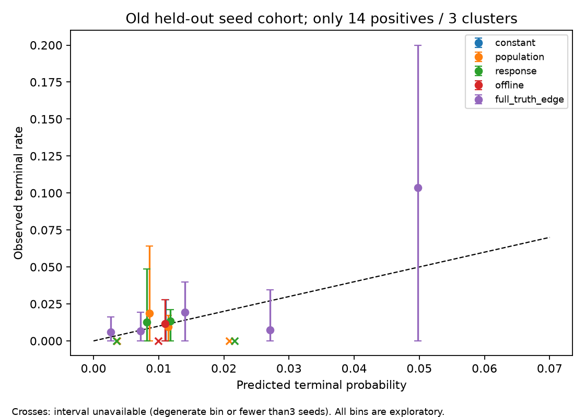

# Independent prospective prediction and privileged diagnostics

This audit concerns identical old baseline-selected assignments, not different policy-selected cohorts. It reads the prior common-cohort snapshots plus raw greedy traces1001–1008, reconstructs all five public outcome labels independently from final events, verifies them against stored labels, and asserts every disclosed assignment-time field was observed by that assignment day. Response-only learning counts events only when `observed_day<=assigned_day`; no future labels or retrospectively disclosed fields become prediction features. All full-funnel predictions satisfy stage nesting.

Training data:2351 assignments/26 qualified, old seeds1001–1005. Old held-out validation:1216/14, seeds1006–1008. Six families share each seed and are clustered together. The constant full funnel uses training stage means; offline terminal-only logistic uses the already frozen train-only ridge coefficients. Neither changes after validation. Offline is a discriminative terminal-only control, not a fabricated coherent funnel. Population and response predictions implement the public reciprocal funnel independently with15-point normal quadrature; the shared Gaussian is integrated jointly, response second moments are retained, missing equality indicators enumerated, and delayed deadline factors coupled to the normal-regime family. This finite quadrature is approximate. The maximum difference from deployed5-point population terminal calculation on3567 identical examples is8.99e−8, a cohort-specific numerical convergence diagnostic.

Privileged prediction levels are clearly separated. `known_parameter_missing` knows true actor acceptance/second biases, response propensities and family but integrates undisclosed soft equality indicators under a uniform prior. `full_truth_edge` also knows true soft features. Neither sees future pair shared effects, Bernoulli draws, delays or exits. These are offline diagnostics and must never be packaged into an evaluated observation-only policy. Known-parameter uniform missing priors ignore outcome-history posterior information and are not an exact observation-history conditional oracle. Stronger information can have worse finite-sample proper scores without violating theory.

| Model, same validation examples | Terminal log loss | Brier | AUC |
|---|---:|---:|---:|
| Constant training rate | .062854 | .0113808 | .500 |
| Public population prior | .062178 | .0113668 | .501 |
| Public response shrinkage | .061250 | .0113500 | .652 |
| Frozen offline ridge | .062707 | .0113774 | .490 |
| Privileged known parameters/missing soft | .059704 | .0112708 | .692 |
| Privileged full-truth edge | .060480 | .0112927 | .680 |

Assignment-weighted point metrics favor response shrinkage over population and offline here. Seed-balanced paired response-minus-constant log-loss is−.001603, approximate Student-t95%[−.002689,−.000517] across only3 old validation clusters. Multiple models/slices were inspected, these are previously examined worlds, only14 terminal positives exist, and this is neither confirmatory model superiority nor a policy-reward claim. Bootstrap outputs have only the three-seed empirical support and are sensitivity summaries. Broad stage/ranking improvements are not established by an AUC point estimate; it has no separate uncertainty interval here.

The artifact reports every unconditional joint stage and stage-conditional proper scores on the same eligible examples, plus terminal slices by family, missingness, assignment time and prior feedback count. Stage-conditional and slice summaries are descriptive with small denominators; they do not use independent assignment-level inferential claims. Seed-balanced overall stage log-loss/Brier/prediction/observed means have cluster t intervals and bootstrap sensitivity. Assignment-weighted means differ from within-seed means; neither is automatically a scenario-balanced policy reward statistic. Missing bin4 pools4–8 missing soft fields. History uses total prior public feedback count from the prospective snapshot, not each actor's history size.

Reliability bins are fixed at[0,.005,.01,.02,.04,1]. Error bars resample entire seed clusters and recompute pooled bin outcome ratios; only three validation clusters exist. Bins with fewer than3 supporting seeds or all-zero/all-one labels have no informative bootstrap interval and are marked with crosses. Their interval is `null`, not a misleading zero-width certainty claim. Data labels, bin counts/events, supporting seed counts and caveats are retained in JSON. Calibration remains weakly identified in rare-event bins, even where prediction means are close to observed rates.

## One-step current-edge diagnostics

The audit replays exact recorded baseline actions on48 previously examined worlds and checks reconstructed introduction lists against raw traces. It examines days0,20,40,59 after actual baseline asks. Every oracle optimizes the same public verified eligible, available, never-introduced graph via maximum-weight general-graph matching. Its chosen matching is scored using full-truth current-edge expected terminal probabilities, integrating future random draws. The oracle state trajectory remains the historical baseline trajectory: no counterfactual outcome is substituted.

Mean extra expected qualified reward per sampled invocation, averaged across each seed's6families×4days: observation-prior static matching+.001878; privileged known-parameter/missing-feature static matching+.002643; privileged full-truth static matching+.003135. Full-truth paired8-seed t95%[+.001422,+.004848]. These tiny local gains quantify immediate ranking/allocation headroom on sampled baseline states; they do not upper-bound60-day headroom, estimate a deployed policy effect, or imply an attainable gain. A dynamic oracle can deliberately avoid a current static optimum. Deliberately labeling these as bounds would be false.

## Expanded privileged rollout audit

`oracle_audit.py` runs four greedy-scored diagnostics on only old1001–1005 worlds, six families, complete60+40 horizon. Information levels are observation-prior, known actor parameters/family with missing soft integrated, full truth on currently public legal edges, and full truth plus free hard disclosure. Free disclosure occurs on arrival only for members with no permanent hard decline; it changes query cost/information, while retaining eligibility, availability, no-repeat rules, exits and shipped outcomes. All levels use canonical ties and current greedy allocation. Therefore stronger information may still worsen a finite realization or dynamic policy; they are diagnostic policies, not optimized bounds or eligible candidates. Expected terminal probabilities along each chosen trajectory and realized terminal reward are recorded separately.

The fixed diagnostic sample completed120 episodes in229.24 CPU seconds. Scenario-balanced mean realized MSMI/100 was observation-prior.5167, known-parameter/missing.4500, full-truth.5500, and full-truth/free-hard.4333. Respective expected-q sums on their chosen trajectories were.37272,.38017,.38595,.39857. These are distinct estimands, and the realized means are highly noisy across only5 clusters. Full-truth minus shipped greedy mean+.1167 had t95%[−.1629,+.3962]; superiority is not established. Free hard disclosure improved its expected-q trajectory sum but did not improve realized mean versus shipped greedy on these worlds. Full-truth greedy reduces introductions from78.3 observation-prior to76.33; free-hard raises to79.07. Neither the disclosure effect nor occupancy mechanism is causally isolated by those descriptive counts. This is credible evidence against treating stronger edge information or hard revelation as an automatic large reward gain, not evidence that true information has no value. The reported numbers do not upper-bound an adaptive full-horizon planner. Complete rows and5-cluster sensitivities are in `oracles.json`. No future outcome randomness or seed decoding enters scores; the seed merely reconstructs the already examined simulator world offline. Action-dependent hash streams make downstream common random numbers incomplete across changed dyad/day choices. The present round's final confirmation data is not accessed by either audit.

## Reproduction and review

Commands: `OPENBLAS_NUM_THREADS=1 OMP_NUM_THREADS=1 .venv/bin/python -m research3.prediction_audit` and the analogous `research3.oracle_audit`. Detailed command/compute ledger is researcher-owned `results/research3/commands_models.json`. Adversarial critic checked information separation and current-edge interpretation and required unavailable uncertainty markers for degenerate reliability bins; those are implemented. Remaining objections are limited old validation support, missing-feature posterior approximation, selected-cohort coverage, and failure of static-oracle gains to characterize dynamic policy value. Primary-method attribution is in `LITERATURE.md`.

## Round 3 stored-forecast contract

The round3 benchmark's prospective snapshot `prediction` field calls inherited `predict_funnel(a,b,state,{}, {"learning":False})`. Its default regime mixture is one-third each of ordinary, shifted and late-drift coefficients. That field is an auxiliary inherited integrated-prior diagnostic, not the actual policy-mode score and not the new six-family population mixture4/6,1/6,1/6. It must not be used as an assumed candidate forecast or interpreted as evidence that the evaluated population policy ranked with one-third weights. The pending registeredC common-example audit recomputes all fixed population/response/offline/constant forecasts independently from assignment-time disclosed features; it ignores this stored auxiliary field. No runner or frozen scoring source is changed to repair labeling.
