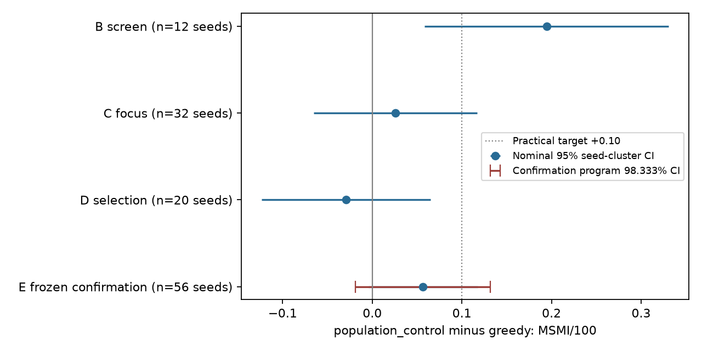

# Round 4: public information and actor feedback

No program-wide superiority over shipped greedy is established.

Frozen `population_control` scores **0.370536 MSMI/100**, versus greedy **0.313988**. The paired effect is **+0.056548**, nominal 95% seed-cluster CI **[-0.004400, +0.117495]**, two-sided p=0.068327248; bootstrap 95% sensitivity interval [-0.001488, +0.114583]. The registered program 98.333333% CI is [-0.018553, +0.131648]. Nominal superiority gate passes: False; program gate passes: False. These comparisons cover the fixed mixture of six simulator families, not every possible market.

The practical target +0.10 is not established and remains inside the nominal interval. Nonsignificance does not establish equivalence. A searched point ranking does not establish that one policy is best. The finite research round closes after its registered confirmation; the sample was not extended in response to significance.

## Prior evidence and preservation

The previous completed study remains greedy 0.372917 versus `simple_fifo` 0.331250, paired −0.041667, CI [−0.091068, +0.007735]. Its constant positive score does not discriminate between dyads; FIFO schedules match greedy, and favorable realized deadlines plausibly contributed to development gains. Round 3 subsequently found clean 0.427083 versus greedy 0.412500, paired +0.014583, CI [−0.030536, +0.059702], without established superiority. Its offline screen gain +0.118 regressed to focused +0.005. No optimistic reinterpretation was carried forward.

The previous sources, raw rows, frozen policies, archives and manifests are preserved. The final gate checks recorded bytes, with three explicitly reconciled inherited review/log metadata discrepancies described in [PROVENANCE_RECONCILIATION.md](PROVENANCE_RECONCILIATION.md). Manifest-matching prefixes and exact current hashes are preserved; no prior file is rewritten. Root `policy.py` is unchanged; this round has a separate observation-only entrypoint. Invalid earlier experiments that omitted follow-up were excluded from evidence of policy quality.

## Mechanisms, criticism and design

Eight policies include shipped greedy and controls for public population scoring, surplus goal queries and approximate Beta response learning. Coordinated acquisition purchases at most three hard-constraint bundles and goal answers in one legal batch before matching, displacing a possible fourth hard bundle. Verification priority uses public partial failures and demographic compatibility. Exact response learning integrates the known uniform response prior. Acceptance learning retains a strong Gaussian bias prior and updates responding first yes/no labels. Every candidate uses greedy allocation of its scores; neither blossom matching nor architectural complexity was presumed beneficial.

All policy inputs are current JSON observations and public past labels. Hidden world state, seeds, scenario labels and future outcomes are excluded. Missing soft features are integrated. Frozen implementations retain bounded caches and a legal empty-action fallback.

The critic identified coordinated acquisition as a bundled intervention: timing and hard-verification throughput change together. Its own-parent contrast isolates the net policy intervention, not each component. Acceptance moment matching may miscalibrate, verification priority may crowd substitutable partners, and exact response corrections may be too small to justify complexity. A cross-zone prior error was corrected before B. Strong cases, falsifiers and objections are recorded in [MECHANISMS.md](MECHANISMS.md), [CRITIC.md](CRITIC.md) and [IMPLEMENTATION_REVIEW.md](IMPLEMENTATION_REVIEW.md).

## Fixed staged experiments

B uses seeds 80001–80012 across six families and eight policies. C uses 81001–81032 for the registered top two new candidates plus their controls. D uses 82001–82020 and a predeclared preference for lower engineering cost within 0.025 of the best mean. E uses the frozen selected policy against shipped greedy on a fresh, fixed seed list. The four stages comprise 2,376 registered main episodes. Every episode has 60 action days and 40 follow-up days. Claims require the exact planned grid, valid episodes and zero fallbacks. There is no offline fitting or inference retuning after B.

### Exploratory B

| Policy | MSMI/100 | Effect vs greedy | 95% cluster CI | Exploratory Holm p |
|---|---:|---:|---|---:|
| hard_priority | 0.506944 | +0.201389 | [+0.045857, +0.356921] | 0.09479 |
| goal_surplus_control | 0.500000 | +0.194444 | [+0.023495, +0.365394] | 0.09479 |
| population_control | 0.500000 | +0.194444 | [+0.058357, +0.330531] | 0.06530 |
| response_uniform | 0.486111 | +0.180556 | [+0.036287, +0.324824] | 0.09479 |
| acceptance_shrinkage | 0.479167 | +0.173611 | [+0.039173, +0.308049] | 0.09479 |
| response_beta_control | 0.479167 | +0.173611 | [+0.037290, +0.309932] | 0.09479 |
| coordinated_goal | 0.395833 | +0.090278 | [-0.129146, +0.309702] | 0.38458 |
| greedy | 0.305556 | reference | — | — |

### Focused C

| Policy | MSMI/100 | Effect vs greedy | 95% cluster CI | Exploratory Holm p |
|---|---:|---:|---|---:|
| hard_priority | 0.382812 | +0.057292 | [-0.068670, +0.183253] | 1.00000 |
| population_control | 0.351562 | +0.026042 | [-0.065037, +0.117120] | 1.00000 |
| greedy | 0.325521 | reference | — | — |
| goal_surplus_control | 0.309896 | -0.015625 | [-0.094726, +0.063476] | 1.00000 |

### Independent selection D

| Policy | MSMI/100 | Effect vs greedy | 95% cluster CI | Exploratory Holm p |
|---|---:|---:|---|---:|
| greedy | 0.416667 | reference | — | — |
| population_control | 0.387500 | -0.029167 | [-0.123243, +0.064910] | 0.97439 |
| hard_priority | 0.370833 | -0.045833 | [-0.181219, +0.089552] | 0.97439 |

The frozen cost rule selected `population_control`. Confirmation has 56 seed clusters (83001–83056), planning SD 0.252618, and practical effect 0.10. Power planning used a nominal two-sided 5% normal approximation plus 10% inflation. It does **not** guarantee 80% power at the stricter program alpha 0.05/3. The registered formula was retained unchanged; this limitation does not authorize a sample extension.

The three-test Bonferroni program gate accounts for the valid old extended, round 3 and round 4 primary confirmations. Nominal 95% inference and program 98.333333% inference are reported separately. A future series would require another explicit multiplicity plan.

### Confirmation by family

| Family | Selected | Greedy | Difference |
|---|---:|---:|---:|
| development | 0.419643 | 0.339286 | +0.080357 |
| sparse | 0.089286 | 0.089286 | +0.000000 |
| cold_start | 0.428571 | 0.419643 | +0.008929 |
| delayed | 0.446429 | 0.375000 | +0.071429 |
| shift | 0.455357 | 0.339286 | +0.116071 |
| drift | 0.383929 | 0.321429 | +0.062500 |

## Prediction and mechanism evidence

The prospective fixed-model audit uses 14023 identical greedy assignments from 32 C seed clusters. Public match-time snapshots prevent reconstruction from future disclosures. Four terminal forecasts yield eight log-loss/Brier contrasts with Holm adjustment. The audit also reconstructs coherent five-stage projections, checks terminal agreement with the evaluated scorer within 1e-12 and reports stage-conditional proper scores descriptively. No parameters are fitted or changed. Assignment-pooled scores, equal-family seed losses and fixed-bin reliability have separate denominators and uncertainty. See [PREDICTION_REVIEW.md](PREDICTION_REVIEW.md) and `prediction_audit.json`.

On the identical prospective C cohort, scenario/seed-balanced terminal log loss was 0.056268 for population scoring, 0.056100 for Beta response learning, 0.056095 for exact uniform response learning and 0.056167 for acceptance shrinkage. All eight terminal proper-score contrasts were inconclusive (Holm p at least 0.9243). Exact uniform versus Beta log-loss difference was approximately −0.00000422; acceptance versus uniform was +0.00007177. These point differences do not demonstrate useful ranking or calibration improvement. Descriptive earlier-stage gains did not establish terminal benefit.

### Registered focused mechanism contrast

| Contrast | Paired effect | 95% CI | Holm p |
|---|---:|---|---:|
| hard_priority minus population_control | +0.031250 | [-0.117660, +0.180160] | 0.671604 |

### Public confirmation funnel

| Public trajectory count | Selected | Greedy |
|---|---:|---:|
| Introductions | 24954 | 25182 |
| At least one first nonresponse | 10651 | 10746 |
| Both respond, at least one rejects | 10657 | 10879 |
| Mutual first acceptance | 3646 | 3557 |
| Date cancelled after mutual acceptance | 847 | 841 |
| Dates happened | 2799 | 2716 |
| At least one second nonresponse after date | 1080 | 1055 |
| Both second responses, at least one negative | 1042 | 1019 |
| Both positive second intentions | 677 | 642 |
| Positive pairs disqualified by deadlines | 428 | 431 |
| Qualified MSMI | 249 | 211 |
| Summed assignment endpoint busy days | 244815 | 245380 |
| Assignments of previously introduced endpoints | 27388 | 27810 |
| Constraint bundles | 22045 | 22045 |
| Soft queries | 0 | 0 |
| Same-batch constraint and goal queries | 0 | 0 |

Counts above are totals, not independent statistical samples. Conditional probabilities with explicit numerator/denominator pairs, query costs, repeat opportunities, busy time and early/late assignments appear in the mechanism JSON files. Public verification and goal availability can change; most outcome randomness cannot be controlled directly. Privileged true-parameter conditional quality sums along realized trajectories are separately labeled offline diagnostics: they read no future draws and are neither deployable forecasts, causal mediation estimates nor tight achievable bounds.

Representative focused and confirmation trajectories are inspected in [TRAJECTORY_REVIEW.md](TRAJECTORY_REVIEW.md). The focused priority-versus-parent point gain reverses after removing its largest-gain seed. Confirmation leave-one-seed-out point effects remain positive (+0.043939 to +0.066667), yet the registered interval crosses zero. Identical dyad/day introductions share complete outcomes; changed dyads or days do not share those streams. The offline true-parameter conditional-quality effect in confirmation is only +0.000328, exploratory CI [−0.005549,+0.006205], and does not establish improved edge quality.

### Deadline invariance and noise

Under ideal independent simulator streams and collision-free introduction identifiers, all eight normal decision rules are invariant to responding second-feedback delays. Busy release occurs after all these labels, and the rules use only complete available-actor histories. A guarded executable additionally requires no resource fallback under every counterfactual delay assignment; zero observed fallbacks alone does not prove that condition. Sixteen finite replays on an already examined seed verified identical actions when every responding second delay was forced to one versus five days.

For these invariant rules, let K count positive pairs whose date meets the assignment-relative deadline. Integrating only the independent second-feedback delays gives expected qualified score 100×0.36×K/N. This is a conditional identity, not a replacement primary endpoint. The eight-candidate B check shows verification priority’s +0.201389 observed effect decomposes into +0.040000 on this proxy and +0.161389 residual deadline luck. The secondary diagnostic was devised after B and did not change promotion, selection or confirmation.

In frozen confirmation the selected policy’s deadline-integrated proxy effect is +0.019286, unadjusted exploratory 95% CI [-0.011865, +0.050436]. It remains secondary. Descriptive differences in chosen trajectories can reflect endogenous pairing, occupancy and favorable other funnel draws. The theorem, independent critique and host-analysis provenance correction are in [DEADLINE_INVARIANCE.md](DEADLINE_INVARIANCE.md), [DEADLINE_REVIEW.md](DEADLINE_REVIEW.md) and the execution-note artifact; the corrected executed analysis source is preserved separately.

## Bottlenecks and achievable headroom

The preserved simulator audit separates insufficient latent feasibility, incomplete verification, nonresponse, rejection, date cancellation, negative second intentions, busy occupancy, exits, retirement and repeated opportunities. Old static privileged graphs averaged 74.625 nonblocked nonisolated endpoints in ordinary worlds and 30.625 in sparse worlds. FIFO eventually verified every nonblocked member; eventual verification coverage alone did not explain low reward. Query scheduling can still change when usable opportunities appear.

Date cancellation has fixed probability 0.22; reciprocal feedback qualification contributes only 0.36 conditional on both-positive outcomes. Earlier assignments do not change assignment-relative or date-relative deadlines. Policies can change dyads, their response/acceptance probabilities and future availability, but cannot infer independent deadline draws from public inputs. The pooled stage denominators above retain these distinctions.

Inherited offline comparisons distinguish public-observation priors, known-parameter integration of still-missing features, full-truth current edges and free hard truth. They are diagnostic heuristic policies, not tight dynamic bounds. An optimistic numerical capacity relaxation on one old seed averaged 0.637692 MSMI/100, sparse 0.102205, while revealing latent parameters/arrivals/exits and relaxing schedules. It cannot establish attainable population improvement. Tiny exact planning refutes universal greedy/scarcity/occupancy rules but does not solve the full simulator.

The previous learning-paradigm audit covered supervised offline prediction, online response learning, public model integration, graph structure, occupancy allocation and exact tiny model-based planning. Large unsupervised/self-supervised models lack demonstrated decision value here; contextual bandit and offline-policy reductions lack adequate action coverage/propensities; full model-free RL is not justified by the sparse coupled outcomes. These are scoped research decisions, not impossibility claims. This round adds coordinated acquisition, verification scheduling, exact online response moments and actor acceptance shrinkage, each with simple controls.

## Evidence classification

| Class | Supported scope |
|---|---|
| Proven mathematical results | Inherited available-endpoint complete-feedback and final-day legal augmentation lemmas. New complete-history response factorization for available actors under fixed independent response priors and ideal independent streams; a pending-actor counterexample prevents unrestricted extension. Scoped second-feedback delay invariance and conditional reward identity. No global optimality theorem. |
| Exact simulator calculations | Three-cost hard bundles, one-cost soft answers, daily budget 12, eleven hard constraints and 60+40 horizon. Exact rational response moments under the specified uniform-prior sampling interpretation. |
| Exact simplified-model solutions | Inherited tiny rational dynamic-programming counterexamples remain preserved. No exact full-simulator dynamic solution is claimed. |
| Empirical findings | Registered seed-cluster terminal reward, prospective identical-example proper scores, finite protocol/resource/parity tests, and descriptive trajectory evidence. |
| Approximation assumptions | Five-point Gaussian quadrature, moment-matched actor posterior, fixed regime mixture, ignored partner/shared posterior coupling, partial hard-completion proxy and missing-feature priors after selection. |
| Unvalidated hypotheses | Other adaptive query bundles, personalized second-bias models, component-local planning and transfer beyond these families. |

## Production, novelty and reproduction

Entrypoint: `python3 -m research4.policy --candidate population_control`. Selected full-episode direct/subprocess/restricted-container equivalence is valid=True; prepare-only=False. The image is 44,748,144 bytes, below the 2 GiB limit. The actual container probe enforces two cores, 1 GiB RAM, 64 PIDs, an unprivileged user, read-only root and blocked egress. All eight candidates also passed dense 200-endpoint checks with diverse synthetic public histories. Wrapper deadline interruption and legal fallback were tested. Finite successful cases do not prove a universal ten-second invocation bound.

Selected confirmation latency (seconds): {'mean': 0.017263434010497184, 'p95': 0.03922982705043977, 'p99': 0.04677304946126239, 'max': 0.1606375410046894}. Peak request: 489,231 bytes; serialized memory: 2 bytes. Subprocess/container startup is measured separately. Host child CPU excludes Docker daemon/container CPU, which is not inferred from wall time. The four primary grids consumed 6,607.79 measured OS child CPU seconds and 3,317.45 sequential stage wall seconds (55.29 minutes); ancillary analysis/replay costs are separately recorded, avoiding parent/child double counting. Command ledgers, seed inventory, source/config hashes, versions, independent replay, lossless archives and restoration instructions accompany the final manifest.

Independent replication uses a separately written simulator loop, public-event reward reconstruction and statistical aggregation. It checks selected population scoring and greedy on seeds 83001 and 83002, all six families, both direct and subprocess modes (48 full episodes). Ordered actions, canonical semantic actions, both digests and outcomes must match exactly, with zero fallback. The replicator reuses the frozen candidate scorer; it is independent execution/statistical verification, not an independent likelihood reimplementation. Selected restricted-container replay is a separate check. All 48 replays/5,760 invocations matched exactly with zero fallback. Replay CPU was 250.548156 seconds; successful ancillary audit CPU was 36.446611 seconds, while a failed ancillary helper was unmetered. The combined measured lower bound is 286.994767 seconds; a total under 300 seconds cannot be certified. See [REPLICATION.md](REPLICATION.md) and [FINAL_REVIEW.md](FINAL_REVIEW.md).

The primary-source literature review attributes Bayesian shrinkage, Gaussian posterior approximations and decision-focused information acquisition to established methods. Their application here does not establish broad novelty. The structural results are explicitly scoped to this observation and timing process. See [LITERATURE.md](LITERATURE.md) and [REPRODUCTION.md](REPRODUCTION.md). The most informative unresolved question is whether joint query timing and endpoint continuation value can yield a reliable effect larger than these controls.

