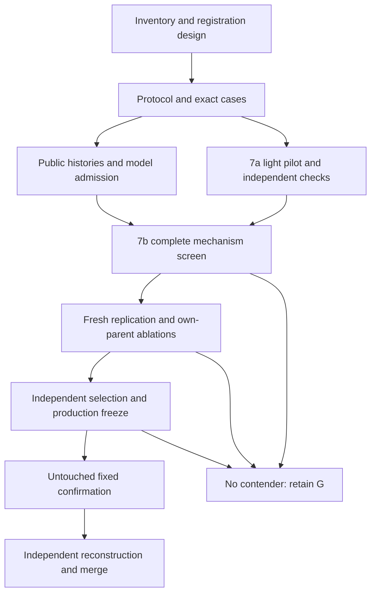

# Research7 master plan

## 1. Goal and result that would justify adoption

Try to build one valid, reproducible public-observation policy that improves qualified MSMI per 100 arrived members over every **named** reference policy in the six-family benchmark. The fixed panel is `G` (shipped greedy), `N` (official no-asks), `R` (official random feasible), `P` (unchanged R6 population control), `K` (unchanged R6 maximum-cardinality/secondary-score control), and `Q6` (frozen R6 `N3_two`). K is an optimizer, not a greedy algorithm; it remains a stronger comparator. This panel does not represent every conceivable greedy rule.

Promotion requires the selected candidate's simultaneous confirmatory lower confidence bound to exceed zero against all six references; its observed mean improvement against G must also be at least **+0.025 MSMI/100**. A stricter practical-superiority claim requires a lower bound above +0.025 and is not the default powered hypothesis. Validity, public-only inputs, complete logging, reproducibility and execution limits are mandatory. Family harms and coverage are reported separately; a positive balanced mean is not a guarantee of positive effects in all six families.

A no-winner outcome is legitimate: preserve G, report bounds and rejected mechanisms, and do not keep searching confirmation seeds. Research6's negative confirmation prevents treating an exploratory +0.04 as a reliable forecast.

## 2. What research6 changes

The primary R6 result was `N3_two - G = +0.003210741`, n=571 seed clusters, SE=.010715, 99% CI [-.02448254,+.03090402], p=.764559. R6 investigated 12,012 stage B-E episodes. Its exact reductions expose complementarity, collision and nonseparable continuation but do not prove a live reward improvement.

Three corrections govern this plan:

1. Hard bundles and soft queries resolve immediately. Delayed dates can reduce future opportunities through longer occupancy and can miss the 30-day qualification cutoff. They do not delay hard answers. Follow-up includes all possible scheduled feedback for day-59 assignments.
2. The six-family score decomposition is descriptive, not a causal proof that a specific acquisition mechanism wasted budget. The +.034151 cold-start and -.034151 delayed estimates cancel each other, while other families determine the small remaining total.
3. Equal selected point means, FIFO4 equality on a finite set, and a failed superiority test do not establish general equivalence, optimality, or a guaranteed robust champion.

Detailed stage evidence and both team reports are integrated in [EVIDENCE_REVIEW.md](EVIDENCE_REVIEW.md). The strongest plausible untested surfaces are released actor history, public return-time conditioning, objective alignment in querying, and **whole-action** continuation. These should be tested before a large generic RL or learned classifier project.

## 3. Observation and transition contract

Freeze the current `kit.py` and `evaluate.py` hashes. Use 200 members, 60 action days (0-59), 40 follow-up days, ask then refreshed match each day, and empty initial memory. Ask budget is 12/day; hard bundle costs 3 and named soft field costs 1. All asks form one batch before any same-day answer. Declines remain declines. Actual matching uses exact eligibility, available members, no historical dyad repeats, no overlap.

Only observable fields/status/timestamps, arrival history, current availability, past introductions, released feedback, ask log, declared training assets and serialized policy memory may enter a policy. Simulator family, generator seed, truth, actor biases, response rates, exits, hidden busy timers and future events are prohibited. Host-only audit oracles remain outside both inference assets and public training exports. No IDs may be decoded to reconstruct a world. ID ordering is allowed only for deterministic ties; identifier-renaming sensitivity must be assessed.

The policy gets no future member list or known exit calendar. Response nonmutuality can establish release at assignment+8 conditional on survival; a public date establishes busy release at date+6, also conditional on survival/pause. Both positive second intentions pause an actor even if late and unqualified. Qualification probability and pause probability must be separate quantities. A last-day assignment can earn full eventual reward after the action horizon; do not penalize it merely because feedback occurs after day59.

## 4. Search portfolio and caps

[STRATEGIES.md](STRATEGIES.md) specifies Q1, H1, A1, A2, Q2, D1, D2, L1, L2 and X1. The first four are relatively light. Q2 and D1/D2 are coupled planners; L1/L2 need admitted public learning; X1 is an optional drift/robustness extension. Exactly ten nonbaseline screen entries maximum, one configuration per ID. Admission failures leave an empty slot; they do not invite a substitute search. Every knob/asset revision gets a new config hash and consumes the same finite development budget.

No exhaustive cross-product of acquisition, ranking, waiting, model and solver is authorized. At most two mechanism families advance from screening; at most one combination and three D contenders exist. C has at most 12 total arms, including the six references and predeclared own-parent controls. D has at most 9 total arms. E has exactly 7 (one frozen candidate plus six references).

A result that only changes predicted objective, Brier/AUC, graph cardinality, clarification rate or matched pairs cannot promote a candidate. Development rollout reward, independent control comparisons and production validity must support it.

## 5. Two-machine division

**7a (smaller machine):** read-only artifact extraction, independent eligibility/metric implementations, constructed exact cases, schema/merge failure injection, light candidate implementations with separate reviews, a 12-cluster light pilot, small subprocess checks, independent statistical reconstruction and archive verification. Default one simulation process, one numerical thread, at most 2 GiB working RSS and 8 GiB new output; 4 GiB free reserve. Hardware is unknown: capabilities must be measured later, and lower limits take precedence.

**7b (this M4 Mac mini, 16 GiB RAM):** public training/validation histories, posterior/occupancy models, coupled rollout and query planners, complete broad screening, ablations, selection, fixed confirmation, dense-graph/resource stress, restricted container evaluation and compressed result packaging. Default two simulation processes; raise to three only after calibration shows total RSS below 10 GiB, no swap growth and acceptable latency. One numerical thread per process. Never run a per-agent simulator pool.

A single coordinator owns the global registrations and leases. Four active agent slots include all directors across both machines; a second coordinating session counts as a worker. Centralize substantive decisions on 7b; 7a receives immutable work orders and never edits the shared experiment registry. Up to three simulation processes globally during concurrent runs (2 Mac+1 small); 7b may use all three when 7a is idle. Limits are separate from agent slots.

## 6. Dependency graph and phase counts

Seed numbers below are **proposed reservations, not certified fresh seeds**. Scan the entire repository, all old manifests/archives/logs and both machines before any launch. Unknown prior usage blocks freshness certification. Existing world files may be read for development audits but never relabeled fresh.

| Phase | Clusters | Families | Arms cap | Episode cap | Home |
|---|---:|---:|---:|---:|---|
| P0 registration/design | 0 | - | - | 0 | Both; coordinator owns registry |
| P1 constructed tests | 0 | - | - | 0 official episodes | Mainly 7a; timed integration on 7b |
| P1 smoke | 4 | 6 | 16 | 384 | 7b, noninferential/resource calibration |
| P2 training | 128 | 6 | 4 behavior policies | 3,072 | 7b, conditional |
| P2 validation | 64 | 6 | Same 4 | 1,536 | 7b, conditional; whole worlds held out |
| P2a light pilot | 12 | 6 | G+Q1+H1+A1+A2 | 360 | 7a, development only |
| P3 complete screen | 48 | 6 | 16 | 4,608 | 7b |
| P4 replication/ablations | 96 | 6 | 12 | 6,912 | 7b; optional complete light-panel shard on 7a only if feasible |
| P5 selection | 128 | 6 | 9 | 6,912 | 7b |
| P6 confirmation | n<=1,800 | 6 | 7 | 75,600 | Mostly 7b; optional <=24 complete clusters on 7a |
| P7 audit/replay | Reuses registered observations | - | Frozen policies | No new inferential episodes | Both; container profiling mainly 7b |

The planned grid ceiling is **99,384 distinct registered episode cells**, including conditional training/validation and smoke. Physical verification replays and infrastructure retries are additional attempts, separately bounded by the finite CPU/storage ledgers; they never increase the independent sample size. This is a worst-case cap, not a request to spend it all. P6 uses the variance-based locked n, generally smaller than 1,800; an exact empty slot reduces upstream counts. Constructed tests, replays, failure-injection attempts, interventions and fitting have separate compute ledgers. Interventions use existing development states in privileged audit branches, not extra confirmation worlds. Failed/retried attempts count against CPU/storage ceilings and are never suppressed.

## 7. Fixed development decisions

- P1: all correctness, leakage, exact-case and merge tests pass. Every candidate needs a unique mechanism and bounded implementation/reviewer contract.
- P2: train only public histories; validation must establish objective-relevant predictive improvement and enough mature events. A failed model blocks dependent candidates; simpler nonlearned mechanisms still proceed. No new validation sample to rescue a failed gate.
- P2a: diagnostic only. Implementations that fail validity are repaired before their P3 freeze using new config IDs. Reward outcomes cannot be called confirmation or merged into P3 estimates.
- P3: rank candidates by paired mean difference versus G. Eligible if mean>=+.025, at least 3 of 6 family point differences nonnegative, no family point difference<-.10, coverage decline<=.02, zero invalid episodes, mechanism fires on >=5% of eligible action opportunities and full grid exists. Retain at most two distinct mechanism families; smaller cost tier then ID breaks exact ties. These noisy rules allocate work; they establish no significance.
- P4: promoted candidate must again show mean>=+.025 vs G and >0 vs its designated own-parent; identify changed-pair/return/query mechanism, no family point loss<-.10 and coverage decline<=.02. Freeze any permitted combination before P4 data are seen, with its own predeclared parent controls; choose at most three D contenders. If controls would exceed 12 arms, reduce entrants before execution rather than omit controls afterward.
- P5: mean>=+.025 vs G, one-sided nominal 90% lower bound>0 vs G, zero invalid, no family point loss<-.05 and coverage decline<=.01. Rank by the **minimum** nominal one-sided 90% lower bound across the six baseline contrasts; within .005 prefer lower cost tier, then lexicographic ID. These are selection scores only. If none qualifies, stop before confirmation.
- P6: no outcome-dependent selection, early significance stopping, family dropping, code fixes, alternative contender or sample extension. Freeze n using [STATISTICS.md](STATISTICS.md), source/asset panel and exact cells before the first E world. Policy invalidity disqualifies that version. A protocol-neutral infrastructure interruption may resume missing attempts from the same registration with preserved evidence.
- P7: independent statistics and production review must agree; every expected cell and invocation must be accounted for. Report no-winner as readily as winner.

P3/P4 harm thresholds are screens, not tested noninferiority guarantees. P5 thresholds are operational selection constraints. P6 descriptive family intervals cannot establish all-family noninferiority unless a separately powered and frozen test was registered.

## 8. Compute and disk contract

Planning observes 173 GiB free and R6 logs around 11.7 MB/episode uncompressed-with-per-invocation gzip. An unchanged recorder would exceed available storage long before the maximum R7 grid. Before P2/P3, implement and test lossless request reconstruction through per-episode streaming compression, content-addressed deduplication of common initial worlds, and exact event/memory deltas; retain original wire bytes or a byte-exact reversible encoding. Write short fsync commit segments and an index so interruption cannot invalidate prior segments. No lossy metrics-only mode for confirmation.

On 7b reserve 30 GiB free and cap new research7 outputs at 100 GiB including attempts, training assets, archives and temporary overlap. Before each phase predict bytes using the conservative upper end of its measured smoke distribution, attempts/replays, and 1.5x headroom. Whole remaining program must fit; otherwise stop before launching and revise the storage plan or use additional explicitly registered storage. Never delete prior results. One compressed archive plus extracted tree may need twice space; build streaming or verify external space before copying.

Illustrative compute ceilings: 7a 6 CPU-hours; 7b 160 simulation/test CPU-hours plus 24 fitting CPU-hours, with per-phase caps in machine plans. An average 4.3 CPU-seconds/episode from R6 is not a forecast for rollout candidates. At 10 seconds/episode, 99,384 episodes consume 276 CPU-hours and exceed the cap; pilot calibration must reject that forecast. Wall-clock estimates are produced only from the actual calibrated mix and bounded process pool. No GPU is required for M4 training, and inference must remain offline CPU-only.

## 9. Future execution artifacts

Create new research7 code only in the paths assigned by ORCHESTRATION. Inherit conceptual runner architecture from R6 but independently fix dependencies, metric denominator, multi-baseline inference, complete transitive fingerprinting, cross-machine determinism, resource guards and logs. Git HEAD is insufficient because much of the research source is currently untracked: package actual files and assets with SHA-256, including imported dependencies and config. Do not modify R6 to make a candidate look like a new baseline.

Required registration: program ID, source tree digest, dependency lock/container digest, baseline/candidate hashes, all stage seed cells, training lineage, primary metric, comparison family, exact gates, n calculation, per-machine shard lists, lease authority, resource forecasts and independent reviews. Required final package: per-cell metrics and complete action logs, all attempts/errors, independent counts/statistics/replays, phase decisions, rejected candidates, unresolved objections and archive validation.

Detailed work orders, phase tests and handoffs are in the linked companion files. A future cheap director follows explicit decisions and queues; it is not authorized to invent new hypotheses or change statistical gates mid-run.
