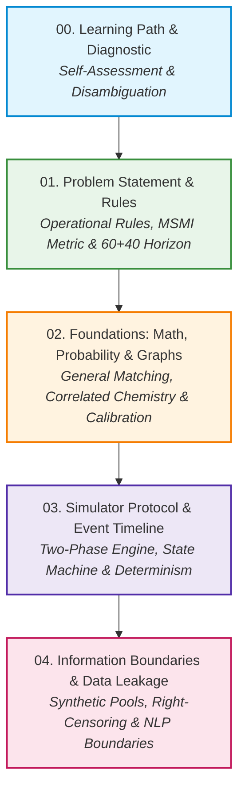

# 00. Learning Path, Curriculum Architecture & Diagnostic Assessment

Welcome to the foundational study series on **The Sequential Matching Problem** (The One Introduction Problem). This document establishes the conceptual architecture, diagnostic self-assessment, nomenclature standards, and curriculum roadmap for mastering sequential reciprocal matching under uncertainty, incomplete observations, and delayed feedback.

---

## 1. Disambiguation & Standard Nomenclature

Before entering the technical material, we establish precise terminology to resolve common ambiguities across the literature, problem statement, and code repository:

### 1.1 "PS": Problem Statement vs. Parametric Scorer
Throughout this study program, the abbreviation **PS** appears in two fundamentally distinct contexts:
1. **PS as Problem Statement**: Refers to the governing specification document [`PROBLEM_STATEMENT.md`](file:///Volumes/1700%20APFS/PERSONAL_PROGRAMMING_PROJECTS/Notes/The%20Sequential%20Matching%20Problem/PROBLEM_STATEMENT.md), defining the offline execution environment, two-phase JSON protocol, validation rules, and competition ranking criteria.
2. **PS as Parametric Scorer**: Refers to the research benchmark family of parametric policy scorers (e.g., `PS_sim`, `PS_emp`, `PS_flat`) developed in [`research9/round2/policies/model.py`](file:///Volumes/1700%20APFS/PERSONAL_PROGRAMMING_PROJECTS/Notes/The%20Sequential%20Matching%20Problem/research9/round2/policies/model.py) and evaluated in [`final_report/REPORT.md`](file:///Volumes/1700%20APFS/PERSONAL_PROGRAMMING_PROJECTS/Notes/The%20Sequential%20Matching%20Problem/final_report/REPORT.md). These models evaluate candidate introduction pairs by estimating multi-stage probabilities of mutual acceptance, date occurrence, and timely second-meeting intention under specific prior distributions.

```
                           ┌────────────────────────────────────────────────────────┐
                           │                     "PS" Context                       │
                           └───────────────────────────┬────────────────────────────┘
                                                       │
                           ┌───────────────────────────┴────────────────────────────┐
                           ▼                                                        ▼
         ┌───────────────────────────────────┐                    ┌───────────────────────────────────┐
         │     PS = Problem Statement        │                    │      PS = Parametric Scorer       │
         ├───────────────────────────────────┤                    ├───────────────────────────────────┤
         │ • Document: PROBLEM_STATEMENT.md  │                    │ • Algorithms: PS_sim, PS_emp...   │
         │ • Specifies rules, bounds & APIs  │                    │ • Multi-stage probabilistic model │
         │ • Version 1.0.0 freeze            │                    │ • Prior-dependent scoring engine  │
         └───────────────────────────────────┘                    └───────────────────────────────────┘
```

### 1.2 Policy Arm Acronyms & Identifiers
The experimental literature and benchmark reports designate specific algorithmic policies via canonical symbols:
* **`G` (Greedy Baseline)**: The default reference policy implemented in [`policy.py`](file:///Volumes/1700%20APFS/PERSONAL_PROGRAMMING_PROJECTS/Notes/The%20Sequential%20Matching%20Problem/policy.py) and [`kit.py`](file:///Volumes/1700%20APFS/PERSONAL_PROGRAMMING_PROJECTS/Notes/The%20Sequential%20Matching%20Problem/kit.py). It queries hard-constraint bundles in public member-list order and executes greedy maximal matching sorted by observed soft-attribute agreement.
* **`N` (`no_asks`)**: The zero-clarification baseline. It expends zero budget on queries and matches exclusively on initially disclosed profile information.
* **`R` (`random`)**: Baseline clarification with random feasible matching; enumerates all valid feasible edges and matches greedily along a uniformly shuffled edge order.
* **`G_arr` / `G_lifo` / `G_deg`**: Information-acquisition variants of `G` that sort candidate queries by arrival chronology (FIFO), reverse arrival (LIFO), or potential degree in the feasible graph.
* **`Q6` (Coordinated Two-Query Acquisition / `N3_two`)**: Information-acquisition policy that coordinates queries across candidate pairs to verify mutual edges simultaneously.
* **`X1` (Adaptive Scorer)**: An online adaptive policy that re-estimates directional acceptance logits with recency weighting and directional calibration.

---

## 2. Curriculum Roadmap & Pedagogical Framework

The foundation notes are structured into five cohesive modules, organized to build mastery from first principles up to production-grade simulator execution:



### The 10-Layer Pedagogical Structure
Every technical section across these notes adheres to a rigorous, publication-grade 10-layer explanatory structure:
1. **The Question**: The exact operational, mathematical, or systemic question being resolved.
2. **Intuition**: Physical, economic, or game-theoretic rationale underlying the phenomenon.
3. **Minimal Concrete Example**: Hand-calculable scenario illustrating the core dynamic.
4. **Formal Definition**: Rigorous mathematical notation, set theory, and state tuples.
5. **Algorithm / Derivation**: Analytical proof, recurrence relation, or step-by-step algorithm.
6. **Implementation Excerpt / Trace**: Line-by-line inspection of repository code ([`kit.py`](file:///Volumes/1700%20APFS/PERSONAL_PROGRAMMING_PROJECTS/Notes/The%20Sequential%20Matching%20Problem/kit.py), [`evaluate.py`](file:///Volumes/1700%20APFS/PERSONAL_PROGRAMMING_PROJECTS/Notes/The%20Sequential%20Matching%20Problem/evaluate.py)).
7. **Experiment / Evidence**: Empirical results, benchmark tables, and asset citations ([`final_report/REPORT.md`](file:///Volumes/1700%20APFS/PERSONAL_PROGRAMMING_PROJECTS/Notes/The%20Sequential%20Matching%20Problem/final_report/REPORT.md)).
8. **What Follows and What Does Not**: Logical boundaries, identifying fallacies and unproven assumptions.
9. **Common Mistakes**: Edge cases, implementation pitfalls, off-by-one errors, and silent bugs.
10. **Practice & Checks**: Self-test exercises with step-by-step verified solutions.

---

## 3. Diagnostic Self-Assessment

Complete this 10-question pre-assessment to evaluate your starting knowledge across combinatorics, sequential probability, simulation protocols, and statistical hygiene. Record your answers before consulting the detailed answer key below.

### Question 1: Operational Timelines
In an evaluation episode, what is the exact difference between the **Decision Horizon** and the **Follow-up Horizon**?
* (A) Decision horizon is days 0–30; follow-up is days 31–60.
* (B) Decision horizon is days 0–59 (proposals permitted); follow-up is days 60–99 (no new asks or pairs; outcomes mature).
* (C) Decision horizon is days 0–60; follow-up is days 61–100 where questions are permitted but matching is frozen.
* (D) Both horizons last 60 days, running concurrently across distinct pools.

### Question 2: Objective Metric Metric Denominator & Units
Consider an episode where 200 members arrive by Day 20. Exactly 2 introductions achieve timely Mutual Second-Meeting Intention (MSMI). What is the episode MSMI score?
* (A) 2.0 (representing 2 qualified pairs per 100 members)
* (B) 1.0 (representing 2 qualified pairs divided by 200 arrived members $\times 100$)
* (C) 0.5 (representing 1 qualified individual per 200 members)
* (D) 4.0 (counting each member of the 2 pairs separately)

### Question 3: Eligibility Logic Under Incomplete Information
Member $A$ has `has_children = False`. Member $B$ has `partner_children = None` with `field_status = 'not_asked'`. Does `eligibility(A, B)` return `feasible`, `infeasible`, or `needs_clarification`?
* (A) `feasible`, because $A$ does not have children, so $B$'s preference cannot be violated.
* (B) `infeasible`, because unobserved fields are treated as non-compliant.
* (C) `needs_clarification`, because all 11 hard fields across both members must be non-null to establish feasibility.
* (D) `feasible`, because missing fields default to `any`.

### Question 4: Missingness Semantics: `False` vs `None`
In the participant data contract, how does the engine distinguish a member who does not have children from a member whose parental status is unknown?
* (A) `has_children` is `0` vs `-1`.
* (B) `has_children` is `False` with `field_status='observed'` vs `has_children` is `None` with `field_status='not_asked'` or `'declined'`.
* (C) `has_children` is empty string `""` vs `null`.
* (D) `has_children` is omitted from the JSON dictionary entirely when unknown.

### Question 5: Non-Bipartite Matching & Allocation
Why does independent pair ranking (sorting all candidate pairs by expected score and greedily picking the top pairs) fail to maximize total pool value?
* (A) Because independent ranking violates graph planarity.
* (B) Because selecting a high-scoring edge consumes both incident vertices, potentially eliminating multiple slightly lower-scoring edges whose sum exceeds the top edge.
* (C) Because sorting takes $\mathcal{O}(|E| \log |E|)$, which exceeds the 10-second CPU limit.
* (D) Because the simulator rejects pairs that are not perfectly matched in age.

### Question 6: Reciprocal Probability & Conditional Independence
Let $p_{A \to B}$ be the probability that $A$ accepts $B$, and $p_{B \to A}$ be the probability that $B$ accepts $A$. In the simulator, is the probability of mutual acceptance $P(A \leftrightarrow B) = p_{A \to B} \times p_{B \to A}$?
* (A) Yes, because individual decisions are reported independently without consulting the other member.
* (B) No, because both decisions depend on a latent shared chemistry variable $\text{shared} \sim \mathcal{N}(0, 0.45^2)$, inducing positive covariance.
* (C) No, because $B$'s response is conditioned on $A$'s response being observed first.
* (D) Yes, by the Markov property of the simulation engine.

### Question 7: Information Boundary & Asking Rules
A policy identifies that Member $A$ declined to answer their `smoking` status (`field_status = 'declined'`). What happens if the policy submits an ask request `{"member_id": "syn_...", "field": "constraints"}`?
* (A) The simulator overrides the decline and returns the latent truth at double cost.
* (B) The simulator raises an immediate `ValueError` and terminates the episode.
* (C) The simulator deducts 3 budget units, updates non-declined hard fields to observed, but leaves `smoking` as `None` with status `'declined'`.
* (D) The simulator converts `'declined'` into a soft preference.

### Question 8: Simulator Event Transitions & Availability
When an introduction is assigned on Day $t$, when do the two members next become eligible for a new introduction if both return positive responses and a date occurs?
* (A) Day $t+1$.
* (B) Day $t+7$ (at the response deadline).
* (C) Day $\text{date\_day} + 6$, provided they do not record mutual second-meeting intention; if they do record mutual positive intention, they pause permanently.
* (D) Day 59, when the decision horizon concludes.

### Question 9: Data Leakage in Model Training
Why is randomly splitting rows from `members.jsonl` or `feedback.jsonl` across training and validation sets considered severe data leakage?
* (A) Because member IDs contain timestamps that leak future calendar dates.
* (B) Because interactions involve pairs of members across an interconnected pool; splitting rows leaks historical partner preferences and future feedback from the same episodes into training.
* (C) Because JSON lines cannot be deserialized independently without memory corruption.
* (D) Because the evaluator checks git commit hashes against the manifest.

### Question 10: NLP & Synthetic Conversation Fragments
Can an LLM or speech model trained on `conversations.jsonl` be claimed as a validated psychological predictor of real-world human romantic compatibility?
* (A) Yes, provided the LLM achieves a validation perplexity below 15.0.
* (B) Yes, because conversations were authored to reflect nuanced interpersonal dynamics.
* (C) No, because conversations are synthetic rule-based templates generated deterministically from discrete questionnaire choices; they validate input processing, not human psychology.
* (D) No, only because the container environment has no GPU acceleration.

---

## 4. Diagnostic Answer Key & Scoring Guide

### Detailed Solutions

1. **(B) Decision horizon is days 0–59; follow-up is days 60–99.**
   * *Evidence*: [`PROBLEM_STATEMENT.md`](file:///Volumes/1700%20APFS/PERSONAL_PROGRAMMING_PROJECTS/Notes/The%20Sequential%20Matching%20Problem/PROBLEM_STATEMENT.md#L83-L90), [`evaluate.py`](file:///Volumes/1700%20APFS/PERSONAL_PROGRAMMING_PROJECTS/Notes/The%20Sequential%20Matching%20Problem/evaluate.py#L65-L77). Decision days 0–59 allow 60 daily rounds of asks and match proposals. Follow-up days 60–99 allow dates and second-meeting responses to mature without new introductions.
2. **(B) 1.0 MSMI per 100 arrived members.**
   * *Evidence*: Metric formula $\text{MSMI}/100 = 100 \times M / N = 100 \times 2 / 200 = 1.0$. One qualified pair counts as ONE outcome ($M=2$), not two members.
3. **(C) `needs_clarification`**.
   * *Evidence*: [`kit.py`](file:///Volumes/1700%20APFS/PERSONAL_PROGRAMMING_PROJECTS/Notes/The%20Sequential%20Matching%20Problem/kit.py#L58-L76). Even though $A$ has no children, `eligibility(a, b)` checks if any field in `HARD` is `None` across both members. If no hard conflict is found, but hard fields remain `None`, the status is `'needs_clarification'`.
4. **(B) `False` + `'observed'` vs `None` + `'not_asked'`/`'declined'`.**
   * *Evidence*: [`docs/DATA_CONTRACT.md`](file:///Volumes/1700%20APFS/PERSONAL_PROGRAMMING_PROJECTS/Notes/The%20Sequential%20Matching%20Problem/docs/DATA_CONTRACT.md#L7-L20). In Python, `None` denotes unknown missingness. A boolean `False` is an observed confirmation.
5. **(B) Vertex contention in general graph matching.**
   * *Evidence*: Section 2 of [`PROBLEM_STATEMENT.md`](file:///Volumes/1700%20APFS/PERSONAL_PROGRAMMING_PROJECTS/Notes/The%20Sequential%20Matching%20Problem/PROBLEM_STATEMENT.md#L30-L45). Matching is non-overlapping; each vertex can appear in at most one edge per batch. A greedy choice of edge $(A, B)$ eliminates all other edges incident to $A$ or $B$.
6. **(B) Latent shared chemistry induces positive covariance.**
   * *Evidence*: [`kit.py`](file:///Volumes/1700%20APFS/PERSONAL_PROGRAMMING_PROJECTS/Notes/The%20Sequential%20Matching%20Problem/kit.py#L145-L157). `shared = r.gauss(0, .45)` enters the logit of both $A \to B$ and $B \to A$. Therefore, conditional on `shared`, they are independent, but marginally they are positively correlated: $P(A \leftrightarrow B) > P(A \to B) P(B \to A)$.
7. **(C) Clarifies available fields, leaves declined as `None`.**
   * *Evidence*: [`kit.py`](file:///Volumes/1700%20APFS/PERSONAL_PROGRAMMING_PROJECTS/Notes/The%20Sequential%20Matching%20Problem/kit.py#L122-L135). The simulator checks `if m['field_status'][k] != 'declined':` before revealing truth. Declined fields remain unobserved.
8. **(C) Day $\text{date\_day} + 6$, or permanent pause on mutual positive intention.**
   * *Evidence*: [`kit.py`](file:///Volumes/1700%20APFS/PERSONAL_PROGRAMMING_PROJECTS/Notes/The%20Sequential%20Matching%20Problem/kit.py#L173-L188). Members are busy during date scheduling until `date_day + 6`. If both second-meeting intentions are positive, `pause_after_mutual_interest` is emitted, permanently retiring them from future availability.
9. **(B) Graph linkage and history leakage.**
   * *Evidence*: [`docs/DATA_CONTRACT.md`](file:///Volumes/1700%20APFS/PERSONAL_PROGRAMMING_PROJECTS/Notes/The%20Sequential%20Matching%20Problem/docs/DATA_CONTRACT.md#L3-L6), [`data_manifest.json`](file:///Volumes/1700%20APFS/PERSONAL_PROGRAMMING_PROJECTS/Notes/The%20Sequential%20Matching%20Problem/data_manifest.json). Pools are disjoint populations. Splitting within a pool leaks connected network structures and sequential interaction histories.
10. **(C) Rule-based synthetic templates validate I/O pipelines, not human psychology.**
    * *Evidence*: [`build_public_data.py`](file:///Volumes/1700%20APFS/PERSONAL_PROGRAMMING_PROJECTS/Notes/The%20Sequential%20Matching%20Problem/build_public_data.py#L22-L37), [`PROBLEM_STATEMENT.md`](file:///Volumes/1700%20APFS/PERSONAL_PROGRAMMING_PROJECTS/Notes/The%20Sequential%20Matching%20Problem/PROBLEM_STATEMENT.md#L60-L75). Dialogues are generated by slot-filling templates directly from discrete field values.

---

### Diagnostic Scoring Rubric & Study Path

| Score (Correct / 10) | Readiness Level | Recommended Focus Area |
|:---:|:---:|:---|
| **9 – 10** | **Advanced Practitioner** | Skim Foundations; focus on [Module 02 §3 (Calibration)](file:///Volumes/1700%20APFS/PERSONAL_PROGRAMMING_PROJECTS/Notes/The%20Sequential%20Matching%20Problem/study_notes/02_foundations_python_probability_and_graphs.md) and [Module 03 §3 (Busy Calendar State Machine)](file:///Volumes/1700%20APFS/PERSONAL_PROGRAMMING_PROJECTS/Notes/The%20Sequential%20Matching%20Problem/study_notes/03_simulator_protocol_and_event_timeline.md). |
| **7 – 8** | **Proficient Developer** | Review missed questions; study [Module 01 (Rules & MSMI Derivation)](file:///Volumes/1700%20APFS/PERSONAL_PROGRAMMING_PROJECTS/Notes/The%20Sequential%20Matching%20Problem/study_notes/01_problem_statement_and_rules.md) and [Module 04 (Leakage Boundaries)](file:///Volumes/1700%20APFS/PERSONAL_PROGRAMMING_PROJECTS/Notes/The%20Sequential%20Matching%20Problem/study_notes/04_data_information_boundaries_and_leakage.md). |
| **4 – 6** | **Developing Student** | Work through all modules sequentially. Pay special attention to [Module 02 (Graph Matching & Shared Latents)](file:///Volumes/1700%20APFS/PERSONAL_PROGRAMMING_PROJECTS/Notes/The%20Sequential%20Matching%20Problem/study_notes/02_foundations_python_probability_and_graphs.md). |
| **0 – 3** | **Foundational Student** | Begin with [Module 01](file:///Volumes/1700%20APFS/PERSONAL_PROGRAMMING_PROJECTS/Notes/The%20Sequential%20Matching%20Problem/study_notes/01_problem_statement_and_rules.md), working out every hand example and code citation step-by-step. |

Proceed to [01. Problem Statement, Rules, and the Formal Objective](01_problem_statement_and_rules.md).
