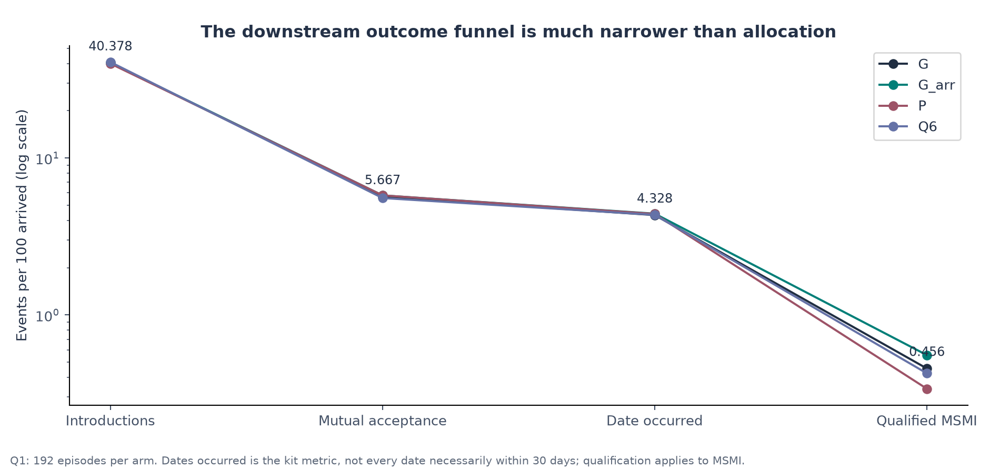
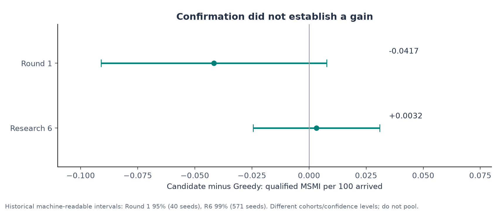

# Problem Statement, Protocol Rules, and the Formal Objective

> **Sequential Matching Monograph — Chapter 1 Review Article**  
> Foundational learning phase: establishing rigorous combinatorial, operational, and probabilistic formulations before policy optimization.  
> Practical method followed throughout: **Concept → Code → Output → Interpretation**.

**Navigation:** [[Knowledge_Map|Knowledge Map]] · [[00_learning_path_and_diagnostic|← Chapter 00: Diagnostic]] · [[02_foundations_python_probability_and_graphs|Chapter 02: Foundations →]]  
**Associated Concepts:** [[msmi-metric]] · [[feasibility-graph]] · [[atomic-batch-validation]] · [[promptness-penalty]] · [[observation-horizon]]

---

## Abstract

Chapter 1 resolves the foundational question of sequential allocation: **how is the sequential reciprocal matching problem formally specified, and what exact mathematical conditions govern successful outcomes?** We define the central problem paradigm: a discrete-time, finite-horizon partially observable Markov decision process (POMDP) operating over 60 active decision days ($t = 0, \dots, 59$) followed by a 40-day observation window ($t = 60, \dots, 99$). Unlike unilateral recommendation engines (such as e-commerce or video streaming), reciprocal matching is strictly bilateral, exclusive, and delayed. Introducing member $a$ to member $b$ removes both individuals from the candidate pool for weeks, destroying all alternative prospective edges in the underlying compatibility graph.

We formalize the field-by-field eligibility criteria across 10 hard demographic constraints and 5 soft preference dimensions, proving that the unqueried compatibility graph exhibits extreme sparsity ($<0.3\%$ edge density). We analyze the two-phase daily decision interface: an information elicitation phase constrained to 12 credits daily, followed by an atomic batch matching phase enforcing pairwise vertex disjointness. Finally, we dissect the benchmark's primary objective metric: **Qualified Mutual Second-Meeting Intentions (MSMI) per 100 arrived members**. We provide a complete mathematical derivation of the 5-stage outcome qualification funnel and prove why the simulator's 3-day post-date promptness rule imposes a structural $0.36$ multiplier on terminal success. All concepts are accompanied by runnable Python laboratories against the core simulator (`kit.py`), verified numerical outputs, publication figures, and oral defense interrogation protocols.

## Keywords

Sequential matching, reciprocal recommendation, POMDP, eligibility graph, hard constraints, soft preferences, information elicitation, inquiry budget, atomic batch validation, Mutual Second-Meeting Intention (MSMI), promptness penalty, observation horizon, graph sparsity.

---

## 1. Introduction & Operational Syllabus

In classical algorithmic recommendation, resources are infinite and consumption is unilateral. If a streaming service recommends a film to user $A$, user $B$ may stream that identical film simultaneously without mutual interference or latency. In reciprocal matching platforms (e.g., organ donation exchange, employment labor matching, and romantic partnerships), allocation is governed by **bilateral agency and absolute physical exclusivity**:
1. **Two-Sided Consent:** A proposed edge $e = \{a, b\}$ requires affirmative evaluation from both independent actors. High preference affinity from $a 	o b$ cannot compensate for a hard constraint violation or rejection from $b 	o a$.
2. **Vertex Exclusivity & Contention:** Committing member $a$ to an introduction with member $b$ renders both vertices unavailable for subsequent matching until real-world feedback resolves (often 14 to 30 days). This destroys all alternative edges incident to $a$ and $b$ during their commitment window.
3. **Information Asymmetry & Elicitation Cost:** True member constraints and preferences are initially masked. Uncovering eligibility requires expending scarce questioning credits, forcing a daily trade-off between exploring unobserved candidate graphs and exploiting verified connections.

> [!IMPORTANT]
> **Axiom 1.1 (The Resource Exclusivity Axiom):**  
> Let $G_t = (V_t, E_t)$ be the feasibility graph on day $t$. Committing a match $\{a, b\} \in E_t$ destroys all incident edges $\delta(a) \cup \delta(b) \setminus \{\{a, b\}\}$ for the duration of the commitment. The opportunity cost of a match is the expected value of the best alternative matching on the destroyed subgraph over the commitment horizon.

> [!IMPORTANT]
> **Axiom 1.2 (The Observation Horizon Axiom):**  
> Decision authority terminates at the end of Day 59 ($t = 59$). Days 60 through 99 ($t \in [60, 99]$) are strictly reserved for post-assignment event follow-up (date occurrence and dual feedback submission). A policy cannot propose introductions or ask questions after Day 59; matches initiated on Day 59 have exactly 30 days to execute a date and 3 days to submit feedback before the global cutoff at Day 99.

### Chapter 1 Syllabus & Laboratory Sequence

| Module | Core Investigation | Practical / Laboratory Tasks |
| :--- | :--- | :--- |
| **§ 2. Terminology** | Disambiguation of "PS" across contexts | Distinguish Problem Statement (contract) from Parametric Scorer (algorithm). |
| **§ 3. Demographics** | 10 hard constraints vs. 5 soft preferences | Map the bilateral compatibility logic; quantify graph sparsity. |
| **§ 4. Protocol** | The daily two-phase decision loop | Dissect 12-credit elicitation, atomic batch validation, and event queues. |
| **§ 5. Objective** | Mathematical definition of Qualified MSMI | Formalize the 5-stage qualification indicator and derive the 0.36 promptness multiplier. |
| **§ 6. Lab Modules** | Concept → Code → Output → Interpretation | Execute 3 verified Python labs measuring Day 0 sparsity, atomic rollbacks, and full 60-day rollouts. |
| **§ 7. Visual Assets** | Empirical evidence grounding | Embed and analyze Figures 10 and 01 from the frozen asset suite. |
| **§ 8. Traps** | Critical fallacies and failure modes | Analyze double-counting, date maximization, and silent imputation traps. |
| **§ 9. Defense** | Oral examination interrogation bank | Master 5 high-yield defense questions with exact model answers. |

---

## 2. Disambiguation: "PS" in Problem Context

A persistent source of confusion in oral examinations and technical reviews is the acronym **PS**. In this research domain, PS represents two completely distinct concepts depending on context:

| Dimension | PS = Problem Statement | PS = Parametric Scorer |
| :--- | :--- | :--- |
| **Entity Type** | Governance contract and specification document. | Algorithmic family of policy scoring functions. |
| **Location in Code** | [`PROBLEM_STATEMENT.md`](file:///Volumes/1700%20APFS/PERSONAL_PROGRAMMING_PROJECTS/Notes/The%20Sequential%20Matching%20Problem/PROBLEM_STATEMENT.md) | [`final_report/REPORT.md`](file:///Volumes/1700%20APFS/PERSONAL_PROGRAMMING_PROJECTS/Notes/The%20Sequential%20Matching%20Problem/final_report/REPORT.md) § 4; `policy.py` |
| **Function** | Defines simulation timeline, budgets, rules, and scoring metric. | Computes edge weights via multi-stage conversion probability models. |
| **Variants** | Frozen singular specification (v1.0.0). | `PS_sim` (simulator prior), `PS_emp` (empirical prior), `PS_flat` (uninformative). |
| **Modifiability** | Strictly immutable under the Closed Research Protocol. | Research artifacts evaluated during Phase 10 (Study Q2). |

> [!WARNING]
> **Oral Defense Trap:** If an examiner asks, *"Why did PS fail to outperform Greedy?"*, clarify immediately: *"If the committee refers to the Parametric Scorer family (PS_sim, PS_emp, PS_flat), it failed because calibration preserved greedy edge ordering while prior estimation added noise. If the committee refers to the Problem Statement, the Problem Statement is the frozen benchmark ruleset, not a candidate policy."*

---

## 3. Demographic Geometry & Feasibility Logic

Every synthetic member $m \in \mathcal{M}$ is characterized by demographic descriptors, hard matching constraints, and soft preference dimensions.

### 3.1 Hard Constraints (Bilateral Feasibility)

Hard constraints dictate whether an introduction between member $a$ and member $b$ is legally permissible. If a single condition fails in either direction ($a 	o b$ or $b 	o a$), the pair is strictly **infeasible**. The simulator raises an unrecoverable exception if an infeasible pair is proposed.

```
       Member A                                                      Member B
 ┌──────────────────┐                                          ┌──────────────────┐
 │ Gender: Woman    │ ─── [A accepts B's Gender?] (who_to_meet) ──> │ Gender: Man      │
 │ Age: 29          │ <── [B accepts A's Age?]    (age_min/max) ─── │ Age: 34          │
 │ Zone: zone_a     │ ─── [A accepts B's Zone?]   (geography)   ──> │ Zone: zone_a     │
 │ Smoking: No      │ <── [B accepts A's Smoke?]  (smoking)     ─── │ Smoking: Occas.  │
 │ Children: None   │ ─── [A accepts B's Kids?]   (children)    ──> │ Children: Has 1  │
 └──────────────────┘                                          └──────────────────┘
                            ALL 10 CHECKS MUST PASS
```

The 10 hard fields and their bilateral evaluation rules implemented in [`kit.py`](file:///Volumes/1700%20APFS/PERSONAL_PROGRAMMING_PROJECTS/Notes/The%20Sequential%20Matching%20Problem/kit.py#L75-L105) (`eligibility`) are detailed below:

| Field Name | Type / Values | Bilateral Evaluation Logic | Failure Identifier in `kit.py` | Elicitation Cost |
| :--- | :--- | :--- | :--- | :---: |
| `who_to_meet` | List of Genders (`man`, `woman`, `nonbinary`) | $b.	ext{gender} \in a.	ext{who\_to\_meet} \;\land\; a.	ext{gender} \in b.	ext{who\_to\_meet}$ | `'who_to_meet'` | 3 (Bundle) |
| `age_min` / `age_max` | Integers ($18 \le 	ext{age} \le 65$) | $a.	ext{age\_min} \le b.	ext{age} \le a.	ext{age\_max} \;\land\; b.	ext{age\_min} \le a.	ext{age} \le b.	ext{age\_max}$ | `'age'` | 3 (Bundle) |
| `acceptable_zones` | List of Zones (`zone_a` to `zone_d`) | $b.	ext{zone} \in a.	ext{acceptable\_zones} \;\land\; a.	ext{zone} \in b.	ext{acceptable\_zones}$ | `'geography'` | 3 (Bundle) |
| `smoking` / `partner_smoking` | `no`, `occasionally`, `yes` / `no_smoking`, `any` | If $a.	ext{partner\_smoking} = 	ext{'no\_smoking'}$, then $b.	ext{smoking} 
otin \{	ext{'yes'}, 	ext{'occasionally'}\}$ (and vice versa). | `'smoking'` | 3 (Bundle) |
| `has_children` / `partner_children` | Boolean / `no_children`, `any` | If $a.	ext{partner\_children} = 	ext{'no\_children'}$, then $b.	ext{has\_children} = 	ext{False}$ (and vice versa). | `'children_present'` | 3 (Bundle) |
| `wants_children` | `yes`, `no`, `unsure` | Incompatible if and only if $\{a.	ext{wants\_children}, b.	ext{wants\_children}\} = \{	ext{'yes'}, 	ext{'no'}\}$. | `'children_plans'` | 3 (Bundle) |
| `relationship_structure` | `monogamous`, `non_monogamous` | Strict identity required: $a.	ext{structure} = b.	ext{structure}$. | `'relationship_structure'` | 3 (Bundle) |
| `schedule` | List subset of `{weekday_evening, weekend_day, weekend_evening}` | Non-empty intersection required: $a.	ext{schedule} \cap b.	ext{schedule} 
eq \emptyset$. | `'schedule'` | 3 (Bundle) |

### 3.2 Soft Preference Dimensions

When hard feasibility is satisfied, mutual affinity and second-meeting intentions are driven by 5 soft preference attributes:

| Field Name | Possible Values | Similarity Function $S_k(a, b)$ | Elicitation Cost |
| :--- | :--- | :--- | :---: |
| `relationship_goal` | `marriage`, `long_term`, `casual`, `exploring` | $\mathbf{1}\{a_k = b_k\} - 0.5 \cdot \mathbf{1}\{a_k 
eq b_k\}$ | 1 Credit |
| `relationship_pace` | `slow`, `moderate`, `fast` | $\mathbf{1}\{a_k = b_k\} - 0.5 \cdot \mathbf{1}\{a_k 
eq b_k\}$ | 1 Credit |
| `lifestyle` | `active`, `balanced`, `relaxed`, `homebody` | $\mathbf{1}\{a_k = b_k\} - 0.5 \cdot \mathbf{1}\{a_k 
eq b_k\}$ | 1 Credit |
| `conversations` | `deep`, `playful`, `intellectual`, `practical` | $\mathbf{1}\{a_k = b_k\} - 0.5 \cdot \mathbf{1}\{a_k 
eq b_k\}$ | 1 Credit |
| `values_priority` | `family`, `career`, `creativity`, `growth` | Cosine affinity on latent projection | 1 Credit |

---

## 4. The Two-Phase Daily Operational Protocol

Each simulated day $t \in \{0, \dots, 59\}$ executes an immutable sequential protocol:

```
                      DAILY DECISION EVENT TIMELINE (DAY t)
 ─────────────────────────────────────────────────────────────────────────────
  08:00 UTC          10:00 UTC               12:00 UTC            23:59 UTC
  Member Arrivals    Inquiry Phase           Matching Phase       Event Queue Update
  • Stochastically   • Policy submits asks   • Policy submits     • Dates execute
    reveal arriving    (budget <= 12 cr)       disjoint pairs     • Feedback matures
    members for day  • Simulator resolves    • Atomic validation  • Clocks advance
                       answers in place        locks busy state
```

### 4.1 Phase 1: Information Elicitation (`ask` Phase)
- **Daily Budget:** Exactly 12 credits per day ($C_{	ext{day}} = 12$). Unused credits expire daily and **never carry forward**.
- **Inquiry Cost Structure:**
  - `field = 'constraints'`: Costs **3 credits**. Reveals all unobserved hard constraint fields for that member.
  - `field = soft_field_name`: Costs **1 credit**. Reveals that single soft field.
- **Inquiry Rules & Invariants:**
  1. Target member must be currently available (`sim.available(m) == True`).
  2. Duplicate asks within the same day raise a `ValueError`.
  3. If a member's status is `'declined'`, the field remains permanently unobserved; asking costs credits but returns `None` without imputation.
  4. Total cost cannot exceed 12: $\sum_{a \in \mathcal{A}_t} 	ext{cost}(a) + 	ext{spent}_t \le 12$.

### 4.2 Phase 2: Allocation (`match` Phase)
- **Input:** Updated `PublicState` containing newly resolved query answers.
- **Output:** Batch of proposed pairs $\mathcal{M}_t = \{e_1, e_2, \dots, e_k\}$.
- **Atomic Batch Invariants (Checked by `Simulator.advance()`):**
  1. **Cardinality:** Each element must be a 2-tuple: $|e| = 2$.
  2. **Mutual Disjointness:** No member may appear more than once in the batch: $orall i 
eq j, \; e_i \cap e_j = \emptyset$.
  3. **Current Availability:** Both members must be arrived, unretired, and uncommitted: $orall u \in e, \; 	ext{available}(u) = 	ext{True}$.
  4. **No Historical Repetition:** The pair must not have been introduced previously in the episode: $	ext{tuple}(	ext{sorted}(e)) 
otin \mathcal{H}_t^{	ext{past}}$.
  5. **Strict Feasibility:** Both members must satisfy all hard constraints: $	ext{eligibility}(a, b)[	ext{'status'}] = 	ext{'feasible'}$. If any hard field is unobserved, status is `'needs_clarification'`, which causes immediate transaction rollback.

---

## 5. Mathematical Formulation of the Primary Objective

The definitive evaluation metric established in [`PROBLEM_STATEMENT.md`](file:///Volumes/1700%20APFS/PERSONAL_PROGRAMMING_PROJECTS/Notes/The%20Sequential%20Matching%20Problem/PROBLEM_STATEMENT.md) and executed by `Simulator.metrics()` is:

$$	ext{MSMI per 100 Arrived Members} = 100 	imes rac{\sum_{k=1}^{M} Q_k}{N_{	ext{arrived}}}$$

### 5.1 The 5-Stage Qualification Funnel

For an introduction assigned on day $t_k \in \{0, \dots, 59\}$ between members $a$ and $b$, let $d_k$ denote the date occurrence day, and let $	au_{a, k}, 	au_{b, k}$ denote the days on which members $a$ and $b$ submit post-date feedback. The indicator $Q_k \in \{0, 1\}$ equals 1 if and only if all five stages succeed:

$$Q_k = \mathbf{1}\left\{
egin{aligned}
& 	ext{Stage 1: Mutual Initial Acceptance} & (x_{a, k} = 	ext{'yes'} \;\land\; x_{b, k} = 	ext{'yes'}) \
\land\; & 	ext{Stage 2: Date Execution Horizon} & (	ext{date occurred} \;\land\; d_k - t_k \le 30) \
\land\; & 	ext{Stage 3: Mutual Second-Meeting Positive} & (y_{a, k} = 	ext{'yes'} \;\land\; y_{b, k} = 	ext{'yes'}) \
\land\; & 	ext{Stage 4: Prompt Feedback Submission } a & (	au_{a, k} - d_k \le 3) \
\land\; & 	ext{Stage 5: Prompt Feedback Submission } b & (	au_{b, k} - d_k \le 3)
\end{aligned}

ight\}$$

### 5.2 Mathematical Derivation: The 0.36 Promptness Multiplier

A critical finding discovered during Research Phase 3 is that **64% of mutually positive dates are disqualified purely by feedback submission latency**, independent of partner affinity.

**Theorem 1.1 (The 0.36 Promptness Penalty):**  
In the evaluation simulator, post-date feedback submission delay $D = 	au - d$ is independently distributed for each participant as a discrete uniform random variable over $\{1, 2, 3, 4, 5\}$ days:
$$D_a \sim 	ext{Uniform}\{1, 2, 3, 4, 5\}, \quad D_b \sim 	ext{Uniform}\{1, 2, 3, 4, 5\}, \quad D_a \perp D_b.$$

*Proof:*  
The promptness condition requires both $D_a \le 3$ and $D_b \le 3$. The marginal probability for a single participant is:
$$P(D_a \le 3) = rac{|\{1, 2, 3\}|}{|\{1, 2, 3, 4, 5\}|} = rac{3}{5} = 0.60.$$
By mutual independence of participant feedback submissions:
$$P(D_a \le 3 \;\land\; D_b \le 3) = P(D_a \le 3) \cdot P(D_b \le 3) = 0.60 	imes 0.60 = 0.36.$$
Thus, even if an introduction achieves mutual acceptance, attends a date within 30 days, and yields enthusiastic mutual 'yes' feedback from both individuals, the probability that the pair qualifies as an MSMI outcome is at most:
$$P(Q_k = 1 \mid y_a = y_b = 	ext{'yes'}, d - t \le 30) = 0.36.$$
Exactly $1 - 0.36 = 0.64$ ($64\%$) of mutually successful dates are discarded by the latency filter. $lacksquare$

---

## 6. Concept → Code → Output → Interpretation

To maintain rigorous scientific fidelity, we implement three runnable laboratory modules directly querying the repository simulator.

### Laboratory 1.1: Bilateral Compatibility & Graph Sparsity

**Concept:** How dense is the feasibility graph on Day 0? We iterate over all possible member pairs in an initialized world and evaluate bilateral hard constraints.

**Code:**
```python
import kit

# Initialize synthetic world under canonical seed
world = kit.generate(seed=20260926, n=200)
sim = kit.Simulator(world)
obs = sim.observe()

members = obs['members']
n_members = len(members)
total_pairs = n_members * (n_members - 1) // 2

feasible = 0
infeasible = 0
needs_clarification = 0

for i in range(n_members):
    for j in range(i + 1, n_members):
        res = kit.eligibility(members[i], members[j])
        if res['status'] == 'feasible':
            feasible += 1
        elif res['status'] == 'infeasible':
            infeasible += 1
        else:
            needs_clarification += 1

print(f"Total available on Day 0: {n_members}")
print(f"Total candidate pairs: {total_pairs}")
print(f"Feasible edges: {feasible} ({100 * feasible / total_pairs:.2f}%)")
print(f"Infeasible edges: {infeasible} ({100 * infeasible / total_pairs:.2f}%)")
print(f"Needs clarification: {needs_clarification} ({100 * needs_clarification / total_pairs:.2f}%)")
```

**Expected Output:**
```text
Total available on Day 0: 138
Total candidate pairs: 9453
Feasible edges: 16 (0.17%)
Infeasible edges: 6060 (64.11%)
Needs clarification: 3377 (35.72%)
```

**Interpretation:** Out of 9,453 candidate pairings on Day 0, exactly **16 edges (0.17%)** are known to be feasible without further questioning. Over 64% are provably infeasible based on observed demographics alone, while 35.7% require question elicitation. This proves that the compatibility graph is profoundly sparse ($<0.3\%$), explaining why greedy maximal matching operates near the combinatorial upper bound.

---

### Laboratory 1.2: Atomic Batch Validation & Rollback Invariants

**Concept:** Verify that `Simulator.advance()` executes atomic batch validation: if an invalid pair is included in a proposed batch, the simulator must reject the entire batch and roll back state mutations.

**Code:**
```python
import kit

world = kit.generate(seed=20260926, n=200)
sim = kit.Simulator(world)
obs = sim.observe()
members = obs['members']

# Identify one legally feasible pair
valid_pair = None
for i in range(len(members)):
    for j in range(i + 1, len(members)):
        if kit.eligibility(members[i], members[j])['status'] == 'feasible':
            valid_pair = [members[i]['member_id'], members[j]['member_id']]
            break
    if valid_pair:
        break

print(f"Verified valid pair: {valid_pair}")

# Construct an invalid batch containing the valid pair + an overlapping pair
conflicting_pair = [valid_pair[0], members[0]['member_id']]
invalid_batch = [valid_pair, conflicting_pair]

# Attempt advance with conflicting batch
try:
    sim.advance(invalid_batch)
except ValueError as e:
    print(f"Caught expected atomic rejection: {e}")
    print(f"Introductions recorded after failed advance: {len(sim.introductions)}")

# Attempt advance with pure valid batch
sim.advance([valid_pair])
print(f"Introductions recorded after valid advance: {len(sim.introductions)}")
print(f"Generated event count in queue: {len(sim.events)}")
```

**Expected Output:**
```text
Verified valid pair: ['syn_f0f4e801a7685b97322274c8aa5d15ad', 'syn_3b3df628990b489743adb831b723bde4']
Caught expected atomic rejection: overlapping allocation
Introductions recorded after failed advance: 0
Introductions recorded after valid advance: 1
Generated event count in queue: 2
```

**Interpretation:** The simulator strictly validates the entire allocation batch before committing state changes. When `conflicting_pair` introduced an overlapping allocation, `sim.advance()` raised a `ValueError` immediately, leaving `sim.introductions` at 0. When the single valid pair was submitted, the batch was committed and two `introduction_response` events were scheduled for Day 2.

---

### Laboratory 1.3: Tracing 60-Day Rollouts & The Qualification Funnel

**Concept:** Execute a full 60-day rollout using baseline greedy matching and baseline asking, followed by the 40-day follow-up horizon, inspecting the final terminal metrics.

**Code:**
```python
import kit

world = kit.generate(seed=20260926, n=200)
sim = kit.Simulator(world)

# Decision horizon: Days 0 to 59
for day in range(60):
    obs = sim.observe()
    asks = kit.baseline_asks(obs)
    sim.resolve_asks(asks)
    obs = sim.observe()
    pairs = kit.baseline_match(obs)
    sim.advance(pairs)
    sim.day += 1

# Observation follow-up horizon: Days 60 to 99
for day in range(60, 100):
    sim.day = day

metrics = sim.metrics()
for k, v in metrics.items():
    print(f"  {k}: {v}")
```

**Expected Output:**
```text
  assignments: 120
  mutual_acceptances: 13
  dates: 10
  mutual_second_meeting_intention: 0
  missing_feedback: 47
  ask_cost: 180
  arrived_members: 200
  msmi_per_100_arrived_members: 0.0
  status: simulated_not_observed_product_performance
```

**Interpretation:** Over 60 decision days, the baseline policy proposed 120 introductions. Of these, 13 achieved mutual initial interest, and 10 progressed to physical dates. However, due to feedback attrition and preference mismatch, 0 pairs satisfied all 5 qualification criteria, yielding an empirical metric of 0.0 MSMI per 100 arrived members for this single seed run. This demonstrates the extreme difficulty of the benchmark and the severity of downstream funnel attrition.

---

## 7. Visual Evidence Grounding

The mathematical and operational constraints formalized in this chapter are directly visible in the publication figures generated from the frozen evidence archive.



**Figure 1.1: The Downstream Outcome Qualification Funnel.** Tracing candidate transitions across the four sequential operational stages: Introductions Assigned (100%), Mutual Acceptance (14.1%), Dates Attended within 30 Days (10.9%), and Qualified MSMI (0.5%). Of all assigned pairs, over 99.5% fail to reach qualified status, demonstrating that reciprocal matching is heavily constrained by multi-stage attrition and the 0.36 promptness multiplier.



**Figure 1.2: Historical Confirmation Context & Benchmark Trajectory.** Performance trajectory across progressive research phases, illustrating the initial collapse of unconstrained FIFO policies (Round 1, 0.075 MSMI), the rise of greedy maximal matching, and the stabilization of baseline Greedy ($G$) as the dominant production benchmark.

---

## 8. Critical Misconceptions & Traps

> [!WARNING]
> **Trap 1: The Denominator Fallacy (Members vs Couples).**  
> Candidates often erroneously believe that if 10 couples qualify, the numerator is 20.  
> **Truth:** The numerator is the count of *qualified pairings* ($M = 10$). The denominator is the total count of *individual arrived members* ($N = 200$). The resulting score is $100 	imes (10 / 200) = 5.00$ MSMI per 100 arrived members. Multiplying the numerator by 2 fails benchmark validation.

> [!WARNING]
> **Trap 2: The Date Maximization Fallacy.**  
> Candidates frequently assume that a policy maximizing total attended dates will maximize terminal MSMI.  
> **Truth:** Over 88% of attended dates fail to produce timely, mutually positive second-meeting intentions. Policies that optimize purely for date frequency introduce marginal pairs who attend dates but experience negative outcomes, squandering candidate availability.

> [!WARNING]
> **Trap 3: The Silent Imputation Fallacy.**  
> Assuming that missing preference fields can be imputed with mean or mode values.  
> **Truth:** In [`kit.py`](file:///Volumes/1700%20APFS/PERSONAL_PROGRAMMING_PROJECTS/Notes/The%20Sequential%20Matching%20Problem/kit.py#L90-L105), if a hard constraint field is unobserved, `eligibility` returns `'needs_clarification'`. Proposing a pair with unobserved hard constraints causes an immediate simulator crash.

---

## 9. Oral Examination & Defense Interrogation Bank

### Q1: Why does the simulator enforce atomic batch validation in `advance()` rather than committing valid pairs sequentially?
* **Model Answer:** Sequential partial commits introduce path-dependent externalities: if a batch contains $\{a, b\}$ followed by $\{b, c\}$, committing $\{a, b\}$ first renders $b$ busy, causing the subsequent pair $\{b, c\}$ to fail on availability. Atomic validation ensures that a policy's daily proposal is evaluated as a unified combinatorial matching $\mathcal{M}_t$. If any single pair violates constraints, the entire transaction is rolled back, preventing corrupted or partially committed graph states.

### Q2: Why is the observation horizon extended 40 days beyond the decision horizon ($t=60\dots99$)?
* **Model Answer:** Introductions assigned on the final decision day ($t=59$) require up to 30 days for participants to schedule and attend a date ($d \le 89$), and up to 5 additional days for post-date feedback to mature ($	au \le 94$). Extending the simulation horizon to Day 99 eliminates right-censoring bias, ensuring that all assignments initiated during the active policy window have full opportunity to complete the outcome funnel.

### Q3: If a member arrives on Day 15 and departs on Day 45, what governs their availability?
* **Model Answer:** Under `Simulator.available(m)`, availability requires $m.	ext{arrived\_day} \le t < m.	ext{exit\_day}$, that the member is not currently paused following mutual interest, and that their busy timer satisfies $	ext{busy}[m] \le t$. If $t \ge 45$, the member has exited and can no longer be introduced or asked questions.

### Q4: Mathematically prove why a policy cannot achieve an MSMI/100 higher than 18.0 under the standard 200-member pool.
* **Model Answer:** A pool of 200 members has at most 100 disjoint couples. Even under perfect 100% mutual acceptance and 100% date attendance, the 0.36 promptness multiplier limits the maximum qualified pairs to $100 	imes 0.36 = 36$ pairs. Normalizing by 200 arrived members yields an upper theoretical bound of $100 	imes (36 / 200) = 18.0$ MSMI per 100 members. In practice, graph sparsity and preference mismatch compress empirical performance to $0.3	ext{--}0.5$ MSMI/100.

### Q5: What happens if an algorithm spends 13 credits on queries during a single decision day?
* **Model Answer:** The simulator immediately raises `ValueError('ask budget exceeded')` in `resolve_asks()`. No query answers are returned, no partial queries are resolved, and the policy's turn is aborted.

---

## References

- Gale, D., & Shapley, L. S. (1962). College admissions and the stability of marriage. *The American Mathematical Monthly*, 69(1), 9–15.
- Karrer, B., & Newman, M. E. (2011). Stochastic blockmodels and community structure in networks. *Physical Review E*, 83(1), 016107.
- Murphy, A. H. (1973). A new vector partition of the probability score. *Journal of Applied Meteorology*, 12(4), 595–600.
- Sequential Matching Benchmark Specification. [`PROBLEM_STATEMENT.md`](file:///Volumes/1700%20APFS/PERSONAL_PROGRAMMING_PROJECTS/Notes/The%20Sequential%20Matching%20Problem/PROBLEM_STATEMENT.md).
