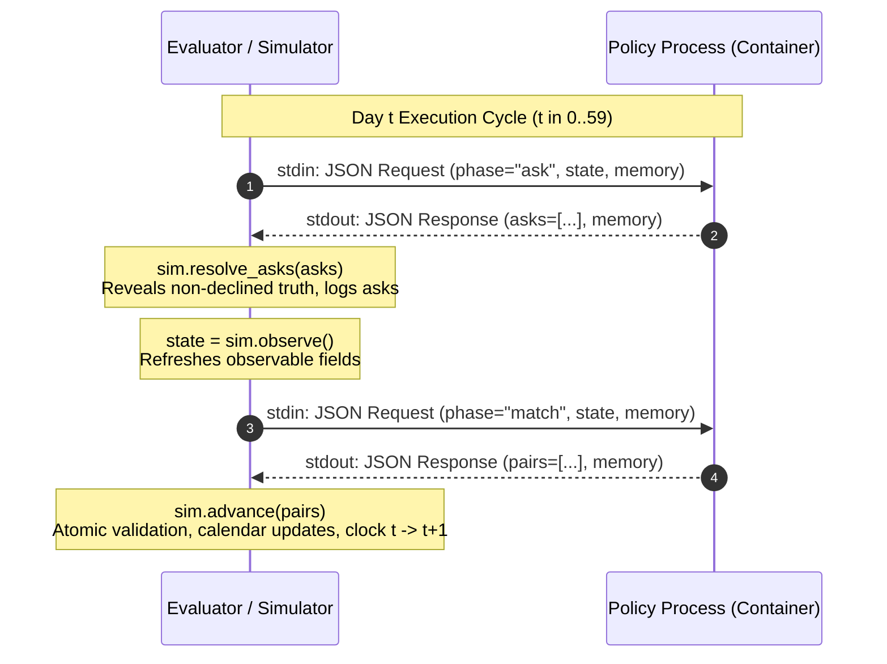

# 03. Simulator Protocol, Event Timeline & Execution Architecture

This document details the operational mechanics of the simulation engine: the two-phase JSON protocol, the underlying event-driven state machine, deterministic pseudo-random seeds, the member availability and busy calendar, and the exact chronological timeline of an introduction from assignment to terminal evaluation.

---

## 1. Disambiguation: "PS" in Simulator Protocol Context

* **PS (Problem Statement)**: Specifies the protocol requirements frozen in [`PROBLEM_STATEMENT.md`](file:///Volumes/1700%20APFS/PERSONAL_PROGRAMMING_PROJECTS/Notes/The%20Sequential%20Matching%20Problem/PROBLEM_STATEMENT.md#L95-L120) and [`docs/POLICY_INTERFACE.md`](file:///Volumes/1700%20APFS/PERSONAL_PROGRAMMING_PROJECTS/Notes/The%20Sequential%20Matching%20Problem/docs/POLICY_INTERFACE.md).
* **PS (Parametric Scorer)**: The multi-stage candidate scoring model family (`PS_sim`, `PS_emp`) evaluated in [`final_report/REPORT.md`](file:///Volumes/1700%20APFS/PERSONAL_PROGRAMMING_PROJECTS/Notes/The%20Sequential%20Matching%20Problem/final_report/REPORT.md).

---

## 2. The Two-Phase Daily Execution Loop

### Layer 1: The Question
How does the evaluation engine interface with an external policy process each day, and how is information refreshed between clarification and matching without state corruption or leakage?

### Layer 2: Intuition
A day cannot be executed in a single monolithic action because matching decisions depend directly on the answers received from clarification questions asked *on that same day*. Thus, each day $t \in \{0, \dots, 59\}$ is strictly divided into two distinct communication rounds:
1. **Ask Phase**: The policy inspects current observations and requests clarifications within its daily budget.
2. **Observation Refresh**: The engine resolves disclosed queries, updates observable profile fields, and records them in the state log.
3. **Match Phase**: The policy receives the updated state containing the newly revealed answers and selects non-overlapping pairs.
4. **Simulator Advance**: The engine validates proposed pairs, generates future outcome events, updates member busy calendars, and advances the clock to $t+1$.

### Layer 3: Minimal Concrete Example
On Day 12, Member $A$ has `smoking = None` (`field_status = 'not_asked'`).
* **Round 1 (Ask Phase)**:
  * Policy receives `phase: "ask"` with `ask_budget_remaining: 12`.
  * Policy sends `{"asks": [{"member_id": "A", "field": "constraints"}], "memory": {"step": 12}}`.
* **State Refresh**:
  * Engine reveals $A$'s ground truth: `smoking = 'no'`, `status = 'observed'`.
  * Engine deducts 3 budget units (`ask_budget_remaining: 9`).
* **Round 2 (Match Phase)**:
  * Policy receives `phase: "match"` with $A$'s `smoking = 'no'` now visible.
  * Pair $(A, B)$ is now known to be `feasible` (previously blocked as `needs_clarification`).
  * Policy sends `{"pairs": [["A", "B"]], "memory": {"step": 12}}`.

### Layer 4: Sequence Diagram of the Protocol Loop



### Layer 5: Code Implementation of the Daily Cycle
In [`evaluate.py`](file:///Volumes/1700%20APFS/PERSONAL_PROGRAMMING_PROJECTS/Notes/The%20Sequential%20Matching%20Problem/evaluate.py#L55-L75), the episode runner drives the cycle:

```python
# From evaluate.py: episode()
for _ in range(60):
    for phase in ('ask', 'match'):
        request = {
            'schema_version': VERSION, 
            'phase': phase,
            'state': sim.observe(), 
            'memory': memory
        }
        response, elapsed = invoke(command, request, timeout)
        inference_seconds += elapsed
        memory = response['memory']
        action = response['asks' if phase == 'ask' else 'pairs']
        digest.update(json.dumps([phase, sim.day, action], sort_keys=True).encode())
        if phase == 'ask':
            sim.resolve_asks(action)
        else:
            sim.advance(action)
```

### Layer 6: Memory & Invocation Invariants
* **Stateless Subprocess Architecture**: The policy process is invoked fresh for every phase call. File system storage in `/tmp` is wiped between runs.
* **Serialized Memory**: Policy state across invocations is preserved **exclusively** through the `memory` JSON property.
* **Payload Limit**: Request, response, and `memory` payloads must each remain below **1 MiB** ($1,048,576$ bytes). Any non-finite float (`NaN`, `Infinity`) triggers immediate rejection.

---

## 3. Simulator State Machine & The Busy Calendar

Understanding member availability is paramount. A member is eligible for an ask or introduction if and only if [`Simulator.available(m)`](file:///Volumes/1700%20APFS/PERSONAL_PROGRAMMING_PROJECTS/Notes/The%20Sequential%20Matching%20Problem/kit.py#L105-L115) returns `True`.

```
                    ┌──────────────────────────────────────┐
                    │ Member Unarrived (day < arrived_day) │
                    └──────────────────┬───────────────────┘
                                       │ day == arrived_day
                                       ▼
    ┌──────────────────────────► AVAILABLE ◄──────────────────────────┐
    │ (arrived_day <= day < exit_day, busy <= day, not paused)         │
    │                                  │                              │
    │ Introduction Assigned            │ Introduction Assigned        │
    │ (No date / One member says No)   │ (Mutual Yes -> Date happens) │
    │                                  ▼                              │
    │                      ┌──────────────────────┐                   │
    │                      │   BUSY (Window 1)    │                   │
    │                      │   busy = day + 8     │                   │
    │                      └──────────┬───────────┘                   │
    │                                 │ Both Accept & Date Scheduled  │
    │                                 ▼                               │
    │                      ┌──────────────────────┐                   │
    │                      │   BUSY (Window 2)    │                   │
    │                      │  busy = date_day + 6 │                   │
    │                      └──────────┬───────────┘                   │
    │                                 │                               │
    │ Date happens, but second        │ Date happens AND both say     │
    │ meeting is NOT mutual Yes       │ YES within 3 days             │
    │                                 ▼                               │
    │                     ┌────────────────────────┐                  │
    └─────────────────────┤ PAUSED_AFTER_MUTUAL_   │                  │
                          │        INTEREST        │──────────────────┘
                          │  (Permanently Retired) │   (Only if not paused)
                          └────────────────────────┘
```

### 3.1 Availability Definition
A member $m$ is available at day $t$ if and only if all four conditions hold:
1. **Arrival**: $\text{arrived\_day}_m \le t$.
2. **Non-Exit**: $t < \text{exit\_day}_m$. (Note: $12\%$ of members have an exit day $\in [22, 60]$; others remain indefinitely).
3. **Non-Paused**: The member has not recorded `pause_after_mutual_interest` with $\text{observed\_day} \le t$.
4. **Busy Calendar**: $\text{busy}[m] \le t$.

```python
# From kit.py: Simulator.available()
def available(self, m):
    i = m['member_id']
    paused = any(
        e['event'] == 'pause_after_mutual_interest' 
        and e['observed_day'] <= self.day 
        and i in next(((x['user_a'], x['user_b']) for x in self.introductions if x['introduction_id'] == e['introduction_id']), ())
        for e in self.events
    )
    return m['arrived_day'] <= self.day < m['exit_day'] and not paused and self.busy.get(i, -1) <= self.day
```

### 3.2 State Transition Windows
When an introduction between $A$ and $B$ is created at Day $t$:

#### Window 1: Introduction Response Window
* The engine immediately sets:
  $$\text{busy}[A] = t + 8, \quad \text{busy}[B] = t + 8.$$
* The response deadline is $t + 7$.
* For each member, response delay is $\Delta \sim \text{DiscreteUniform}\{1, \dots, 7\}$:
  * If the member responds, $\text{observed\_day} = t + \Delta$.
  * If the member does not respond (`no_response`), $\text{observed\_day} = t + 7$ (with `value = None`).
* **Exit condition from Window 1**: If either member declines or fails to respond, both members automatically become available again on Day $t + 8$ (since $\text{busy} \le t+8$).

#### Window 2: Date Scheduling & Execution Window
* If **both** members respond `yes`, a date is scheduled:
  $$\text{date\_day} = \max(\tau_A^{\text{resp}}, \tau_B^{\text{resp}}) + \Delta_{\text{date}}, \quad \Delta_{\text{date}} \sim \text{DiscreteUniform}\{1, \dots, 14\}$$
  *(In the `delayed` scenario family, an additional $\text{randint}(5, 12)$ is added).*
* The engine extends the busy calendar:
  $$\text{busy}[A] = \text{date\_day} + 6, \quad \text{busy}[B] = \text{date\_day} + 6.$$
* On day $\text{date\_day}$, the date takes place with probability $0.78$ (`date_happened = True`).

#### Window 3: Second-Meeting Feedback & Permanent Pause
* If the date occurs, members submit second-meeting intentions with delay $\Delta_2 \sim \text{DiscreteUniform}\{1, \dots, 5\}$.
* If both members report `value = 'yes'` (regardless of whether delay exceeded 3 days), the engine emits:
  $$\text{event} = \text{'pause\_after\_mutual\_interest'}, \quad \text{observed\_day} = \max(\tau_A^{\text{sec}}, \tau_B^{\text{sec}}).$$
* Once observed, both members are **permanently paused** and will never return to availability.

---

## 4. Comprehensive Introduction Chronology & Gantt Traces

### Trace 1: Successful Qualified MSMI Outcome ($Q = 1$)

```
Day  0: Introduction assigned at t = 0.
        busy[A] = 8, busy[B] = 8.
Day  3: A responds 'yes' (observed_day = 3).
Day  5: B responds 'yes' (observed_day = 5).
        Both responded 'yes'! Date scheduled for Day 14.
        busy[A] = 20, busy[B] = 20 (date_day + 6 = 14 + 6).
Day 14: Date occurs! (date_happened = True, observed_day = 14).
        Condition Check: date_day - t = 14 - 0 = 14 <= 30 (PASS).
Day 16: A reports second-meeting 'yes' (tau_A = 16, delay = 2 <= 3: PASS).
Day 17: B reports second-meeting 'yes' (tau_B = 17, delay = 3 <= 3: PASS).
        Event 'pause_after_mutual_interest' emitted at observed_day = 17.
        Both members permanently paused.
        Terminal Status: QUALIFIED MSMI (Q = 1).
```

```
Timeline (Days):
0      3    5           14     16 17             20
├──────┼────┼────────────┼──────┼──┼──────────────┤
▲      ▲    ▲            ▲      ▲  ▲              ▲
Assign A=yes B=yes      Date    A  B(Pause)      busy clears
                         Happens 'yes' (Q=1)
```

### Trace 2: Disqualified Outcome: Late Response ($\tau - d > 3$)

```
Day 10: Introduction assigned at t = 10.
Day 13: Both members respond 'yes'. Date scheduled for Day 22.
Day 22: Date occurs! (date_happened = True).
        Condition Check: 22 - 10 = 12 <= 30 (PASS).
Day 24: A reports second-meeting 'yes' (delay = 2 <= 3: PASS).
Day 27: B reports second-meeting 'yes' (delay = 5 > 3: FAIL).
        Terminal Status: DISQUALIFIED (Q = 0).
        Reason: B's response arrived 5 days after date (> 3 day limit).
        Note: The date is counted in secondary metric 'dates', and both
        members are still paused, but MSMI receives 0 credit!
```

---

## 5. Deterministic Pseudo-Randomness & Seed Hashing

To guarantee perfect reproducibility across distributed systems while preventing cross-episode correlation, the simulator uses deterministic SHA-256 seed hashing.

### 5.1 The `rand_for` Primitive
In [`kit.py`](file:///Volumes/1700%20APFS/PERSONAL_PROGRAMMING_PROJECTS/Notes/The%20Sequential%20Matching%20Problem/kit.py#L22-L24):

```python
def rand_for(*parts):
    digest = hashlib.sha256('|'.join(map(str, parts)).encode()).digest()[:16]
    return random.Random(int.from_bytes(digest, 'big'))
```

* For any assigned pair $(A, B)$ on day $t$ under world seed $S$:
  $$\text{PRNG} = \text{rand\_for}(S, A, B, t)$$
* All downstream stochastic events (individual response decisions, response delays, date scheduling offsets, second-meeting intentions) are generated strictly from this deterministic sub-stream.
* **Reproducibility Invariant**: Evaluating the same policy against the same world seed will produce byte-for-byte identical action digests and metrics.

### 5.2 Opaque Identifiers
* Member identifiers are generated as:
  $$\text{member\_id} = \text{"syn\_"} + \text{UUID}(128\text{-bit int}).\text{hex}$$
* Introduction identifiers:
  $$\text{intro\_id} = \text{"intro\_"} + \text{SHA256}(A \mid B \mid t)[:24]$$
* **Security & Fair Play**: Identifiers convey zero information about arrival day, latent bias, or preference. Any attempt by a policy to reverse-engineer generator seeds or state from identifiers is strictly prohibited by [`PROBLEM_STATEMENT.md` §11](file:///Volumes/1700%20APFS/PERSONAL_PROGRAMMING_PROJECTS/Notes/The%20Sequential%20Matching%20Problem/PROBLEM_STATEMENT.md#L205-L225).

---

## 6. Action Validation & Atomic Batch Rejection

The simulator enforces strict atomic validation:

$$\text{Validation}(\text{Batch}) = \begin{cases} \text{Commit All Pairs} & \text{if } \forall p \in \text{Batch}, \; \text{Valid}(p) \\ \text{Raise ValueError (Commit 0 Pairs)} & \text{if } \exists p \in \text{Batch}, \; \neg\text{Valid}(p) \end{cases}$$

### Complete Failure Checklist

| Violation | Exception Raised | Root Cause |
|---|---|---|
| Pair format wrong | `ValueError('pair length')` | Element is not a 2-element array (e.g., `["syn_01"]`). |
| Unknown identifier | `ValueError('unknown member')` | String ID does not exist in pool. |
| Duplicate member in batch | `ValueError('overlapping allocation')` | Member $A$ appears in $(A, B)$ and $(A, C)$ in same batch. |
| Member unavailable | `ValueError('unavailable member')` | Member is unarrived, paused, exited, or busy ($\text{busy} > t$). |
| Repeated introduction | `ValueError('repeat pair')` | Pair was already introduced on an earlier day in this episode. |
| Ineligible pair | `ValueError('hard constraint...')` | Stated age, gender, zone, smoking, children, or schedule conflict. |
| Unclarified hard field | `ValueError('hard constraint...')` | Attempted to match when a hard field is `None`. |
| Budget overrun | `ValueError('ask budget exceeded')` | Total ask units in ask phase $> 12$. |
| Duplicate ask | `ValueError('duplicate ask')` | Same `(member_id, field)` asked multiple times in one round. |
| Ask unavailable member | `ValueError('ask member unavailable')` | Clarification requested for an unarrived, busy, or paused member. |

---

Proceed to [04. Data Contracts, Information Boundaries, and Preventing Leakage](04_data_information_boundaries_and_leakage.md).
