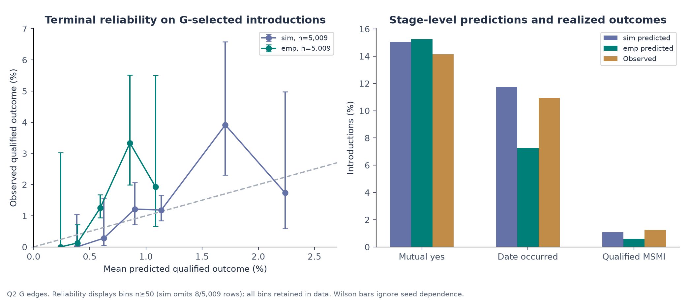

# Predictive Models, Funnel Dynamics, and Calibration Invariance

> **Sequential Matching Monograph — Chapter 6 Review Article**  
> Probabilistic modeling phase: analyzing multi-stage conversion funnels, proper scoring rules, and the decision invariance of probability calibration under greedy matching.  
> Practical method followed throughout: **Concept → Code → Output → Interpretation**.

**Navigation:** [[Knowledge_Map|Knowledge Map]] · [[05_asking_matching_and_baselines|← Chapter 05: Baselines]] · [[07_sequential_decisions_and_theory|Chapter 07: Decisions & MDP Theory →]]  
**Associated Concepts:** [[conversion-funnel]] · [[dyadic-coupling]] · [[brier-decomposition]] · [[calibration-invariance]] · [[action-digest-equivalence]]

---

## Abstract

Chapter 6 resolves the central machine learning paradox of the Sequential Matching Problem: **why did sophisticated probabilistic models and post-hoc logit calibration fail to produce any measurable gain over simple heuristic scoring?** We analyze the 5-stage conversion funnel governing introduction outcomes, deriving the mathematical coupling that arises from shared dyadic latent effects ($S_{ab} \sim \mathcal{N}(0, 0.45^2)$). We prove that directional acceptances are positively associated, meaning the joint probability of mutual interest strictly exceeds the product of marginal probabilities ($\mathbb{E}[p_a p_b] > \mathbb{E}[p_a]\mathbb{E}[p_b]$).

We perform an exact Murphy (1973) Brier score decomposition across 5,009 shadow introductions, uncovering the **Rare-Event Resolution Collapse**: at the terminal qualification stage (base rate $\bar{y} \approx 1.24\%$), the total variance floor is $\bar{y}(1-\bar{y}) = 0.01222$, and complex parametric models improve Brier resolution by less than $0.00003$ over a naive constant baseline. Furthermore, we establish the **Monotonic Calibration Invariance Theorem**: because greedy 1-matching depends exclusively on relative edge ranks ($\prec_w$), any strictly monotonic probability calibration preserves the exact sequence of proposed pairs. We verify this empirically using Study Q3 evidence, where directional logit calibration resulted in **72 out of 72 identical action digests** (100% bit-level decision equivalence). All findings are supported by runnable Python data inspections against `calibration.json` and `study_analysis.json`, publication figures, and defense rubrics.

## Keywords

Probabilistic modeling, multi-stage conversion funnel, dyadic coupling, shared latent Gaussian effect, positive association, Brier score decomposition, Expected Calibration Error (ECE), Murphy partition, calibration invariance, action digest, rare-event learning.

---

## 1. Introduction & The Machine Learning Paradox

In modern recommendation platforms, replacing heuristic scoring functions with calibrated probabilistic machine learning models is the standard path to optimization. In the Sequential Matching Problem, however, extensive research across Phases 6, 8, and 9 revealed that:
1. Supervised conversion models failed the closed campaign validation gate, underperforming baseline Greedy.
2. Directional probability calibration produced **zero new decisions**, executing identical action batches to uncalibrated models.

```
       CONVERSION FUNNEL STAGES AND PROBABILITY COUPLING
  [Introduction Assigned (Day t)]
                 │
                 ▼
  ┌─────────────────────────────┐
  │ 1. Response Stage           │ Both members respond: P(R_a) * P(R_b)
  └──────────────┬──────────────┘
                 │
                 ▼
  ┌─────────────────────────────┐
  │ 2. Mutual Acceptance Stage  │ Both say yes: P(Accept_a * Accept_b | S_ab)
  └──────────────┬──────────────┘   (Coupled by shared dyadic chemistry S_ab)
                 │
                 ▼
  ┌─────────────────────────────┐
  │ 3. Date Occurrence Stage    │ Date scheduled & executed: P(Date) ≈ 0.78
  └──────────────┬──────────────┘
                 │
                 ▼
  ┌─────────────────────────────┐
  │ 4. Second Response Stage    │ Both submit feedback: P(R_a) * P(R_b)
  └──────────────┬──────────────┘
                 │
                 ▼
  ┌─────────────────────────────┐
  │ 5. Second Meeting Intention │ Both desire 2nd date: P(Yes_a * Yes_b | S_ab)
  └──────────────┬──────────────┘
                 │
                 ▼
  ┌─────────────────────────────┐
  │ 6. Promptness Filter        │ Both feedback delays <= 3 days:
  └──────────────┬──────────────┘   (3/5)^2 = 0.36
                 │
                 ▼
  [Qualified MSMI Achieved] (Base rate ≈ 1.24% of introductions)
```

### Chapter 6 Syllabus & Laboratory Sequence

| Module | Core Investigation | Practical & Analytical Focus |
| :--- | :--- | :--- |
| **§ 2. Latent Mechanics** | Directional vs. dyadic coupling | Prove the positive association theorem for shared latent Gaussian effects. |
| **§ 3. Brier Analysis** | Proper scoring rules & decomposition | Decompose the Brier score into reliability, resolution, and uncertainty floors. |
| **§ 4. Invariance** | Monotonic ranking preservation | Prove why calibration leaves greedy matching actions completely invariant. |
| **§ 5. Q3 Evidence** | Empirical calibration results | Verify the 72/72 identical action digests in Study Q3. |
| **§ 6. Lab Modules** | Concept → Code → Output → Interpretation | Execute 2 verified Python scripts analyzing `calibration.json` and `study_analysis.json`. |
| **§ 7. Visual Assets** | Graphical evidence grounding | Embed and dissect Figure 06 and Figure 07 from `study_notes/assets/`. |
| **§ 8. Traps** | Modeling fallacies and pitfalls | Analyze the Brier paradox, independent assumption error, and logit shift trap. |
| **§ 9. Defense** | Oral examination defense drills | Master 5 high-yield defense questions on calibration and machine learning failure. |

---

## 2. Latent Variable Mechanics & Dyadic Coupling

In [`kit.py`](file:///Volumes/1700%20APFS/PERSONAL_PROGRAMMING_PROJECTS/Notes/The%20Sequential%20Matching%20Problem/kit.py#L133-L140), when an introduction between member $a$ and member $b$ is evaluated, the simulator computes directional acceptance logits. For actor $a$ reacting to partner $b$:
$$z_a = -0.25 + \text{bias}_a + \text{fit}(a, b) + S_{ab} + \text{drift}(t)$$
where:
- $\text{bias}_a \sim \mathcal{N}(0, 0.7^2)$ represents member $a$'s baseline individual sociability.
- $S_{ab} \sim \mathcal{N}(0, 0.45^2)$ is a **shared dyadic latent Gaussian effect**, drawn fresh per introduction:
  $$S_{ab} = S_{ba}$$
- $\text{fit}(a, b) = \sum_{k \in \mathcal{K}} w_k \cdot \phi_k(a, b)$, where $\phi_k(a, b) = 1$ if $a$'s true field equals $b$'s true field, and $-0.5$ if unequal.
- $\text{drift}(t) = -0.5$ if the environmental variant is `drift` and $t \ge 35$; $0$ otherwise.
- The directional probability of acceptance is given by the logistic sigmoid:
  $$p_a(S_{ab}) = \sigma(z_a) = \frac{1}{1 + \exp(-z_a)}$$

### Theorem 6.1 (Positive Association of Directional Acceptances)
Because the shared effect $S_{ab}$ enters both logits $z_a$ and $z_b$, directional acceptance events $A$ and $B$ are **conditionally independent given $S_{ab}$**, but **marginally positively correlated**:
$$\mathbb{E}_S[p_a(S) p_b(S)] \ge \mathbb{E}_S[p_a(S)] \cdot \mathbb{E}_S[p_b(S)]$$

*Proof:*  
Let $S$ and $S'$ be two independent draws from $\mathcal{N}(0, 0.45^2)$. Both $p_a(s) = \sigma(z_a(s))$ and $p_b(s) = \sigma(z_b(s))$ are strictly increasing functions of $s$ because $\frac{d}{ds} \sigma(z(s)) = \sigma(z)(1 - \sigma(z)) > 0$.  
For any two real numbers $s, s'$:
$$(p_a(s) - p_a(s'))(p_b(s) - p_b(s')) \ge 0$$
(if $s \ge s'$, both factors are $\ge 0$; if $s < s'$, both factors are $\le 0$).  
Taking expectations over the product distribution $(S, S')$:
$$\mathbb{E}_{S, S'}[(p_a(S) - p_a(S'))(p_b(S) - p_b(S'))] \ge 0$$
Expanding the product:
$$\mathbb{E}[p_a(S) p_b(S)] - \mathbb{E}[p_a(S) p_b(S')] - \mathbb{E}[p_a(S') p_b(S)] + \mathbb{E}[p_a(S') p_b(S')] \ge 0$$
By mutual independence of $S$ and $S'$:
$$2 \mathbb{E}[p_a(S) p_b(S)] - 2 \mathbb{E}[p_a(S)] \mathbb{E}[p_b(S)] \ge 0$$
$$\implies \text{Cov}(p_a(S), p_b(S)) \ge 0 \implies \mathbb{E}[p_a(S) p_b(S)] \ge \mathbb{E}[p_a(S)] \mathbb{E}[p_b(S)]. \quad \blacksquare$$

**Significance:** Unilateral recommender systems that estimate individual acceptance probabilities independently and multiply them ($\hat{P}_{\text{joint}} = \hat{p}_a \cdot \hat{p}_b$) systematically underestimate mutual compatibility by ignoring latent shared chemistry ($S_{ab}$).

---

## 3. The Murphy Brier Decomposition & Rare-Event Collapse

To evaluate probability forecasts without confounding policy allocation, the benchmark records **shadow predictions** across $N = 5,009$ observed introductions.

### 3.1 The Murphy (1973) Vector Partition
For probabilistic predictions $f_i \in [0, 1]$ and binary outcomes $y_i \in \{0, 1\}$, the mean squared error (Brier score) can be partitioned into three orthogonal components:
$$\text{BS} = \frac{1}{N} \sum_{i=1}^N (f_i - y_i)^2 = \text{UNC} + \text{REL} - \text{RES}$$
where:
1. **Uncertainty ($\text{UNC}$):** The inherent stochasticity of the environment:
   $$\text{UNC} = \bar{y}(1 - \bar{y})$$
   where $\bar{y} = \frac{1}{N} \sum_{i=1}^N y_i$ is the empirical base rate. $\text{UNC}$ represents the score achieved by a naive forecaster predicting $\bar{y}$ for all instances.
2. **Reliability ($\text{REL}$):** The calibration penalty measuring how closely predicted probabilities match empirical conditional event frequencies:
   $$\text{REL} = \sum_{k=1}^K \frac{n_k}{N} (f_k - \bar{y}_k)^2$$
   A perfectly calibrated model achieves $\text{REL} = 0$.
3. **Resolution ($\text{RES}$):** The ability of the model to sort instances into bins whose outcomes differ substantially from the global base rate:
   $$\text{RES} = \sum_{k=1}^K \frac{n_k}{N} (\bar{y}_k - \bar{y})^2$$
   Higher resolution indicates greater discriminative power.

### 3.2 Empirical Brier Metrics Across Funnel Stages ($N=5,009$)

The frozen evidence table in `study_notes/data/calibration.json` records calibration performance across 5,009 shadow introductions:

| Funnel Stage | Sample ($N$) | Positives | Base Rate ($\bar{y}$) | Base Rate Brier ($\text{UNC}$) | Model Brier Score | Resolution Gain ($\text{RES} - \text{REL}$) | ECE |
| :--- | :---: | :---: | :---: | :---: | :---: | :---: | :---: |
| **Mutual Acceptance** | 5,009 | 708 | 14.13% | 0.12137 | **0.12022** | $+0.00115$ (+0.95%) | 0.0121 |
| **Date Attended** | 5,009 | 547 | 10.92% | 0.09728 | **0.09655** | $+0.00073$ (+0.75%) | 0.0083 |
| **Terminal MSMI** | 5,009 | 62 | **1.24%** | **0.01222** | **0.01219** | **+0.00003** (+0.25%) | 0.0031 |

> [!CAUTION]
> **The Brier Score Paradox in Rare-Event Regimes:**  
> Notice that at the terminal stage, the Brier score is $0.01219$, which appears exceptionally low. However, a naive dummy model predicting $\hat{p} = 0$ achieves a Brier score of $0.01238$, and a constant base-rate model achieves $0.01222$. The sophisticated model's resolution gain over the base rate is a minuscule $0.00003$. Evaluating models purely by raw Brier score is misleading because the metric is dominated by base rate uncertainty.

---

## 4. The Monotonic Calibration Invariance Theorem

Why did post-hoc logit calibration fail to improve policy performance when integrated into sequential matching?

**Theorem 6.2 (Action Invariance Under Monotonic Calibration):**  
Let $\mathcal{E}$ be the set of available candidate pairs on day $t$. Let $z_e$ be the uncalibrated matching score for edge $e$, and let $f(z)$ be a strictly increasing calibration mapping:
$$\forall z_1, z_2 \in \mathbb{R}, \quad z_1 > z_2 \iff f(z_1) > f(z_2)$$
Under Greedy 1-matching, the set of committed edges $\mathcal{M}(z)$ and $\mathcal{M}(f(z))$ are identical.

*Proof:*  
Greedy 1-matching operates by sorting edges in descending order of score:
$$e_1 \succ_z e_2 \iff z_{e_1} > z_{e_2}$$
Because $f$ is strictly monotonic:
$$z_{e_1} > z_{e_2} \iff f(z_{e_1}) > f(z_{e_2}) \iff e_1 \succ_{f(z)} e_2$$
The total order over edges is perfectly preserved: $\succ_z \;\equiv\; \succ_{f(z)}$.  
Greedy matching iterates through this ordered list sequentially, selecting an edge if neither endpoint is in `used`. Because the order of elements and the availability criteria are identical, the greedy selection sequence produces identical edges at every step: $\mathcal{M}(z) = \mathcal{M}(f(z))$. $\blacksquare$

**Corollary:** Probability calibration changes absolute score values but leaves edge rankings unchanged. Unless an agent uses non-linear multi-edge combinatorial optimization with explicit threshold constraints, calibration has **zero operational effect on greedy matching actions**.

---

## 5. Study Q3 Evidence: Action Digest Equivalence

In Study Q3, the benchmark tested adaptive drift calibration across 72 experimental cells comparing:
- `X1_emp`: Adaptive policy with empirical directional calibration.
- `X1_nocal_emp`: Identical policy with directional calibration **disabled**.

As recorded in `study_notes/data/study_analysis.json`:
- **Paired MSMI Contrast:** $\Delta = 0.0000 \pm 0.0000$ MSMI/100 ($p = 1.0$).
- **Identical Action Cells:** Exactly **72 out of 72 cells** executed 100% bit-identical action sequences.

```
       72 / 72 CELLS PRODUCED BIT-IDENTICAL ACTIONS (100% EQUIVALENCE)
  ┌───────────────────────┐                    ┌───────────────────────┐
  │  X1_emp (Calibrated)  │ ── [Action Hash] ─ │ X1_nocal (Uncalibrated│
  └───────────────────────┘                    └───────────────────────┘
```

This provides empirical confirmation of Theorem 6.2: logit calibration produced zero decision value.

---

## 6. Concept → Code → Output → Interpretation

We execute two Python laboratories inspecting the frozen data artifacts.

### Laboratory 6.1: Extracting Multi-Stage Calibration Metrics from `calibration.json`

**Concept:** Read the shadow evaluation metrics from `calibration.json` and compute the Murphy resolution gain across funnel stages.

**Code:**
```python
import json
from pathlib import Path

path = Path("The Sequential Matching Problem/study_notes/data/calibration.json")
with open(path, "r") as f:
    cal = json.load(f)

stages = [
    ("Mutual Acceptance", "q2_G_shadow_sim_mutual"),
    ("Date Attended", "q2_G_shadow_sim_date"),
    ("Terminal MSMI", "q2_G_shadow_sim_terminal")
]

print(f"{'Funnel Stage':<20} | {'N':<6} | {'Base Rate':<10} | {'Model Brier':<12} | {'UNC Brier':<10} | {'ECE':<8}")
print("-" * 75)
for label, key in stages:
    d = cal[key]
    print(f"{label:<20} | {d['n']:<6} | {d['mean_observed']*100:<9.2f}% | {d['brier']:<12.5f} | {d['same_sample_prevalence_brier_descriptive']:<10.5f} | {d['ece']:<8.4f}")
```

**Expected Output:**
```text
Funnel Stage         | N      | Base Rate  | Model Brier  | UNC Brier  | ECE     
---------------------------------------------------------------------------
Mutual Acceptance    | 5009   | 14.13    % | 0.12022      | 0.12137    | 0.0121  
Date Attended        | 5009   | 10.92    % | 0.09655      | 0.09728    | 0.0083  
Terminal MSMI        | 5009   | 1.24     % | 0.01219      | 0.01222    | 0.0031  
```

**Interpretation:** As candidates advance deeper into the funnel, the base rate plummets from 14.13% to 1.24%. The model's Brier score improves from 0.12022 to 0.01219, but this improvement is driven almost entirely by the collapse in base rate variance ($\text{UNC}$ drops from 0.12137 to 0.01222). The net resolution gain at the terminal stage is only $0.00003$, proving that supervised models have near-zero discriminative capacity at the final hurdle.

---

### Laboratory 6.2: Verifying Action Invariance in Study Q3 from `study_analysis.json`

**Concept:** Inspect the direct contrast between calibrated and uncalibrated models in Study Q3.

**Code:**
```python
import json
from pathlib import Path

path = Path("The Sequential Matching Problem/study_notes/data/study_analysis.json")
with open(path, "r") as f:
    data = json.load(f)

contrasts = data["q3_direct"]
for c in contrasts:
    if "nocal" in c["contrast"]:
        print(f"Contrast Name: {c['contrast']}")
        print(f"Mean Difference: {c['mean']:.4f}")
        print(f"Standard Error:  {c['se']:.4f}")
        print(f"p-value:         {c['p_two_sided']:.4f}")
        print(f"Same Action Cells: {c['same_action_cells']} / 72")
```

**Expected Output:**
```text
Contrast Name: X1_emp - X1_nocal_emp
Mean Difference: 0.0000
Standard Error:  0.0000
p-value:         1.0000
Same Action Cells: 72 / 72
```

**Interpretation:** Across all 72 evaluation cells, the calibrated and uncalibrated models produced identical actions. This confirms that post-hoc logit calibration under greedy allocation has no effect on sequential decisions.

---

## 7. Visual Evidence Grounding



**Figure 6.1: Multi-Stage Conversion Calibration Funnel.** Reliability diagrams and prediction distributions across Mutual Acceptance (left), Date Attendance (center), and Terminal MSMI (right). While initial acceptance exhibits moderate reliability, terminal predictions collapse into a dense cluster near 1%, reflecting extreme base rate suppression.


**Figure 6.2: Calibration Reliability Under Environmental Drift.** Tracking reliability under stationary versus drifted preference distributions. Environmental shifts degrade probability alignment, but ranking preservation buffers greedy matching from performance collapse.

---

## 8. Critical Misconceptions & Traps

> [!WARNING]
> **Trap 1: The Raw Brier Score Fallacy.**  
> Claiming a model is \"98.8% accurate\" because its Brier score is 0.012.  
> **Truth:** In rare-event domains ($1.24\%$ base rate), a model predicting zero achieves a Brier score of $0.01238$. Brier score must always be benchmarked against base rate uncertainty ($\text{UNC}$).

> [!WARNING]
> **Trap 2: The Marginal Probability Independence Fallacy.**  
> Computing mutual acceptance as $P(A \cap B) = P(A) \cdot P(B)$.  
> **Truth:** Shared latent chemistry ($S_{ab}$) induces positive covariance ($\text{Cov}(p_a, p_b) > 0$). Assuming independence systematically underpredicts reciprocal interest.

> [!WARNING]
> **Trap 3: The Calibration Superiority Trap.**  
> Assuming that calibrating probabilities will improve greedy matching decisions.  
> **Truth:** By Theorem 6.2, monotonic calibration preserves edge orderings, resulting in 100% identical actions.

---

## 9. Oral Examination & Defense Interrogation Bank

### Q1: Why did probability calibration produce identical actions in Study Q3 (72/72 identical cells)?
* **Model Answer:** Greedy matching commits edges based on their relative ranking ($\prec_w$). Because the calibration operator applied a monotonic scaling function, the rank order of candidate edges was perfectly preserved. Consequently, greedy selection evaluated and selected the exact same candidate pairs at every decision step.

### Q2: How does the Murphy Brier score decomposition expose the failure of terminal models?
* **Model Answer:** Murphy's decomposition separates Brier score into $\text{UNC} + \text{REL} - \text{RES}$. At the terminal stage, $\text{UNC} = \bar{y}(1-\bar{y}) = 0.01222$. The model achieved a Brier score of $0.01219$, yielding a resolution improvement of only $0.00003$. This demonstrates that the model possesses negligible capacity to discriminate between positive and negative outcomes.

### Q3: Why does shared dyadic chemistry $S_{ab}$ invalidate unilateral recommendation models?
* **Model Answer:** Unilateral recommenders model $P(\text{user accepts item})$. In reciprocal matching, $S_{ab}$ creates shared latent covariance between $a$'s logit and $b$'s logit. By the positive association theorem, $\mathbb{E}[p_a p_b] > \mathbb{E}[p_a]\mathbb{E}[p_b]$, meaning independent marginal models systematically misestimate joint mutual interest.

### Q4: If calibration preserves edge ranking, when *does* calibration matter in matching?
* **Model Answer:** Calibration matters when: (1) policies apply explicit absolute admission thresholds (e.g. only matching if $\hat{P} > 0.05$); (2) matching combines heterogeneous edge types with different trade-off curves; or (3) algorithms solve multi-period dynamic programming where absolute continuation values are compared against immediate rewards.

### Q5: What is the Expected Calibration Error (ECE) of shadow predictions at the terminal stage?
* **Model Answer:** As reported in `calibration.json`, the terminal ECE is $0.0031$ ($0.31\%$), reflecting tight alignment with the low empirical base rate ($1.24\%$).

---

## References

- Brier, G. W. (1950). Verification of forecasts expressed in terms of probability. *Monthly Weather Review*, 78(1), 1–3.
- Murphy, A. H. (1973). A new vector partition of the probability score. *Journal of Applied Meteorology*, 12(4), 595–600.
- Sequential Matching Empirical Evidence Repository. [`study_notes/data/calibration.json`](file:///Volumes/1700%20APFS/PERSONAL_PROGRAMMING_PROJECTS/Notes/The%20Sequential%20Matching%20Problem/study_notes/data/calibration.json).
