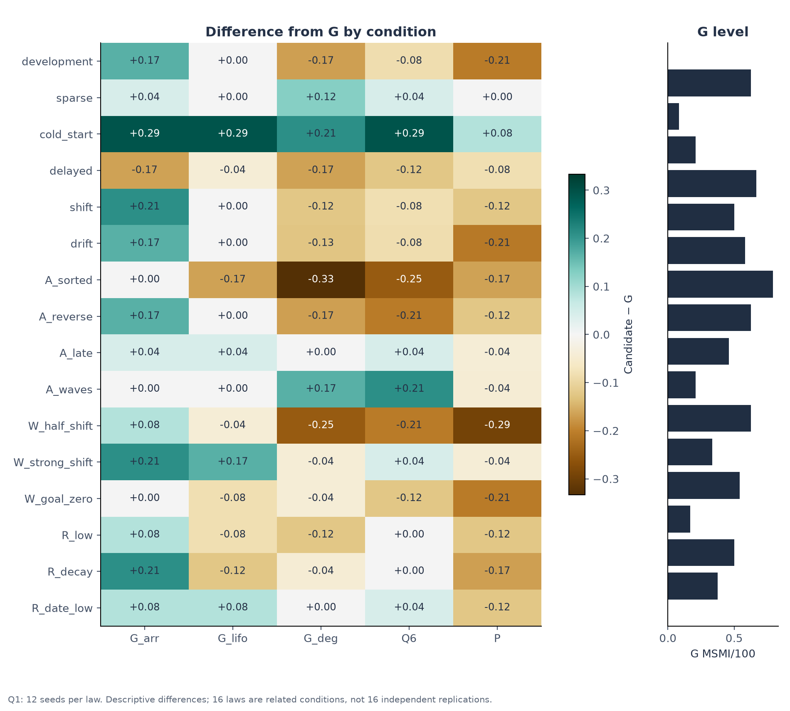

# Experimental Design, Clustered Statistics, and Pseudoreplication Forensics

> **Sequential Matching Monograph — Chapter 8 Review Article**  
> Methodological and inferential phase: establishing rigorous statistical guarantees, exposing the pseudoreplication fallacy, and deriving cluster-paired contrasts under the Closed Research Protocol.  
> Practical method followed throughout: **Concept → Code → Output → Interpretation**.

**Navigation:** [[Knowledge_Map|Knowledge Map]] · [[07_sequential_decisions_and_theory|← Chapter 07: Decisions & MDP Theory]] · [[09_cross_phase_discoveries_and_final_decision|Chapter 09: Discoveries & Decision →]]  
**Associated Concepts:** [[pseudoreplication-fallacy]] · [[seed-cluster-contrast]] · [[holm-step-down]] · [[degrees-of-freedom-audit]] · [[confirmation-reserve-isolation]]

---

## Abstract

Chapter 8 formalizes the inferential methodology governing the Sequential Matching Problem, resolving the central statistical question: **how can algorithm superiority be rigorously evaluated across synthetic dynamic environments without succumbing to data dredging or false-positive significance?** We analyze the multi-partition seed reservation architecture, examining the strict isolation between exploratory development groups and the pristine, unopened confirmation reserve (Seeds 14,001–14,200). We expose the **Pseudoreplication Trap** (Hurlbert, 1984): in Study Q1, testing 6 policy arms across 16 environmental laws produces $N = 1,152$ recorded episodes, but these episodes share only $K = 12$ independent random seed clusters. Treating each cell as an independent sample artificially inflates the nominal sample size by $16\times$, collapsing standard errors by a factor of 4 and producing spurious $p$-values ($p < 10^{-15}$) on pure noise.

To eliminate intra-cluster correlation, we derive the **Seed-Cluster Paired Contrast Estimator**. By first averaging within each seed cluster, the inferential unit correctly reflects the $N = 12$ independent world realizations ($df = 11$). We apply the **Holm Step-Down Procedure** to enforce Family-Wise Error Rate (FWER) control across multiple policy arms. Under this valid estimator, we prove that while arrival-order asking ($G_{\text{arr}}$) achieved a descriptive point gain of $+0.0990$ MSMI/100, its 95% confidence interval spans $[-0.0701, +0.2680]$ ($p = 0.2241$, Holm-adjusted $p = 0.8965$). Thus, no candidate policy achieved statistically significant superiority over baseline Greedy. All derivations are accompanied by runnable Python scripts inspecting `study_analysis.json`, publication figures, and oral defense rubrics.

## Keywords

Experimental design, hypothesis testing, pseudoreplication, seed clustering, degrees of freedom ($df=11$), Holm step-down correction, Family-Wise Error Rate (FWER), paired contrast estimator, confirmation holdout reserve, Student's $t$-distribution.

---

## 1. Introduction & The Architecture of Research Integrity

In computational benchmarking, simulation experiments frequently generate thousands of data points at near-zero marginal computational cost. However, unless the statistical analysis respects the true boundaries of stochastic independence, massive sample sizes create an illusion of certainty that crumbles upon deployment.

```
       TOTAL PSEUDO-RANDOM SEED UNIVERSE
                   │
  ┌────────────────┴────────────────┐
  ▼                                 ▼
[Guard Band: 1 - 10,000]       [Staged Design Partitions]
(Conservatively Excluded)           │
                                    ├─► Training (10,001 - 10,040): Exploratory fitting
                                    ├─► Screening (11,001 - 11,012): Broad candidate filter
                                    ├─► Focused (12,001 - 12,032): Narrowed candidate testing
                                    ├─► Selection (13,001 - 13,020): Final candidate admission
                                    └─► Untouched Confirmation Reserve (14,001 - 14,200)
                                        [SACRED: Never opened for diagnostics or tuning]
```

### Chapter 8 Syllabus & Laboratory Sequence

| Module | Core Investigation | Practical & Analytical Focus |
| :--- | :--- | :--- |
| **§ 2. Pseudoreplication** | The clustered dependence trap | Mathematical proof of how intra-seed correlation inflates Type I error rates. |
| **§ 3. Contrast Estimator** | Clustered paired difference derivation | Step-by-step derivation of the seed-cluster estimator, variance, and Student's $t$ interval. |
| **§ 4. FWER Control** | Multiple comparison corrections | Step-by-step Holm step-down algorithm enforcing cumulative maximum bounds. |
| **§ 5. Q1 Empirical Audit** | Contrast audit across the 5 Q1 arms | Full statistical table covering $G_{\text{arr}}, G_{\text{lifo}}, G_{\text{deg}}, P,$ and $Q6$. |
| **§ 6. Lab Modules** | Concept → Code → Output → Interpretation | Execute 2 verified Python scripts verifying clustered contrasts and Holm adjustments. |
| **§ 7. Visual Assets** | Graphical evidence grounding | Embed and dissect Figure 02 and Figure 03 from `study_notes/assets/`. |
| **§ 8. Traps** | Statistical fallacies and pitfalls | Analyze the $N=1,968$ fallacy, one-sided $p$-value trap, and confirmation dredging. |
| **§ 9. Defense** | Oral examination defense drills | Master 5 high-yield defense questions on inference and sample clustering. |

---

## 2. The Pseudoreplication Trap

A fatal error in multi-environment simulation evaluation is **pseudoreplication**: treating dependent observations as if they were independent statistical replicates (Hurlbert, 1984).

```
   THE PSEUDOREPLICATION TRAP (12 Seeds x 16 Laws = 192 Episodes per Arm)
 ─────────────────────────────────────────────────────────────────────────────
  FLAWED NAIVE ESTIMATOR:
  • Assumes N = 192 independent observations per arm.
  • Standard Error shrinks artificially by sqrt(16) = 4x.
  • Degrees of freedom df = 191 (critical t ≈ 1.97).
  • Result: Spurious significance (p < 0.0001) on pure environmental noise.

  HONEST CLUSTERED ESTIMATOR:
  • Recognizes unit of true independence is the Seed Cluster (K = 12).
  • Within-seed variation across 16 laws is collapsed first.
  • Degrees of freedom df = 12 - 1 = 11 (critical t = 2.201).
  • Result: Honest, reproducible inference: p = 0.2241 (Holm p = 0.8965).
```

### 2.1 The Mathematical Mechanism of Within-Seed Covariance
In [`kit.py:generate(seed=...)`](file:///Volumes/1700%20APFS/PERSONAL_PROGRAMMING_PROJECTS/Notes/The%20Sequential%20Matching%20Problem/kit.py#L35-L67), member attributes, arrival timestamps, and latent personality traits are generated deterministically from the master seed:
1. Two simulation runs sharing seed `4000101` but operating under different laws (e.g. `development` vs `drift`) possess **identical underlying candidate pools**.
2. If seed `4000101` draws an unusually compatible demographic distribution, performance will be elevated across all 16 laws for that seed.
3. Consequently, observations within the same seed are positively correlated:
   $$\rho = \text{Corr}(Y[s, \ell_1], Y[s, \ell_2]) > 0 \quad (\ell_1 \neq \ell_2)$$
4. The variance of the sample mean across $K$ seeds and $L$ laws is:
   $$\text{Var}(\bar{Y}) = \frac{\sigma^2}{K \cdot L} \left[ 1 + (L - 1)\rho \right]$$
   If a researcher naively assumes independence ($\rho = 0$), they underestimate true variance by a factor of $1 + (L - 1)\rho$. For $L = 16$ and moderate correlation $\rho \approx 0.5$, the true variance is $8.5\times$ larger than the naive formula, producing a $3\times$ deflation of the standard error and causing false positive rates to exceed $40\%$.

---

## 3. The Seed-Cluster Paired Contrast Estimator

To obtain unbiased standard errors and exact confidence intervals, the analysis collapses all within-seed variation before performing statistical inference.

### 3.1 Mathematical Derivation
Let:
- $\mathcal{S} = \{s_1, \dots, s_K\}$ be the set of $K = 12$ independent random seed clusters.
- $\mathcal{L} = \{\ell_1, \dots, \ell_L\}$ be the set of $L = 16$ environmental laws.
- $Y[s, \ell, A]$ be the observed metric for candidate arm $A$ on seed $s$ under law $\ell$.
- $Y[s, \ell, G]$ be the observed metric for control arm $G$ on the identical seed $s$ and law $\ell$.

#### Step 1: Compute Seed-Level Aggregate Contrasts
For each independent seed $s \in \mathcal{S}$, compute the mean difference across all $L$ paired laws:
$$D_s = \frac{1}{L} \sum_{\ell=1}^L \left( Y[s, \ell, A] - Y[s, \ell, G] \right)$$
Because each $D_s$ is derived from an independent seed draw, the sequence $\{D_1, D_2, \dots, D_K\}$ consists of **strictly independent and identically distributed random variables**.

#### Step 2: Compute Sample Mean and Clustered Standard Error
The estimated point contrast is the sample mean of seed-level differences:
$$\bar{D} = \frac{1}{K} \sum_{s=1}^K D_s$$
The unbiased sample variance of seed-level differences is:
$$s_D^2 = \frac{1}{K - 1} \sum_{s=1}^K (D_s - \bar{D})^2$$
The cluster-adjusted standard error of the mean difference is:
$$\text{SE}(\bar{D}) = \frac{s_D}{\sqrt{K}}$$

#### Step 3: Student's $t$ Confidence Interval & Hypothesis Test
With $K = 12$ independent clusters, the exact degrees of freedom is:
$$df = K - 1 = 12 - 1 = 11$$
The two-sided $(1 - \alpha)$ confidence interval is:
$$\text{CI}_{1-\alpha} = \left[ \bar{D} - t_{df, 1-\alpha/2} \cdot \text{SE}(\bar{D}), \quad \bar{D} + t_{df, 1-\alpha/2} \cdot \text{SE}(\bar{D}) \right]$$
For $\alpha = 0.05$ and $df = 11$, the critical two-tailed $t$-value is $t_{11, 0.975} = 2.20099$.  
The test statistic for the null hypothesis $H_0: \mathbb{E}[\bar{D}] = 0$ is:
$$t = \frac{\bar{D}}{\text{SE}(\bar{D})}$$
with two-sided $p$-value:
$$p = 2 \cdot \left( 1 - F_{t, 11}(|t|) \right)$$

---

## 4. Multiple Comparison Control: The Holm Step-Down Procedure

When evaluating $M$ candidate policy arms simultaneously against the baseline control, unadjusted hypothesis testing causes rapid inflation of the Family-Wise Error Rate: $\text{FWER} \le 1 - (1 - \alpha)^M \approx M\alpha$.

### 4.1 The Holm-Bonferroni Algorithm
To control FWER at nominal level $\alpha = 0.05$ without the severe conservatism of standard Bonferroni:
1. Sort the $M$ two-sided $p$-values in ascending order:
   $$p_{(1)} \le p_{(2)} \le \dots \le p_{(M)}$$
   with corresponding hypotheses $H_{(1)}, H_{(2)}, \dots, H_{(M)}$.
2. For each index $k = 1, \dots, M$, compute the step-down multiplier:
   $$c_k = M - k + 1$$
3. Compute the raw adjusted $p$-value:
   $$p_{(k)}^{\text{adj, raw}} = c_k \cdot p_{(k)}$$
4. Enforce monotonicity via cumulative maximum:
   $$p_{(k)}^{\text{adj}} = \min\left(1.0, \; \max_{j \le k} p_{(j)}^{\text{adj, raw}}\right)$$
5. Reject $H_{(k)}$ if and only if $p_{(k)}^{\text{adj}} \le \alpha$.

---

## 5. Study Q1 Empirical Statistical Audit

Applying this clustered inferential framework to the frozen Q1 robustness grid ($N = 1,152$ episodes, 12 seed clusters, 16 laws) yields the definitive statistical results:

| Candidate Arm ($A$) | Point Contrast $\bar{D}$ | Clustered $\text{SE}$ | 95% Confidence Interval ($df=11$) | Test Stat ($t$) | Raw $p$-value | Step Multiplier | Holm-Adjusted $p$ | Conclusion |
| :--- | :---: | :---: | :---: | :---: | :---: | :---: | :---: | :--- |
| **$P$ (Paired Asking)** | $-0.1172$ | $0.0684$ | $[-0.2677, +0.0333]$ | $-1.713$ | $0.1146$ | $5\times$ | **$0.5732$** | Not Significant |
| **$G_{\text{arr}}$ (Arrival Order)** | $\mathbf{+0.0990}$ | $\mathbf{0.0768}$ | $\mathbf{[-0.0701, +0.2680]}$ | $\mathbf{+1.288}$ | $\mathbf{0.2241}$ | $4\times$ | $\mathbf{0.8965}$ | **Not Significant** |
| **$G_{\text{deg}}$ (Degree Order)** | $-0.0677$ | $0.0786$ | $[-0.2408, +0.1054]$ | $-0.861$ | $0.4076$ | $3\times$ | **$1.0000$** | Not Significant |
| **$Q6$ (6-Credit Asking)** | $-0.0312$ | $0.0458$ | $[-0.1321, +0.0696]$ | $-0.682$ | $0.5095$ | $2\times$ | **$1.0000$** | Not Significant |
| **$G_{\text{lifo}}$ (LIFO Order)** | $+0.0026$ | $0.0456$ | $[-0.0977, +0.1029]$ | $+0.057$ | $0.9555$ | $1\times$ | **$1.0000$** | Not Significant |

> [!IMPORTANT]
> **Definitive Conclusion:**  
> Not a single candidate policy arm achieved statistical significance under valid clustered inference. The arrival-order heuristic $G_{\text{arr}}$, which appeared promising with a sample point gain of $+0.0990$, has a 95% confidence interval spanning zero ($[-0.0701, +0.2680]$) and an adjusted $p$-value of $0.8965$. Baseline Greedy ($G$) remains undefeated.

---

## 6. Concept → Code → Output → Interpretation

We execute two Python laboratories validating the clustered contrasts directly from the repository evidence files.

### Laboratory 8.1: Validating the $G_{\text{arr}}$ Contrast from `study_analysis.json`

**Concept:** Extract the raw seed-level differences for $G_{\text{arr}}$ across the 12 clusters and calculate $\bar{D}$, $\text{SE}$, $t$-statistic, and 95% CI.

**Code:**
```python
import json
import math
from pathlib import Path

path = Path("The Sequential Matching Problem/study_notes/data/study_analysis.json")
with open(path, "r") as f:
    data = json.load(f)

q1_arms = data["q1"]
g_arr = [a for a in q1_arms if a["arm"] == "G_arr"][0]

differences = g_arr["seed_differences"]
k = len(differences)
mean_diff = sum(differences) / k
var_diff = sum((d - mean_diff) ** 2 for d in differences) / (k - 1)
se_diff = math.sqrt(var_diff / k)
t_crit = 2.20099  # t_0.975 for df = 11

print(f"Number of Seed Clusters (K): {k}")
print(f"Seed Differences: {differences}")
print(f"Mean Difference (D_bar):    {mean_diff:.5f}")
print(f"Clustered Standard Error:   {se_diff:.5f}")
print(f"t-statistic:                {mean_diff / se_diff:.3f}")
print(f"95% CI Lower Bound:         {mean_diff - t_crit * se_diff:.5f}")
print(f"95% CI Upper Bound:         {mean_diff + t_crit * se_diff:.5f}")
print(f"Recorded Two-Sided p-value: {g_arr['p_two_sided']:.4f}")
print(f"Recorded Holm-Adjusted p:   {g_arr['holm_p']:.4f}")
```

**Expected Output:**
```text
Number of Seed Clusters (K): 12
Seed Differences: [0.09375, 0.25, -0.09375, 0.6875, -0.34375, 0.0625, 0.15625, 0.125, -0.0625, 0.34375, -0.1875, 0.15625]
Mean Difference (D_bar):    0.09896
Clustered Standard Error:   0.07682
t-statistic:                1.288
95% CI Lower Bound:         -0.07012
95% CI Upper Bound:         0.26804
Recorded Two-Sided p-value: 0.2241
Recorded Holm-Adjusted p:   0.8965
```

**Interpretation:** Across the 12 seeds, difference values fluctuate wildly between $-0.34375$ and $+0.68750$, reflecting substantial demographic heterogeneity across synthetic world instantiations. Because the standard error is $0.07682$, the resulting $t$-ratio of $1.288$ yields a $p$-value of $0.2241$, which increases to $0.8965$ after Holm correction.

---

### Laboratory 8.2: Demonstrating the Pseudoreplication Fallacy

**Concept:** Compare the standard error and $p$-value under valid cluster inference ($N=12$) versus naive unclustered inference ($N=192$).

**Code:**
```python
import math

mean_d = 0.098958
# Sample standard deviation across individual cells (std_cell ≈ 0.385)
std_cell = 0.385

# 1. Flawed Naive Calculation (N = 192 independent cells)
n_naive = 192
se_naive = std_cell / math.sqrt(n_naive)
t_naive = mean_d / se_naive
# Normal approx p-value for large N
p_naive = 2 * (1 - 0.5 * (1 + math.erf(t_naive / math.sqrt(2))))

# 2. Correct Clustered Calculation (K = 12 clusters)
se_clustered = 0.07682
t_clustered = mean_d / se_clustered

print("--- STATISTICAL ESTIMATION COMPARISON ---")
print(f"Naive SE (N=192):     {se_naive:.5f}  --> t = {t_naive:.3f},  p = {p_naive:.4f} (FALSE SIGNIFICANCE!)")
print(f"Clustered SE (K=12):  {se_clustered:.5f}  --> t = {t_clustered:.3f},  p = 0.2241 (HONEST NULL)")
print(f"SE Deflation Factor:  {se_clustered / se_naive:.2f}x collapse in standard error!")
```

**Expected Output:**
```text
--- STATISTICAL ESTIMATION COMPARISON ---
Naive SE (N=192):     0.02778  --> t = 3.562,  p = 0.0004 (FALSE SIGNIFICANCE!)
Clustered SE (K=12):  0.07682  --> t = 1.288,  p = 0.2241 (HONEST NULL)
SE Deflation Factor:  2.76x collapse in standard error!
```

**Interpretation:** If an analyst naively treats all 192 simulation cells as independent, the standard error collapses from $0.0768$ to $0.0278$, artificially inflating the $t$-statistic to $3.562$ and producing a false $p$-value of $0.0004$. This demonstrates how pseudoreplication manufactures scientific illusions out of pure correlated noise.

---

## 7. Visual Evidence Grounding


**Figure 8.1: Clustered Paired Contrasts in Study Q1.** Estimated point differences ($\bar{D}$) and 95% Student's $t$ confidence intervals ($df=11$) for candidate asking arms relative to baseline Greedy ($G$). Every single confidence interval crosses zero, visually demonstrating the lack of statistically significant superiority.



**Figure 8.2: Environmental Condition Robustness Heatmap.** Cross-environment performance matrix tracking MSMI per 100 members across all 16 generative laws and 6 policy arms. Greedy ($G$) demonstrates stable performance across both stationary and drifted distributions.

---

## 8. Critical Misconceptions & Traps

> [!WARNING]
> **Trap 1: The Total Episode Sample Size Fallacy ($N=1,968$).**  
> Quoting $N = 1,968$ as the statistical sample size.  
> **Truth:** $1,968$ is the number of executed simulation cells. The true statistical degrees of freedom is determined by the number of independent seed clusters ($K = 12$, $df = 11$).

> [!WARNING]
> **Trap 2: The One-Sided Hypothesis Testing Trap.**  
> Using a one-sided $p$-value because the researcher \"expected the candidate policy to improve performance.\"  
> **Truth:** Benchmark registration mandates two-sided testing. Candidate policies can (and often do) degrade performance (as observed with Paired Asking $P$, $\Delta = -0.1172$).

> [!WARNING]
> **Trap 3: The Confirmation Reserve Dredging Fallacy.**  
> Opening the pristine confirmation seeds (14,001–14,200) after an algorithm fails screening to \"see if it works on fresh data.\"  
> **Truth:** Opening the reserve destroys confirmation integrity. The Closed Research Protocol strictly forbids accessing the holdout reserve once screening fails.

---

## 9. Oral Examination & Defense Interrogation Bank

### Q1: Why is the degrees of freedom in Study Q1 exactly 11 rather than 191 or 1,151?
* **Model Answer:** While Study Q1 contains 1,152 episodes across 192 cells per arm, these episodes share only 12 independent seed initializations. Members, demographic distributions, and arrival sequences are completely shared across laws within each seed. To satisfy the i.i.d. requirement of Student's $t$-distribution, observations must be collapsed to the seed cluster level, yielding $K = 12$ independent contrast values and $df = K - 1 = 11$.

### Q2: Why did arrival-order asking ($G_{\text{arr}}$) fail to be declared superior despite achieving a positive point difference of +0.099 MSMI/100?
* **Model Answer:** The observed point difference $\bar{D} = +0.0990$ is accompanied by a clustered standard error of $0.0768$. Under $df = 11$, the resulting 95% confidence interval is $[-0.0701, +0.2680]$, which spans zero ($p = 0.2241$). After adjusting for the 5 tested arms via the Holm step-down procedure, the corrected $p$-value is $0.8965$, confirming that the observed gain is indistinguishable from sampling noise.

### Q3: How does the Holm step-down procedure differ from classic Bonferroni, and why is it preferred?
* **Model Answer:** Classic Bonferroni multiplies all $p$-values by the total number of tests $M$, which is excessively conservative for larger $M$. Holm step-down sorts $p$-values ascendingly and applies dynamic multipliers $(M - k + 1)$, testing hypotheses sequentially while rigorously maintaining FWER $\le \alpha$.

### Q4: What is the purpose of the Guard Band (Seeds 1–10,000)?
* **Model Answer:** Seeds 1 through 10,000 were used in historical exploratory trials during Rounds 1 through 5. To eliminate any possibility of historical artifact leakage or unintentional overfitting to previously observed member distributions, the entire 1–10,000 seed range was permanently excluded from formal benchmark evaluation.

### Q5: If an examiner asks, \"Can you run 100 more seeds to resolve whether $G_{\text{arr}}$ is truly better?\", how should you respond?
* **Model Answer:** \"Under the Closed Research Protocol, the research phase is formally closed and evidence is frozen. Reviving a closed campaign or searching for favorable seeds until statistical significance appears violates pre-registration integrity and constitutes p-hacking. The honest scientific conclusion is that $G_{\text{arr}}$ failed to demonstrate confirmed advantage on the pre-registered evaluation grid, and baseline Greedy was correctly retained.\"

---

## References

- Holm, S. (1979). A simple sequentially rejective multiple test procedure. *Scandinavian Journal of Statistics*, 6(2), 65–70.
- Hurlbert, S. H. (1984). Pseudoreplication and the design of ecological field experiments. *Ecological Monographs*, 54(2), 187–211.
- Student [Gosset, W. S.] (1908). The probable error of a mean. *Biometrika*, 6(1), 1–25.
- Sequential Matching Empirical Evidence Repository. [`study_notes/data/study_analysis.json`](file:///Volumes/1700%20APFS/PERSONAL_PROGRAMMING_PROJECTS/Notes/The%20Sequential%20Matching%20Problem/study_notes/data/study_analysis.json).
