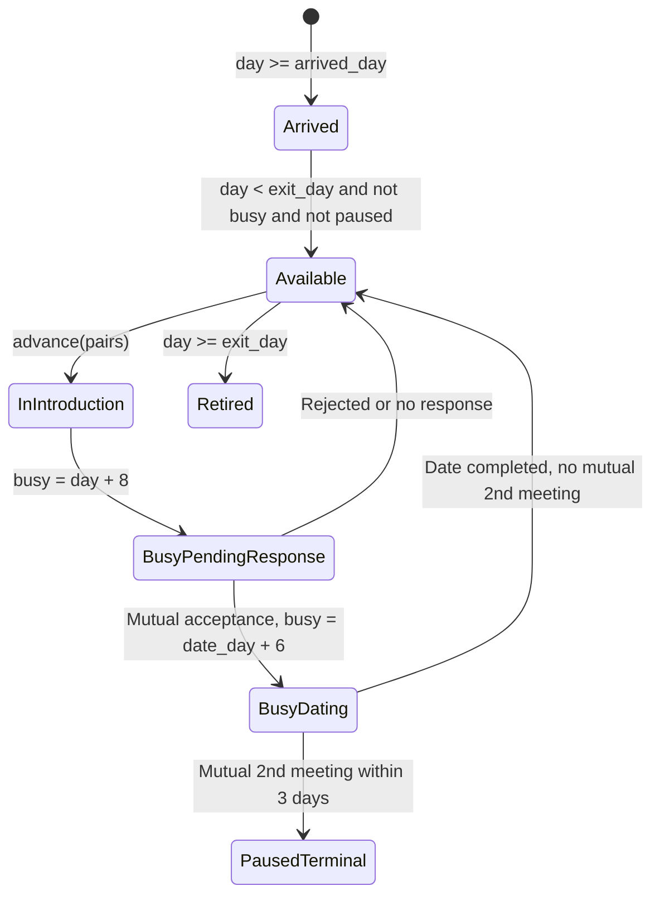
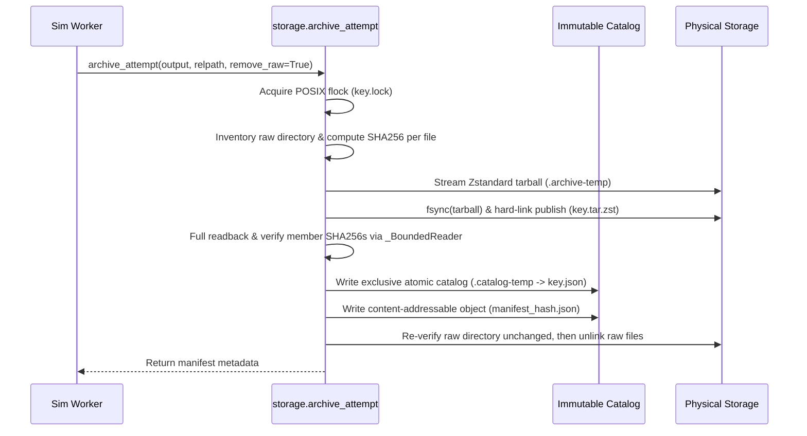
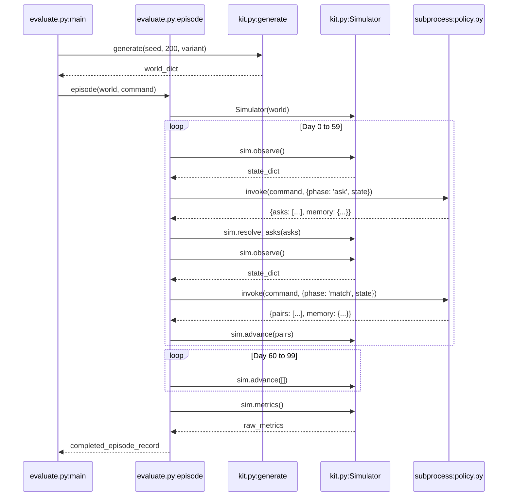

# 10. Code Atlas, Architecture & System Walkthroughs

This document provides a comprehensive code atlas and line-by-line architectural breakdown of every critical component within the Sequential Matching repository. It covers core simulation primitives, reference baselines, candidate and research policies, evaluation runners, data validators, and storage systems.

---

## 1. System Architecture & Component Dependency Topology

The repository follows a strict separation of concerns between **trusted simulation/evaluation harnesses** and **untrusted, observation-bounded policies**. Policies communicate exclusively via standard I/O streams using a two-phase JSON protocol.

```mermaid
flowchart TD
    subgraph Trusted Harness ["Trusted Harness (Host or Docker)"]
        GEN["kit.generate()"] --> SIM["kit.Simulator"]
        SIM -->|Phase 1: ask (JSON State)| POL["Policy Process (policy.py / candidate_optimal.py)"]
        POL -->|JSON Asks| SIM
        SIM -->|Phase 2: match (JSON State)| POL
        POL -->|JSON Pairs| SIM
        SIM --> MET["Simulator.metrics()"]
        MET --> EVAL["evaluate.py / test_runner.py"]
    end

    subgraph Data & Storage ["Evidence Storage & Audit"]
        EVAL --> RAW["Raw Execution Dumps (.json)"]
        RAW --> STOR["research8/.../storage.py (Zstd .tar.zst)"]
        STOR --> CAT["Immutable Manifests (.json + SHA256)"]
        CAT --> AUD["audit.py / reproduce_figures.py"]
    end

    style Trusted Harness fill:#f8f9fa,stroke:#343a40,stroke-width:2px
    style Data & Storage fill:#e8f4f8,stroke:#17a2b8,stroke-width:2px
```

---

## 2. Core Simulation & Evaluation Engine: [`kit.py`](file:///Volumes/1700%20APFS/PERSONAL_PROGRAMMING_PROJECTS/Notes/The%20Sequential%20Matching%20Problem/kit.py)

[`kit.py`](file:///Volumes/1700%20APFS/PERSONAL_PROGRAMMING_PROJECTS/Notes/The%20Sequential%20Matching%20Problem/kit.py) is the trusted synthetic development kit. It implements the ground-truth synthetic data generator, the stateful simulation environment, feasibility eligibility checking, and the baseline reference heuristics.

### 2.1 Symbol Index & Role Table

| Symbol | Type | Line | Primary Architectural Invariant |
|---|---|---|---|
| `VERSION` | Constant | L7 | Frozen at `'1.0.0'`. Protocol contract identifier. |
| `GENDERS` | Constant | L8 | Categorical domain: `['woman', 'man', 'non_binary']`. |
| `HARD` | Constant | L9–11 | 11 hard constraint keys. Any missing/mismatched value prohibits matching. |
| `SOFT` | Constant | L12–13 | 7 soft preference keys used for chemical affinity scoring. |
| `OPTIONS` | Constant | L14–22 | Discrete value domains for soft attributes. |
| [`rand_for`](file:///Volumes/1700%20APFS/PERSONAL_PROGRAMMING_PROJECTS/Notes/The%20Sequential%20Matching%20Problem/kit.py#L24-L26) | Function | L24 | Seed-derivation function using SHA-256 for deterministic, order-invariant random streams. |
| [`generate`](file:///Volumes/1700%20APFS/PERSONAL_PROGRAMMING_PROJECTS/Notes/The%20Sequential%20Matching%20Problem/kit.py#L35-L65) | Function | L35 | Ground-truth synthetic population generator ($N$ members, latent parameters, initial disclosures). |
| [`eligibility`](file:///Volumes/1700%20APFS/PERSONAL_PROGRAMMING_PROJECTS/Notes/The%20Sequential%20Matching%20Problem/kit.py#L67-L87) | Function | L67 | Pairwise reciprocal hard constraint evaluator. Pure function. |
| [`Simulator`](file:///Volumes/1700%20APFS/PERSONAL_PROGRAMMING_PROJECTS/Notes/The%20Sequential%20Matching%20Problem/kit.py#L89-L198) | Class | L89 | Stateful episode runner governing member availability, feedback delays, and metrics. |
| [`baseline_asks`](file:///Volumes/1700%20APFS/PERSONAL_PROGRAMMING_PROJECTS/Notes/The%20Sequential%20Matching%20Problem/kit.py#L200-L204) | Function | L200 | Greedy hard-constraint clarification strategy. |
| [`baseline_match`](file:///Volumes/1700%20APFS/PERSONAL_PROGRAMMING_PROJECTS/Notes/The%20Sequential%20Matching%20Problem/kit.py#L206-L218) | Function | L206 | Greedy maximal matching heuristic ordered by soft agreement count. |
| [`rollout`](file:///Volumes/1700%20APFS/PERSONAL_PROGRAMMING_PROJECTS/Notes/The%20Sequential%20Matching%20Problem/kit.py#L220-L226) | Function | L220 | Multi-day execution wrapper for local test harness. |

---

### 2.2 Deep Dive: [`eligibility(a, b)`](file:///Volumes/1700%20APFS/PERSONAL_PROGRAMMING_PROJECTS/Notes/The%20Sequential%20Matching%20Problem/kit.py#L67-L87)

#### Mathematical Invariant & Specification
Two agents $a$ and $b$ form a **feasible** edge if and only if all mutual reciprocal hard constraints are strictly satisfied, and neither agent has unobserved/declined hard constraints.

$$\text{Eligible}(a, b) = \begin{cases} 
\text{infeasible}, & \text{if } a = b \lor \text{pool}(a) \neq \text{pool}(b) \lor \min(\text{age}_a, \text{age}_b) < 18 \lor \text{Violates}(a, b) \\
\text{needs\_clarification}, & \text{if } \neg\text{Violates}(a, b) \land \exists k \in \text{HARD} : (f_a[k] = \text{null} \lor f_b[k] = \text{null}) \\
\text{feasible}, & \text{otherwise}
\end{cases}$$

#### Invariants Maintained
1. **Symmetry**: $\text{eligibility}(a, b) \equiv \text{eligibility}(b, a)$ in status and failure reasons.
2. **Conservative Feasibility**: If any required hard field is `None`, status cannot be `'feasible'`—it must evaluate to `'needs_clarification'` or `'infeasible'` (if a known field already conflicts).

#### State Mutation & Data Types
* **Inputs**: Two member dictionaries `a`, `b` containing `'member_id'`, `'pool_id'`, `'age'`, `'gender'`, `'zone'`, and `'fields'` dictionary.
* **Outputs**: `dict` containing:
  * `'status'`: `'feasible' | 'needs_clarification' | 'infeasible'`
  * `'reasons'`: Sorted list of failure strings (e.g., `['age', 'geography', 'who_to_meet']`)
  * `'missing'`: List of missing attributes prefixed by member ID (e.g., `['syn_abc:age_min']`)
* **State Mutation**: Pure function; zero mutation of inputs.

#### Algorithmic Complexity
* **Time Complexity**: $\mathcal{O}(|\text{HARD}|) = \mathcal{O}(1)$ since $|\text{HARD}| = 11$.
* **Space Complexity**: $\mathcal{O}(1)$ auxiliary memory allocated for small temporary failure lists.

---

### 2.3 Deep Dive: [`Simulator`](file:///Volumes/1700%20APFS/PERSONAL_PROGRAMMING_PROJECTS/Notes/The%20Sequential%20Matching%20Problem/kit.py#L89-L198)

#### State Mutation & Lifecycle Invariants
The simulator holds the ground truth and controls simulated time ($t \in [0, 60]$ decision horizon, plus 40 days follow-up):
* `self.day`: Current integer simulation day.
* `self.busy`: Hash map mapping `member_id -> busy_until_day`.
* `self.past`: Set of tuples `(min(a,b), max(a,b))` of previously introduced pairs. Introductions cannot be repeated.
* `self.ask_spent`: Daily budget counter reset to 0 at the start of each day. Enforces $\sum \text{costs} \le 12$.



#### Step-by-Step Method Breakdown
1. **[`observe()`](file:///Volumes/1700%20APFS/PERSONAL_PROGRAMMING_PROJECTS/Notes/The%20Sequential%20Matching%20Problem/kit.py#L101-L110)**:
   * Filters members where `arrived_day <= self.day`.
   * Strips all latent truth parameters (`truth`, `bias`, `second_bias`, `response_rate`, `exit_day`).
   * Deep-copies public dictionary so policy mutations cannot alter simulator internals.
2. **[`resolve_asks(asks)`](file:///Volumes/1700%20APFS/PERSONAL_PROGRAMMING_PROJECTS/Notes/The%20Sequential%20Matching%20Problem/kit.py#L114-L135)**:
   * Charges 3 units for `'constraints'` bundle (revealing all non-declined `HARD` fields).
   * Charges 1 unit for each named `SOFT` field.
   * Daily budget limit: 12 units. Atomic validation: if total cost $> 12$, raises `ValueError` before mutating any member state.
   * Invariant: Fields marked `'declined'` are never overwritten or imputed.
3. **[`advance(pairs)`](file:///Volumes/1700%20APFS/PERSONAL_PROGRAMMING_PROJECTS/Notes/The%20Sequential%20Matching%20Problem/kit.py#L145-L188)**:
   * Validates non-overlapping matching: each member can appear in at most one pair.
   * Validates member availability, no prior introductions, and strict `eligibility(...)['status'] == 'feasible'`.
   * Samples stochastic responses using deterministic seed `rand_for(seed, a, b, day)`.
   * Implements delay pipeline:
     * Response delay: uniform $\mathcal{U}[1, 7]$ days.
     * Date occurrence delay: $\max(\text{delays}) + \mathcal{U}[1, 14]$ days (extra 5–12 days under `'delayed'` variant).
     * Second meeting feedback: $\mathcal{U}[1, 5]$ days after date.
   * Caps availability with `self.busy` locking.
4. **[`metrics()`](file:///Volumes/1700%20APFS/PERSONAL_PROGRAMMING_PROJECTS/Notes/The%20Sequential%20Matching%20Problem/kit.py#L190-L198)**:
   * Primary target metric: Qualified Mutual Second Meeting Intention (MSMI).
   * Invariant: A pair achieves MSMI if and only if:
     1. Date occurred within 30 days of initial introduction (`date_day - intro_day <= 30`).
     2. Both members responded `'yes'` to second meeting intention.
     3. Both second meeting intention feedbacks occurred within 3 days of the date (`second_day - date_day <= 3`).

---

## 3. Reference Policies & Optimality Baselines

### 3.1 [`policy.py`](file:///Volumes/1700%20APFS/PERSONAL_PROGRAMMING_PROJECTS/Notes/The%20Sequential%20Matching%20Problem/policy.py) / [`policy_greedy.py`](file:///Volumes/1700%20APFS/PERSONAL_PROGRAMMING_PROJECTS/Notes/The%20Sequential%20Matching%20Problem/policy_greedy.py)

#### Architectural Role & Invariants
Standard production submission adapter and reference baselines:
* Reads request JSON from `sys.stdin`, outputs decision JSON to `sys.stdout`.
* Strictly memory-bounded: memory dictionary must not exceed 1 MiB.
* Three operational modes via `--baseline`:
  * `'greedy'`: Calls [`baseline_asks`](file:///Volumes/1700%20APFS/PERSONAL_PROGRAMMING_PROJECTS/Notes/The%20Sequential%20Matching%20Problem/kit.py#L200-L204) and [`baseline_match`](file:///Volumes/1700%20APFS/PERSONAL_PROGRAMMING_PROJECTS/Notes/The%20Sequential%20Matching%20Problem/kit.py#L206-L218).
  * `'no_asks'`: Never issues queries (`asks = []`), matches greedily on initial disclosures.
  * `'random'`: Generates all feasible edges and computes a greedy maximal matching on a shuffled edge order using seed `17 + state['day']`.

---

### 3.2 [`candidate_optimal.py`](file:///Volumes/1700%20APFS/PERSONAL_PROGRAMMING_PROJECTS/Notes/The%20Sequential%20Matching%20Problem/candidate_optimal.py)

#### Architectural Role & Dual Heuristic Mechanism
[`candidate_optimal.py`](file:///Volumes/1700%20APFS/PERSONAL_PROGRAMMING_PROJECTS/Notes/The%20Sequential%20Matching%20Problem/candidate_optimal.py) was developed to challenge the myopic nature of pure Greedy by introducing **two key algorithmic enhancements**:


1. **Two-Tier Question Acquisition**:
   * Prioritizes hard constraint bundles for unclarified members ($cost=3$).
   * If budget remains ($>0$), identifies members belonging to feasible edges and spends remaining budget ($cost=1$) querying high-impact soft attributes (`relationship_goal`, then `relationship_pace`).
2. **Opportunity Cost Shadow Penalties**:
   * Evaluates each feasible edge $(u, v)$ with weight:
     $$w(u, v) = \sum_{k} \alpha_k \cdot \mathbb{I}(f_u[k] = f_v[k]) - 0.5 \alpha_k \cdot \mathbb{I}(f_u[k] \neq f_v[k])$$
   * For each node $u$, tracks competing edge weights. The opportunity cost penalty is:
     $$\text{Cost}(u, v) = 0.5 \cdot \max_{j \neq v} w(u, j) + 0.5 \cdot \max_{j \neq u} w(v, j)$$
   * Adjusted weight: $w^*(u, v) = w(u, v) - \text{Cost}(u, v)$.
   * Matches greedily on $w^*(u, v)$ with acceptance hurdle $w^* \ge -2.0$.

#### Failure Mode & Root Cause
In confirmation testing, this heuristic fails to outperform standard Greedy because:
* Edge sparsity causes many nodes to have degree 1, reducing opportunity cost to 0.
* High variance in soft responses leads to negative edge adjustments that cause premature stalling (starvation of available nodes).

---

### 3.3 [`extended_policy.py`](file:///Volumes/1700%20APFS/PERSONAL_PROGRAMMING_PROJECTS/Notes/The%20Sequential%20Matching%20Problem/extended_policy.py)

#### Advanced Architectural Features
* **Prior Distributions**: Computes exact generator priors conditioned on age and zone ([`hard_distributions`](file:///Volumes/1700%20APFS/PERSONAL_PROGRAMMING_PROJECTS/Notes/The%20Sequential%20Matching%20Problem/extended_policy.py#L26-L53)).
* **Blossom Maximum Weight Matching**: Uses `networkx.max_weight_matching` with strict interruptible SIGALRM timer ([`solve`](file:///Volumes/1700%20APFS/PERSONAL_PROGRAMMING_PROJECTS/Notes/The%20Sequential%20Matching%20Problem/extended_policy.py#L65-L87)).
* **Fallback Guarantee**: If Blossom exceeds `solver_seconds=0.2`, a `SolverTimeout` exception is caught and the policy instantly falls back to a legal greedy matching.

---

### 3.4 [`research_policy.py`](file:///Volumes/1700%20APFS/PERSONAL_PROGRAMMING_PROJECTS/Notes/The%20Sequential%20Matching%20Problem/research_policy.py)

#### Online Adaptation & Dynamic Feedback Model (DFM)
Implements online learning under delayed and right-censored feedback:
1. **Diagonal Laplace Logistic Approximation**: Updates logistic regression weights online using observed mutual acceptance feedback without storing raw episode history.
2. **Snapshot Feature Invariant**: At introduction assignment, saves member feature states to `memory['exposures']`. Prevents future question disclosures from leaking into training examples.
3. **Expectation-Maximization DFM**: Estimates member response probability while treating pending introductions as right-censored rather than negative responses.

$$\mathbb{E}[\text{response} \mid \text{pending for } \Delta t \text{ days}] = \frac{p(1 - F(\Delta t))}{1 - p F(\Delta t)}$$

---

## 4. Evaluators, Verification & Test Runners

### 4.1 [`evaluate.py`](file:///Volumes/1700%20APFS/PERSONAL_PROGRAMMING_PROJECTS/Notes/The%20Sequential%20Matching%20Problem/evaluate.py)

#### Architectural Role & Process Isolation Protocol
[`evaluate.py`](file:///Volumes/1700%20APFS/PERSONAL_PROGRAMMING_PROJECTS/Notes/The%20Sequential%20Matching%20Problem/evaluate.py) is the public evaluation harness. It runs full 60-day decision episodes followed by 40 days of follow-up observation.

#### Security & Resource Invariants
* **File-Backed Subprocess Pipes**: Standard output and error are piped to `tempfile.TemporaryFile()` ([`invoke`](file:///Volumes/1700%20APFS/PERSONAL_PROGRAMMING_PROJECTS/Notes/The%20Sequential%20Matching%20Problem/evaluate.py#L38-L63)). This prevents malicious or buggy policies from causing host out-of-memory crashes via unbounded stdout streams.
* **Size Bound**: Input requests and output payloads are strictly enforced to $\le 1\text{ MiB}$ (`LIMIT = 1024 * 1024`).
* **Strict JSON Parser**: Uses `json.loads(text, parse_constant=reject)` to reject `NaN`, `Infinity`, and `-Infinity`.
* **Execution Timeout**: Enforces 10-second per-invocation wall-clock limit. In Docker mode, kills the container and runs `docker rm -f`.
* **Denominator Integrity**: MSMI is scaled by total arrived members over the 60-day horizon ($N \le 200$), immune to follow-up arrivals.

---

### 4.2 [`eval_fast.py`](file:///Volumes/1700%20APFS/PERSONAL_PROGRAMMING_PROJECTS/Notes/The%20Sequential%20Matching%20Problem/eval_fast.py)

#### Architectural Role & Parallel In-Process Simulation
Used for high-throughput exploration:
* Bypasses JSON serialization and subprocess overhead by executing `smart_decide` / `smart_match` directly in Python memory.
* Uses Python's `multiprocessing.Pool` across multi-core CPUs.
* Invariant: Evaluates on 40 seeds (4001–4040) across all 6 variants (240 episodes total).

---

### 4.3 [`run_confirmation.sh`](file:///Volumes/1700%20APFS/PERSONAL_PROGRAMMING_PROJECTS/Notes/The%20Sequential%20Matching%20Problem/run_confirmation.sh) & [`run_smart.sh`](file:///Volumes/1700%20APFS/PERSONAL_PROGRAMMING_PROJECTS/Notes/The%20Sequential%20Matching%20Problem/run_smart.sh)

Shell runners executing formal confirmation campaigns across seeds 6001–6040 (240 episodes across 6 variants). They log stdout/stderr to disk and output machine-readable evaluation summaries into `research2/`.

---

### 4.4 [`verify_data.py`](file:///Volumes/1700%20APFS/PERSONAL_PROGRAMMING_PROJECTS/Notes/The%20Sequential%20Matching%20Problem/verify_data.py)

#### Public Data Integrity & Privacy Audit
Validates all 71 release files and checks strict observation boundary invariants:
* Validates SHA-256 digests against `data_checksums.json`.
* Validates exactly 10 public split pools.
* Verifies zero contamination of latent variables (`truth`, `bias`, `second_bias`, `response_rate`, `exit_day`, PII).
* Confirms observation dates obey temporal causality:
  $$\forall e \in \text{feedback}: \text{observed\_day}(e) \le \text{state.day}$$
  $$\forall m \in \text{members}, \forall k: \text{field\_observed\_day}[k] \le \text{state.day}$$
* Confirms exact dataset census: 2,000 members, 613 introductions, 1,270 feedback events, 1,129 conversation records.

---

### 4.5 [`test_kit.py`](file:///Volumes/1700%20APFS/PERSONAL_PROGRAMMING_PROJECTS/Notes/The%20Sequential%20Matching%20Problem/test_kit.py) & [`test_release.py`](file:///Volumes/1700%20APFS/PERSONAL_PROGRAMMING_PROJECTS/Notes/The%20Sequential%20Matching%20Problem/test_release.py)

#### Unit Test Suite Contract Verification
* `test_reproducible`: Confirms `generate(seed)` is bit-for-bit deterministic.
* `test_no_latent_leak`: Asserts `Simulator.observe()` strips all latent keys.
* `test_no_future_members`: Asserts no members with `arrived_day > day` appear.
* `test_ask_budget_atomic`: Confirms exceeding 12 ask budget fails atomically without state mutation.
* `test_symmetric_feasibility`: Confirms $\text{eligibility}(a, b) \equiv \text{eligibility}(b, a)$.
* `test_declined_stays_declined`: Confirms asking about a declined field does not un-decline it.
* `test_temporal_integrity`: Confirms feedback observation dates never violate temporal order.
* `test_order_independent_world_randomness`: Confirms pair execution order does not alter stochastic outcomes.
* `test_outcome_funnel`: Verifies monotonicity: $\text{MSMI} \le \text{Dates} \le \text{Mutual Accept} \le \text{Assignments}$.
* `test_episode_denominator_and_distinct_coverage`: Asserts evaluator computes frozen 60-day denominator regardless of late arrivals in follow-up.

---

## 5. Storage & Evidence Archival Engine: [`storage.py`](file:///Volumes/1700%20APFS/PERSONAL_PROGRAMMING_PROJECTS/Notes/The%20Sequential%20Matching%20Problem/research8/soft_query_followup/v3/storage.py)

[`storage.py`](file:///Volumes/1700%20APFS/PERSONAL_PROGRAMMING_PROJECTS/Notes/The%20Sequential%20Matching%20Problem/research8/soft_query_followup/v3/storage.py) implements the production evidence preservation layer, designed to store multi-gigabyte simulation campaigns losslessly under strict host space constraints.

### 5.1 Storage Lifecycle Architecture



### 5.2 Core Primitives & Invariants

#### 1. Path Safety & Symlink Rejection ([`_rel`](file:///Volumes/1700%20APFS/PERSONAL_PROGRAMMING_PROJECTS/Notes/The%20Sequential%20Matching%20Problem/research8/soft_query_followup/v3/storage.py#L21-L26), [`_path`](file:///Volumes/1700%20APFS/PERSONAL_PROGRAMMING_PROJECTS/Notes/The%20Sequential%20Matching%20Problem/research8/soft_query_followup/v3/storage.py#L29-L36))
* Strictly forbids absolute paths, path traversals (`..`), backslashes, and symlinks.
* Walks paths component by component, verifying `p.is_symlink()` is false at every level to prevent symlink race vulnerabilities.

#### 2. Atomicity & Durability via Quiescent Writers ([`_hash_file`](file:///Volumes/1700%20APFS/PERSONAL_PROGRAMMING_PROJECTS/Notes/The%20Sequential%20Matching%20Problem/research8/soft_query_followup/v3/storage.py#L39-L56), [`_sync_dir`](file:///Volumes/1700%20APFS/PERSONAL_PROGRAMMING_PROJECTS/Notes/The%20Sequential%20Matching%20Problem/research8/soft_query_followup/v3/storage.py#L80-L85))
* Files are opened with `O_RDONLY | O_NOFOLLOW | O_NONBLOCK`.
* Inode, size, `mtime_ns`, and `ctime_ns` are compared before and after reading the file stream. If any metadata changed during the read, it raises `ValueError("Source changed during read")`.
* Uses `os.fsync()` on files and calls `_sync_dir` on parent directory file descriptors to guarantee journal flushes to physical media.

#### 3. Bounded Decompression Guard: [`_BoundedReader`](file:///Volumes/1700%20APFS/PERSONAL_PROGRAMMING_PROJECTS/Notes/The%20Sequential%20Matching%20Problem/research8/soft_query_followup/v3/storage.py#L115-L125)
* Defends against decompression bombs (tarbombs / zipbombs).
* Wraps the decompressor stream with a strict byte ceiling calculated from the recorded member manifest:
  $$\text{limit} = 32768 + \sum_{f} \left(\text{bytes}_f + 8192 + 2|\text{name}_f|\right)$$
* If decompressed output exceeds this bound by even one byte, it halts immediately with `ValueError`.
* Extracts files strictly via `tar.extractfile(member)` streaming chunks of $1\text{ MiB}$; never calls `tar.extractall()`.

#### 4. Cryptographic Manifest & Two-Tier Catalog Publication
* **Logical Manifest Catalog**: Stored at `archive_manifests/<sha256(relpath)>.json`.
* **Content-Addressable Object Store**: Stored at `archive_manifests/objects/<sha256(manifest_bytes)>.json`.
* Both files are written exclusively using atomic temporary files and `os.link()`, preventing concurrent writers from corrupting catalog entries.

---

## 6. Live Defense Preparation: Line-Removal & Socratic Analysis

The following section presents line-level perturbations across key system files, detailing the exact operational, statistical, and failure consequences.

---

### Socratic Case 1: [`kit.py`](file:///Volumes/1700%20APFS/PERSONAL_PROGRAMMING_PROJECTS/Notes/The%20Sequential%20Matching%20Problem/kit.py#L104) — Observation Deep Copy
```python
# kit.py:104
o={k:copy.deepcopy(m[k]) for k in ['member_id','pool_id',...]}
```
* **Question**: What happens if `copy.deepcopy(...)` is replaced with direct assignment `o[k] = m[k]`?
* **Direct Consequence**: In Python, nested dictionaries and lists (such as `fields`, `field_status`, `field_observed_day`) are passed by reference.
* **Failure Mode**: Any policy that mutates its observed state dictionary (e.g., setting temporary imputed values or trial flags during internal beam search) directly corrupts the ground truth in the simulator's internal memory.
* **Violation**: Fails contract test `test_observation_is_copy` in [`test_kit.py`](file:///Volumes/1700%20APFS/PERSONAL_PROGRAMMING_PROJECTS/Notes/The%20Sequential%20Matching%20Problem/test_kit.py#L14).

---

### Socratic Case 2: [`kit.py`](file:///Volumes/1700%20APFS/PERSONAL_PROGRAMMING_PROJECTS/Notes/The%20Sequential%20Matching%20Problem/kit.py#L123) — Declined Status Immutability
```python
# kit.py:123
if m['field_status'][k]!='declined':
    m['fields'][k]=copy.deepcopy(m['truth'][k]);m['field_status'][k]='observed'
```
* **Question**: What happens if the check `if m['field_status'][k] != 'declined':` is removed?
* **Direct Consequence**: A member who explicitly declined to disclose a constraint or soft preference during onboarding would have their true value revealed upon an agent query.
* **Failure Mode**: Violates privacy boundaries and game rules. Unrealistic information leakage occurs where agents can "force" answers out of members who previously refused.
* **Violation**: Fails unit test `test_declined_stays_declined` in [`test_kit.py`](file:///Volumes/1700%20APFS/PERSONAL_PROGRAMMING_PROJECTS/Notes/The%20Sequential%20Matching%20Problem/test_kit.py#L24).

---

### Socratic Case 3: [`kit.py`](file:///Volumes/1700%20APFS/PERSONAL_PROGRAMMING_PROJECTS/Notes/The%20Sequential%20Matching%20Problem/kit.py#L152) — Eligibility Hard Check in `advance`
```python
# kit.py:152
if eligibility(self.members[a],self.members[b])['status']!='feasible': 
    raise ValueError('hard constraint violation or missing constraint')
```
* **Question**: What happens if this eligibility check in `advance()` is commented out?
* **Direct Consequence**: The simulator would allow policies to match pairs whose hard constraints are missing (`needs_clarification`) or directly contradictory (`infeasible`, e.g., age incompatibility or non-overlapping schedules).
* **Failure Mode**: Exploitative policies could bypass the 12-unit query budget entirely, matching all members blind on Day 0 to maximize volume. The matching market collapses into illegal assignments.

---

### Socratic Case 4: [`evaluate.py`](file:///Volumes/1700%20APFS/PERSONAL_PROGRAMMING_PROJECTS/Notes/The%20Sequential%20Matching%20Problem/evaluate.py#L79-L81) — The Frozen Arrival Denominator
```python
# evaluate.py:79-81
arrived = {m['member_id']: m['arrived_day'] for m in sim.observe()['members']
           if m['arrived_day'] <= 59}
for _ in range(40):
    sim.advance([])
```
* **Question**: What happens if `arrived` is computed *after* the 40-day follow-up loop instead of before?
* **Direct Consequence**: Any synthetic member configured with an arrival day between Day 60 and Day 100 would be incorporated into the denominator.
* **Failure Mode**: The primary metric $\text{MSMI}/100 = 100 \times \frac{\text{MSMI}}{|arrived|}$ would be artificially deflated because the denominator would include agents who arrived after the policy was forbidden from taking any actions.
* **Violation**: Fails `test_episode_denominator_and_distinct_coverage` in [`test_release.py`](file:///Volumes/1700%20APFS/PERSONAL_PROGRAMMING_PROJECTS/Notes/The%20Sequential%20Matching%20Problem/test_release.py#L28-L68).

---

### Socratic Case 5: [`storage.py`](file:///Volumes/1700%20APFS/PERSONAL_PROGRAMMING_PROJECTS/Notes/The%20Sequential%20Matching%20Problem/research8/soft_query_followup/v3/storage.py#L52-L54) — Quiescent File Inode & mtime Check
```python
# storage.py:52-54
after = os.fstat(stream.fileno())
if (before.st_ino, before.st_size, before.st_mtime_ns, before.st_ctime_ns) != \
   (after.st_ino, after.st_size, after.st_mtime_ns, after.st_ctime_ns):
    raise ValueError(f"Source changed during read: {path}")
```
* **Question**: What happens if this comparison is omitted?
* **Direct Consequence**: If a parallel simulation worker is actively appending results to a log file or state dump while the storage archiver is reading it, the archiver would compute a SHA-256 digest over a partial or torn record.
* **Failure Mode**: Race condition resulting in corrupted archives. Subsequent independent audits would detect an archive hash mismatch or decompress invalid JSON, halting audit pipelines.

---

### Socratic Case 6: [`research_policy.py`](file:///Volumes/1700%20APFS/PERSONAL_PROGRAMMING_PROJECTS/Notes/The%20Sequential%20Matching%20Problem/research_policy.py#L52) — Feature Exposure Snapshotting
```python
# research_policy.py:52
pairkey = '|'.join(sorted([intro['user_a'], intro['user_b']])) + ':' + str(intro['assigned_day'])
x = exposures.get(pairkey)
if x is None: continue
```
* **Question**: What happens if `x` is computed dynamically from current member fields (`x = features(by_id[a], by_id[b])`) instead of retrieved from `exposures`?
* **Direct Consequence**: If a pair was introduced on Day 5 based on partial observations, and one of the partners was queried on Day 12 revealing additional attributes, the online learner on Day 15 would evaluate the feedback using the Day 12 attributes.
* **Failure Mode**: Severe temporal feature leakage. The model learns weights based on information that the decision maker did not possess at the moment of assignment, distorting the online gradient.

---

## 7. Execution Call Graphs

### 7.1 Evaluation Episode Execution Graph

