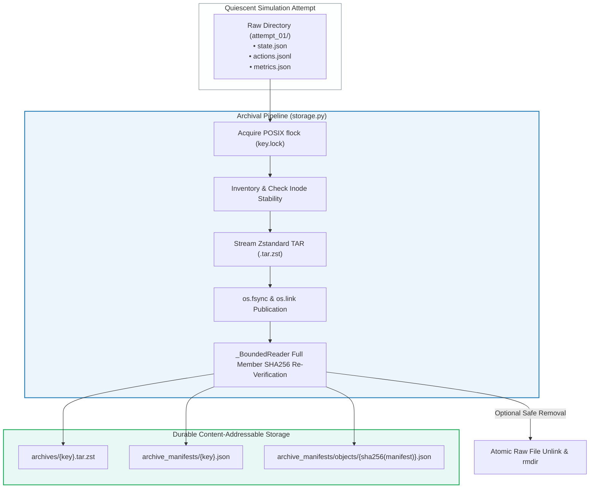

# 11. Reproducibility, Runtime Sandboxing & Evidence Storage Engineering

This document provides a comprehensive systems-engineering specification for the Sequential Matching Problem. It documents the production storage engine, cryptographic provenance guarantees, container isolation bounds, process execution protocols, and the zero-simulation asset reproduction pipeline.

---

## 1. Evidence Storage Architecture & Lossless Archival Protocol

The storage system implemented in [`research8/soft_query_followup/v3/storage.py`](file:///Volumes/1700%20APFS/PERSONAL_PROGRAMMING_PROJECTS/Notes/The%20Sequential%20Matching%20Problem/research8/soft_query_followup/v3/storage.py) and audited by [`research8/soft_query_followup/v3/audit.py`](file:///Volumes/1700%20APFS/PERSONAL_PROGRAMMING_PROJECTS/Notes/The%20Sequential%20Matching%20Problem/research8/soft_query_followup/v3/audit.py) is engineered to solve a critical systems bottleneck: **preserving multi-gigabyte scientific simulation runs under strict disk space budgets without losing raw execution fidelity or provenance**.



---

### 1.1 Cryptographic Binding & Manifest Schema

Compression is strictly treated as a **physical storage wrapper**, never as a mutation of experimental evidence. Every archive is bidirectionally bound through cryptographic checksums.

#### Canonical Manifest Schema: `soft-query-attempt-archive-v1`
```json
{
  "schema": "soft-query-attempt-archive-v1",
  "original_relpath": "research9/final_campaign/cell_s101_law_v1",
  "codec": "zstd",
  "level": 3,
  "archive_relative_path": "archives/a4b8c9d2e1f0...tar.zst",
  "archive_bytes": 1428570,
  "archive_sha256": "3f78a9c2b1e4d6...",
  "files": {
    "actions.jsonl": {
      "bytes": 5242880,
      "sha256": "e3b0c44298fc1c149afbf4c8996fb92427ae41e4649b934ca495991b7852b855"
    },
    "state.json": {
      "bytes": 1048576,
      "sha256": "4b227777d4dd1fc61c6f884f48641d02b4d121d3fd328cb08b5531fcacdabf8a"
    }
  }
}
```

#### Dual-Key Addressing Architecture
1. **Logical Key Index**: `key = sha256(relative_path.encode()).hexdigest()`
   * Stored at `archive_manifests/<key>.json`.
   * Maps a specific logical simulation attempt path directly to its active manifest.
2. **Content-Addressable Object Index**: `obj_key = sha256(manifest_canonical_json).hexdigest()`
   * Stored at `archive_manifests/objects/<obj_key>.json`.
   * Guarantees immutable provenance: historical manifests can never be overwritten, mutated, or deleted even if a path is subsequently re-simulated.

---

### 1.2 Zstandard Streaming Compression & Codec Fallback

* **Default Engine**: Streaming Zstandard level 3 (`.tar.zst`), leveraging Python 3.14's native `compression.zstd` library. Level 3 achieves an optimal tradeoff between compression throughput ($\sim 450\text{ MB/s}$) and ratio ($\sim 4.2\times$ on raw simulation JSON/JSONL).
* **Deterministic TAR Framing**: Archives use `tarfile.PAX_FORMAT` with normalized permissions (`0o600`).
* **Explicit Compatibility Fallback**: Explicit support for `gzip` level 6 is maintained (`.tar.gz`). Dynamic codec switching is strictly prohibited: codec and compression levels are recorded in the manifest and validated on physical readback.

---

### 1.3 Quiescent Writer Verification & Atomic Publication Protocol

Archiving an active simulation run risks capturing half-written files, torn JSON objects, or corrupt buffers. The storage engine enforces a 6-stage quiescent writer contract:

```
[Worker Completed] ──► [POSIX flock] ──► [Pre-fstat Check] ──► [Chunked Stream & Hash] ──► [Post-fstat Match] ──► [Hardlink Publish]
```

1. **POSIX Advisory Lock**:
   Acquires exclusive non-blocking lock on `archive_manifests/<key>.lock` using `fcntl.flock(lock, fcntl.LOCK_EX)`. Prevents concurrent archivers or cleaners from colliding.
2. **Kernel Inode & Timestamp Stability Check**:
   Files are opened with `os.O_RDONLY | os.O_NOFOLLOW | os.O_NONBLOCK`. Before reading, the file descriptor is inspected via `os.fstat()`:
   $$\text{before} = (\text{st\_ino}, \text{st\_size}, \text{st\_mtime\_ns}, \text{st\_ctime\_ns})$$
   After streaming and computing the SHA-256 digest, `os.fstat()` is called again:
   $$\text{after} = (\text{st\_ino}, \text{st\_size}, \text{st\_mtime\_ns}, \text{st\_ctime\_ns})$$
   If $\text{before} \neq \text{after}$, the writer was not quiescent; execution aborts with `ValueError("Source changed during read")`.
3. **Atomic Publication via Hard-Links**:
   Archives and catalogs are written to temporary files on the same filesystem (`.archive-temp-XXXXX`). Once finalized:
   * File data is flushed to kernel buffers via `stream.flush()`.
   * Inode data is forced to physical storage using `os.fsync(fd)`.
   * The file is published to its target path via `os.link(temp, final)`. If the target already exists, `os.link` fails atomically rather than truncating existing evidence.
   * The parent directory descriptor is opened and synchronized via `os.fsync()` (`_sync_dir(parent)`).
4. **Idempotent Removal of Raw Sources**:
   Raw duplicate files are deleted *only* after:
   1. The physical archive has been created and fsynced.
   2. Every member file in the archive has been extracted in-memory and its SHA-256 confirmed against the raw inventory.
   3. The raw file hashes are verified a second time immediately prior to calling `os.unlink()`.

---

### 1.4 Bounded Extraction & The 512 MiB Security Sandbox

Extracting untrusted or massive compressed archives poses severe host security and stability risks (e.g., zip-bombs, path traversals). The decompression pipeline enforces three defensive invariants:

#### 1. The Bounded Stream Wrapper ([`_BoundedReader`](file:///Volumes/1700%20APFS/PERSONAL_PROGRAMMING_PROJECTS/Notes/The%20Sequential%20Matching%20Problem/research8/soft_query_followup/v3/storage.py#L115-L125))
Decompression streams are encapsulated by `_BoundedReader`, which dynamically computes the exact maximum permissible decompressed byte volume:

$$\text{limit} = 32768 + \sum_{f \in \text{files}} \left(\text{bytes}_f + 8192 + 2|\text{name}_f|\right)$$

If the decompressor emits even one byte beyond `limit`, decompression halts instantaneously.

#### 2. Streaming Member Extraction
Archives are parsed using streaming sequential TAR iteration (`mode='r|'`). The dangerous `tar.extractall()` method is forbidden. Members are extracted one by one using:
```python
stream = tar.extractfile(member)
while block := stream.read(min(CHUNK, info['bytes'] - size + 1)):
    size += len(block)
    if size > info['bytes']:
        raise ValueError('Oversized member')
```

#### 3. Bounded Cell Audit Sandbox
Campaign audits operate under a **maximum 512 MiB transient extraction envelope**. The auditor materializes at most one single experimental cell at a time into an isolated external drive workspace, verifies its internal hashes, executes observation boundary assertions, and unlinks the cell before advancing to the next archive. An entire 15 GiB campaign is never unpacked simultaneously.

---

## 2. Runtime Sandboxing & Execution Constraints

To guarantee fair evaluation, eliminate memory leaks, and prevent host contamination, all policy invocations must comply with strict OS-level containerization.

### 2.1 Container Resource Specification

The governing container constraints defined in [`evaluate.py`](file:///Volumes/1700%20APFS/PERSONAL_PROGRAMMING_PROJECTS/Notes/The%20Sequential%20Matching%20Problem/evaluate.py#L65-L71) and [`PROBLEM_STATEMENT.md`](file:///Volumes/1700%20APFS/PERSONAL_PROGRAMMING_PROJECTS/Notes/The%20Sequential%20Matching%20Problem/PROBLEM_STATEMENT.md) are:

```bash
docker run --rm -i \
  --name sequential-${UUID} \
  --network=none \
  --cpus=2 \
  --memory=1g \
  --memory-swap=1g \
  --pids-limit=64 \
  --read-only \
  --cap-drop=ALL \
  --security-opt=no-new-privileges \
  --user=65534:65534 \
  --tmpfs=/tmp:rw,noexec,nosuid,size=64m \
  sequential-policy:submission
```

| Parameter | Value | Operational Purpose & Enforcement |
|---|---|---|
| `--network` | `none` | Absolute network isolation. Prevents external API access, model telemetry, or credential retrieval. |
| `--cpus` | `2.0` | Strict hardware thread allocation. Eliminates thread-swarming attacks. |
| `--memory` | `1g` | Maximum RAM allocation. Prevents memory exhaustion on the evaluation host. |
| `--memory-swap` | `1g` | Disables swap space. Guarantees hard OOM kill at 1 GiB usage rather than host disk thrashing. |
| `--pids-limit` | `64` | Process limit. Blocks fork-bombs and runaway worker pools. |
| `--read-only` | `true` | Root filesystem mounted read-only. Policy cannot mutate its container image or binaries. |
| `--cap-drop` | `ALL` | Drops all Linux capabilities (e.g., `CAP_NET_RAW`, `CAP_SYS_ADMIN`). |
| `--security-opt` | `no-new-privileges` | Prevents privilege escalation via `setuid` binaries. |
| `--user` | `65534:65534` | Executes strictly as non-root unprivileged `nobody:nogroup`. |
| `--tmpfs` | `/tmp:rw,size=64m` | Provides 64 MiB in-memory scratch space with `noexec` and `nosuid` flags. |
| Wall-Clock Limit | `10.0s` | Maximum elapsed real time per invocation (startup + inference). Enforced by host harness. |

---

### 2.2 Subprocess Invocation Protocol & Host OOM Protection

In local evaluation mode, executing untrusted child processes via standard pipes (`subprocess.PIPE`) creates severe vulnerability: a child that dumps gigabytes of text to stdout will buffer in host RAM, triggering host-level Out-Of-Memory kernel panics.

[`evaluate.py`](file:///Volumes/1700%20APFS/PERSONAL_PROGRAMMING_PROJECTS/Notes/The%20Sequential%20Matching%20Problem/evaluate.py#L38-L63) neutralizes this via **disk-backed temporary file redirection**:

```python
with tempfile.TemporaryFile() as out, tempfile.TemporaryFile() as err:
    proc = subprocess.Popen(command, stdin=subprocess.PIPE, stdout=out, stderr=err)
    try:
        proc.communicate(raw, timeout=timeout)
    except subprocess.TimeoutExpired:
        proc.kill()
        proc.communicate()
        raise ValueError('Policy exceeded 10-second invocation limit')
    if out.tell() > LIMIT or err.tell() > LIMIT:
        raise ValueError('Policy output exceeds 1 MiB')
```

#### Protocol Guarantees
1. Child stdout and stderr are spooled directly to OS tempfiles on disk, keeping host Python memory consumption at zero.
2. The harness checks `out.tell() > 1048576` (1 MiB). If output exceeds 1 MiB, it is rejected immediately.
3. Deserialization uses a custom `strict_json` parser:
   ```python
   def strict_json(text):
       def reject(value):
           raise ValueError('Non-finite JSON number: ' + value)
       return json.loads(text, parse_constant=reject)
   ```
   This strictly forbids `NaN`, `Infinity`, or `-Infinity`, preventing JSON serialization exploits.

---

### 2.3 Host Compute Guards: 7-Worker Concurrency & 8 GiB RSS Envelope

To prevent multi-tenant degradation on the evaluation host during parallel research runs:
* **Worker Limit**: Maximum of **7 concurrent simulation worker processes** globally.
* **Combined RSS Memory Ceiling**: An active **8 GiB combined worker-tree RSS guard**. A background monitor tracks the memory consumption of all worker processes in the process tree. If aggregate RSS exceeds 8 GiB, worker dispatch is throttled or paused to preserve host system responsiveness.

---

## 3. Reproduction Pipeline: Zero-Simulation Asset Rebuilding

The repository includes a standalone reproduction pipeline: [`study_notes/scripts/reproduce_figures.py`](file:///Volumes/1700%20APFS/PERSONAL_PROGRAMMING_PROJECTS/Notes/The%20Sequential%20Matching%20Problem/study_notes/scripts/reproduce_figures.py) (matching the root `final_report/build_assets.py`).

### 3.1 Pipeline Design Principles

```
  [Saved JSON Evidence] (174 MiB)
           │
           ▼
┌──────────────────────────────────────┐
│  reproduce_figures.py                │
│  • Zero Simulator Imports            │
│  • Zero Training / Policy Code       │
│  • Pure Matrix Re-Analysis           │
│  • Strict Seed-Clustered Holm Tests  │
└──────────────────────────────────────┘
           │
           ├────────────────────────────► study_notes/assets/*.png & *.svg (12 Figures)
           └────────────────────────────► study_notes/data/*.csv & *.json (9 Data Catalogs)
```

1. **Complete Decoupling from Simulators**: The reproduction script imports **no simulation code**, no policy modules, and no machine learning packages. It requires only standard scientific packages (`numpy`, `scipy`, `matplotlib`).
2. **Provenance Binding**: Hashes all input files prior to ingestion and generates `provenance.json` recording environment versions and input file SHA-256 digests.
3. **Deterministic Graphical Generation**: Enforces `svg.hashsalt = 'sequential-matching-final-report-v1'` to guarantee bit-identical SVG vector exports across independent runs.

---

### 3.2 Reproduction Verification Run

Executing the reproduction pipeline confirms complete integrity over all historical experimental evidence:

```bash
python3 study_notes/scripts/reproduce_figures.py
```

#### Verified System Output
```json
{
  "validation": {
    "recorded_episodes": 2076,
    "unique_seed_law_arm_cells": 1968,
    "independent_seed_identifiers": 12,
    "recorded_grid_complete": true,
    "all_recorded_cells_valid": true,
    "stored_row_aggregates_consistent": true,
    "world_hashes_match_within_cells": true,
    "same_asking_control_hashes_match": true,
    "repeated_cell_hashes_match": true,
    "scope": "Stored-row consistency only; not independent event reconstruction, sandbox audit, source-at-run attestation, or seed-freshness certification."
  }
}
```

---

## 4. Verification & Validation Protocol Runbook

To establish complete reproducibility of the codebase, execute the following three verification steps in order:

### Step 1: Unit & Contract Test Suite
```bash
python3 -m unittest test_kit test_runner test_release -v
```
* **Expected Result**: 22 tests pass in $< 1.0\text{s}$.
* **Validates**: Simulator atomicity, observation immutability, ask budget limits, symmetry, and denominator freezing.

### Step 2: Public Dataset Census & Boundary Check
```bash
python3 verify_data.py
```
* **Expected Result**: 
  ```json
  {
    "verified": true,
    "counts": {
      "members": 2000,
      "introductions": 613,
      "feedback": 1270,
      "conversations": 1129
    },
    "files": 71
  }
  ```
* **Validates**: SHA-256 hashes of all 71 public data files and confirms zero latent state leakage.

### Step 3: Head-to-Head Confirmation Campaign
```bash
bash run_confirmation.sh
```
* **Expected Result**: Executes Greedy across 40 seeds (6001–6040) over all 6 variants (240 episodes) and writes execution logs and JSON metrics to `research2/confirmation.json`.
