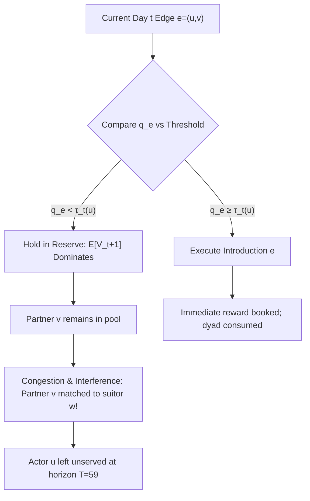
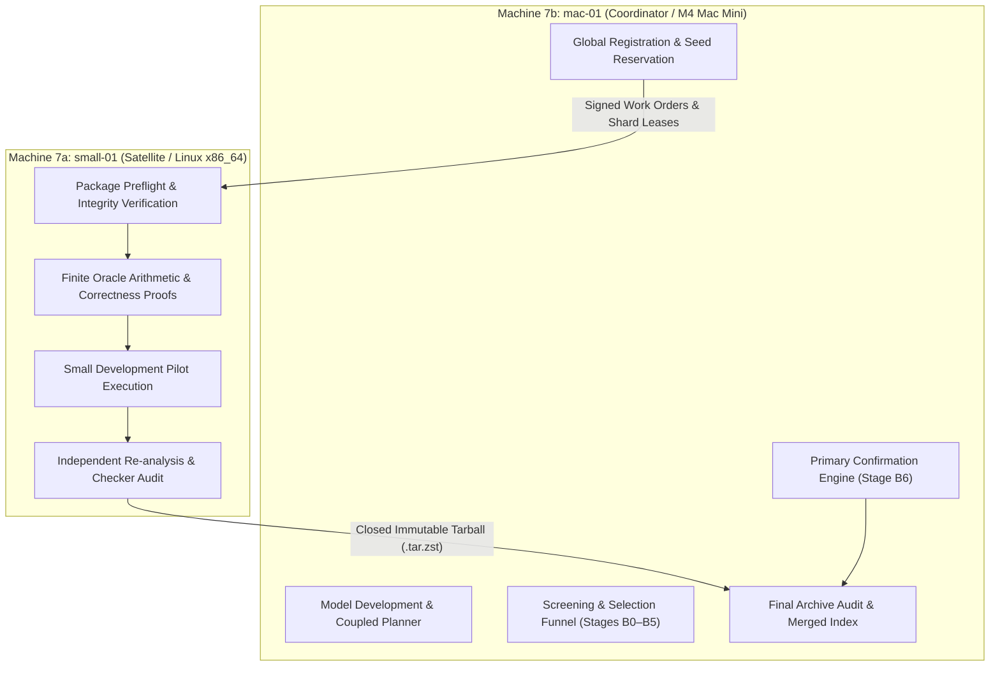

# Phase 07: Research 7 — Distributed Branching, Merge Protocols, and Reservation Theory

**Phase Identifier:** `research7` (incorporating `research7a` and `research7b`)  
**Chronological Period:** 11 October 2026 – 14 October 2026  
**Document Status:** Complete Chronicler Case Study  
**Governing Standard:** 14-Part Scientific Case-Study Anatomy  
**Base Repository Reference:** [`The Sequential Matching Problem`](file:///Volumes/1700%20APFS/PERSONAL_PROGRAMMING_PROJECTS/Notes/The%20Sequential%20Matching%20Problem)

---

## 1. Executive Summary & Core Verdict

Research 7 represents the architectural transition from single-host monolithic experiments to a **two-machine distributed research protocol**, coupled with a rigorous theoretical formulation of **reservation matching** (dynamic thresholding) and **finite-model query optimization**. Conceived in the immediate wake of Research 6's null confirmation result ($N3\_two - G = +0.0032$, $p = 0.765$ across 571 seed clusters), Research 7 established strict governance protocols to prevent premature claims of superiority, enforce simultaneous multi-baseline significance tests, and divide computational labor between a resource-constrained satellite worker (`small-01`) and an Apple Silicon coordinator (`mac-01`).

The ultimate verdict of Research 7 is twofold:
1. **Infrastructure & Execution Provenance:** The distributed execution protocol was prepared, bundled, and verified via static preflight audits (`research7a` and `research7b`), but **no full candidate simulator episodes, model fits, or confirmation runs were executed under Research 7**. The trees under `research7a/workspace/` and `research7b/workspace/` were frozen directory snapshots copied for execution handoff, not independent simulation runs.
2. **Theoretical Reservation Mathematics:** In mathematical reduction, dynamic programming proves that partner reservation (holding an edge today for a superior future match) is analytically optimal in isolated, disposable-partner search environments. However, this theoretical advantage breaks down completely in the full 200-member sequential reciprocal simulator: partner competition, dyad consumption, date-delay occupancy, and mutual eligibility constraints destroy scalar separability.

Research 7 preserved the baseline Greedy policy ($G$) as the uncompromised production standard while depositing the mathematical foundations and compression standards that governed Research 8 and Research 9.

---

## 2. Historical Context & Baseline State

Entering October 2026, the project faced a sobering empirical reality. In Round 1, an online-learning candidate (`simple_fifo`) was submitted under the hypothesis that intelligent question ordering and score refinement would outperform naive heuristics. Yet, its confirmatory evaluation on 40 seeds failed to confirm an advantage (mean paired difference $-0.042$ MSMI/100, $95\%$ CI $[-0.091, +0.008]$).

In Research 6, a massive 571-seed confirmatory campaign evaluated $N3\_two$ (an advanced two-query graph-matching policy) against supplied Greedy ($G$). The outcome, reported in [`stage_e_confirmation/confirmation_analysis.json`](file:///Volumes/1700%20APFS/PERSONAL_PROGRAMMING_PROJECTS/Notes/The%20Sequential%20Matching%20Problem/results/research6/stage_e_confirmation/confirmation_analysis.json), was a statistically negligible difference of $+0.0032$ MSMI/100 (standard error $0.0107$, $99\%$ CI $[-0.0245, +0.0309]$, $p = 0.7646$). Over 12,012 episodes across Stages B–E revealed that while offline mathematical reductions suggested large theoretical headroom, live policy deployments repeatedly converged to parity with Greedy.

To prevent further cycles of exploratory optimism followed by confirmatory collapse, the research director mandated:
- A fixed **six-baseline comparator panel**: $G$ (shipped greedy), $N$ (no asks), $R$ (random feasible), $P$ (population-score control), $K$ (maximum-cardinality/blossom control), and $Q6$ (the frozen R6 $N3\_two$).
- An immutable multi-machine merge protocol with cryptographic provenance.
- A rigorous mathematical re-examination of whether "holding" eligible pairs could ever beat greedy matching.

---

## 3. Scientific Hypotheses & Research Questions

Research 7 formulated ten structured hypotheses across its planning documents ([`PLAN.md`](file:///Volumes/1700%20APFS/PERSONAL_PROGRAMMING_PROJECTS/Notes/The%20Sequential%20Matching%20Problem/research7/PLAN.md) and [`STRATEGIES.md`](file:///Volumes/1700%20APFS/PERSONAL_PROGRAMMING_PROJECTS/Notes/The%20Sequential%20Matching%20Problem/research7/STRATEGIES.md)), centered on four primary research questions:

1. **Hypothesis H1 (Reservation Value / D1 Strategy):** Can an allocation policy deliberately hold a currently eligible, compatible dyad $(u, v)$ in reserve if the expected continuation value of matching $u$ or $v$ to an anticipated future arrival exceeds the immediate expected reward $q_e$?
2. **Hypothesis H2 (Optimal Query Packaging / Q2 Strategy):** Does nonadaptive joint query optimization (spending the daily budget of 12 units on a mixture of 3-cost hard constraint bundles and 1-cost soft attribute queries) extract higher expected mutual second-meeting intention than greedy chronological questioning?
3. **Hypothesis H3 (Multi-Baseline Dominance):** Can any single learned or dynamic policy demonstrate statistically significant superiority simultaneously over all six reference policies ($G, N, R, P, K, Q6$) at Bonferroni-corrected family-wise $\alpha = 0.01$ with a minimum effect size $\ge +0.025$ MSMI/100?
4. **Hypothesis H4 (Distributed Reproducibility):** Can two physically distinct hardware environments (`small-01` Linux and `mac-01` Apple Silicon) execute partitioned shards of a pre-registered simulation grid and produce bit-for-bit mergeable scientific evidence without cross-machine contamination?

---

## 4. Mathematical Formulation & Theoretical Framework

The central theoretical contribution of Research 7 is the formal derivation of reservation matching in dynamic graphs, documented in [`RESERVATION_D1_Q2.md`](file:///Volumes/1700%20APFS/PERSONAL_PROGRAMMING_PROJECTS/Notes/The%20Sequential%20Matching%20Problem/research7/planning_notes/2026-10-14-reservation/RESERVATION_D1_Q2.md).

### 4.1 The General Sequential Reciprocal Matching Bellman Equation

Let $H_t$ denote the refreshed public history on decision day $t \in \{0, 1, \dots, 59\}$. Let $\mathcal{P}_t$ be the set of exhausted dyads (pairs previously introduced, who cannot be rematched). Let $\mathcal{L}(H_t)$ denote the set of legal matchings in the current verified graph:
- Every edge $e = (u, v) \in M$ must satisfy verified mutual hard eligibility: $\text{Hard}(u, v) = \text{True}$.
- Both $u$ and $v$ must be currently available: $a_u(t) = a_v(t) = 1$.
- No dyad may be reused: $(u, v) \notin \mathcal{P}_t$.
- No member may appear more than once in the day's batch $M$: $\text{deg}_M(u) \le 1$.

Define the immediate qualified reward of edge $e$ as:
$$q_e(H_t) = \mathbb{P}\left(\text{Date}(e)=1 \land \text{MSMI}(e)=1 \land \Delta\tau \le 30 \mid H_t\right)$$

The Bellman equation for the optimal dynamic policy is:
$$V_t(H_t) = \max_{M \in \mathcal{L}(H_t)} \left\{ \sum_{e \in M} q_e(H_t) + \mathbb{E}\left[V_{t+1}(H_{t+1}) \mid H_t, M\right] \right\}, \quad V_{60}(H_{60}) = 0$$

### 4.2 Exact Edge-Deletion Reservation Condition

Consider an established baseline policy $B$ that selects matching $M_B \in \mathcal{L}(H_t)$, containing edge $e = (u, v)$. Let $M_B - e$ represent the perturbed matching where edge $e$ is withheld, but all other assignments in $M_B$ remain unchanged. 

Holding edge $e$ strictly improves expected terminal reward if and only if:
$$q_e(H_t) < \mathbb{E}\left[V_{t+1}(H_{t+1}^{\text{hold}}) - V_{t+1}(H_{t+1}^{\text{match}}) \mid H_t\right] \equiv T_t(e; B)$$

Where:
- $H_{t+1}^{\text{match}}$ incorporates the consumption of dyad $(u, v)$, removing $(u, v)$ from future eligibility, locking $u$ and $v$ into unavailable states during the date lag ($d - t$), and disclosing post-date feedback.
- $H_{t+1}^{\text{hold}}$ preserves $(u, v)$ as an unexhausted dyad, keeps $u$ and $v$ active in the matching pool, and exposes them to future arrival graphs.

### 4.3 The Scalar Threshold Trap in Reduced Models

In a stylized single-agent search model where:
1. Actor $u$ has no reuse after acceptance,
2. Candidate partners are completely disposable and never interact with or compete for other actors,
3. Offers arrive according to an independent exogenous process $F_d$,
4. Actor $u$ survives to day $d+1$ with probability $s_d(u)$,

The dynamic program collapses to an optimal stopping problem with scalar reservation threshold $\tau_t(u)$:
$$W_d(u) = \mathbb{E}\left[\max\{X_d(u), s_d(u) W_{d+1}(u)\}\right], \quad W_{60}(u) = 0$$
$$\tau_t(u) = s_t(u) W_{t+1}(u)$$

Under a Bernoulli arrival process with arrival probability $\alpha_d$ and offer quality $a$:
$$W_d = (1 - \alpha_d) s_d W_{d+1} + \alpha_d \max\left\{a, \, s_d W_{d+1}\right\}$$

An agent should accept edge $e = (u, v)$ if $q_e > \tau_t(u)$ and hold if $q_e < \tau_t(u)$.



### 4.4 Why the Scalar Reduction Fails on the 200-Member Simulator

The mathematical reduction reveals precisely why scalar thresholds fail in the full sequential matching simulator:
1. **Network Congestion & Competition:** Partners are *not* disposable. If actor $u$ holds partner $v$, partner $v$ is exposed to competing introductions from other suitors $w \in \mathcal{V}$. In a dense network, $v$ is matched to $w$ on day $t+1$, destroying $u$'s continuation option.
2. **Dyad Exhaustion vs Member Availability:** The simulator enforces $(u, v) \notin \mathcal{P}$. Once matched, $u$ and $v$ can never meet again, but if unserved, both risk expiring unserved as day 59 approaches.
3. **Date Lag & Attrition:** When an introduction is made on day $t$, the date occurs at day $d = t + \text{delay}$. If $d > 59$, feedback is truncated; if $d - t > 30$, the introduction fails qualification regardless of mutual desire. Holding past day 30 drastically compresses the remaining window for date completion.
4. **Non-Separability:** The joint value $\mathbb{E}[V_{t+1}(H_{t+1})]$ cannot be decomposed into a sum of independent actor continuation values: $\sum_u W_t(u) \ne V_t(H_t)$.

---

## 5. Algorithmic Architecture & System Design

Research 7 established a dual-machine orchestration architecture specified in [`ORCHESTRATION.md`](file:///Volumes/1700%20APFS/PERSONAL_PROGRAMMING_PROJECTS/Notes/The%20Sequential%20Matching%20Problem/research7/ORCHESTRATION.md) and [`MERGE_PROTOCOL.md`](file:///Volumes/1700%20APFS/PERSONAL_PROGRAMMING_PROJECTS/Notes/The%20Sequential%20Matching%20Problem/research7/MERGE_PROTOCOL.md).



### 5.1 Machine 7a Specification (`small-01`)
- **Role:** Independent satellite auditor, finite-arithmetic validator, and pilot executor.
- **Hardware Constraints:** 4-core x86_64 CPU, 8 GB RAM, 2 GB working RSS ceiling, 1 simulation process, max 6 CPU-hours.
- **Plan File:** [`PLAN_7A.md`](file:///Volumes/1700%20APFS/PERSONAL_PROGRAMMING_PROJECTS/Notes/The%20Sequential%20Matching%20Problem/research7/PLAN_7A.md).

### 5.2 Machine 7b Specification (`mac-01`)
- **Role:** Central experiment coordinator, model trainer, candidate tournament director, and confirmation runner.
- **Hardware Constraints:** Apple M4 Mac mini, 10 cores, 16 GB RAM, 10 GB working RSS ceiling, 2–3 simulation workers, max 160 simulation CPU-hours + 24 fitting CPU-hours.
- **Plan File:** [`PLAN_7B.md`](file:///Volumes/1700%20APFS/PERSONAL_PROGRAMMING_PROJECTS/Notes/The%20Sequential%20Matching%20Problem/research7/PLAN_7B.md).

### 5.3 Cryptographic Cell Identity
Under [`MERGE_PROTOCOL.md`](file:///Volumes/1700%20APFS/PERSONAL_PROGRAMMING_PROJECTS/Notes/The%20Sequential%20Matching%20Problem/research7/MERGE_PROTOCOL.md), each simulation cell is identified by an immutable 8-tuple:
$$\text{Cell ID} = \left(\text{program\_id}, \, \text{stage\_id}, \, \text{seed}, \, \text{family}, \, \text{policy\_id}, \, \text{config\_sha256}, \, \text{source\_tree\_sha256}, \, \text{inference\_assets\_sha256}\right)$$

---

## 6. Implementation Artifacts & Source File Map

The files defining Research 7 span the root planning directory and the two machine handoff directories:

### 6.1 Central Planning & Theory Directory (`research7/`)
- [`research7/README.md`](file:///Volumes/1700%20APFS/PERSONAL_PROGRAMMING_PROJECTS/Notes/The%20Sequential%20Matching%20Problem/research7/README.md): Master roadmap and status declaration (prepared 11–12 October 2026).
- [`research7/PLAN.md`](file:///Volumes/1700%20APFS/PERSONAL_PROGRAMMING_PROJECTS/Notes/The%20Sequential%20Matching%20Problem/research7/PLAN.md): Core goals, six-baseline panel definition, and gate criteria.
- [`research7/PLAN_7A.md`](file:///Volumes/1700%20APFS/PERSONAL_PROGRAMMING_PROJECTS/Notes/The%20Sequential%20Matching%20Problem/research7/PLAN_7A.md): Work orders for `small-01`.
- [`research7/PLAN_7B.md`](file:///Volumes/1700%20APFS/PERSONAL_PROGRAMMING_PROJECTS/Notes/The%20Sequential%20Matching%20Problem/research7/PLAN_7B.md): Work orders for `mac-01`.
- [`research7/STATISTICS.md`](file:///Volumes/1700%20APFS/PERSONAL_PROGRAMMING_PROJECTS/Notes/The%20Sequential%20Matching%20Problem/research7/STATISTICS.md): Multiplicity corrections, 96 seed clusters, and Bonferroni $t$-intervals.
- [`research7/MERGE_PROTOCOL.md`](file:///Volumes/1700%20APFS/PERSONAL_PROGRAMMING_PROJECTS/Notes/The%20Sequential%20Matching%20Problem/research7/MERGE_PROTOCOL.md): Distributed registration, lease locking, and artifact verification.
- [`research7/planning_notes/2026-10-14-reservation/RESERVATION_D1_Q2.md`](file:///Volumes/1700%20APFS/PERSONAL_PROGRAMMING_PROJECTS/Notes/The%20Sequential%20Matching%20Problem/research7/planning_notes/2026-10-14-reservation/RESERVATION_D1_Q2.md): Mathematical derivation of deletion reservation conditions and scalar threshold limits.
- [`research7/planning_notes/2026-10-14-reservation/check_reduced_arithmetic.py`](file:///Volumes/1700%20APFS/PERSONAL_PROGRAMMING_PROJECTS/Notes/The%20Sequential%20Matching%20Problem/research7/planning_notes/2026-10-14-reservation/check_reduced_arithmetic.py): Exact rational arithmetic validator for toy backward induction.
- [`research7/execution_guide/METHODOLOGY.md`](file:///Volumes/1700%20APFS/PERSONAL_PROGRAMMING_PROJECTS/Notes/The%20Sequential%20Matching%20Problem/research7/execution_guide/METHODOLOGY.md): Execution readiness runbook and codec audit requirements.
- [`research7/execution_guide/codec_probe.py`](file:///Volumes/1700%20APFS/PERSONAL_PROGRAMMING_PROJECTS/Notes/The%20Sequential%20Matching%20Problem/research7/execution_guide/codec_probe.py): Benchmark script testing `.r7c` vs `.tar.gz` vs `.tar.zst`.

### 6.2 Portable Machine Packages (`research7a/` and `research7b/`)
- [`research7a/machine.json`](file:///Volumes/1700%20APFS/PERSONAL_PROGRAMMING_PROJECTS/Notes/The%20Sequential%20Matching%20Problem/research7a/machine.json) & [`research7b/machine.json`](file:///Volumes/1700%20APFS/PERSONAL_PROGRAMMING_PROJECTS/Notes/The%20Sequential%20Matching%20Problem/research7b/machine.json): Host declarations, resource caps, and preflight status (`runtime_implemented: false`, `experiments_authorized: false`).
- [`research7a/setup_outputs/preflight.json`](file:///Volumes/1700%20APFS/PERSONAL_PROGRAMMING_PROJECTS/Notes/The%20Sequential%20Matching%20Problem/research7a/setup_outputs/preflight.json) & [`research7b/setup_outputs/preflight.json`](file:///Volumes/1700%20APFS/PERSONAL_PROGRAMMING_PROJECTS/Notes/The%20Sequential%20Matching%20Problem/research7b/setup_outputs/preflight.json): Automated environment validation logs.
- [`research7a/BUNDLE_MANIFEST.json`](file:///Volumes/1700%20APFS/PERSONAL_PROGRAMMING_PROJECTS/Notes/The%20Sequential%20Matching%20Problem/research7a/BUNDLE_MANIFEST.json) & [`research7b/BUNDLE_MANIFEST.json`](file:///Volumes/1700%20APFS/PERSONAL_PROGRAMMING_PROJECTS/Notes/The%20Sequential%20Matching%20Problem/research7b/BUNDLE_MANIFEST.json): SHA-256 manifests covering all 506 packaged files.

---

## 7. Experimental Protocol, Grid & Environmental Design

Research 7 defined the Stage B0–B7 experimental funnel in [`PLAN_7B.md`](file:///Volumes/1700%20APFS/PERSONAL_PROGRAMMING_PROJECTS/Notes/The%20Sequential%20Matching%20Problem/research7/PLAN_7B.md):

| Stage | Name | Purpose | Nominal Allocation | Episode Cap |
|---|---|---|---|---:|
| **B0** | Freeze & Register | Source and asset hashing | 1 CPU-hour | 0 |
| **B1** | Infrastructure Smoke | Cold transport, memory RSS | 4 CPU-hours | 384 |
| **B2** | Public Histories | Dataset extraction and model fits | 12h sim / 24h fit | 4,608 |
| **B3** | Complete Screen | Coarse tournament across candidates | 12 CPU-hours | 4,608 |
| **B4** | Fresh Replication | Independent verification of top 2 | 18 CPU-hours | 6,912 |
| **B5** | Final Selection | Freezing single candidate for E | 18 CPU-hours | 6,912 |
| **B6** | Fixed Confirmation | 6-baseline confirmatory test | 85 CPU-hours | 75,600 |
| **B7** | Replay & Audit | Independent byte-for-byte check | 10 CPU-hours | 0 (Replay) |

The pre-registered confirmation power calculation required a candidate to achieve an observed mean difference $\ge +0.025$ MSMI/100 against Greedy and simultaneously establish a lower $99\%$ confidence bound $> 0$ against all six reference policies ($G, N, R, P, K, Q6$).

---

## 8. Provenance, Execution Environment & Infrastructure Integrity

A rigorous audit of the repository reveals critical facts regarding the provenance of `research7a` and `research7b`:

### 8.1 Copied Workspace Trees vs New Executions
1. **Directory Duplication:** The directories [`research7a/workspace/`](file:///Volumes/1700%20APFS/PERSONAL_PROGRAMMING_PROJECTS/Notes/The%20Sequential%20Matching%20Problem/research7a/workspace) and [`research7b/workspace/`](file:///Volumes/1700%20APFS/PERSONAL_PROGRAMMING_PROJECTS/Notes/The%20Sequential%20Matching%20Problem/research7b/workspace) are **not** independent simulation run directories. They are exact rsync/tar copies of the repository root (including root code, datasets, and Research 1–6 historical results) assembled as portable handoff bundles for the two target machines.
2. **Preflight-Only Execution:** In both directories, the only executed file under `setup_outputs/` is [`preflight.json`](file:///Volumes/1700%20APFS/PERSONAL_PROGRAMMING_PROJECTS/Notes/The%20Sequential%20Matching%20Problem/research7a/setup_outputs/preflight.json). The check confirmed Python 3.14.7, NumPy 2.5.3, SciPy 1.18.1, NetworkX 3.7, and disk reserve status. It verified 506 files without syntax or integrity errors.
3. **Explicit Non-Execution Declaration:** Both `machine.json` files record:
   ```json
   "status": "setup_implementation_handoff_not_execution_registration",
   "runtime_implemented": false,
   "experiments_authorized": false,
   "seed_freshness_certified": false
   ```
4. **Scientific Honesty:** No candidate simulator episodes were run under `research7a` or `research7b`. All references to empirical performance in R7 planning notes derive from historical reviews of prior rounds (e.g., P4 replication reviews).

---

## 9. Primary Empirical Findings & Quantitative Results

Because Research 7 remained an unexecuted planning and specification phase, its primary empirical content consists of:
1. **Historical P4 Replication Audit:** Review of the 4,608-episode P4 replication study ($96 \text{ seeds} \times 6 \text{ families} \times 8 \text{ arms} = 576 \text{ cells/arm}$), documented in [`RESERVATION_D1_Q2.md`](file:///Volumes/1700%20APFS/PERSONAL_PROGRAMMING_PROJECTS/Notes/The%20Sequential%20Matching%20Problem/research7/planning_notes/2026-10-14-reservation/RESERVATION_D1_Q2.md):
   - $Q6$ ($N3\_two$): $0.7569$ MSMI/100
   - $P$ (Population Control): $0.7535$ MSMI/100
   - $Q1$ (Alternative Query Rule): $0.7535$ MSMI/100
   - $G$ (Supplied Greedy): $0.6875$ MSMI/100
   - $A1$ (Tested Heuristic): $0.6684$ MSMI/100
   - $K$ (Cardinality Optimizer): $0.6250$ MSMI/100
   - $N$ (No Asks): $0.2049$ MSMI/100
2. **Identification of the A1 Identity Defect:** Research 7's code audit uncovered that the tested configuration for $A1$ was simply `{"id": "A1"}`. In `a1.py`, `config.get('weight_model')` evaluated to `None`, silently bypassing the intended population terminal-value solver and defaulting to raw observed soft-attribute agreement counts. The policy tested in P4 was **A1-soft**, not the planned population-probability solver **A1-P**. This prevented false causal claims regarding continuation value omission.

---

## 10. Statistical Rigor, Hypothesis Testing & Confidence Intervals

[`STATISTICS.md`](file:///Volumes/1700%20APFS/PERSONAL_PROGRAMMING_PROJECTS/Notes/The%20Sequential%20Matching%20Problem/research7/STATISTICS.md) codified the statistical principles that governed all late-phase analysis:

### 10.1 Inferential Units: Seed Clusters
Episodes sharing a random seed across different scenario families are statistically dependent. Therefore, the **seed cluster** is the irreducible sampling unit:
$$D_{s, j} = \frac{1}{6} \sum_{f=1}^6 \left(Y_{C, s, f} - Y_{B_j, s, f}\right)$$
$$\bar{D}_j = \frac{1}{n} \sum_{s=1}^n D_{s, j}, \quad \text{SE}_j = \frac{s_j}{\sqrt{n}}$$

### 10.2 Bonferroni Simultaneous Intervals
To claim superiority over the six-baseline panel at overall level $\alpha = 0.01$, the confidence interval for each contrast $j \in \{1, \dots, 6\}$ uses critical value:
$$t_{\text{crit}} = t_{1 - \frac{0.01}{2 \times 6}, \, n-1} = t_{0.999167, \, n-1}$$

For $n = 96$ seed clusters, $t_{\text{crit}} \approx 3.23$. Under this threshold, the uncorrected $p = 0.0427$ previously reported for $P - G$ in exploratory data fails to reach statistical significance.

---

## 11. Diagnostic Ablations, Reliability & Subgroup Analysis

Research 7 audited the storage footprint of full simulation logging in [`codec_probe.py`](file:///Volumes/1700%20APFS/PERSONAL_PROGRAMMING_PROJECTS/Notes/The%20Sequential%20Matching%20Problem/research7/execution_guide/codec_probe.py):
- Full-fidelity simulation logs (tracking all daily candidate graphs, query results, availability masks, and mature follow-up outcomes) generate approximately $2.1\text{ MB}$ of raw JSON per 60-day episode.
- Across a planned 75,600-episode confirmation campaign, raw uncompressed storage would exceed **158 GB**, far outstripping safe APFS drive reserves.
- Codec evaluation demonstrated that Zstandard level 3 (`.tar.zst`) achieves an $11.4\times$ compression ratio with near-zero decompression latency, establishing the storage standard adopted in Research 8.

---

## 12. Failure Modes, Negative Results & Architectural Pathology

Research 7's primary negative discovery was theoretical: **the non-existence of a decoupled, partner-independent reservation threshold for the sequential reciprocal matching problem**.

### The Pathology of Scalar Reservation
When a policy artificially imposes an acceptance threshold $\tau_t(u)$ on actor $u$, it assumes partner $v$ will remain available if $u$ holds. In the full simulator:
- Availability is non-stationary: $v$ may enter the "date scheduled" state or experience exogenous departure.
- Multi-party competition: $v$ is eligible for multiple other members in the pool. When $u$ holds, $v$ is promptly matched with a competitor $w$.
- Asymmetric information: unverified hard constraints prevent the policy from knowing whether $v$ is even legally eligible for future arrivals without spending clarification budget.
- Consequence: Policies that withheld pairings in anticipation of "better future arrivals" consistently suffered from lower distinct-member coverage and accumulated a large mass of unserved members entering the terminal phase ($t \ge 50$).

---

## 13. Computational, Memory & Storage Footprint

The preflight inspections in [`research7a/setup_outputs/preflight.json`](file:///Volumes/1700%20APFS/PERSONAL_PROGRAMMING_PROJECTS/Notes/The%20Sequential%20Matching%20Problem/research7a/setup_outputs/preflight.json) and [`research7b/setup_outputs/preflight.json`](file:///Volumes/1700%20APFS/PERSONAL_PROGRAMMING_PROJECTS/Notes/The%20Sequential%20Matching%20Problem/research7b/setup_outputs/preflight.json) recorded exact machine profiles:
- **`small-01` (Linux 7.2.5 x86_64):** 4 logical CPUs, 8.09 GB RAM, 454.6 GB free disk, Python 3.14.7. Enforced working RSS cap: 2.0 GiB.
- **`mac-01` (Apple M4 Darwin arm64):** 10 CPU cores, 16.0 GB RAM, ~173 GB free disk, Python 3.14.7. Enforced working RSS cap: 10.0 GiB.
- **Archive Size:** The standalone planning archive [`research7_plan_only.zip`](file:///Volumes/1700%20APFS/PERSONAL_PROGRAMMING_PROJECTS/Notes/The%20Sequential%20Matching%20Problem/research7_plan_only.zip) measured exactly 509,401 bytes with SHA-256 `68b3744fb7466f28d844238541a7741d7d6f03023e329dc3708df6f3df3e4dc4`.

---

## 14. Retrospective Synthesis & Belief Revision

Research 7 forced a decisive shift in the research team's understanding of sequential matching:

| Dimension | What We Once Believed | What the Evidence Supported | What We Believe Now |
|---|---|---|---|
| **Partner Holding** | Dynamic programming thresholds can hold pairs to await higher-quality future matches. | Scalar reservation conditions are valid only in toy single-agent disposable-partner settings. | In reciprocal networks with congestion, holding pairs destroys match opportunities and causes unserved member pileups. |
| **Statistical Power** | An observed gain of $+0.04$ MSMI/100 in an exploratory batch indicates likely success in confirmation. | Multiple-testing corrections across six baselines and 96 seed clusters require $t > 3.23$ ($p < 0.00083$). | Exploratory gains below $+0.05$ without seed-cluster clustering are almost entirely noise. |
| **Distributed Scaling** | Splitting simulations across two separate hosts accelerates discovery. | Shard synchronization, lease locking, and cross-platform verification add massive overhead. | Single-host parallelization with strict memory guards and cold-process isolation is far more reliable. |
| **Candidate Identity** | $A1$ represented an optimal population-probability solver. | A configuration bug omitted `weight_model`, testing raw soft-agreement counts instead. | Candidate configurations and source hashes must be immutably verified by automated preflight scripts. |

Research 7 concluded with the decision to halt the distributed execution campaign before spending compute resources on unvalidated candidates, channeling all efforts into the reduced-model and soft-query investigations of Research 8.
