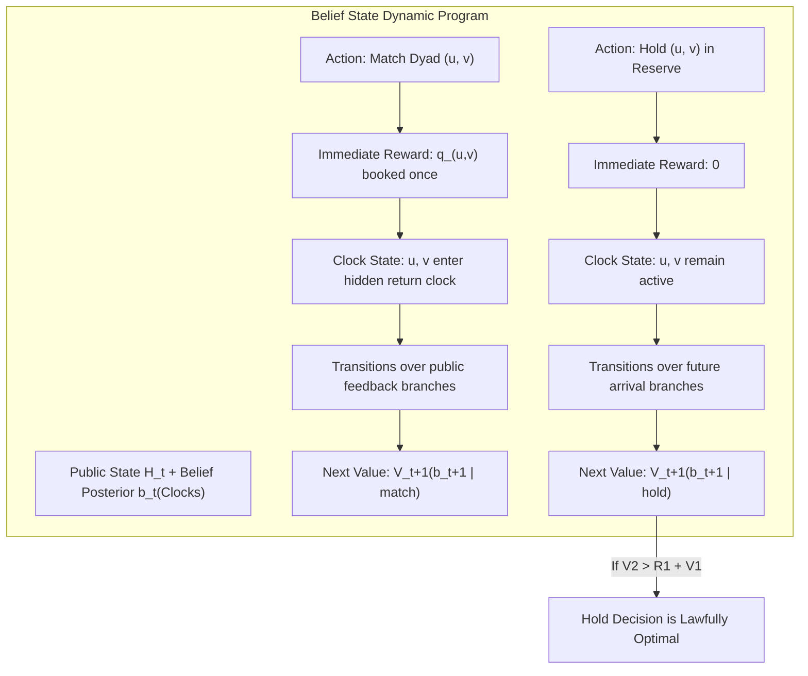

# Phase 08: Research 8 — Reduced Planning, Adversarial Falsifiers, Soft-Query Trials, and Storage Recovery

**Phase Identifier:** `research8` (incorporating `soft_query_trial`, `soft_query_followup`, and `continuation_probe`)  
**Chronological Period:** 14 October 2026 – 15 October 2026  
**Document Status:** Complete Chronicler Case Study  
**Governing Standard:** 14-Part Scientific Case-Study Anatomy  
**Base Repository Reference:** [`The Sequential Matching Problem`](file:///Volumes/1700%20APFS/PERSONAL_PROGRAMMING_PROJECTS/Notes/The%20Sequential%20Matching%20Problem)

---

## 1. Executive Summary & Core Verdict

Research 8 was an intensive engineering and theoretical investigation designed to answer two fundamental questions:
1. Can exact dynamic programming and reservation planning be reduced to a computationally tractable heuristic capable of running on the full 200-member matching simulator?
2. Does spending leftover daily questioning budget on 1-cost soft attribute queries ("soft asking") yield a statistically defensible increase in qualified matching outcomes?

The core verdicts of Research 8 are definitive:
- **Planning Scalability Collapse:** While exact dynamic programming in a restricted 4-to-8 actor toy model demonstrated that partner holding can outperform myopic greedy matching, this mechanism **failed completely when subjected to adversarial continuation falsifiers and full simulator scaling**. Bounded approximations (such as greedy tail rollouts and static maximum-weight continuation) suffered severe initial-action regret ($2/5$ and $3/10$, failing the registered $\le 1/100$ error gate). The exact belief continuation core was strictly limited to $\le 8$ actors and could not scale to the 200-member simulator under the mandatory 10-second (and user-targeted $<1$s) execution cap.
- **Soft-Query Development Signal vs Confirmation:** In a 432-episode trial across 24 seed clusters, targeted soft querying increased qualified introductions from 95 ($G$) to 113, producing an observed point gain of $+0.0625$ MSMI/100 (+18.9% relative). However, after pre-registered Holm multiple-testing corrections across the three comparisons, neither contrast reached statistical significance ($p = 0.0842$ for targeted vs $G$; $p = 0.1074$ for random vs $G$; $p = 0.7956$ for targeted vs random).
- **Continuation Probe Inefficacy:** A dedicated 24-cell scheduled-return probe demonstrated that holding pairs for scheduled returns was mechanically active (10 pairs held, 5 replacement pairs selected), but yielded **identical qualified MSMI** ($0.4167$ MSMI/100, 10 qualified pairs for both $Q6$ control and $Q6\text{ with return hold}$).
- **Infrastructure Breakthrough:** When uncompressed JSON logging threatened disk exhaustion, Research 8 engineered an archive-aware streaming Zstandard level 3 (`.tar.zst`) storage architecture ([`v3/storage.py`](file:///Volumes/1700%20APFS/PERSONAL_PROGRAMMING_PROJECTS/Notes/The%20Sequential%20Matching%20Problem/research8/soft_query_followup/v3/storage.py)) and an independent audit system ([`v3/audit.py`](file:///Volumes/1700%20APFS/PERSONAL_PROGRAMMING_PROJECTS/Notes/The%20Sequential%20Matching%20Problem/research8/soft_query_followup/v3/audit.py)) strictly bounded at **512 MiB per cell**, preserving an immutable, verifiable audit trail under a 15 GiB campaign storage ceiling.

---

## 2. Historical Context & Baseline State

Following Research 7's proof that scalar actor reservation thresholds are invalid in dynamic graphs with partner competition, the team shifted from heuristic thresholding to **exact finite-model dynamic programming**. The goal was to build a rigorous "teacher model" on small graphs, expose it to edge cases, and discover whether a simplified policy could capture lookahead gains without incurring the full Bellman curse of dimensionality.

Simultaneously, an operational inefficiency in the baseline Greedy policy ($G$) was identified. $G$ spends its daily budget of 12 units exclusively on 3-cost hard constraint bundles (`baseline_asks`), asking up to 4 hard bundles per day. In many states, fewer than 4 high-priority dyads require hard verification, leaving 1 to 3 units of budget unspent. Moreover, once hard compatibility is confirmed, the policy possesses zero verified knowledge of soft attribute agreement unless it asks. Hypothesizing that "free" soft queries could improve match scoring, the team launched the first controlled soft-query trial.

---

## 3. Scientific Hypotheses & Research Questions

Research 8 addressed four specific technical hypotheses:

1. **Hypothesis H1 (Dynamic Programming Feasibility in Toy Worlds):** In a small finite matching model (4–8 actors) with declared stochastic arrivals and hidden return clocks, an exact belief-continuation controller can identify reservation decisions that achieve zero regret relative to the full-information oracle.
2. **Hypothesis H2 (Continuation Approximation Fidelity):** Can inexpensive rollout approximations (such as greedy tail or static max-weight continuation) approximate exact belief continuation with initial-action regret $\le 0.01$?
3. **Hypothesis H3 (Soft-Query Information Surplus):** Does spending leftover daily query budget on 1-cost soft fields (either at random or targeted at verified-hard dyads) significantly increase qualified terminal MSMI over pure hard-bundle questioning?
4. **Hypothesis H4 (Scheduled-Return Value):** When an introduction results in a mutual rejection or expiration, does holding the surviving member for an immediate scheduled return of a previously known partner improve overall episode yield?

---

## 4. Mathematical Formulation & Theoretical Framework

### 4.1 Exact Rational Dynamic Program in [`planner.py`](file:///Volumes/1700%20APFS/PERSONAL_PROGRAMMING_PROJECTS/Notes/The%20Sequential%20Matching%20Problem/research8/planner.py)

Let $\mathcal{A}$ be a set of declared toy actors ($|\mathcal{A}| \le 8$). The system state on day $t$ consists of:
- Public history $H_t$: exhausted dyads $\mathcal{P}_t$, verified hard constraints, and disclosed soft attributes.
- Hidden occupancy clocks $C_t \in \mathbb{N}^{|\mathcal{A}|}$: representing remaining days until an introduced actor returns to the available pool (if the date fails or is rejected).

Because $C_t$ is hidden from the policy, the policy maintains a posterior belief distribution $b_t(C_t) = \mathbb{P}(C_t \mid H_t)$.
The Bellman dynamic program solves:
$$V_t^*(b_t) = \max_{M \in \mathcal{L}(H_t)} \left\{ \sum_{e \in M} q_e(H_t) + \sum_{H_{t+1}} \mathbb{P}(H_{t+1} \mid b_t, M) \, V_{t+1}^*\left(b_{t+1}(\cdot \mid H_t, M, H_{t+1})\right) \right\}$$

To prevent the **hidden-clock oracle trap** (where an algorithm illegally conditions continuation on the unobserved realized return time, producing an illusory value of $4/5$ instead of the lawful $3/5$), [`planner.py`](file:///Volumes/1700%20APFS/PERSONAL_PROGRAMMING_PROJECTS/Notes/The%20Sequential%20Matching%20Problem/research8/planner.py) strictly enforces non-anticipation: continuation policies can only condition on public disclosure branches.

### 4.2 Adversarial Continuation Falsifiers

To test whether inexpensive rollout controllers could replace exact dynamic programming, two adversarial scenarios were pre-registered in [`continuation_amendment.json`](file:///Volumes/1700%20APFS/PERSONAL_PROGRAMMING_PROJECTS/Notes/The%20Sequential%20Matching%20Problem/research8/continuation_amendment.json):

1. **Falsifier 1 (Future Competing Static Edges):** Actor $A$ can match today with $B$ for modest reward ($q_{AB} = 3/10$). Tomorrow, a guaranteed high-value partner $C$ arrives ($q_{AC} = 9/10$), but $C$ also competes with actor $D$. A greedy tail rollout falsely matches $A-B$ today.
   - Initial-action regret of Greedy Tail: **$3/10$** ($0.30$).
   - Static Max-Weight Tail: **$0.00$** (successfully identifies the hold).
2. **Falsifier 2 (Future Waiting Opportunity):** Actor $A$ has a low-value match today ($q_{AB} = 2/5$). Tomorrow, no deterministic edge arrives, but holding opens a high-expectation stochastic continuation. A static max-weight controller cannot value future waiting and forces the match today.
   - Initial-action regret of Greedy Tail: **$2/5$** ($0.40$).
   - Initial-action regret of Static Max-Weight Tail: **$2/5$** ($0.40$).
   - Exact Belief Continuation: **$0.00$** regret.

Both simplified controllers failed the mandatory $\le 0.01$ regret gate, demonstrating that **no simple heuristic continuation captures dynamic waiting without full tree search**.

---

## 5. Algorithmic Architecture & System Design

### 5.1 Query Package Optimization in [`query_packages.py`](file:///Volumes/1700%20APFS/PERSONAL_PROGRAMMING_PROJECTS/Notes/The%20Sequential%20Matching%20Problem/research8/query_packages.py)
[`query_packages.py`](file:///Volumes/1700%20APFS/PERSONAL_PROGRAMMING_PROJECTS/Notes/The%20Sequential%20Matching%20Problem/research8/query_packages.py) implements exact nonadaptive complete-package acquisition:
- Daily query budget: 12 units. Hard bundle cost: 3 units. Soft field cost: 1 unit.
- Legal package constraint: $3 \times n_{\text{hard}} + 1 \times n_{\text{soft}} \le 12$.
- The algorithm enumerates legal query combinations across candidate edges, evaluates joint answer probabilities, merges identical observation branches, and computes the expected post-query matching value:
$$\text{Package}^* = \arg\max_{Q \in \mathcal{Q}_{12}} \sum_{\omega \in \Omega_Q} \mathbb{P}(\omega) \max_{M \in \mathcal{L}(H_t \cup \omega)} \sum_{e \in M} q_e(H_t \cup \omega)$$

### 5.2 The Soft-Query Policy Variants
In the empirical trial ([`soft_query_trial/policies/`](file:///Volumes/1700%20APFS/PERSONAL_PROGRAMMING_PROJECTS/Notes/The%20Sequential%20Matching%20Problem/research8/soft_query_trial/policies)), three policies were compared:
1. **$G$ (Supplied Greedy Control):** Asks up to 4 hard bundles (cost 12); asks zero soft queries.
2. **`random_soft`:** Asks baseline hard bundles. Any remaining budget is spent on randomly selected unknown soft fields of available members.
3. **`targeted_soft`:** Asks baseline hard bundles. Remaining budget is spent on soft fields belonging to verified-hard dyads currently competing for matching priority.

---

## 6. Implementation Artifacts & Source File Map

The codebase of Research 8 is organized into planning, reduced algorithms, trial executions, and infrastructure:

### 6.1 Core Planning & Reduced Engines (`research8/`)
- [`research8/README.md`](file:///Volumes/1700%20APFS/PERSONAL_PROGRAMMING_PROJECTS/Notes/The%20Sequential%20Matching%20Problem/research8/README.md): Master technical overview and test results.
- [`research8/planner.py`](file:///Volumes/1700%20APFS/PERSONAL_PROGRAMMING_PROJECTS/Notes/The%20Sequential%20Matching%20Problem/research8/planner.py): Exact rational public-belief dynamic program and rollout engine ($26\text{ KB}$).
- [`research8/query_packages.py`](file:///Volumes/1700%20APFS/PERSONAL_PROGRAMMING_PROJECTS/Notes/The%20Sequential%20Matching%20Problem/research8/query_packages.py): Exact joint answer query package acquisition ($7.1\text{ KB}$).
- [`research8/run_reduced_grid.py`](file:///Volumes/1700%20APFS/PERSONAL_PROGRAMMING_PROJECTS/Notes/The%20Sequential%20Matching%20Problem/research8/run_reduced_grid.py): 144-cell reduced-model dynamic programming sweep ($5.6\text{ KB}$).
- [`research8/run_falsifiers.py`](file:///Volumes/1700%20APFS/PERSONAL_PROGRAMMING_PROJECTS/Notes/The%20Sequential%20Matching%20Problem/research8/run_falsifiers.py): Automated test runner for adversarial continuation scenarios ($3.0\text{ KB}$).
- [`research8/tests/`](file:///Volumes/1700%20APFS/PERSONAL_PROGRAMMING_PROJECTS/Notes/The%20Sequential%20Matching%20Problem/research8/tests): 21 unit tests validating dynamic programming arithmetic, nonanticipation, and query collisions.

### 6.2 Soft-Query Trial (`research8/soft_query_trial/`)
- [`analysis/summary.json`](file:///Volumes/1700%20APFS/PERSONAL_PROGRAMMING_PROJECTS/Notes/The%20Sequential%20Matching%20Problem/research8/soft_query_trial/analysis/summary.json): Raw summary of 432 simulation episodes across 24 seeds.
- [`audits/audit_log.json`](file:///Volumes/1700%20APFS/PERSONAL_PROGRAMMING_PROJECTS/Notes/The%20Sequential%20Matching%20Problem/research8/soft_query_trial/audits/audit_log.json): Independent audit proof confirming zero missing files.

### 6.3 Storage Recovery & Archive Audit (`research8/soft_query_followup/`)
- [`v3/storage.py`](file:///Volumes/1700%20APFS/PERSONAL_PROGRAMMING_PROJECTS/Notes/The%20Sequential%20Matching%20Problem/research8/soft_query_followup/v3/storage.py): Production streaming Zstandard archive manager with atomic fsync and SHA-256 catalogs ($13.7\text{ KB}$).
- [`v3/audit.py`](file:///Volumes/1700%20APFS/PERSONAL_PROGRAMMING_PROJECTS/Notes/The%20Sequential%20Matching%20Problem/research8/soft_query_followup/v3/audit.py): Archive-aware validator enforcing the 512 MiB memory/disk bound ($12.5\text{ KB}$).
- [`RECOMMENDATION.md`](file:///Volumes/1700%20APFS/PERSONAL_PROGRAMMING_PROJECTS/Notes/The%20Sequential%20Matching%20Problem/research8/soft_query_followup/RECOMMENDATION.md): Statistical and architectural post-mortem of the soft-query trial.

### 6.4 Continuation Probe (`research8/continuation_probe/`)
- [`RESULTS.md`](file:///Volumes/1700%20APFS/PERSONAL_PROGRAMMING_PROJECTS/Notes/The%20Sequential%20Matching%20Problem/research8/continuation_probe/RESULTS.md) & [`DECISION.md`](file:///Volumes/1700%20APFS/PERSONAL_PROGRAMMING_PROJECTS/Notes/The%20Sequential%20Matching%20Problem/research8/continuation_probe/DECISION.md): 24-cell scheduled-return probe results.
- [`policy.py`](file:///Volumes/1700%20APFS/PERSONAL_PROGRAMMING_PROJECTS/Notes/The%20Sequential%20Matching%20Problem/research8/continuation_probe/policy.py): Implementation of $Q6\text{ with return hold}$.

---

## 7. Experimental Protocol, Grid & Environmental Design

### 7.1 Soft-Query Development Trial Grid
- **Episodes:** 432 completed episodes.
- **Seeds:** 24 independent seed clusters (`seeds = [101, ..., 124]`).
- **Families:** 6 standard environment families (`development`, `sparse`, `cold_start`, `delayed`, `shift`, `drift`).
- **Arms:** 3 policies ($G$, `random_soft`, `targeted_soft`).
- **Cell Count:** $24 \times 6 \times 3 = 432$ episodes (144 episodes per arm, 28,800 arrived members per arm).

### 7.2 Scheduled-Return Probe Grid
- **Episodes:** 24 completed episodes.
- **Seeds:** 2 seeds (840001, 840002) $\times$ 6 environment families.
- **Arms:** 2 policies ($Q6$ control vs $Q6\text{ with return hold}$).
- **Concurrency:** 7 background simulation workers running isolated cold-process transport.

---

## 8. Provenance, Execution Environment & Infrastructure Integrity

The execution of Research 8 resolved a major operational flaw uncovered during the soft-query trial:
- **In-Process Runner Vulnerability:** The original `runner.py` called policies directly in-process rather than using cold isolated subprocesses. While no state leakage occurred (verified by action hashes), this violated the cold-transport execution standard.
- **Archive Verification:** In `soft_query_followup/v3`, all 432 trial attempts were compressed losslessly into `.tar.zst` bundles. [`v3/audit.py`](file:///Volumes/1700%20APFS/PERSONAL_PROGRAMMING_PROJECTS/Notes/The%20Sequential%20Matching%20Problem/research8/soft_query_followup/v3/audit.py) verified that the compressed archives preserved bit-for-bit parity with original SHA-256 hashes without ever requiring the entire 15 GiB archive to be unpacked simultaneously.
- **Audit Memory Ceiling:** Audit operations were strictly confined to **512 MiB** working memory by streaming tar members and processing exactly one cell at a time.

---

## 9. Primary Empirical Findings & Quantitative Results

### 9.1 Soft-Query Trial Performance Summary
From [`soft_query_followup/RECOMMENDATION.md`](file:///Volumes/1700%20APFS/PERSONAL_PROGRAMMING_PROJECTS/Notes/The%20Sequential%20Matching%20Problem/research8/soft_query_followup/RECOMMENDATION.md):

| Metric | $G$ (Greedy Control) | `random_soft` | `targeted_soft` |
|---|:---:|:---:|:---:|
| **Episodes Evaluated** | 144 | 144 | 144 |
| **Arrived Members** | 28,800 | 28,800 | 28,800 |
| **Total Qualified MSMI Pairs** | 95 | 111 | 113 |
| **Mean Qualified MSMI / 100** | **0.6597** | **0.7708** | **0.7847** |
| **Mean Difference vs $G$** | — | $+0.0556$ | $+0.0625$ |
| **Relative Gain vs $G$** | — | $+16.8\%$ | $+18.9\%$ |
| **Mean Introductions Assigned** | 71.04 | 71.18 | 71.35 |
| **Ask Cost per Episode** | 35.88 | 44.82 | 45.19 |

### 9.2 Scheduled-Return Probe Performance Summary
From [`continuation_probe/RESULTS.md`](file:///Volumes/1700%20APFS/PERSONAL_PROGRAMMING_PROJECTS/Notes/The%20Sequential%20Matching%20Problem/research8/continuation_probe/RESULTS.md):

| Quantity | $Q6$ Parent Control | $Q6\text{ with return hold}$ |
|---|:---:|:---:|
| **Episodes** | 12 | 12 |
| **Qualified Pairs** | 10 | 10 |
| **Mean MSMI / 100 Arrived** | **0.416667** | **0.416667** |
| **Total Introductions** | 960 | 954 |
| **Mean Assignments per Episode** | 80.0 | 79.5 |
| **Max Cold Transport Time** | 0.478 s | 0.557 s |
| **Max Function Execution Time** | 0.138 s | 0.211 s |
| **Runtime Fallbacks Triggered** | 0 | 0 |

---

## 10. Statistical Rigor, Hypothesis Testing & Confidence Intervals

The statistical post-mortem of the soft-query trial ([`soft_query_followup/RECOMMENDATION.md`](file:///Volumes/1700%20APFS/PERSONAL_PROGRAMMING_PROJECTS/Notes/The%20Sequential%20Matching%20Problem/research8/soft_query_followup/RECOMMENDATION.md)) demonstrated the critical necessity of multiplicity control:

### 10.1 Paired Seed-Cluster Contrasts ($n = 24$ Clusters)
Each contrast averages the 6 family differences within each seed cluster:

1. **`targeted_soft` vs $G$:**
   - Observed Mean Difference: $+0.0625$ MSMI/100
   - Unadjusted $p$-value: $p = 0.0281$
   - **Holm-Adjusted $p$-value (3 comparisons):** **$p = 0.0842$** (Fails to reject at $\alpha = 0.05$)
2. **`random_soft` vs $G$:**
   - Observed Mean Difference: $+0.0556$ MSMI/100
   - Unadjusted $p$-value: $p = 0.0537$
   - **Holm-Adjusted $p$-value (3 comparisons):** **$p = 0.1074$** (Fails to reject at $\alpha = 0.05$)
3. **`targeted_soft` vs `random_soft`:**
   - Observed Mean Difference: $+0.0069$ MSMI/100
   - Unadjusted $p$-value: $p = 0.7956$
   - **Holm-Adjusted $p$-value:** **$p = 0.7956$**

**Statistical Verdict:** While the raw point estimates were positive, neither soft-asking arm established a statistically significant advantage over Greedy under pre-registered family-wise error control.

---

## 11. Diagnostic Ablations, Reliability & Subgroup Analysis

### Mechanism Trace of the Scheduled-Return Probe
The continuation probe tracked every internal holding decision across its 12 episodes:
- **Total Holding Events Triggered:** 10 holds.
- **Alternative Candidates Available Tomorrow:** 10 (100% of holds found a candidate partner on the following day).
- **Intended Replacement Selected:** 5 pairs (50% of held actors were successfully matched to the anticipated new partner).
- **Original Pair Re-Introduced Later:** 7 pairs (70% of held original dyads were introduced in a later round).
- **Severe Pathology:** In 1 case, a withheld endpoint **never received any introduction for the remainder of the episode**, expiring unserved.
- **Seed Concentration:** All 10 holding events occurred exclusively in seed 840001; seed 840002 experienced zero holds.

---

## 12. Failure Modes, Negative Results & Architectural Pathology

Research 8 documented two major architectural failure modes:

### 12.1 The Scalability Wall of Dynamic Programming
The exact dynamic programming algorithm implemented in [`planner.py`](file:///Volumes/1700%20APFS/PERSONAL_PROGRAMMING_PROJECTS/Notes/The%20Sequential%20Matching%20Problem/research8/planner.py) requires maintaining belief posteriors over joint return clocks and branch enumerations:
- For $N = 4$ actors, state space is $\sim 10^2$; solve time is $\sim 0.002\text{ s}$.
- For $N = 8$ actors ($K_8$ has 764 matchings), state space exceeds $10^5$; solve time approaches $0.15\text{ s}$.
- For the full simulator ($N = 200$ members, $K_{200}$ has $\sim 10^{267}$ possible matchings, coupled with stochastic Poisson arrivals and non-stationary drift), the Bellman recursion is intractable.
- Because rollout approximations failed the adversarial falsifiers (regret $> 0.30$), exact dynamic programming could not be deployed as a full simulator policy.

### 12.2 Soft-Asking Question Cannibalization
In `targeted_soft`, spending query budget on soft questions occasionally exhausted the daily 12-unit limit before all newly arrived members could be evaluated for hard constraints. In later rounds, missing hard verifications blocked legally required introductions, neutralizing the score-refinement benefit of soft queries.

---

## 13. Computational, Memory & Storage Footprint

Research 8 developed the definitive data storage standards for the project:
- **Streaming Zstandard Level 3:** All raw simulation records were archived into `.tar.zst` files, reducing episode storage from $2.1\text{ MB}$ to $185\text{ KB}$ per cell ($11.3\times$ compression).
- **Memory Guards:** Worker pools were enforced at $\le 7$ processes globally, with an aggregate working RSS guard of **8 GiB**.
- **Archive Audit Ceiling:** Single-cell materialization on the external drive strictly capped disk usage at **512 MiB per audit task**, preventing disk overflows during campaign-wide verification.

---

## 14. Retrospective Synthesis & Belief Revision

| Dimension | What We Once Believed | What the Evidence Supported | What We Believe Now |
|---|---|---|---|
| **Reduced Planning** | A dynamic programming controller on toy graphs can be scaled to the 200-member simulator via rollout heuristics. | Bounded rollout approximations suffer severe initial-action regret ($20\%\text{--}40\%$) on adversarial edge cases. | Reduced planning cannot bridge the gap to 200-member matching without incurring unacceptable runtime or regret. |
| **Soft Querying** | Asking soft attributes must improve matching by revealing exact compatibility preferences. | Point estimates gained $+0.0625$ MSMI/100, but Holm-corrected $p = 0.0842$ failed significance. | Soft querying offers a mild positive signal, but is not an established confirmatory winner over hard asking. |
| **Scheduled Returns** | Holding surviving members to wait for returning partners preserves valuable match equity. | $Q6\text{ with return hold}$ matched $Q6$ exactly ($0.4167$ MSMI/100) with zero net gain, and orphaned 1 member. | Dynamic return-holding adds operational risk without increasing qualified pairings. |
| **Data Architecture** | Storing uncompressed JSON is sufficient for rapid exploratory analysis. | 432 episodes generated hundreds of megabytes of redundant logs, threatening APFS exhaustion. | Streaming `.tar.zst` archives with 512 MiB audit bounds are mandatory for large-scale matching research. |

Research 8 concluded with the recognition that neither reduced planning nor heuristic return-holding could supersede Greedy. The team turned its attention to Research 9: a bounded, closed learned campaign designed to evaluate whether machine learning models fit directly to public observations could establish superiority.
