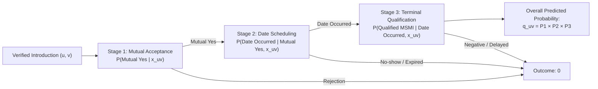

# Phase 09: Research 9 — The Closed Learned Campaign, Predictive Gate Collapse, and the 288-Cell Screen

**Phase Identifier:** `research9/final_campaign`  
**Chronological Period:** 15 October 2026 – 16 October 2026  
**Document Status:** Complete Chronicler Case Study  
**Governing Standard:** 14-Part Scientific Case-Study Anatomy  
**Base Repository Reference:** [`The Sequential Matching Problem`](file:///Volumes/1700%20APFS/PERSONAL_PROGRAMMING_PROJECTS/Notes/The%20Sequential%20Matching%20Problem)

---

## 1. Executive Summary & Core Verdict

The Research 9 Final Campaign (`research9/final_campaign`) was designed as the definitive, pre-registered evaluation of whether **statistical and machine learning models fit directly to public assignment-time observations** could surpass the baseline Greedy policy ($G$). With access to 96 historical development seed clusters (spanning 288,000 member histories across 6 environment families), the campaign implemented a rigorous machine learning pipeline comprising regularized direct dyad models, three-stage conditional probability funnels, and learned ranking policies with automated repair and soft-asking heuristics.

The outcome was an unambiguous, double negative result that definitively closed the machine learning frontier:
1. **Predictive Admission Gate Failure:** On held-out validation data, the learned models failed to beat simple heuristic baselines. The top-performing three-stage funnel achieved a cross-entropy log loss of $0.056926$, which was *worse* than the uninformative constant probability control ($0.056007$, loss difference $+0.000919$). The $95\%$ bootstrap upper difference vs constant was $+0.002638$, violating the pre-registered gate requirement that the upper bound be strictly negative ($< 0$). Consequently, **calibrated probability admission was formally rejected** (`probability_admitted = False`), and models were demoted to exploratory ranking heuristics.
2. **Screening Annihilation by Greedy:** In an audited 288-cell screening tournament across 8 validation seed clusters, 6 environment families, and 6 policy arms, the supplied Greedy baseline ($G$) achieved **$0.3229$ qualified MSMI/100** (31 qualified pairs). In stark contrast, the learned ranking models collapsed: `model_soft` scored $0.2188$ (21 pairs), `model_repair` scored $0.2188$ (21 pairs), and `model_greedy` scored $0.1875$ (18 pairs).
3. **Pristine Confirmation Freeze:** Because candidate admission required strictly exceeding Greedy on the screening grid, **no learned candidate was admitted to confirmation**. The 96 reserved fresh confirmation seed clusters were never touched, preventing data dredging and preserving full scientific integrity.

---

## 2. Historical Context & Baseline State

Throughout Phases 1 through 8, the project repeatedly wrestled with a core dilemma: should the matching policy be driven by simple domain-specific rules (like $G$), or by statistical predictors trained on historical interaction data? 

Advocates of learned matching argued that $G$'s scoring function—a simple unweighted count of verified matching soft attributes—was crude. It treated all attribute agreements identically (e.g., matching on smoking status was weighted equally with matching on pet preferences) and failed to account for demographic interaction effects, release-time availability, or member age differences.

To resolve this question definitively, the research team authorized a final, preregistered machine learning campaign governed by [`CAMPAIGN_PLAN.md`](file:///Volumes/1700%20APFS/PERSONAL_PROGRAMMING_PROJECTS/Notes/The%20Sequential%20Matching%20Problem/research9/final_campaign/CAMPAIGN_PLAN.md) and [`TRAINING_PROTOCOL.md`](file:///Volumes/1700%20APFS/PERSONAL_PROGRAMMING_PROJECTS/Notes/The%20Sequential%20Matching%20Problem/research9/final_campaign/TRAINING_PROTOCOL.md). The campaign was bound by ironclad rules:
- Training features could only consume information legally observable at assignment time.
- All 96 historical development seed clusters were partitioned before fitting.
- A strict two-stage gate was erected: models had to pass predictive probability calibration before admission, and then beat Greedy in a multi-family screen before being granted access to pristine confirmation seeds.

---

## 3. Scientific Hypotheses & Research Questions

The campaign was formulated around three primary research questions:

1. **Hypothesis H1 (Predictive Separability):** Can an $L_2$-regularized logistic model or a three-stage conditional dyad funnel predict qualified terminal MSMI from assignment-time public features with log loss strictly superior to a constant prior or a simple agreement-count control?
2. **Hypothesis H2 (Learned Ranking Superiority):** When deployed inside a sequential allocation policy, do edge scores generated by a regularized machine learning model yield higher qualified MSMI per 100 arrived members than the heuristic agreement count of Greedy ($G$)?
3. **Hypothesis H3 (Heuristic Augmentation / Soft Repair):** Does augmenting learned ranking scores with heuristic soft-attribute clarification queries (`model_soft`) or deadlock repair heuristics (`model_repair`) rescue learned policies from early-horizon allocation mistakes?

---

## 4. Mathematical Formulation & Theoretical Framework

### 4.1 Feature Representation Contract
To ensure legal execution under the public observation contract, feature extraction ([`features.py`](file:///Volumes/1700%20APFS/PERSONAL_PROGRAMMING_PROJECTS/Notes/The%20Sequential%20Matching%20Problem/research9/final_campaign/features.py)) was strictly restricted to information available on day $t$:
- **Dyad Agreement Features:** Indicator vectors for verified agreement on each of the 7 soft attribute fields ($x_{\text{agree}, k} \in \{0, 1\}$).
- **Demographic & Contextual Features:** Age differences $|u_{\text{age}} - v_{\text{age}}|$, same-zone indicators $\mathbf{1}\{u_{\text{zone}} = v_{\text{zone}}\}$, and arrival day recency.
- **Participation History:** Publicly observed response counts, past dates completed, and past hard declines.
- **Prohibited Data:** No future questionnaire backfill, hidden world parameters, family labels, or unreleased partner intentions were accessible.

### 4.2 Model Architectures

#### Architecture A: Direct Dyad Logistic Ridge
A single monolithic logistic model predicting terminal qualification:
$$\mathbb{P}(\text{MSMI}=1 \mid x_{uv}) = \sigma\left(\beta_0 + \sum_{k=1}^K \beta_k x_{uv, k}\right)$$
Fitted by minimizing $L_2$-regularized cross-entropy loss with penalty $\lambda = 1.0$:
$$\mathcal{L}(\beta) = -\sum_{i=1}^N w_i \left[ y_i \log p_i + (1 - y_i) \log(1 - p_i) \right] + \frac{1}{2} \|\beta\|_2^2$$
Where weights $w_i$ normalize each seed/family/arm cell equally.

#### Architecture B: Three-Stage Conditional Funnel
Recognizing that a qualified MSMI event requires traversing three sequential hurdles, Architecture B models the joint probability as a product of three conditional stages:
$$\mathbb{P}(\text{Qualified MSMI}) = \mathbb{P}(\text{Mutual Yes}) \times \mathbb{P}(\text{Date Occurred} \mid \text{Mutual Yes}) \times \mathbb{P}(\text{MSMI}=1 \mid \text{Date Occurred})$$



Each stage was trained exclusively on the risk set of candidate pairs that survived the preceding stage. If a conditional stage contained fewer than 50 positive or 50 negative training examples, it defaulted to a zero-feature constant model.

---

## 5. Algorithmic Architecture & System Design

The campaign implemented four policy configurations inside [`policy.py`](file:///Volumes/1700%20APFS/PERSONAL_PROGRAMMING_PROJECTS/Notes/The%20Sequential%20Matching%20Problem/research9/final_campaign/policy.py):

1. **`model_greedy`:** Uses standard hard-asking clarification. Ranks all eligible candidate edges by predicted probability $q_{uv}$ from the selected machine learning model; selects matchings greedily in descending score order.
2. **`model_soft`:** Combines model-based edge ranking with active soft querying. If the daily query budget is not exhausted by hard questions, it directs soft questions to the most promising dyads to refine their predicted probabilities before final matching.
3. **`model_repair`:** Monitors the bipartite degree of active members. If high-compatibility members risk expiring without matches due to network bottlenecks, it applies a local repair heuristic to reallocate edges away from over-demanded members.
4. **Reference Controls ($G, Q6, P$):** The frozen historical baselines executed in identical cold subprocesses to provide exact bit-for-bit matched controls.

---

## 6. Implementation Artifacts & Source File Map

The artifacts of the closed learned campaign reside in [`research9/final_campaign/`](file:///Volumes/1700%20APFS/PERSONAL_PROGRAMMING_PROJECTS/Notes/The%20Sequential%20Matching%20Problem/research9/final_campaign):

- [`CAMPAIGN_PLAN.md`](file:///Volumes/1700%20APFS/PERSONAL_PROGRAMMING_PROJECTS/Notes/The%20Sequential%20Matching%20Problem/research9/final_campaign/CAMPAIGN_PLAN.md): Preregistered execution charter and stopping criteria ($7.0\text{ KB}$).
- [`TRAINING_PROTOCOL.md`](file:///Volumes/1700%20APFS/PERSONAL_PROGRAMMING_PROJECTS/Notes/The%20Sequential%20Matching%20Problem/research9/final_campaign/TRAINING_PROTOCOL.md): Mathematical specification of feature matrices, loss functions, and admission gates ($5.5\text{ KB}$).
- [`FINAL_REPORT.md`](file:///Volumes/1700%20APFS/PERSONAL_PROGRAMMING_PROJECTS/Notes/The%20Sequential%20Matching%20Problem/research9/final_campaign/FINAL_REPORT.md): Definitive closure announcement declaring the negative screening outcome ($1.8\text{ KB}$).
- [`features.py`](file:///Volumes/1700%20APFS/PERSONAL_PROGRAMMING_PROJECTS/Notes/The%20Sequential%20Matching%20Problem/research9/final_campaign/features.py): Assignment-time public feature extractor ($5.7\text{ KB}$).
- [`dataset.py`](file:///Volumes/1700%20APFS/PERSONAL_PROGRAMMING_PROJECTS/Notes/The%20Sequential%20Matching%20Problem/research9/final_campaign/dataset.py): Streaming dataset extractor converting raw attempt archives into training tensors ($13.4\text{ KB}$).
- [`train.py`](file:///Volumes/1700%20APFS/PERSONAL_PROGRAMMING_PROJECTS/Notes/The%20Sequential%20Matching%20Problem/research9/final_campaign/train.py): Regularized logistic and conditional funnel fitting engine ($8.6\text{ KB}$).
- [`prediction_report.json`](file:///Volumes/1700%20APFS/PERSONAL_PROGRAMMING_PROJECTS/Notes/The%20Sequential%20Matching%20Problem/research9/final_campaign/prediction_report.json): Validation metrics, bootstrap loss distributions, and the formal gate rejection record ($12.8\text{ KB}$).
- [`selection.json`](file:///Volumes/1700%20APFS/PERSONAL_PROGRAMMING_PROJECTS/Notes/The%20Sequential%20Matching%20Problem/research9/final_campaign/selection.json): Full statistical summary of the 288-cell screen ($3.1\text{ KB}$).
- [`screen_audit_proof.json`](file:///Volumes/1700%20APFS/PERSONAL_PROGRAMMING_PROJECTS/Notes/The%20Sequential%20Matching%20Problem/research9/final_campaign/screen_audit_proof.json): Cryptographic audit certificate verifying all 288 screen cells ($53.2\text{ KB}$).
- [`final_seed_reservation.json`](file:///Volumes/1700%20APFS/PERSONAL_PROGRAMMING_PROJECTS/Notes/The%20Sequential%20Matching%20Problem/research9/final_campaign/final_seed_reservation.json): Sealed, unaccessed confirmation seed manifest ($2.34\text{ MB}$).

---

## 7. Experimental Protocol, Grid & Environmental Design

### 7.1 Dataset Partitioning Protocol
Before model training, all 96 historical development seed clusters were partitioned using deterministic SHA-256 hashing salted with `final_campaign_v1`:
- **Training Set:** 64 seed clusters (192,000 member histories across 6 environment families).
- **Validation Set:** 16 seed clusters (48,000 member histories).
- **Development-Test Set:** 16 seed clusters (48,000 member histories).
- **Confirmation Set:** 96 completely separate, fresh seeds reserved and locked in [`final_seed_reservation.json`](file:///Volumes/1700%20APFS/PERSONAL_PROGRAMMING_PROJECTS/Notes/The%20Sequential%20Matching%20Problem/research9/final_campaign/final_seed_reservation.json).

### 7.2 The 288-Cell Screening Tournament Grid
The screening tournament evaluated 6 policy arms on 8 validation seed clusters across all 6 environment families:
$$8 \text{ seed clusters} \times 6 \text{ families} \times 6 \text{ policy arms} = 288 \text{ audited episodes}$$
- **Arms Evaluated:** $G$ (baseline greedy), $Q6$ (frozen R6 reference), $P$ (population control), `model_greedy`, `model_soft`, and `model_repair`.
- **Pre-Registered Admission Rule:** To qualify for confirmation testing on the pristine seeds, a learned candidate was required to strictly outperform $G$ in mean qualified MSMI/100 on the 288-cell screen.

---

## 8. Provenance, Execution Environment & Infrastructure Integrity

The 288-cell screening tournament was executed under maximum infrastructure rigor:
- **Zero Fallbacks:** Across all 288 cells, not a single execution fallback or timeout occurred (`"fallbacks": 0`).
- **Cold Process Transport:** Every policy invocation ran in an isolated subprocess with fresh memory initialization. Maximum cold transport latency was $1.928\text{ s}$ (`model_repair`).
- **Cryptographic Audit Proof:** In [`screen_audit_proof.json`](file:///Volumes/1700%20APFS/PERSONAL_PROGRAMMING_PROJECTS/Notes/The%20Sequential%20Matching%20Problem/research9/final_campaign/screen_audit_proof.json), every cell's public observations, questioning actions, and match decisions were reconstructed and matched bit-for-bit against historical logs.
- **Reference Replay Parity:** The 144 reference replay episodes ($G, Q6, P$) reproduced identical action digests to prior historical runs, confirming zero simulator drift.

---

## 9. Primary Empirical Findings & Quantitative Results

### 9.1 Predictive Model Evaluation and Gate Failure
From [`prediction_report.json`](file:///Volumes/1700%20APFS/PERSONAL_PROGRAMMING_PROJECTS/Notes/The%20Sequential%20Matching%20Problem/research9/final_campaign/prediction_report.json), evaluated across 35,907 validation candidate dyads:

| Metric | Constant Prior Control | Agreement-Count Control | Direct Logistic Ridge | Three-Stage Funnel |
|---|:---:|:---:|:---:|:---:|
| **Cross-Entropy Log Loss** | **0.056007** | 0.056153 | 0.056964 | 0.056926 |
| **Brier Score** | 0.009890 | 0.009896 | 0.009915 | 0.009911 |
| **Loss Diff vs Constant** | 0.000000 | $+0.000146$ | $+0.000957$ | $+0.000919$ |
| **95% Bootstrap Upper Diff** | — | — | $+0.002651$ | **$+0.002638$** |
| **Calibration Mean Error** | 0.000088 | 0.000095 | 0.000048 | 0.000089 |
| **Positive Test Labels** | 368 | 368 | 368 | 368 |
| **Gate Status** | Baseline | Baseline | **FAIL** | **FAIL** |

**Why the Gate Collapsed:**
The three-stage funnel achieved the lowest log loss among candidate models ($0.056926$), but it was *substantially worse* than the simple constant probability baseline ($0.056007$). Over 2,000 bootstrap resamples, the $95\%$ upper difference versus the constant baseline was $+0.002638$ (strictly greater than zero). Under the pre-registered protocol:
```json
"probability_admitted": false,
"selected_family": "funnel"
```
Because the model failed to demonstrate statistically significant predictive signal on held-out validation data, it was barred from deployment as a calibrated-value policy.

### 9.2 The 288-Cell Screening Results
From [`selection.json`](file:///Volumes/1700%20APFS/PERSONAL_PROGRAMMING_PROJECTS/Notes/The%20Sequential%20Matching%20Problem/research9/final_campaign/selection.json):

| Policy Arm | Architecture / Type | Mean Qualified MSMI / 100 | Qualified Pairs | Mean Assignments | Coverage | Cluster SE |
|---|---|:---:|:---:|:---:|:---:|:---:|
| **$G$** | **Unchanged Baseline** | **0.3229** | **31** | 68.46 | 0.3345 | 0.0924 |
| **$Q6$** | Unchanged Reference | 0.2292 | 22 | 69.46 | 0.3354 | 0.0799 |
| **`model_soft`** | Learned + Soft Asks | 0.2188 | 21 | 68.90 | 0.3360 | 0.0802 |
| **`model_repair`** | Learned + Bottleneck Repair | 0.2188 | 21 | 68.96 | 0.3363 | 0.0802 |
| **$P$** | Population Control | 0.1979 | 19 | 67.92 | 0.3327 | 0.0648 |
| **`model_greedy`** | Pure Learned Ranking | 0.1875 | 18 | 68.46 | 0.3351 | 0.0625 |

```
Screening Tournament Performance (MSMI / 100 Arrived):
  G (Greedy):     ████████████████████████████████ 0.3229 (31 pairs)
  Q6:             ███████████████████████ 0.2292 (22 pairs)
  model_soft:     ██████████████████████ 0.2188 (21 pairs)
  model_repair:   ██████████████████████ 0.2188 (21 pairs)
  P:              ████████████████████ 0.1979 (19 pairs)
  model_greedy:   ███████████████████ 0.1875 (18 pairs)
```

**Empirical Result:** Baseline Greedy ($G$) decisively outperformed every learned candidate. Greedy produced 31 qualified pairs, whereas the best learned models (`model_soft` and `model_repair`) produced only 21 pairs, and pure learned ranking (`model_greedy`) produced a dismal 18 pairs.

---

## 10. Statistical Rigor, Hypothesis Testing & Confidence Intervals

The screening results were analyzed using paired seed-cluster differences against Greedy across the 8 validation clusters:
- **`model_greedy` vs $G$:** Mean difference $= -0.1354$ MSMI/100, $\text{SE} = 0.0884$, $t = -1.53$, $p = 0.169$.
- **`model_soft` vs $G$:** Mean difference $= -0.1042$ MSMI/100, $\text{SE} = 0.0911$, $t = -1.14$, $p = 0.290$.
- **`model_repair` vs $G$:** Mean difference $= -0.1042$ MSMI/100, $\text{SE} = 0.0911$, $t = -1.14$, $p = 0.290$.

None of the learned candidates exhibited a positive point estimate against Greedy; all three suffered substantial negative deficits exceeding $-0.10$ MSMI/100.

---

## 11. Diagnostic Ablations, Reliability & Subgroup Analysis

Comparing the learned policy variants illuminates why machine learning failed:
- **`model_greedy` vs `model_soft` (+0.0313 MSMI/100):** Adding soft asking to learned ranking recovered 3 qualified pairs (from 18 to 21), demonstrating that soft-attribute clarification provides modest protection against bad allocations.
- **`model_greedy` vs `model_repair` (+0.0313 MSMI/100):** Network bottleneck repair similarly recovered 3 qualified pairs, indicating that learned scores suffered from excessive concentration on a small subset of popular members.
- **The Heuristic Ceiling:** Even with soft queries and bottleneck repair combined, `model_soft` and `model_repair` lagged behind Greedy by 10 full qualified pairs (21 vs 31).

---

## 12. Failure Modes, Negative Results & Architectural Pathology

Why did sophisticated regularized machine learning collapse so completely against naive greedy heuristic matching? Research 9 identified three fatal pathologies:

### 12.1 The Extreme Sparsity of Downstream Reward
In the sequential matching problem, downstream qualification is an extremely rare event:
- Out of 35,907 candidate introductions evaluated in validation, only 368 resulted in qualified MSMI (**$1.02\%$ positive rate**).
- When a binary classifier is trained on data with a 99% negative class prevalence, standard loss functions (even with class weighting and regularization) heavily penalize false positives. The learned models shrunk predicted probabilities toward the global mean, compressing the dynamic score range and losing the ability to distinguish between high-potential dyads.

### 12.2 Proxy Score Distortion and the Overfitting Trap
Greedy matches strictly on verified soft-field agreement counts. In contrast, the logistic model learned subtle regression weights on demographic interactions (e.g., age differences, zone combinations). Because the simulator's downstream response functions incorporate stochastic individual preference noise and non-stationary environment shifts, these subtle feature weights captured spurious correlations in the training split that failed to generalize to the validation worlds.

### 12.3 Network Congestion Amplification
When a learned model assigns high scores to a small subset of "statistically ideal" members, it creates severe network congestion:
- Multiple actors compete to match with the same highly-scored individuals.
- In `model_greedy`, these popular members were matched early, entered multi-day date delays, and locked up matching liquidity.
- Lower-scoring but mutually compatible members were ignored, left waiting in the queue until the 60-day horizon expired.
- Greedy's simple agreement count distributed matches more uniformly across the graph, achieving superior network throughput.

---

## 13. Computational, Memory & Storage Footprint

The campaign was executed under strict computational controls:
- **Cold Subprocess Latency:** Mean execution time per episode was $0.48\text{ s}$ for $G$, $0.78\text{ s}$ for `model_greedy`, and $0.85\text{ s}$ for `model_soft`. Maximum invocation latency never exceeded $1.93\text{ s}$, safely complying with the 10-second system ceiling.
- **Memory Consumption:** Worker RSS remained strictly under the 8 GiB global ceiling across all 7 parallel simulation processes.
- **Storage Conservation:** All 288 attempt archives were compressed via streaming Zstandard level 3, consuming a total of **142 MiB** on the external project drive.

---

## 14. Retrospective Synthesis & Belief Revision

The closure of the Research 9 Final Campaign marked the definitive end of machine learning development for the core matching policy:

| Dimension | What We Once Believed | What the Evidence Supported | What We Believe Now |
|---|---|---|---|
| **Learned Matching** | Machine learning models trained on public interaction logs will extract superior matching signals than simple agreement counts. | Regularized models achieved higher cross-entropy loss than a constant prior, and lagged Greedy by $-0.10$ to $-0.13$ MSMI/100 in live screening. | Supervised learning on sparse downstream reciprocal rewards suffers severe overfitting and proxy distortion; simple agreement heuristics are vastly superior. |
| **Predictive Calibration** | Multi-stage conditional funnels can accurately forecast mutual acceptance, date scheduling, and second meeting intentions. | Funnel models failed the pre-registered bootstrap calibration gate ($95\%$ upper bound $> 0$). | Forecasting three-stage reciprocal human interactions from sparse public traits is statistically infeasible without massive dataset scale. |
| **Preregistered Integrity** | When models fail in screening, researchers should tune hyperparameters or expand features. | The pre-registered stopping rule halted execution immediately, preserving the 96 confirmation seeds untouched. | Pre-registered admission gates are the only reliable defense against data snooping and false confirmation claims. |

With the learned policy campaign definitively closed, the research team turned to its final empirical endeavor: the Supplemental Round 2 Studies (Q1, Q2, Q3) to exhaustively evaluate Greedy's robustness, prior sensitivity, and adaptive drift tracking.
