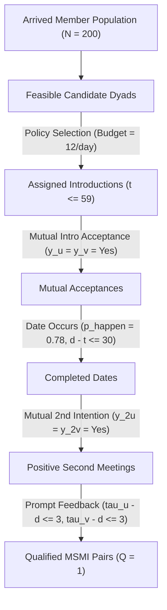
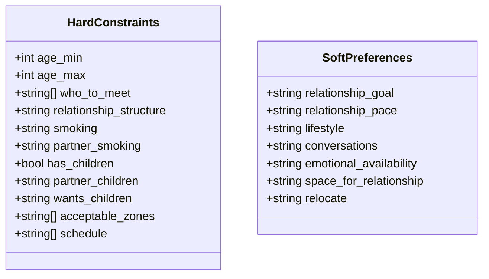

# Glossary, Mathematical Notation, and Domain Variables

**The Sequential Reciprocal Matching Problem Under Changing Conditions**  
**Monograph Reference Systems & Specification Document**  
**Authoritative Reference:** [final_report/REPORT.md](file:///Volumes/1700%20APFS/PERSONAL_PROGRAMMING_PROJECTS/Notes/The%20Sequential%20Matching%20Problem/final_report/REPORT.md) | [DATA_CONTRACT.md](file:///Volumes/1700%20APFS/PERSONAL_PROGRAMMING_PROJECTS/Notes/The%20Sequential%20Matching%20Problem/docs/DATA_CONTRACT.md) | [POLICY_INTERFACE.md](file:///Volumes/1700%20APFS/PERSONAL_PROGRAMMING_PROJECTS/Notes/The%20Sequential%20Matching%20Problem/docs/POLICY_INTERFACE.md)

---

## 1. System Horizons, Time Indices, and Event Days

| Symbol | Definition and Mathematical Domain | Operational Meaning | Implementation Source |
|---|---|---|---|
| $t$ | $t \in \{0, 1, \dots, 59\}$ | Decision day index during which the policy interacts with the environment (asking questions and proposing match batches). | [`kit.py:advance`](file:///Volumes/1700%20APFS/PERSONAL_PROGRAMMING_PROJECTS/Notes/The%20Sequential%20Matching%20Problem/kit.py) |
| $T_{\text{decision}}$ | $60$ days | Total duration of the active decision window ($t=0$ to $t=59$). No actions (asks or introductions) can be submitted after day 59. | [`PROBLEM_STATEMENT.md`](file:///Volumes/1700%20APFS/PERSONAL_PROGRAMMING_PROJECTS/Notes/The%20Sequential%20Matching%20Problem/PROBLEM_STATEMENT.md) |
| $T_{\text{followup}}$ | $40$ days | Post-decision monitoring window ($t=60$ to $t=99$). Downstream simulated events (dates, second meetings, responses) mature without active policy interventions. | [`kit.py:run_sim`](file:///Volumes/1700%20APFS/PERSONAL_PROGRAMMING_PROJECTS/Notes/The%20Sequential%20Matching%20Problem/kit.py) |
| $T_{\text{total}}$ | $100$ days | Full episode lifespan ($T_{\text{decision}} + T_{\text{followup}}$). Day 59 is NOT the outcome deadline; all evaluation occurs after day 99. | [`REPORT.md:§2`](file:///Volumes/1700%20APFS/PERSONAL_PROGRAMMING_PROJECTS/Notes/The%20Sequential%20Matching%20Problem/final_report/REPORT.md) |
| $t_{\text{assign}}$ | $t_{\text{assign}} \in \{0, \dots, 59\}$ | Exact decision day on which an introduction $(u, v)$ is assigned by the policy via the `advance()` batch. | [`kit.py:advance`](file:///Volumes/1700%20APFS/PERSONAL_PROGRAMMING_PROJECTS/Notes/The%20Sequential%20Matching%20Problem/kit.py) |
| $d$ | $d \in \mathbb{N}, \; d \ge t_{\text{assign}}$ | Simulated day on which the physical date occurs between members $u$ and $v$ (conditional on mutual acceptance). | [`kit.py:resolve_date`](file:///Volumes/1700%20APFS/PERSONAL_PROGRAMMING_PROJECTS/Notes/The%20Sequential%20Matching%20Problem/kit.py) |
| $\tau_u, \tau_v$ | $\tau \in \mathbb{N}, \; \tau \ge d$ | Simulated days on which members $u$ and $v$ submit their second-meeting intention feedback. | [`kit.py:resolve_feedback`](file:///Volumes/1700%20APFS/PERSONAL_PROGRAMMING_PROJECTS/Notes/The%20Sequential%20Matching%20Problem/kit.py) |
| $d - t_{\text{assign}} \le 30$ | Boolean condition | Maximum allowed latency from introduction assignment to date occurrence for an outcome to qualify for MSMI. | [`REPORT.md:§2`](file:///Volumes/1700%20APFS/PERSONAL_PROGRAMMING_PROJECTS/Notes/The%20Sequential%20Matching%20Problem/final_report/REPORT.md) |
| $\tau_u - d \le 3, \; \tau_v - d \le 3$ | Boolean condition | Maximum allowed feedback latency for second-meeting intention submission following the date. | [`REPORT.md:§2`](file:///Volumes/1700%20APFS/PERSONAL_PROGRAMMING_PROJECTS/Notes/The%20Sequential%20Matching%20Problem/final_report/REPORT.md) |

---

## 2. Core Mathematical Formulations and Outcome Funnel

### 2.1 The Qualified Outcome Indicator ($Q$)

For any introduction assigned on day $t$ between members $a$ and $b$:
$$Q = \mathbf{1}\left\{ \text{date occurred} \;\land\; (d - t \le 30) \;\land\; (y_a = y_b = \text{yes}) \;\land\; (\tau_a - d \le 3) \;\land\; (\tau_b - d \le 3) \right\}$$

Where:
- $\mathbf{1}\{\cdot\}$ is the indicator function.
- $y_a, y_b \in \{\text{yes}, \text{no}\}$ are the second-meeting intentions.
- One qualified introduction counts as **one outcome unit** (one qualified pair), NOT two members.

### 2.2 Primary Metric: MSMI per 100 Arrived Members

$$\text{MSMI}/100 = 100 \times \frac{\sum_{i=1}^{M} Q_i}{N_{\text{arrived by day 59}}}$$

Where:
- $M$ is the total number of introductions made across the 60 decision days.
- $N_{\text{arrived by day 59}}$ is the total number of distinct members who arrived in the pool on or before day 59 (nominally $200$ members per episode).

### 2.3 Secondary Performance Metrics

| Metric | Mathematical Formula | Denominator / Basis | Interpretation |
|---|---|---|---|
| **Dates / 100** | $100 \times \frac{N_{\text{dates occurred}}}{N_{\text{arrived}}}$ | $N_{\text{arrived}}$ | Physical meetings held. Does not enforce the 30-day deadline or feedback criteria. |
| **Mutual Acceptance / 100** | $100 \times \frac{N_{y_a^{(1)}=y_b^{(1)}=\text{yes}}}{N_{\text{arrived}}}$ | $N_{\text{arrived}}$ | Frequency of both parties accepting the initial introduction. |
| **Introductions / 100** | $100 \times \frac{M}{N_{\text{arrived}}}$ | $N_{\text{arrived}}$ | Total introduction assignments dispatched by the policy. |
| **Coverage (%)** | $\frac{|\{u \in \text{Pool} : \text{Introduced}(u)\}|}{N_{\text{arrived}}}$ | $N_{\text{arrived}}$ | Proportion of arrived members who received at least one introduction. |
| **Unserved (%)** | $1.0 - \text{Coverage}$ | $N_{\text{arrived}}$ | Proportion of arrived members who never received an introduction. |
| **Served Wait Time** | $t_{\text{first\_intro}}(u) - t_{\text{arrived}}(u)$ | Served members only | Latency from arrival to first introduction. **Must exclude unserved members**. |
| **Cumulative Ask Cost** | $\sum_{t=0}^{59} \text{Cost}(A_t)$ | Per episode | Total budget expended on profile questions ($C_{\text{bundle}}=3, C_{\text{soft}}=1$). |

### 2.4 Terminal Probability Decomposition and Latent Factors

Under the parametric outcome model:
$$\mathbb{P}(\text{Terminal Qualified} \mid u, v) = \underbrace{(3/5)^2}_{0.36} \times h \times d \times k_u k_v \times \mathbb{E}\left[ a_u a_v s_u s_v \right]$$

Where:
- **$0.36 = (3/5)^2$**: The probability that two independent feedback delays distributed uniformly over $\{1, 2, 3, 4, 5\}$ days both fall within the 3-day post-date deadline ($P(\tau - d \le 3) = 3/5 = 0.60$).
- **$h = \mathbb{P}(d - t \le 30)$**: Date latency survival factor ($h = 1.0$ in standard families; $h = 5368/5488 \approx 0.978$ under delayed family).
- **$d = 0.78$**: Base date occurrence probability conditional on mutual initial acceptance ($p_{\text{happen}}$).
- **$k_u = \mathbb{E}[R_u^2]$**: Second moment of the response propensity $R_u \sim \text{Uniform}[0.55, 0.98]$.
- **$a_u, a_v$**: First-stage introduction acceptance logistic functions driven by preference weights and dyadic noise.
- **$s_u, s_v$**: Second-meeting intention logistic functions.
- **$S \sim \mathcal{N}(0, 0.45^2)$**: Dyadic shared Gaussian noise common to members $u$ and $v$.

---

## 3. Directional Calibration, Shrinkage, and Adaptive Formulas

### 3.1 Recency-Weighted Empirical Drift Estimation

For adaptive arm $X1$, past feedback responses $k \in \{1, \dots, K\}$ observed at day $t_k$ are weighted by exponential recency:
$$w_k = 2^{-(t - t_k) / \tau_{\text{half}}}, \quad \text{with half-life } \tau_{\text{half}} = 14 \text{ days}$$

The objective minimized at decision day $t$ incorporates an $L_2$ MAP shrinkage penalty towards the baseline prior:
$$\mathcal{L}(\theta) = -\sum_{k=1}^K w_k \log \mathbb{P}(y_k \mid x_k; \theta) + \frac{\lambda}{2} \|\theta - \theta_{\text{prior}}\|_2^2, \quad \lambda = 0.05$$

### 3.2 Directional Logit Calibration with Conservative Shrinkage

Using a sliding observation window of $W = 21$ days, the policy estimates the empirical bias $\hat{\Delta}$ of predicted logits versus observed binary acceptance:
$$\hat{\Delta} = \text{mean}\left(\text{logit}(\hat{y}_k) - \text{logit}(y_k)\right), \quad \text{SE}(\hat{\Delta}) = \frac{\hat{\sigma}_\Delta}{\sqrt{K_{21}}}$$

To guard against noise-induced overcorrection on sparse feedback, directional shrinkage is applied using a 90% normal critical value ($z_{0.95} = 1.64485$):
$$\Delta_{\text{applied}} = \text{sign}(\hat{\Delta}) \max\left(0, \; |\hat{\Delta}| - 1.64485 \cdot \text{SE}(\hat{\Delta})\right)$$

- If $|\hat{\Delta}| \le 1.64485 \cdot \text{SE}(\hat{\Delta})$, $\Delta_{\text{applied}} = 0$ (no adjustment made).
- If $|\hat{\Delta}| > 1.64485 \cdot \text{SE}(\hat{\Delta})$, the correction is shrunken towards zero by $1.64485 \cdot \text{SE}(\hat{\Delta})$.

---

## 4. Statistical Evaluation, Calibration, and Multiplicity Metrics

### 4.1 Calibration Diagnostics

| Metric | Formula | Description & Meaning |
|---|---|---|
| **Brier Score** | $\text{BS} = \frac{1}{N}\sum_{i=1}^N (p_i - y_i)^2$ | Mean squared error of predicted probability $p_i \in [0, 1]$ against realized binary outcome $y_i \in \{0, 1\}$. |
| **Brier (Zero)** | $\text{BS}_0 = \frac{1}{N}\sum_{i=1}^N (0 - y_i)^2 = \bar{y}$ | Benchmark Brier score achieved by a trivial policy predicting zero probability for every dyad. |
| **Brier (Prevalence)** | $\text{BS}_{\text{prev}} = \bar{y}(1 - \bar{y})$ | Descriptive reference score achieved by predicting sample mean prevalence everywhere. |
| **Signed Error (Bias)** | $\text{Bias} = \frac{1}{N}\sum_{i=1}^N (p_i - y_i)$ | Mean prediction minus observed outcome. Negative indicates underprediction; positive indicates overprediction. |
| **Expected Calibration Error (ECE)** | $\text{ECE} = \sum_{b=1}^B \frac{N_b}{N} |\bar{p}_b - \bar{y}_b|$ | Weighted average absolute error across $B$ probability bins ($N_b$ items in bin $b$). |

### 4.2 Seed-Cluster Contrast Inference

For arm $a$, reference baseline $G$, seed cluster $s \in \{1, \dots, S\}$, and fixed law set $\mathcal{L}$:
$$D_s = \frac{1}{|\mathcal{L}|}\sum_{\ell \in \mathcal{L}} \left( Y_{s\ell a} - Y_{s\ell G} \right)$$

The aggregate contrast estimator, sample standard error, and Student-$t$ confidence interval are:
$$\bar{D} = \frac{1}{S}\sum_{s=1}^S D_s, \quad s_D = \sqrt{\frac{1}{S-1}\sum_{s=1}^S (D_s - \bar{D})^2}, \quad \text{SE}(\bar{D}) = \frac{s_D}{\sqrt{S}}$$
$$\text{CI}_{1-\alpha} = \left[ \bar{D} - t_{S-1, 1-\alpha/2} \cdot \text{SE}(\bar{D}), \quad \bar{D} + t_{S-1, 1-\alpha/2} \cdot \text{SE}(\bar{D}) \right]$$

### 4.3 Step-Down Holm-Bonferroni Multiplicity Correction

To control family-wise error rate (FWER) across $m$ exploratory hypothesis tests within a study family, two-sided p-values $p_{(1)} \le p_{(2)} \le \dots \le p_{(m)}$ are adjusted via step-down with cumulative maximum monotonicity:
$$p_{(k)}^{\text{adj}} = \max_{j \le k} \min\left(1, \; (m - j + 1) \cdot p_{(j)}\right)$$

---

## 5. Domain Variables, Attributes, and Data Contract Schema

### 5.1 Member Record Schema (`members.jsonl`)

| Field Name | Type / Allowed Range | Nullable? | Role and Operational Semantics |
|---|---|---|---|
| `member_id` | String (`syn_` + 32 hex chars) | No | Unique synthetic member identifier. Opaque string; cannot be decomposed. |
| `pool_id` | String (`public_01` to `public_10`) | No | Partition identifier. Members can only match within their designated pool. |
| `age` | Integer $\in [21, 46]$ | No | Exact synthetic age used for reciprocal age compatibility. |
| `gender` | `woman` \| `man` \| `non_binary` | No | Self-declared gender identity. Never used to infer romantic preferences. |
| `zone` | Opaque string label | No | Geographic sector. Must reciprocally match acceptable partner zones. |
| `arrived_day` | Integer $\in [0, 20]$ | No | Day member enters the active matching market. Unavailable before this day. |
| `available` | Boolean (`true` \| `false`) | No | Dynamic operational state. False when paused, matched, or inactive. |
| `fields` | Object dictionary | No | Map of preference and profile traits (detailed in §5.2). Null if unobserved. |
| `field_status` | Enum (`observed`, `not_asked`, `declined`) | No | Explicit tracking of information missingness versus explicit refusal. |
| `field_observed_day` | Integer $\in [0, 59]$ or `null` | Yes | Day field became visible to the policy via initial survey or question. |

### 5.2 Hard Constraint Fields (Bundle: `constraints`, Cost = 3)

All 11 hard constraint fields must be strictly satisfied reciprocally. Any unknown or declined hard field prevents eligibility check clearance (`needs_clarification`).

1. **`age_min`, `age_max`**: Inclusive integers $[18, 65]$. Member $u$'s age must fall in $[v.\text{age\_min}, v.\text{age\_max}]$, and vice versa.
2. **`who_to_meet`**: Non-empty array $\subseteq \{\text{woman}, \text{man}, \text{non\_binary}\}$. Must contain partner's gender reciprocally.
3. **`relationship_structure`**: Enum (`monogamous`, `non_monogamous`). Both members must hold identical values.
4. **`smoking`**: Enum (`no`, `occasionally`, `yes`). Stated personal consumption.
5. **`partner_smoking`**: Enum (`no_smoking`, `any`). If `no_smoking`, partner cannot be `yes` or `occasionally`.
6. **`has_children`**: Boolean (`true`, `false`). Stated parental status.
7. **`partner_children`**: Enum (`no_children`, `any`). If `no_children`, partner cannot have `has_children == true`.
8. **`wants_children`**: Enum (`yes`, `no`, `unsure`). Conflict occurs only if one states `yes` and the other states `no`. `unsure` does not conflict.
9. **`acceptable_zones`**: Non-empty array of zone strings. Each member's zone must belong to the other's acceptable list.
10. **`schedule`**: Array $\subseteq \{\text{weekday\_evening}, \text{weekend\_day}, \text{weekend\_evening}\}$. Must have at least one overlapping slot.

### 5.3 Soft Preference Fields (Individual Cost = 1)

Soft fields are used for compatibility scoring and ranking. They do NOT block feasibility.
- **`relationship_goal`**: `long_term` | `exploring`
- **`relationship_pace`**: `slow` | `steady` | `quick`
- **`lifestyle`**: `quiet` | `mixed` | `social`
- **`conversations`**: `ideas` | `stories` | `practical` | `playful`
- **`emotional_availability`**: `ready` | `taking_time`
- **`space_for_relationship`**: `limited` | `moderate` | `ample`
- **`relocate`**: `yes` | `no` | `unsure`

### 5.4 Feedback Event Types (`feedback.jsonl`)

- **`introduction_response`**: Emitted per individual member $\in \{\text{yes}, \text{no}, \text{null}\}$. Both must be `yes` for date scheduling.
- **`date_happened`**: Emitted at pair level $\in \{\text{true}, \text{false}\}$. Requires prior mutual acceptance.
- **`second_meeting_intention`**: Emitted per member $\in \{\text{yes}, \text{no}, \text{null}\}$ only after date occurs.
- **`pause_after_mutual_interest`**: Emitted at pair level (`true`) when both state positive second-meeting intentions.

---

## 6. Technical and Algorithmic Terminology

### 6.1 Feasibility and Matching Graph Concepts

- **Reciprocal Hard Feasibility**: A dyad $(u, v)$ is feasible if and only if all 11 hard constraints are reciprocally verified as mutually satisfied. Unobserved or declined hard constraints yield `needs_clarification`.
- **Graph Sparsity**: The ratio of feasible edges to all possible $\binom{N}{2}$ pairs. In this benchmark, before clarification, active feasible density is under $0.1\%$ (~17.8 edges per 200 members in development).
- **Non-Bipartite Matching**: Because pool populations include non-binary members and arbitrary preference overlaps, the compatibility graph $G = (V, E)$ is general, not bipartite. Algorithms assuming bipartition (e.g., standard Hungarian method) cannot represent the full feasible set without graph loss.
- **Maximal vs. Maximum Matching**:
  - *Maximal Matching*: An edge set where no additional disjoint edge can be added without removing an existing edge. Greedy first-fit produces a maximal matching.
  - *Maximum Cardinality / Weight Matching (MWM)*: An edge set maximizing total cardinality or edge weights (solved in general graphs via Edmonds' Blossom algorithm).
- **FIFO Clarification Invariance**: The mathematical theorem establishing that any policy requesting hard-constraint bundles in public member-list order exhausts identical queries and incurs identical ask costs on a given world seed, completely invariant to the matching decisions made. This holds because members with unverified hard profiles cannot be matched and thus remain available.

### 6.2 Prior Structures and Adaptive Estimation

- **Simulator-Informed Prior (`sim`)**: Parametric prior whose hyperparameters (latent variances, base weights, date occurrence probability $d=0.78$) are initialized using exact knowledge of the synthetic generator specification.
- **Observable-Fit Prior (`emp`)**: Empirical prior estimated from 10 public snapshot datasets (2,000 members). Fits observable Beta response distributions and logistic weights from public tables, but retains generator latent scales ($0.65, 0.45, 0.50$).
- **Flat Prior (`flat`)**: Uninformative prior assuming equal logits and diffuse uncertainty.
- **Snapshot Censoring**: The methodological distortion arising when evaluating outcomes at an intermediate day (e.g. day 30). For example, mutual acceptances pending date occurrence are falsely counted as non-dates if follow-up maturity is ignored, biasing date occurrence rate estimates downwards ($0.4762$ vs true $0.78$).

### 6.3 Inferential and Experimental Concepts

- **Seed Cluster Inference**: Statistical analysis where all episodes sharing the same underlying random seed identifier (across all scenario laws) are aggregated into a single cluster difference $D_s$. Treats the seed (world population) as the independent unit of analysis, avoiding false degrees of freedom.
- **Independent Observation Fallacy**: The erroneous practice of treating related scenario variations on the same seed (e.g., 16 laws on 12 seeds = 192 rows) as independent samples ($N=192$), producing artificially deflated standard errors and spurious statistical significance.
- **Holm-Bonferroni Multiplicity Adjustment**: A step-down procedure ensuring strong control of family-wise Type I error rate without the over-conservatism of single-step Bonferroni.
- **Closed Research Protocol**: Strict governance protocol mandating that once confirmatory evaluation or report synthesis begins, no new policy tuning, heuristic search, hyperparameter adjustment, or simulation runs may take place.
