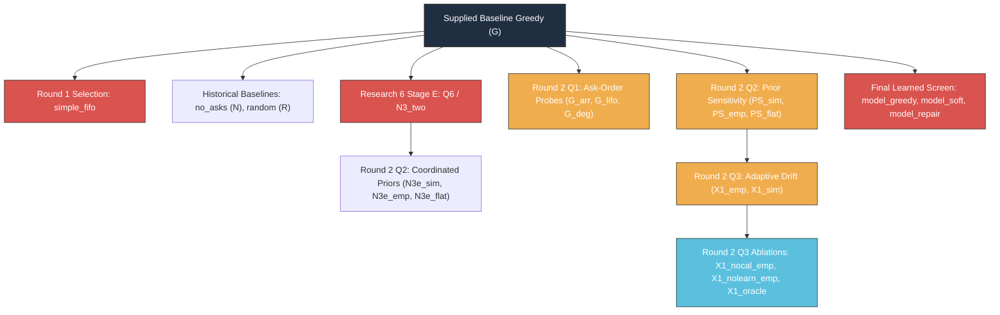

# Policy Aliases, Architectural Lineage, and Algorithmic Taxonomies

**The Sequential Reciprocal Matching Problem Under Changing Conditions**  
**Monograph Reference Systems & Lineage Registry**  
**Authoritative Reference:** [final_report/REPORT.md](file:///Volumes/1700%20APFS/PERSONAL_PROGRAMMING_PROJECTS/Notes/The%20Sequential%20Matching%20Problem/final_report/REPORT.md) | [research9/round2/arms.py](file:///Volumes/1700%20APFS/PERSONAL_PROGRAMMING_PROJECTS/Notes/The%20Sequential%20Matching%20Problem/research9/round2/arms.py) | [ROUND1_SUBMISSION.md](file:///Volumes/1700%20APFS/PERSONAL_PROGRAMMING_PROJECTS/Notes/The%20Sequential%20Matching%20Problem/ROUND1_SUBMISSION.md)

---

## 1. Complete Policy Lineage and Decision Taxonomy

---

## 2. Comprehensive Master Policy Registry

| Arm Identifier | Canonical Code Alias | Historical Cohort & Source Phase | Parent / Control Baseline | Clarification Strategy (Asks) | Dyad Scoring Function | Batch Allocation Rule | Empirical Results & Statistical Verdict | Production Status |
|---|---|---|---|---|---|---|---|---|
| **`G`** | `greedy` | Base release & root executable ([`policy.py`](file:///Volumes/1700%20APFS/PERSONAL_PROGRAMMING_PROJECTS/Notes/The%20Sequential%20Matching%20Problem/policy.py)) | None (Standard Reference) | Public member-list order FIFO hard asks (`constraints` bundle, cost 3, up to budget // 3 = 4 asks/day). | Number of matching, observed soft-field values ($S_{uv} = \sum_{f} \mathbf{1}\{x_{uf} = x_{vf} \neq \text{null}\}$). | Greedy maximal matching sorted descending by soft score; deterministic tie-breaks. | **Baseline Reference**. Q1 MSMI: 0.4557 (175 pairs); Q2 MSMI: 0.5167 (62 pairs); Q3 MSMI: 0.5833 (84 pairs); Learned Screen: 0.3229 (31 pairs). | **RETAINED** root executable. Default production standard. |
| **`simple_fifo`** | `simple_fifo` | Round 1 Confirmatory Submission ([`ROUND1_SUBMISSION.md`](file:///Volumes/1700%20APFS/PERSONAL_PROGRAMMING_PROJECTS/Notes/The%20Sequential%20Matching%20Problem/ROUND1_SUBMISSION.md)) | `G` | Public member-list FIFO hard-bundle asks (cost 3, up to 4/day). Zero soft questions. | Constant aggregate terminal probability estimate ($P_{\text{term}} \approx \text{const}$). All candidate edges have uniform score. | Greedy first-fit in canonical member ID order (scores provide no discrimination). | **Negative Confirmatory**. 40 seed clusters (480 eps): Diff vs G = $-0.04167$ MSMI/100, 95% CI [$-0.09107, +0.00773$], $p = 0.09596$. | **DISCARDED**. Failed to demonstrate superiority over G. |
| **`G_arr`** | `greedy_arrival` | Round 2 Q1 Robustness Study ([`research9/round2/arms.py`](file:///Volumes/1700%20APFS/PERSONAL_PROGRAMMING_PROJECTS/Notes/The%20Sequential%20Matching%20Problem/research9/round2/arms.py)) | `G` | Chronological arrival order hard-bundle asks (`arrived_day` ascending; tie-break by list order). | Same as `G` (count of equal observed soft answers). | Same as `G` (greedy maximal matching). | **Exploratory Lead Only**. 192 eps (12 seeds): 213 pairs, 0.5547 MSMI/100. Diff vs G = $+0.0990$, 95% CI [$-0.0701, +0.2680$], Holm $p = 0.8965$. | **REJECTED FOR PROMOTION**. CI includes zero under seed-cluster inference. |
| **`G_lifo`** | `greedy_reverse_arrival` | Round 2 Q1 Robustness Study | `G` | Reverse arrival order hard-bundle asks (`arrived_day` descending; newly arrived first). | Same as `G` (count of equal observed soft answers). | Same as `G` (greedy maximal matching). | 192 eps (12 seeds): 176 pairs, 0.4583 MSMI/100. Diff vs G = $+0.0026$, 95% CI [$-0.0977, +0.1029$], Holm $p = 1.000$. | **DISCARDED**. Indistinguishable from baseline G. |
| **`G_deg`** | `greedy_degree` | Round 2 Q1 Robustness Study | `G` | Potential degree order hard-bundle asks (prioritize members with maximum feasible candidate edges). | Same as `G` (count of equal observed soft answers). | Same as `G` (greedy maximal matching). | 192 eps (12 seeds): 149 pairs, 0.3880 MSMI/100. Diff vs G = $-0.0677$, 95% CI [$-0.2408, +0.1054$], Holm $p = 1.000$. | **DISCARDED**. Point estimate inferior to G. |
| **`P`** | `population_model` | Research 3/4/6 & Q1 Robustness | `G` | Baseline member-list FIFO hard asks. | Static population logistic regression score without dyadic personal preferences. | Greedy allocation on predicted population probability. | Q1: 130 pairs, 0.3385 MSMI/100. Diff vs G = $-0.1172$, 95% CI [$-0.2677, +0.0333$], Holm $p = 0.5732$. Learned Screen: 0.1979 MSMI/100. | **HISTORICAL CONTROL**. Confirmed inferior to G across all studies. |
| **`Q6`** | `N3_two` | Research 6 Stage E & Q1 Robustness ([`research6/REPORT.md`](file:///Volumes/1700%20APFS/PERSONAL_PROGRAMMING_PROJECTS/Notes/The%20Sequential%20Matching%20Problem/research6/REPORT.md)) | `G` | Coordinated two-query lookahead (joint hard-constraint asking for complementary pairs). | Parametric outcome probability model under simulator prior. | Greedy maximal matching on predicted terminal reward. | **Large Confirmatory Negative**. Research 6 Stage E (571 clusters, 6,852 eps): Diff vs G = $+0.003211$, 99% CI [$-0.02448, +0.03090$], $p = 0.7646$. Q1: Diff vs G = $-0.0313$. | **DISCARDED**. Definitively failed in 571-cluster confirmatory trial. |
| **`PS_sim`** | `parametric_sim` | Round 2 Q2 Prior Sensitivity ([`research9/round2/arms.py`](file:///Volumes/1700%20APFS/PERSONAL_PROGRAMMING_PROJECTS/Notes/The%20Sequential%20Matching%20Problem/research9/round2/arms.py)) | `G` (asks) | Baseline member-list FIFO hard asks (identical ask logs to G). | Multi-stage parametric outcome model initialized with **simulator-informed prior**. | Greedy allocation on expected terminal reward. | 60 eps (12 seeds): 53 pairs, 0.4417 MSMI/100. Diff vs G = $-0.0750$, 95% CI [$-0.2466, +0.0966$], Holm $p = 1.000$. | **DISCARDED**. Underperforms simple soft agreement. |
| **`PS_emp`** | `parametric_emp` | Round 2 Q2 Prior Sensitivity & Q3 Drift | `G` (asks) | Baseline member-list FIFO hard asks (identical ask logs to G). | Multi-stage parametric outcome model initialized with **public-observation empirical prior**. | Greedy allocation on expected terminal reward. | Q2: 49 pairs, 0.4083 MSMI/100. Diff vs G = $-0.1083$, 95% CI [$-0.2969, +0.0803$], Holm $p = 1.000$. Direct vs PS_sim = $-0.0333$. | **DISCARDED**. Empirical prior does not improve allocation. |
| **`PS_flat`** | `parametric_flat` | Round 2 Q2 Prior Sensitivity | `G` (asks) | Baseline member-list FIFO hard asks (identical ask logs to G). | Multi-stage parametric outcome model initialized with **uninformative flat prior**. | Greedy allocation on expected terminal reward. | 60 eps (12 seeds): 58 pairs, 0.4833 MSMI/100. Diff vs G = $-0.0333$, 95% CI [$-0.2403, +0.1736$], Holm $p = 1.000$. | **DISCARDED**. No gain over baseline G. |
| **`N3e_sim`** | `n3_two_sim` | Round 2 Q2 Prior Sensitivity | `Q6` | Coordinated two-query lookahead acquisition under simulator prior. | Parametric scorer under simulator prior. | Greedy maximal matching on expected terminal reward. | 60 eps (12 seeds): 67 pairs, 0.5583 MSMI/100. Diff vs G = $+0.0417$, 95% CI [$-0.1792, +0.2625$], Holm $p = 1.000$. | **DISCARDED**. No confirmed gain over G. |
| **`N3e_emp`** | `n3_two_emp` | Round 2 Q2 Prior Sensitivity | `Q6` | Coordinated two-query lookahead acquisition under empirical prior. | Parametric scorer under empirical prior. | Greedy maximal matching on expected terminal reward. | 60 eps (12 seeds): 68 pairs, 0.5667 MSMI/100. Diff vs G = $+0.0500$, 95% CI [$-0.0785, +0.1785$], Holm $p = 1.000$. Direct vs N3e_sim = $+0.0083$. | **DISCARDED**. CI includes zero. |
| **`N3e_flat`** | `n3_two_flat` | Round 2 Q2 Prior Sensitivity | `Q6` | Coordinated two-query lookahead acquisition under flat prior. | Parametric scorer under flat prior. | Greedy maximal matching on expected terminal reward. | 60 eps (12 seeds): 62 pairs, 0.5167 MSMI/100. Diff vs G = $0.0000$, 95% CI [$-0.1777, +0.1777$], Holm $p = 1.000$. | **DISCARDED**. Point estimate identical to G. |
| **`X1_emp`** | `adaptive_emp` | Round 2 Q3 Drift Study ([`research9/round2/policies/model.py`](file:///Volumes/1700%20APFS/PERSONAL_PROGRAMMING_PROJECTS/Notes/The%20Sequential%20Matching%20Problem/research9/round2/policies/model.py)) | `G` (asks), `PS_emp` (scorer) | Baseline member-list FIFO hard asks (identical ask logs to G). | Recency-weighted acceptance logistic estimation ($\tau_{\text{half}}=14$d) + directional logit calibration with shrinkage. | Greedy matching on adaptive scores. Zero hold/reservation threshold. | 72 eps (12 seeds): 64 pairs, 0.4444 MSMI/100. Diff vs G = $-0.1389$, 95% CI [$-0.4632, +0.1854$], Holm $p = 1.000$. Direct vs PS_emp = $+0.0139$. | **DISCARDED**. Point estimate inferior to G. |
| **`X1_sim`** | `adaptive_sim` | Round 2 Q3 Drift Study | `G` (asks), `PS_sim` (scorer) | Baseline member-list FIFO hard asks (identical ask logs to G). | Recency-weighted acceptance logistic estimation starting from simulator prior + directional calibration. | Greedy matching on adaptive scores. | 72 eps (12 seeds): 74 pairs, 0.5139 MSMI/100. Diff vs G = $-0.0694$, 95% CI [$-0.4110, +0.2721$], Holm $p = 1.000$. | **DISCARDED**. Underperforms G. |
| **`X1_nocal_emp`** | `adaptive_nocal_emp` | Round 2 Q3 Component Ablation | `X1_emp` | Baseline member-list FIFO hard asks (identical ask logs to G). | Recency-weighted acceptance logistic estimation **WITHOUT** directional logit calibration ($\Delta_{\text{applied}} = 0$). | Greedy matching on uncalibrated adaptive scores. | 72 eps (12 seeds): 64 pairs, 0.4444 MSMI/100. **Action Digest Invariance**: Exactly matches `X1_emp` across all 72 episodes (diff = $0.0000$). | **DIAGNOSTIC ABLATION**. Demonstrates directional calibration had zero effect on matching decisions. |
| **`X1_nolearn_emp`** | `adaptive_nolearn_emp` | Round 2 Q3 Component Ablation | `X1_emp` | Baseline member-list FIFO hard asks (identical ask logs to G). | Static empirical prior weights **WITHOUT** recency learning, but retaining directional logit calibration. | Greedy matching on calibrated static scores. | 72 eps (12 seeds): 62 pairs, 0.4306 MSMI/100. Exactly matches `PS_emp` (diff = $0.0000$). | **DIAGNOSTIC ABLATION**. Verifies weight learning accounts for the $+0.0139$ MSMI/100 shift over static PS. |
| **`X1_oracle`** | `adaptive_oracle` | Round 2 Q3 Privileged Diagnostic | `X1_sim` | Baseline member-list FIFO hard asks (identical ask logs to G). | Parametric scorer provided with **exact ground-truth simulator drift schedule** and true shift timing. | Greedy matching on oracle-informed scores. | 72 eps (12 seeds): 66 pairs, 0.4583 MSMI/100. Diff vs G = $-0.1250$, 95% CI [$-0.4342, +0.1842$], Holm $p = 1.000$. | **PRIVILEGED BENCHMARK**. Proves even perfect drift knowledge does not rescue complex scorers on sparse graphs. |
| **`no_asks`** | `N` | Historical Baseline Suite ([`kit.py`](file:///Volumes/1700%20APFS/PERSONAL_PROGRAMMING_PROJECTS/Notes/The%20Sequential%20Matching%20Problem/kit.py)) | None | Zero questions asked ($C_{\text{ask}} = 0$). | Observed soft agreement on unclarified profiles. | Greedy matching on whatever sparse unclarified feasible edges exist. | Historical matched grid (30 eps, seeds 301–305): 3 pairs, 0.0500 MSMI/100, 0.850 Dates/100, 10.70% coverage. | **LOWER BOUND CONTROL**. Proves hard-constraint clarification is mandatory for graph construction. |
| **`random`** | `R` | Historical Baseline Suite ([`kit.py`](file:///Volumes/1700%20APFS/PERSONAL_PROGRAMMING_PROJECTS/Notes/The%20Sequential%20Matching%20Problem/kit.py)) | `G` (asks) | Baseline member-list FIFO hard asks ($C_{\text{ask}} = 201.0$). | Uniform random assignment of edge weights. | Greedy maximal matching in randomized edge order. | Historical matched grid (30 eps, seeds 301–305): 19 pairs, 0.3167 MSMI/100, 4.633 Dates/100, 34.25% coverage. | **RANDOM-FEASIBLE CONTROL**. Demonstrates baseline soft scoring adds modest value over arbitrary feasible matching. |
| **`model_greedy`** | `learned_greedy` | Final Learned Campaign ([`research9/final_campaign/`](file:///Volumes/1700%20APFS/PERSONAL_PROGRAMMING_PROJECTS/Notes/The%20Sequential%20Matching%20Problem/research9/final_campaign/)) | `G` | Baseline member-list FIFO hard asks. | Random forest ranker trained on 216k historical public dyads using assignment-time features. | Greedy matching on model ranking. | 48 cells (8 dev groups): 18 pairs, 0.1875 MSMI/100 (vs G = 0.3229, 31 pairs). Max cold transport: 1.79s. | **DISCARDED AT SCREEN GATE**. Failed screen admission rule; confirmation remained unopened. |
| **`model_repair`** | `learned_repair` | Final Learned Campaign | `G` | Baseline member-list FIFO hard asks. | Learned ranker + 2-opt local edge exchange on initial greedy matching. | Local repair allocation maximizing batch predicted score. | 48 cells (8 dev groups): 21 pairs, 0.2188 MSMI/100 (vs G = 0.3229). Max cold transport: 1.93s. | **DISCARDED AT SCREEN GATE**. Failed screen admission rule. |
| **`model_soft`** | `learned_soft_query` | Final Learned Campaign | `G` | Dynamic allocation of daily budget: up to 2 soft questions per member alongside hard bundles. | Learned ranker incorporating clarified soft features. | Greedy matching on updated soft predictions. | 48 cells (8 dev groups): 21 pairs, 0.2188 MSMI/100 (vs G = 0.3229). Max cold transport: 1.61s. | **DISCARDED AT SCREEN GATE**. Soft clarification wasted budget without improving matches. |

---

## 3. Key Architectural and Mechanistic Invariances

### 3.1 FIFO Clarification Invariance

$$\forall \pi_1, \pi_2 \in \Pi_{\text{FIFO-hard}}, \quad \text{Asks}(\pi_1, s, \ell) \equiv \text{Asks}(\pi_2, s, \ell) \quad \text{and} \quad \text{Cost}(\pi_1, s, \ell) \equiv \text{Cost}(\pi_2, s, \ell)$$

*Proof / Mechanism*: Incomplete members (those with unobserved or unclarified hard fields) cannot be matched under the reciprocal feasibility contract. Consequently, their availability is governed strictly by exogenous arrival and departure laws, completely decoupled from any matching assignments made among already-verified members. Any policy using list-order FIFO hard questioning visits identical members in identical order on identical days.

### 3.2 Action Digest Invariance under Directional Logit Calibration

$$\text{Actions}(X1\text{\_emp}, s, \ell) \equiv \text{Actions}(X1\text{\_nocal\_emp}, s, \ell) \quad \forall 72 \text{ cells in Q3}$$

*Proof / Mechanism*: A common logit offset $\Delta_{\text{applied}}$ applied to all candidate edges changes the absolute predicted probabilities, but preserves the strictly monotonic rank ordering of edges:
$$\text{logit}(p_{uv}) + \Delta > \text{logit}(p_{wz}) + \Delta \iff p_{uv} > p_{wz}$$
Because the allocation algorithm is a greedy first-fit selector without a reservation or holding threshold, modifying the global probability scale without altering relative dyadic ranking results in an identical matching batch on every day.
