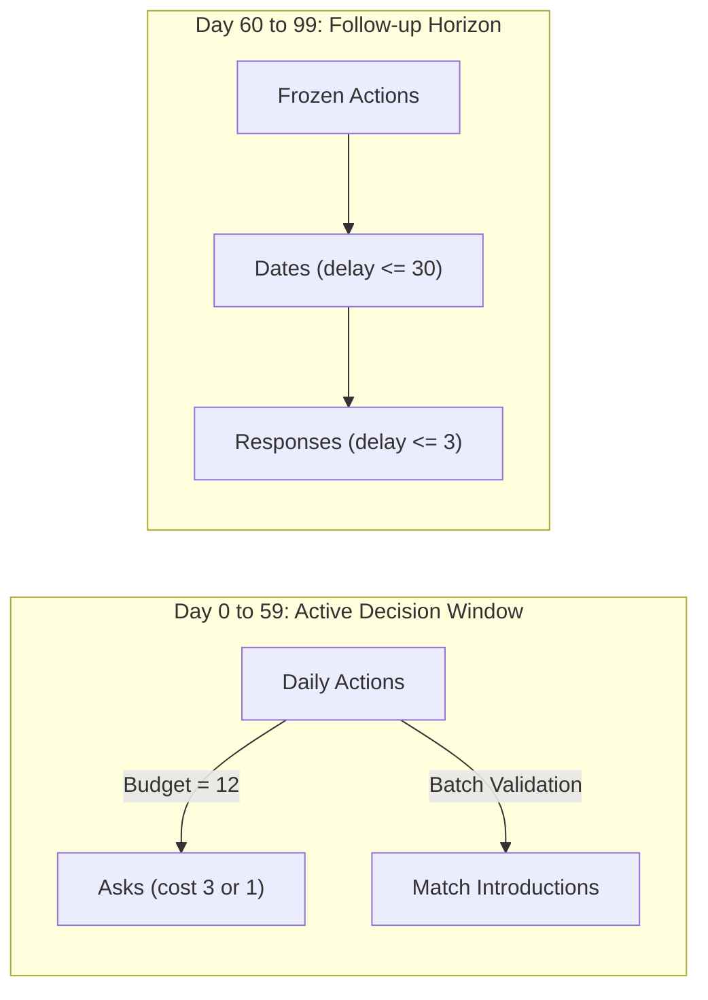

# Executive Quick Reference: The Sequential Reciprocal Matching Problem

**Authoritative System Summary & Oral Defense Cheat Sheet**  
**Monograph Reference Systems** | Reference: [final_report/REPORT.md](file:///Volumes/1700%20APFS/PERSONAL_PROGRAMMING_PROJECTS/Notes/The%20Sequential%20Matching%20Problem/final_report/REPORT.md) | Entrypoint: [`policy.py`](file:///Volumes/1700%20APFS/PERSONAL_PROGRAMMING_PROJECTS/Notes/The%20Sequential%20Matching%20Problem/policy.py)

---

## 1. System Constants and Operating Parameters

| Dimension | Exact Numerical Value | Enforcement & Implementation Semantics |
|---|---|---|
| **Active Decision Horizon** | **60 days** ($t \in [0, 59]$) | Policy is queried twice daily: `resolve_asks()` then `advance()`. Frozen after day 59. |
| **Follow-up Horizon** | **40 days** ($t \in [60, 99]$) | Downstream events mature. Day 59 is NOT an outcome cutoff; evaluation occurs after day 99. |
| **Total Episode Lifespan** | **100 days** | Complete simulation boundary. |
| **Population per Episode** | **200 arrived members** | Nominal denominator for primary metric $\text{MSMI}/100$. Arrivals occur across days $0$ to $20$. |
| **Daily Asking Budget** | **12 units / day** | Non-cumulative (unused budget does not roll over). |
| **Hard Constraint Bundle** | **3 units** (`constraints`) | Returns all 11 hard fields for 1 member. Max $12 / 3 = 4$ bundles/day. |
| **Soft Attribute Question** | **1 unit** (single named field) | Returns 1 named soft field for 1 member. Max 12 questions/day. |
| **Date Latency Deadline** | **$\le 30$ days** post-intro | Date must occur within 30 days of assignment ($d - t \le 30$). |
| **Feedback Latency Deadline**| **$\le 3$ days** post-date | Second-meeting response must arrive within 3 days ($\tau - d \le 3$). Factor: $(3/5)^2 = 0.36$. |
| **Container Compute Limits** | **10s** / call, **1 GiB** RAM, **2** cores | Read-only filesystem, no network, no GPU. Maximum image size 2 GiB. |

---

## 2. Primary Objective and Outcome Funnel

$$\text{MSMI}/100 = 100 \times \frac{\sum_{i=1}^M Q_i}{N_{\text{arrived by day 59}}}$$
$$Q = \mathbf{1}\left\{ \text{date occurred} \;\land\; (d - t \le 30) \;\land\; (y_a = y_b = \text{yes}) \;\land\; (\tau_a - d \le 3) \;\land\; (\tau_b - d \le 3) \right\}$$

- **Outcome Unit**: One qualified introduction pair ($Q=1$) counts as **one outcome unit** (NOT two individuals).
- **Date Occurrence Probability**: $d = 0.78$ ($p_{\text{happen}}$) conditional on mutual introduction acceptance.
- **Two-Sided Promptness Factor**: $P(\tau_a - d \le 3 \land \tau_b - d \le 3) = (3/5)^2 = 0.36$ under uniform $[1, 5]$ delay.

---

## 3. Retained Production Policy (`policy.py`)

The official production recommendation retains the **Supplied Baseline Greedy Policy ($G$)**:
1. **Clarification Strategy**: Request hard-constraint bundles (`constraints`, cost 3) for up to 4 available members per day who have missing, non-declined hard fields, ordered strictly by public member-list appearance. **Zero soft-field asks**.
2. **Edge Compatibility Scoring**: Count identical, observed soft-field answers between eligible candidates:
   $$S_{uv} = \sum_{f \in \text{soft}} \mathbf{1}\left\{ x_{uf} = x_{vf} \neq \text{null} \right\}$$
3. **Allocation Engine**: Greedy first-fit maximal matching. Feasible edges are sorted descending by soft score $S_{uv}$, breaking ties deterministically by canonical member-ID pairs. Zero reservation threshold (immediate dispatch).

---

## 4. Master Statistical Contrasts Summary

*All contrasts evaluated as $\Delta(\text{Arm} - G)$ using honest seed-cluster contrasts with Student-$t$ distributions.*

| Candidate Arm | Study / Cohort | Independent Unit | Mean Diff $\Delta$ | 95% Confidence Interval | $p$-value | Holm $p$ | Production Verdict |
|---|---|---|---|---|---|---|---|
| **`simple_fifo`** | Round 1 Confirmatory | 40 Seed Clusters | $-0.0417$ | [$-0.0911, +0.0077$] | $0.0960$ | — | **Refuted**. Failed confirmatory superiority test. |
| **`Q6` (`N3_two`)** | Research 6 Stage E | 571 Seed Clusters | $+0.0032$ | [$-0.0245, +0.0309$]* | $0.7646$ | — | **Refuted**. Null cannot be rejected ($N=6,852$ eps, *99% CI). |
| **`G_arr`** | Round 2 Q1 Robustness | 12 Seed Clusters | $+0.0990$ | [$-0.0701, +0.2680$] | $0.2241$ | $0.8965$ | **Exploratory Only**. Spans zero under cluster inference. |
| **`G_lifo`** | Round 2 Q1 Robustness | 12 Seed Clusters | $+0.0026$ | [$-0.0977, +0.1029$] | $0.9555$ | $1.0000$ | **Discarded**. Indistinguishable from baseline G. |
| **`G_deg`** | Round 2 Q1 Robustness | 12 Seed Clusters | $-0.0677$ | [$-0.2408, +0.1054$] | $0.4076$ | $1.0000$ | **Discarded**. Point estimate inferior to G. |
| **`PS_sim`** | Round 2 Q2 Priors | 12 Seed Clusters | $-0.0750$ | [$-0.2466, +0.0966$] | $0.3568$ | $1.0000$ | **Discarded**. Simulator-informed scorer trails G. |
| **`PS_emp`** | Round 2 Q2 Priors | 12 Seed Clusters | $-0.1083$ | [$-0.2969, +0.0803$] | $0.2323$ | $1.0000$ | **Discarded**. Empirical prior distorted by censoring. |
| **`PS_flat`** | Round 2 Q2 Priors | 12 Seed Clusters | $-0.0333$ | [$-0.2403, +0.1736$] | $0.7296$ | $1.0000$ | **Discarded**. Flat prior yields no advantage. |
| **`X1_emp`** | Round 2 Q3 Drift | 12 Seed Clusters | $-0.1389$ | [$-0.4632, +0.1854$] | $0.3661$ | $1.0000$ | **Discarded**. Adaptive tracking fails on sparse feedback. |
| **`X1_oracle`** | Round 2 Q3 Diagnostic | 12 Seed Clusters | $-0.1250$ | [$-0.4342, +0.1842$] | $0.3925$ | $1.0000$ | **Diagnostic**. Perfect drift schedule still underperforms G. |
| **`model_greedy`** | Final Learned Screen | 8 Dev Groups | $-0.1354$ | (Screen mean: 0.1875 vs G: 0.3229) | — | — | **Screen Gate Failed**. Confirmation groups unopened. |

---

## 5. Vital Methodological Invariances and Theorems

### 5.1 FIFO Clarification Invariance
$$\forall \pi_1, \pi_2 \in \Pi_{\text{FIFO-hard}}, \quad \text{Asks}(\pi_1) \equiv \text{Asks}(\pi_2) \quad \text{and} \quad \text{Cost}(\pi_1) \equiv \text{Cost}(\pi_2)$$
Because incomplete members cannot clear reciprocal feasibility checks, their availability is governed solely by exogenous arrivals, completely decoupled from match allocations.

### 5.2 Action Digest Invariance under Directional Calibration
$$\text{Actions}(X1_{\text{emp}}) \equiv \text{Actions}(X1_{\text{nocal\_emp}}) \quad \forall 72 \text{ episodes in Q3}$$
Applying a scalar logit offset $\Delta_{\text{applied}}$ strictly preserves candidate edge rankings. Under greedy first-fit allocation without a reservation threshold, absolute probability adjustments produce zero changes in match batches.

---

## 6. Three Critical Oral Defense Pitfalls to Avoid

1. **DO NOT claim $G_{\text{arr}}$ is a proven winner**: The initial $p = 0.0009$ committed the Independent Observation Fallacy by treating 192 scenario rows as independent. The honest seed-cluster analysis yields 95% CI [$-0.0701, +0.2680$] ($p=0.2241$, Holm $p=0.8965$), which spans zero.
2. **DO NOT invoke the Day-60 Feedback Cutoff theory**: Day 59 is only the decision cutoff. The simulator includes an explicit 40-day post-decision follow-up horizon ($t \in [60, 99]$) where all dates and second-meeting feedbacks mature completely.
3. **DO NOT claim demographic fairness from coarse unserved rates**: Men (64.7%), women (64.5%), and non-binary members (63.1%) have similar unserved rates under $G$, but 35% decline hard fields (guaranteeing unserved status), and 58% of complete profiles remain unserved due to graph sparsity. Descriptive similarity does not prove causal equity or intersectional fairness.
