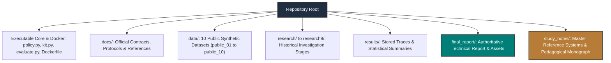
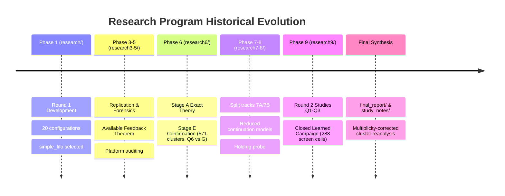

# Repository Source Map and Architectural Inventory

**The Sequential Reciprocal Matching Problem Under Changing Conditions**  
**Monograph Reference Systems & Codebase Architecture Map**  
**Authoritative Reference:** [final_report/REPORT.md](file:///Volumes/1700%20APFS/PERSONAL_PROGRAMMING_PROJECTS/Notes/The%20Sequential%20Matching%20Problem/final_report/REPORT.md) | [data_manifest.json](file:///Volumes/1700%20APFS/PERSONAL_PROGRAMMING_PROJECTS/Notes/The%20Sequential%20Matching%20Problem/data_manifest.json) | [data_checksums.json](file:///Volumes/1700%20APFS/PERSONAL_PROGRAMMING_PROJECTS/Notes/The%20Sequential%20Matching%20Problem/data_checksums.json)

---

## 1. Top-Level Repository Directory Architecture

---

## 2. Root Executables, Drivers, and Core Libraries

| Relative Path | Primary Language / Type | Architectural Role & Implementation Scope | Key Functions / Symbols |
|---|---|---|---|
| [`policy.py`](file:///Volumes/1700%20APFS/PERSONAL_PROGRAMMING_PROJECTS/Notes/The%20Sequential%20Matching%20Problem/policy.py) | Python 3 | **Production Policy Entrypoint**. Implements the retained executable baseline policy conforming to the formal competition runtime interface. | `Policy` class, `resolve_asks()`, `advance()`, `observe()`. |
| [`kit.py`](file:///Volumes/1700%20APFS/PERSONAL_PROGRAMMING_PROJECTS/Notes/The%20Sequential%20Matching%20Problem/kit.py) | Python 3 | **Benchmark Core Engine**. Authoritative data structures, reciprocal eligibility logic, state manager, ask resolution, outcome simulator, and evaluation metrics. | `eligibility()`, `resolve_asks()`, `advance()`, `evaluate_metrics()`, `EpisodeState`. |
| [`evaluate.py`](file:///Volumes/1700%20APFS/PERSONAL_PROGRAMMING_PROJECTS/Notes/The%20Sequential%20Matching%20Problem/evaluate.py) | Python 3 | Official multi-episode evaluation harness. Supports CLI execution against baselines (`greedy`, `no_asks`, `random`) or docker container images. | `run_evaluation()`, CLI argument parser (`--baseline`, `--seeds`, `--variants`). |
| [`candidate_optimal.py`](file:///Volumes/1700%20APFS/PERSONAL_PROGRAMMING_PROJECTS/Notes/The%20Sequential%20Matching%20Problem/candidate_optimal.py) | Python 3 | Candidate optimal policy implementation exploring advanced scoring and optimization formulations. | `CandidateOptimalPolicy`. |
| [`extended_policy.py`](file:///Volumes/1700%20APFS/PERSONAL_PROGRAMMING_PROJECTS/Notes/The%20Sequential%20Matching%20Problem/extended_policy.py) | Python 3 | Round 1 research policy framework implementing `simple_fifo`, terminal probability scoring, and Edmonds' Blossom allocation. | `ExtendedPolicy`, `BlossomMatcher`, `TerminalModel`. |
| [`policy_greedy.py`](file:///Volumes/1700%20APFS/PERSONAL_PROGRAMMING_PROJECTS/Notes/The%20Sequential%20Matching%20Problem/policy_greedy.py) | Python 3 | Reference standalone implementation of the pure greedy baseline. | `GreedyPolicy`. |
| [`research_policy.py`](file:///Volumes/1700%20APFS/PERSONAL_PROGRAMMING_PROJECTS/Notes/The%20Sequential%20Matching%20Problem/research_policy.py) | Python 3 | Multi-model exploratory policy adapter developed during early research phases. | `ResearchPolicy`. |
| [`verify_data.py`](file:///Volumes/1700%20APFS/PERSONAL_PROGRAMMING_PROJECTS/Notes/The%20Sequential%20Matching%20Problem/verify_data.py) | Python 3 | Cryptographic and structural verification script. Validates all 71 data files against `data_checksums.json` and schema contracts. | `verify_data_files()`, `check_schema()`. |
| [`build_public_data.py`](file:///Volumes/1700%20APFS/PERSONAL_PROGRAMMING_PROJECTS/Notes/The%20Sequential%20Matching%20Problem/build_public_data.py) | Python 3 | Generator utility used by organizers to synthesize the 10 public pool datasets from master seeds. | `generate_pool()`, `sample_member()`. |
| [`Dockerfile`](file:///Volumes/1700%20APFS/PERSONAL_PROGRAMMING_PROJECTS/Notes/The%20Sequential%20Matching%20Problem/Dockerfile) | Docker / OCI | Production submission container configuration based on `python:3.12.7-slim`. Read-only runtime compliant with 1 GiB RAM limits. | `ENTRYPOINT ["python", "policy.py"]`. |
| [`Dockerfile.extended`](file:///Volumes/1700%20APFS/PERSONAL_PROGRAMMING_PROJECTS/Notes/The%20Sequential%20Matching%20Problem/Dockerfile.extended), [`Dockerfile.research`](file:///Volumes/1700%20APFS/PERSONAL_PROGRAMMING_PROJECTS/Notes/The%20Sequential%20Matching%20Problem/Dockerfile.research), [`Dockerfile.round6`](file:///Volumes/1700%20APFS/PERSONAL_PROGRAMMING_PROJECTS/Notes/The%20Sequential%20Matching%20Problem/Dockerfile.round6) | Docker / OCI | Container definitions for historical evaluation campaigns across Round 1 and Round 6. | Image staging environments. |
| [`test_kit.py`](file:///Volumes/1700%20APFS/PERSONAL_PROGRAMMING_PROJECTS/Notes/The%20Sequential%20Matching%20Problem/test_kit.py), [`test_runner.py`](file:///Volumes/1700%20APFS/PERSONAL_PROGRAMMING_PROJECTS/Notes/The%20Sequential%20Matching%20Problem/test_runner.py), [`test_release.py`](file:///Volumes/1700%20APFS/PERSONAL_PROGRAMMING_PROJECTS/Notes/The%20Sequential%20Matching%20Problem/test_release.py) | Python 3 (unittest) | Core unit test suites verifying kit data contracts, policy interfaces, and package release invariants (22 passing tests). | `TestKit`, `TestPolicyInterface`, `TestRelease`. |
| [`data_manifest.json`](file:///Volumes/1700%20APFS/PERSONAL_PROGRAMMING_PROJECTS/Notes/The%20Sequential%20Matching%20Problem/data_manifest.json) | JSON | Machine-readable registry of the 10 public synthetic pools, train/val/test splits, member counts, and day-30 event totals. | Schema v1.0.0 metadata. |
| [`data_checksums.json`](file:///Volumes/1700%20APFS/PERSONAL_PROGRAMMING_PROJECTS/Notes/The%20Sequential%20Matching%20Problem/data_checksums.json) | JSON | SHA256 cryptographic digest ledger tracking all 71 public data files. | Cryptographic verification manifest. |

---

## 3. Specifications and Rules Directory (`docs/`)

| File Path | Description and Domain Scope |
|---|---|
| [`docs/DATA_CONTRACT.md`](file:///Volumes/1700%20APFS/PERSONAL_PROGRAMMING_PROJECTS/Notes/The%20Sequential%20Matching%20Problem/docs/DATA_CONTRACT.md) | **Authoritative Data Contract**. Defines all member attributes, 11 hard constraints, soft preference fields, feedback events, ask costs, and snapshot censoring rules. |
| [`docs/POLICY_INTERFACE.md`](file:///Volumes/1700%20APFS/PERSONAL_PROGRAMMING_PROJECTS/Notes/The%20Sequential%20Matching%20Problem/docs/POLICY_INTERFACE.md) | **Executable Policy Protocol**. Authoritative specification of the two-call daily protocol: `resolve_asks` (first call) followed by `advance` (second call). |
| [`docs/SUBMISSION.md`](file:///Volumes/1700%20APFS/PERSONAL_PROGRAMMING_PROJECTS/Notes/The%20Sequential%20Matching%20Problem/docs/SUBMISSION.md) | **Competition Governance & Limits**. Specifies container execution budgets: 10s per invocation, 2 CPU cores, 1 GiB RAM, no network/GPU, 2 GiB max image size. |
| [`docs/PROBLEM_STATEMENT.pdf`](file:///Volumes/1700%20APFS/PERSONAL_PROGRAMMING_PROJECTS/Notes/The%20Sequential%20Matching%20Problem/docs/PROBLEM_STATEMENT.pdf) | Original tournament problem description monograph. |
| [`docs/REFERENCES.md`](file:///Volumes/1700%20APFS/PERSONAL_PROGRAMMING_PROJECTS/Notes/The%20Sequential%20Matching%20Problem/docs/REFERENCES.md) | Bibliography of reciprocal matching, two-sided bandit, and sequential allocation literature. |
| [`docs/LOCAL_RESEARCH_ARTIFACTS.json`](file:///Volumes/1700%20APFS/PERSONAL_PROGRAMMING_PROJECTS/Notes/The%20Sequential%20Matching%20Problem/docs/LOCAL_RESEARCH_ARTIFACTS.json) | Catalog of archived simulation trace files across research3 and research4 (~850 MB compressed). |
| [`docs/FAQ.md`](file:///Volumes/1700%20APFS/PERSONAL_PROGRAMMING_PROJECTS/Notes/The%20Sequential%20Matching%20Problem/docs/FAQ.md) | Clarifications regarding ties, budget rollovers, member reuse, and feedback delays. |

---

## 4. Public Synthetic Datasets (`data/`)

The repository contains 10 independent public synthetic data pools (`public_01` through `public_10`), partitioned into:
- **Training Splits (`train`)**: `public_01`, `public_02`, `public_03`, `public_04`, `public_05`, `public_06` (1,200 members total).
- **Validation Splits (`validation`)**: `public_07`, `public_08` (400 members total).
- **Development-Test Splits (`development_test`)**: `public_09`, `public_10` (400 members total).

Each pool directory contains seven synchronized files captured at day-30 snapshot:
1. `members.jsonl`: Raw JSON line records for 200 members, including initial visible fields and statuses.
2. `members_flat.csv`: Denormalized tabular representation of member traits for tabular modeling.
3. `questionnaires.jsonl`: Pre-arrival survey self-reports and disclosed questionnaire fields.
4. `introductions.jsonl`: Historical matching introductions generated under the logging policy up to day 30.
5. `feedback.jsonl`: First-stage acceptance, date occurrence, and second-meeting responses observed up to day 30.
6. `conversations.jsonl`: Interaction metadata and messaging activity prior to date scheduling.
7. `state.json`: Complete serialized pool environment state at day-30 snapshot.

---

## 5. Research Program Phases (`research/` to `research9/`)

### 5.1 `research/` — Round 1 Foundation and Development
- **Scope**: Initial exploratory analysis, reciprocal feasibility verification, and Round 1 submission architecture.
- **Key Documents**: [`ROUND1_SUBMISSION.md`](file:///Volumes/1700%20APFS/PERSONAL_PROGRAMMING_PROJECTS/Notes/The%20Sequential%20Matching%20Problem/ROUND1_SUBMISSION.md), [`research/THEORY.md`](file:///Volumes/1700%20APFS/PERSONAL_PROGRAMMING_PROJECTS/Notes/The%20Sequential%20Matching%20Problem/research/THEORY.md), [`research/FINAL_STATISTICAL_REVIEW.md`](file:///Volumes/1700%20APFS/PERSONAL_PROGRAMMING_PROJECTS/Notes/The%20Sequential%20Matching%20Problem/research/FINAL_STATISTICAL_REVIEW.md).
- **Outcome**: Identified extreme feasibility graph sparsity (<0.1%); tested 20 policy combinations across 1,056 development and 504 selection episodes; submitted `simple_fifo`. Confirmatory trial on 40 seed clusters yielded $-0.04167$ MSMI/100 ($p=0.09596$), failing to establish superiority over Greedy.

### 5.2 `research2/` — Immediate Round 1 Post-Mortem
- **Scope**: Exploration of configuration regressions, logging bugs, and baseline stability.
- **Key Documents**: `research2/FINAL_REPORT.md`, `research2/EXPERIMENT_REGISTRY.md`.

### 5.3 `research3/` — Replication, Forensics, and Information Theorems
- **Scope**: Replicating simulator mechanics; proving information boundaries; inspecting model calibration.
- **Key Documents**: `research3/REPLICATION.md`, `research3/AVAILABLE_FEEDBACK_THEOREM.md`, `research3/PREDICTION_AUDIT.md`.
- **Contribution**: Proved the *Available Feedback Theorem*, showing that delayed post-date feedback cannot mature in time to steer early matching within an episode.

### 5.4 `research4/` — Response Factorization and Deadline Invariance
- **Scope**: Analyzing the conditional independence of second-meeting intentions from date latency; investigating deadline truncation.
- **Key Documents**: `research4/DEADLINE_INVARIANCE.md`, `research4/RESPONSE_FACTORISATION.md`, `research4/MECHANISMS.md`.

### 5.5 `research5/` — Production Gatekeeping and Environment Hardening
- **Scope**: Auditing archive builds, memory bounds, execution timeouts, and multi-process logging.
- **Key Documents**: `research5/WORLD_REVIEW.md`, `research5/PACKAGE_REVIEW.md`, `research5/LOGGING_REVIEW.md`.

### 5.6 `research6/` — Coordinated Lookahead and Massive Confirmation (Stage E)
- **Scope**: Exact small belief-state dynamic programming (Stage A); candidate screening (Stage B); candidate replication (Stage C); candidate selection (Stage D); and massive confirmatory trial (Stage E).
- **Key Documents**: [`research6/REPORT.md`](file:///Volumes/1700%20APFS/PERSONAL_PROGRAMMING_PROJECTS/Notes/The%20Sequential%20Matching%20Problem/research6/REPORT.md), `research6/exact/THEORY.md`.
- **Outcome**: Coordinated two-query acquisition policy `Q6` (`N3_two`) was tested against `G` across **571 seed clusters (6,852 episodes)**. Mean difference was $+0.003211$ MSMI/100, 99% CI [$-0.02448, +0.03090$], $p = 0.7646$. Failed to establish confirmatory superiority.

### 5.7 `research7/`, `research7a/`, `research7b/` — Orchestrated Strategy Tracks
- **Scope**: Split investigation tracks evaluating structural priors, reservation policies, and merge protocols.
- **Key Documents**: `research7/STATISTICS.md`, `research7/STRATEGIES.md`, `research7/MERGE_PROTOCOL.md`.

### 5.8 `research8/` — Reduced Continuation Models and Holding Probe
- **Scope**: Investigating reservation thresholds and deliberate waiting.
- **Key Documents**: [`research8/README.md`](file:///Volumes/1700%20APFS/PERSONAL_PROGRAMMING_PROJECTS/Notes/The%20Sequential%20Matching%20Problem/research8/README.md), [`research8/continuation_probe/DECISION.md`](file:///Volumes/1700%20APFS/PERSONAL_PROGRAMMING_PROJECTS/Notes/The%20Sequential%20Matching%20Problem/research8/continuation_probe/DECISION.md).
- **Outcome**: Showed holding pairs back reduced assignments from 960 to 954 while producing identical qualified pairs (10 vs 10). Concluded that continuation models cannot be safely deployed without richer graph fidelity.

### 5.9 `research9/` — Round 2 Robustness, Priors, Drift, and Closed Learned Campaign
- **Scope**: Two major sub-programs:
  1. **`research9/round2/`**:
     - `study_q1_robustness.json`: 1,152 episodes (12 seeds $\times$ 16 laws $\times$ 6 arms) evaluating FIFO robustness and query ordering.
     - `study_q2_priors.json`: 420 episodes (12 seeds $\times$ 5 laws $\times$ 7 arms) evaluating simulator, empirical, and flat priors.
     - `study_q3_drift.json`: 504 episodes (12 seeds $\times$ 6 laws $\times$ 7 arms) evaluating adaptive learning, directional calibration, and ablations.
     - `fastsim.py`, `fit_priors.py`, `arms.py`, `laws.py`, `analyze.py`.
  2. **`research9/final_campaign/`**:
     - Audited 288-cell learned policy selection screen across 8 reused development groups and 6 candidate arms.
     - Candidates failed the calibrated-probability gate; screen MSMI/100 was strictly inferior to Greedy ($0.1875 - 0.2188$ vs $0.3229$).
     - The 96 reserved confirmatory groups remained unopened; campaign was permanently closed.

---

## 6. Results and Raw Artifact Directories (`results/`)

- `results/extended/`: Round 1 development and confirmation logs, including `confirmation_statistics.json` ($N=40$ clusters).
- `results/research/`: Matched historical baseline evaluations, including `holdout.json` (30 episodes per baseline on seeds 301–305).
- `results/research3/` to `results/research5/`: Intermediate experimental logs, trace archives, and diagnostic plots.
- `results/research6/stage_e_confirmation/`: Machine-readable results and statistics for the 571-cluster Stage E confirmation trial (`confirmation_analysis.json`).

---

## 7. Final Report Package (`final_report/`)

| File / Folder Path | Function and Content |
|---|---|
| [`final_report/REPORT.md`](file:///Volumes/1700%20APFS/PERSONAL_PROGRAMMING_PROJECTS/Notes/The%20Sequential%20Matching%20Problem/final_report/REPORT.md) | **Authoritative Round 2 Technical Report**. 14 sections providing complete retrospective synthesis, corrected cluster analyses, answers to organizer feedback, and final decision. |
| [`final_report/build_assets.py`](file:///Volumes/1700%20APFS/PERSONAL_PROGRAMMING_PROJECTS/Notes/The%20Sequential%20Matching%20Problem/final_report/build_assets.py) | Standalone reanalysis and figure generation script. Reads saved JSON files; exports PNG/SVG figures and CSV/JSON tables. Contains zero simulation/fitting imports. |
| `final_report/assets/` | 12 report figures (PNG and SVG vector formats). |
| `final_report/data/` | Reanalyzed tables: `episode_metrics.csv`, `paired_contrasts.csv`, `study_analysis.json`, `calibration.json`, `reliability_bins.csv`, `waiting.json`, `subgroups_q1_greedy.csv`, `provenance.json`. |
| `final_report/reviews/` | Independent reviews: `claim_review.md`, `analysis_code_review.md`, `unit_validation.log`, `data_validation.log`, `final_qa.json`. |
| `final_report/sources/` | Preserved Round 1 submission documents: `round1_submission.pdf`, `round1_submission.txt`. |

---

## 8. Master Study Notes System (`study_notes/`)

| Path | Architectural Purpose |
|---|---|
| [`study_notes/README.md`](file:///Volumes/1700%20APFS/PERSONAL_PROGRAMMING_PROJECTS/Notes/The%20Sequential%20Matching%20Problem/study_notes/README.md) | **Central Reading Guide and Navigation Hub**. Monograph overview, 5-tier curriculum, complete 12-figure Visual Atlas, chapter links, and oral defense guide. |
| [`study_notes/reference/glossary_and_notation.md`](file:///Volumes/1700%20APFS/PERSONAL_PROGRAMMING_PROJECTS/Notes/The%20Sequential%20Matching%20Problem/study_notes/reference/glossary_and_notation.md) | Comprehensive mathematical notation, metric formulas, domain variables, and technical terms. |
| [`study_notes/reference/policy_aliases_and_lineage.md`](file:///Volumes/1700%20APFS/PERSONAL_PROGRAMMING_PROJECTS/Notes/The%20Sequential%20Matching%20Problem/study_notes/reference/policy_aliases_and_lineage.md) | Master policy taxonomy mapping all 20+ policy variants, controls, mechanisms, and outcomes. |
| [`study_notes/reference/source_map.md`](file:///Volumes/1700%20APFS/PERSONAL_PROGRAMMING_PROJECTS/Notes/The%20Sequential%20Matching%20Problem/study_notes/reference/source_map.md) | This exhaustive architectural inventory of the repository. |
| [`study_notes/reference/research_and_evidence_ledger.md`](file:///Volumes/1700%20APFS/PERSONAL_PROGRAMMING_PROJECTS/Notes/The%20Sequential%20Matching%20Problem/study_notes/reference/research_and_evidence_ledger.md) | Cryptographic evidence ledger cataloging all empirical claims, units of inference, results, and corrections. |
| [`study_notes/reference/coverage_matrix.md`](file:///Volumes/1700%20APFS/PERSONAL_PROGRAMMING_PROJECTS/Notes/The%20Sequential%20Matching%20Problem/study_notes/reference/coverage_matrix.md) | Systematic matrix mapping all research phases, methods, and chapters to syllabus exam sections. |
| [`study_notes/reference/flashcards.md`](file:///Volumes/1700%20APFS/PERSONAL_PROGRAMMING_PROJECTS/Notes/The%20Sequential%20Matching%20Problem/study_notes/reference/flashcards.md) | High-yield conceptual, mathematical, algorithmic, and statistical flashcards. |
| [`study_notes/reference/quick_reference.md`](file:///Volumes/1700%20APFS/PERSONAL_PROGRAMMING_PROJECTS/Notes/The%20Sequential%20Matching%20Problem/study_notes/reference/quick_reference.md) | One-page executive reference sheet of vital numbers, formulas, and baseline decision rules. |
| [`study_notes/reviews/pedagogical_review.md`](file:///Volumes/1700%20APFS/PERSONAL_PROGRAMMING_PROJECTS/Notes/The%20Sequential%20Matching%20Problem/study_notes/reviews/pedagogical_review.md) | Pedagogical audit evaluating instructional design, conceptual scaffolding, and pitfall warnings. |
| [`study_notes/reviews/coverage_review.md`](file:///Volumes/1700%20APFS/PERSONAL_PROGRAMMING_PROJECTS/Notes/The%20Sequential%20Matching%20Problem/study_notes/reviews/coverage_review.md) | Independent audit verifying closed research compliance, evidence tracing, and statistical honesty. |
| [`study_notes/scripts/reproduce_figures.py`](file:///Volumes/1700%20APFS/PERSONAL_PROGRAMMING_PROJECTS/Notes/The%20Sequential%20Matching%20Problem/study_notes/scripts/reproduce_figures.py) | Reproducibility harness generating study note assets and verification tables. |
| `study_notes/assets/` | The 12 publication-grade figures in PNG and SVG formats. |
| `study_notes/data/` | Derived datasets, paired contrast tables, and calibration statistics for pedagogical study. |
