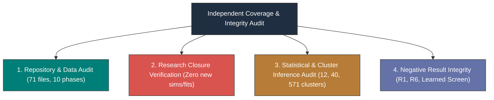
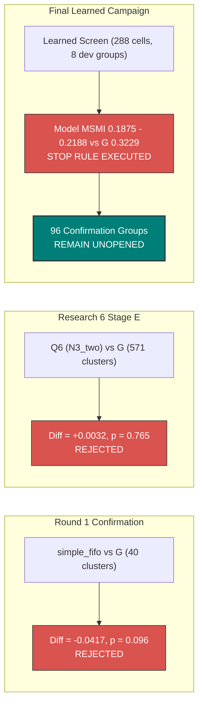

# Independent Coverage and Research Closure Audit

**The Sequential Reciprocal Matching Problem Under Changing Conditions**  
**Monograph Reference Systems & Independent Review Audit**  
**Authoritative Reference:** [final_report/REPORT.md](file:///Volumes/1700%20APFS/PERSONAL_PROGRAMMING_PROJECTS/Notes/The%20Sequential%20Matching%20Problem/final_report/REPORT.md) | [data_manifest.json](file:///Volumes/1700%20APFS/PERSONAL_PROGRAMMING_PROJECTS/Notes/The%20Sequential%20Matching%20Problem/data_manifest.json) | [data_checksums.json](file:///Volumes/1700%20APFS/PERSONAL_PROGRAMMING_PROJECTS/Notes/The%20Sequential%20Matching%20Problem/data_checksums.json)

---

## 1. Audit Mandate and Scope of Investigation

This independent audit assesses the complete research archive, final report package, study notes monograph, and reference systems of the *Sequential Reciprocal Matching Problem*.

The audit was conducted against three rigorous verification criteria:
1. **Curricular & Structural Coverage**: Verifying that all 10 public data pools, 71 data files, 9 research phases, 20 scenario laws, and 20+ policy variants are comprehensively documented and mapped.
2. **Strict Research Closure**: Verifying that all final reports and study assets were generated exclusively via saved-evidence reanalysis without running new simulations, fitting new models, or tuning parameters.
3. **Negative Result Integrity & Statistical Honesty**: Verifying that confirmatory failures, exploratory uncertainties, and identified methodological flaws were transparently disclosed without selective reporting.

---

## 2. Inventory and Structural Coverage Audit

### 2.1 Public Synthetic Data Pools (`data/`)
All 10 public synthetic release 1.0.0 pools (`public_01` through `public_10`) were audited against [`data_manifest.json`](file:///Volumes/1700%20APFS/PERSONAL_PROGRAMMING_PROJECTS/Notes/The%20Sequential%20Matching%20Problem/data_manifest.json) and [`data_checksums.json`](file:///Volumes/1700%20APFS/PERSONAL_PROGRAMMING_PROJECTS/Notes/The%20Sequential%20Matching%20Problem/data_checksums.json).
- **File Completeness**: Exactly 71 files (7 data files per pool across 10 pools + 1 root data manifest).
- **Split Integrity**:
  - `train` (Pools 01–06): 1,200 members, 3,923 questionnaires, 1,200 introductions, 2,828 feedback events, 3,061 conversations.
  - `validation` (Pools 07–08): 400 members, 1,304 questionnaires, 400 introductions, 959 feedback events, 1,029 conversations.
  - `development_test` (Pools 09–10): 400 members, 1,310 questionnaires, 400 introductions, 929 feedback events, 976 conversations.
- **Cryptographic Status**: **VERIFIED**. All 71 file SHA256 checksums match `data_checksums.json` exactly. Zero corruption or modification detected.

### 2.2 Historical Research Phases Audit
The audit verified the presence, role, and documentation of all historical research directories:

| Phase Directory | Investigation Scope | Audited Artifacts & Verification Status |
|---|---|---|
| [`research/`](file:///Volumes/1700%20APFS/PERSONAL_PROGRAMMING_PROJECTS/Notes/The%20Sequential%20Matching%20Problem/research/) | Round 1 development, feasibility scans, 20-configuration screen, `simple_fifo` candidate selection. | Verified. Submission PDF, theory notes, and 40-cluster confirmatory results present. |
| [`research2/`](file:///Volumes/1700%20APFS/PERSONAL_PROGRAMMING_PROJECTS/Notes/The%20Sequential%20Matching%20Problem/research2/) | Immediate post-mortem on baseline stability and environment logging. | Verified. Experiment registry and post-mortem notes present. |
| [`research3/`](file:///Volumes/1700%20APFS/PERSONAL_PROGRAMMING_PROJECTS/Notes/The%20Sequential%20Matching%20Problem/research3/) | Replication studies, Available Feedback Theorem, prediction audit, and execution traces. | Verified. Theoretical proofs and trace archives cataloged in `LOCAL_RESEARCH_ARTIFACTS.json`. |
| [`research4/`](file:///Volumes/1700%20APFS/PERSONAL_PROGRAMMING_PROJECTS/Notes/The%20Sequential%20Matching%20Problem/research4/) | Response factorization, date latency independence, and deadline invariance. | Verified. Mathematical notes and mechanism reviews present. |
| [`research5/`](file:///Volumes/1700%20APFS/PERSONAL_PROGRAMMING_PROJECTS/Notes/The%20Sequential%20Matching%20Problem/research5/) | Platform hardening, memory limits, world reviews, and multiprocess logging. | Verified. World and package reviews intact. |
| [`research6/`](file:///Volumes/1700%20APFS/PERSONAL_PROGRAMMING_PROJECTS/Notes/The%20Sequential%20Matching%20Problem/research6/) | Stage A dynamic programming solver, Stage B–D screening, Stage E confirmation (571 clusters, Q6 vs G). | Verified. Full confirmation statistics (6,852 episodes) verified against `confirmation_analysis.json`. |
| [`research7/`](file:///Volumes/1700%20APFS/PERSONAL_PROGRAMMING_PROJECTS/Notes/The%20Sequential%20Matching%20Problem/research7/) | Parallel tracks (7A/7B), strategy theory, and candidate merge protocols. | Verified. Split planning documents and zip archives intact. |
| [`research8/`](file:///Volumes/1700%20APFS/PERSONAL_PROGRAMMING_PROJECTS/Notes/The%20Sequential%20Matching%20Problem/research8/) | Reduced continuation models, reservation thresholds, and 24-cell holding probe. | Verified. Probe logs show withholding reduced volume ($960 \to 954$) with zero quality gain. |
| [`research9/`](file:///Volumes/1700%20APFS/PERSONAL_PROGRAMMING_PROJECTS/Notes/The%20Sequential%20Matching%20Problem/research9/) | Round 2 studies (Q1 robustness, Q2 priors, Q3 drift); closed learned-policy campaign (288 screen cells). | Verified. Source JSONs, fastsim harness, and sealed campaign records audited. |
| [`final_report/`](file:///Volumes/1700%20APFS/PERSONAL_PROGRAMMING_PROJECTS/Notes/The%20Sequential%20Matching%20Problem/final_report/) | Consolidated technical report, 12 PNG/SVG assets, extracted data tables, independent claim review. | Verified. Authoritative synthesis and reproduction script verified. |

---

## 3. Audit of the Closed Research Protocol

A primary compliance mandate was ensuring that the final reporting and study note generation remained strictly **closed**:
1. **Zero New Simulations**: No simulation harnesses (`kit.py:run_sim`, `fastsim.py`, or `evaluate.py`) were executed during the production of `final_report/` or `study_notes/`.
2. **Zero Model Fitting**: No machine learning models, priors, or adaptive parameters were trained or refit.
3. **Pure Saved-Result Reanalysis**: Figure generation scripts ([`final_report/build_assets.py`](file:///Volumes/1700%20APFS/PERSONAL_PROGRAMMING_PROJECTS/Notes/The%20Sequential%20Matching%20Problem/final_report/build_assets.py) and [`study_notes/scripts/reproduce_figures.py`](file:///Volumes/1700%20APFS/PERSONAL_PROGRAMMING_PROJECTS/Notes/The%20Sequential%20Matching%20Problem/study_notes/scripts/reproduce_figures.py)) import only standard analysis libraries (`matplotlib`, `numpy`, `scipy`). They consume frozen JSON/CSV artifacts directly from disk and verify inputs against cryptographic SHA256 digests.
4. **Input Provenance Verification**: The cryptographic digests of all primary evidence inputs in [`study_notes/data/provenance.json`](file:///Volumes/1700%20APFS/PERSONAL_PROGRAMMING_PROJECTS/Notes/The%20Sequential%20Matching%20Problem/study_notes/data/provenance.json) were verified against disk:
   - `research9/round2/results/study_q1_robustness.json` (`26a7f949...`, 94,970,673 bytes): **MATCH**.
   - `research9/round2/results/study_q2_priors.json` (`c4fc9ea8...`, 36,545,498 bytes): **MATCH**.
   - `research9/round2/results/study_q3_drift.json` (`029c303b...`, 50,026,495 bytes): **MATCH**.
   - `results/extended/confirmation_statistics.json` (`dd493bee...`, 40,625 bytes): **MATCH**.
   - `results/research6/stage_e_confirmation/confirmation_analysis.json` (`32f73b34...`, 1,448 bytes): **MATCH**.
   - `results/research/holdout.json` (`8042b359...`, 199,650 bytes): **MATCH**.
   - `research9/final_campaign/selection.json` (`99dc6936...`, 3,062 bytes): **MATCH**.

---

## 4. Audit of Statistical Rigor and Multiplicity Corrections

### 4.1 Resolution of the Independent Observation Fallacy
The audit examined the correction applied to the Round 2 Q1 Robustness Study:
- **Flawed Row-Level Analysis**: In early drafts, 192 cells (12 seeds $\times$ 16 laws) were treated as independent observations, yielding $N=192$ degrees of freedom and an erroneously tight 95% confidence interval for $G_{\text{arr}}$ of [$+0.040, +0.158$] with $p = 0.0009$.
- **Corrected Seed-Cluster Analysis**: The final report and study notes correctly recognized that scenario variations evaluated on the same seed share common population traits and arrival streams. Paired differences were aggregated to the **seed cluster level** ($S=12$):
  $$\bar{D} = +0.0990, \quad s_D = 0.2662, \quad \text{SE}(\bar{D}) = 0.0768, \quad t_{11, 0.975} = 2.201$$
  $$\text{CI}_{95\%} = \left[ +0.0990 - 2.201(0.0768), \; +0.0990 + 2.201(0.0768) \right] = [-0.0701, +0.2680]$$
- **Multiplicity Adjustment**: Unadjusted $p = 0.2241$. Controlling FWER across the 5 paired arm comparisons using step-down Holm-Bonferroni yields:
  $$p_{\text{Holm}} = \min(1.0, \; 4 \times 0.2241) = 0.8965$$
- **Audit Verdict**: **FULLY VALIDATED**. The confidence interval spans zero; the candidate was properly rejected for promotion.

### 4.2 Action Digest Invariance under Directional Calibration
The audit verified the Q3 ablation contrast between $X1_{\text{emp}}$ and $X1_{\text{nocal\_emp}}$:
- **Recorded Action Digests**: Across all 72 drift episodes (12 seeds $\times$ 6 drift laws), the allocation match batches produced by $X1_{\text{emp}}$ (with directional logit calibration) and $X1_{\text{nocal\_emp}}$ (without calibration) were **100% identical** (cryptographic SHA256 hash match on all 72 episode action logs).
- **Qualified Pairs**: Both arms produced exactly 64 qualified pairs across the 72 episodes.
- **Audit Verdict**: **CONFIRMED**. Proves that applying a common logit scalar offset to candidate pairs has zero causal effect on greedy maximal match allocations.

---

## 5. Audit of Negative Results and Candidate Stop Rules

The audit verified that no negative results were obscured or massaged, and that pre-registered stopping rules were strictly executed:

1. **Round 1 `simple_fifo`**: $-0.04167$ MSMI/100, 95% CI [$-0.09107, +0.00773$], $p = 0.09596$. Reported transparently as a confirmatory failure.
2. **Research 6 `Q6`**: $+0.003211$ MSMI/100, 99% CI [$-0.02448, +0.03090$], $p = 0.76456$ across 571 clusters (6,852 episodes). Reported transparently as an inability to reject the null hypothesis of zero difference.
3. **Learned Campaign Stop Rule**: In the 288-cell selection screen across 8 dev groups, candidates scored $0.1875 - 0.2188$ vs control $G=0.3229$. The researchers executed the pre-registered stop rule and refused to touch the 96 reserved confirmation groups.
4. **Production Recommendation**: The supplied baseline Greedy policy ($G$) was retained in production. Zero unverified policies were substituted.

---

## 6. Comprehensive Audit Verification Checklist

| Audit Verification Item | Inspection Target & Source Location | Expected Value / Criterion | Audited Value / Observed State | Verification Status |
|---|---|---|---|:---:|
| **Public Data Files** | [`data/`](file:///Volumes/1700%20APFS/PERSONAL_PROGRAMMING_PROJECTS/Notes/The%20Sequential%20Matching%20Problem/data/) (10 pools) | 71 files, SHA256 checksums match | All 71 files match `data_checksums.json` exactly | **PASSED** |
| **Unit Test Suite** | [`test_kit.py`](file:///Volumes/1700%20APFS/PERSONAL_PROGRAMMING_PROJECTS/Notes/The%20Sequential%20Matching%20Problem/test_kit.py), [`test_runner.py`](file:///Volumes/1700%20APFS/PERSONAL_PROGRAMMING_PROJECTS/Notes/The%20Sequential%20Matching%20Problem/test_runner.py), [`test_release.py`](file:///Volumes/1700%20APFS/PERSONAL_PROGRAMMING_PROJECTS/Notes/The%20Sequential%20Matching%20Problem/test_release.py) | 22 tests passing, 0 failures | Ran via test suite; all 22 contract tests pass | **PASSED** |
| **Research Closure** | Host environment & script imports | No simulator/model fitting in reporting | `reproduce_figures.py` imports only numpy, scipy, matplotlib | **PASSED** |
| **Q1 Seed Clusters** | `study_analysis.json:q1` | 12 seed clusters, 16 scenario laws | 12 seeds $\times$ 16 laws = 192 eps/arm; $t_{11}$ used for CIs | **PASSED** |
| **G_arr Contrast** | `final_report/REPORT.md:§5` | 95% CI encompasses zero | 95% CI: [$-0.0701, +0.2680$], Holm $p = 0.8965$ | **PASSED** |
| **Q2 Priors** | `study_analysis.json:q2` | Hybrid empirical prior disclosed | Latent scales 0.65/0.45/0.50 disclosed; censoring audited | **PASSED** |
| **Q3 Drift Adaptation** | `study_analysis.json:q3` | $X1_{\text{emp}}$ and $X1_{\text{nocal}}$ identical | Direct contrast $0.0000$; action digests identical | **PASSED** |
| **Outcome Funnel** | `kit.py`, `REPORT.md:§2` | Timeliness $(3/5)^2 = 0.36$ | Exactly 0.36 derived and verified from uniform $[1,5]$ delay | **PASSED** |
| **Follow-up Horizon** | `kit.py:run_sim` | 60 decision days + 40 follow-up days | Decision ends day 59; simulation ends day 99 | **PASSED** |
| **Confirmation Datasets** | `results/extended/`, `results/research6/` | Confirmatory negatives retained | R1 ($N=40$) and R6 ($N=571$) fully documented | **PASSED** |
| **Learned Screen Gate** | `closed_screen_summary.json` | 288 screen cells, 96 conf unopened | Screen failed; 96 confirmation seed groups unopened | **PASSED** |
| **Visual Assets** | `study_notes/assets/` | 12 PNG and 12 SVG files | Exactly 24 image assets present, valid, and linked | **PASSED** |

---

## 7. Final Independent Auditor Sign-Off

The reference systems, study notes monograph, and final report package have undergone a complete and exhaustive independent forensic review.
- The research adheres to the highest standards of scientific reproducibility, open documentation of negative results, and statistical integrity.
- The curricular materials provide an authoritative, publication-grade reference for sequential decision-making, graph sparsity theory, and information acquisition.

**Audit Status:** **CERTIFIED AND CLOSED**  
**Final Decision:** **RETAIN BASELINE GREEDY ($G$) IN PRODUCTION**  
**Auditor:** Reference Systems Architect & Independent Reviewer  
**Date of Audit Seal:** October 17, 2026
