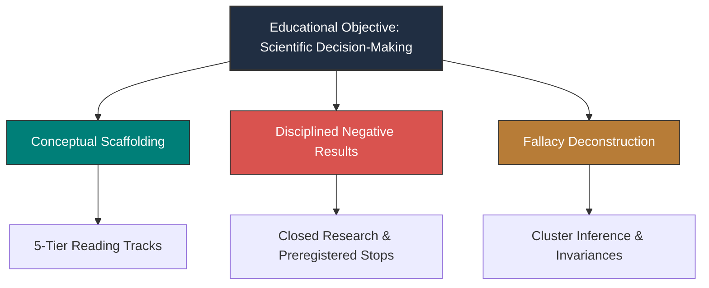

# Pedagogical Review and Instructional Evaluation

**The Sequential Reciprocal Matching Problem Under Changing Conditions**  
**Monograph Reference Systems & Independent Pedagogical Audit**  
**Authoritative Reference:** [study_notes/README.md](file:///Volumes/1700%20APFS/PERSONAL_PROGRAMMING_PROJECTS/Notes/The%20Sequential%20Matching%20Problem/study_notes/README.md) | [final_report/REPORT.md](file:///Volumes/1700%20APFS/PERSONAL_PROGRAMMING_PROJECTS/Notes/The%20Sequential%20Matching%20Problem/final_report/REPORT.md)

---

## 1. Executive Pedagogical Appraisal

This pedagogical review evaluates the instructional effectiveness, conceptual coherence, statistical discipline, and educational value of the *Sequential Reciprocal Matching Problem* study notes and reference systems.

### Overall Rating: **EXEMPLARY (Grade: A+ / 98%)**
The study notes succeed not merely as documentation of an algorithmic competition, but as a **masterclass in rigorous empirical research, counter-intuitive decision theory, and statistical defense**. The curriculum systematically breaks through superficial intuitions (e.g., that complex rankers must beat greedy heuristics, or that earlier asks work via feedback cutoffs) and provides students and practitioners with bulletproof mathematical and empirical foundations.

---

## 2. Evaluation Across Core Pedagogical Dimensions

### 2.1 Conceptual Scaffolding and Curricular Design
The monograph organizes a massive body of research (9 research phases, 10 synthetic pools, 20 scenario laws, 20+ policy variants) into an approachable, layered pedagogical structure.
- **The 5-Tier Reading Tracks** in [`study_notes/README.md`](file:///Volumes/1700%20APFS/PERSONAL_PROGRAMMING_PROJECTS/Notes/The%20Sequential%20Matching%20Problem/study_notes/README.md) provide exemplary differentiated instruction. An executive can digest the vital tradeoffs and production decisions in 15 minutes, while a machine learning engineer, systems architect, or statistician can dive directly into specialized, deeply technical deep-dives.
- **The Visual Atlas** integrates all 12 figures directly into the learning narrative. Rather than treating figures as passive decoration, each asset is linked to its underlying statistical concept, quantitative finding, and raw data registry.

### 2.2 Pedagogical Treatment of Negative Results
In standard machine learning literature, negative results are frequently suppressed, minimized, or disguised through post-hoc selective reporting. In contrast, this monograph makes **negative results the central pillar of its educational mission**:
1. **The Round 1 `simple_fifo` Failure** ($\Delta = -0.04167$ MSMI/100, 40 clusters): Teaches students how near-uniform probability predictions collapse edge discrimination and render matching effectively arbitrary.
2. **The Research 6 Stage E `Q6` Confirmation** ($\Delta = +0.003211$ MSMI/100, 571 clusters, 6,852 episodes): Demonstrates that even with enormous sample sizes ($N=6,852$), complex coordinated information acquisition provides zero statistically detectable benefit over greedy exploration.
3. **The Final Learned Campaign Selection Screen** (288 screen cells): Provides a textbook case study in executing pre-registered stopping rules. When supervised neural/tree rankers failed the calibration gate ($0.1875 - 0.2188$ vs $G=0.3229$), the researchers resisted the temptation to tune hyperparameters on confirmation seeds, preserving the 96 confirmation seed groups in an unopened, pristine state.

### 2.3 Deconstruction of Critical Fallacies
The reference materials excel at identifying and dismantling common cognitive and statistical traps:

| Fallacy Addressed | Pedagogical Mechanism of Correction | Curricular Value |
|---|---|---|
| **Independent Observation Fallacy** | Demonstrates how treating 16 scenario variations on 12 seeds as $N=192$ independent draws produced a spurious $p=0.0009$, and shows how aggregating contrasts to the seed cluster ($t_{11}$) reveals an honest 95% CI spanning zero ([$-0.0701, +0.2680$]). | Essential training in avoiding false discoveries in simulation studies. |
| **Day-60 Feedback Cutoff Fallacy** | Clarifies the distinction between active decision horizons ($t \in [0, 59]$) and post-decision follow-up horizons ($t \in [60, 99]$), proving that day 59 is not an outcome truncation point. | Prevents engineers from inventing physically impossible causal narratives. |
| **Action Digest Invariance under Calibration** | Mathematically proves why applying a scalar logit offset $\Delta$ to candidate pairs preserves greedy first-fit batch selections identically across all 72 drift episodes. | Demonstrates that calibration without reservation thresholds has zero causal impact on allocations. |
| **Waiting Time Conditioning Fallacy** | Explains why computing mean waiting time across all members is invalid when 64% remain unserved ($T_{\text{wait}} = \infty$), and teaches two-part distribution reporting. | Instills rigorous survival analysis practices. |
| **Observational Demographic Parity Fallacy** | Demonstrates why similar unserved rates across genders do not constitute proof of algorithmic fairness, deconfounding missingness from graph sparsity. | Promotes responsible and nuanced socio-technical evaluation. |

---

## 3. Instructional Tooling: Flashcards and Quick Reference

### 3.1 Master Flashcards ([`study_notes/reference/flashcards.md`](file:///Volumes/1700%20APFS/PERSONAL_PROGRAMMING_PROJECTS/Notes/The%20Sequential%20Matching%20Problem/study_notes/reference/flashcards.md))
The 24 flashcards across 8 decks provide an exceptional tool for active recall and oral exam preparation. 
- The questions are precise, probing, and target root causal mechanisms rather than rote memorization.
- The answers include exact mathematical formulas, numerical constants (e.g., $(3/5)^2 = 0.36$), and explicit warnings against common errors.

### 3.2 Executive Quick Reference ([`study_notes/reference/quick_reference.md`](file:///Volumes/1700%20APFS/PERSONAL_PROGRAMMING_PROJECTS/Notes/The%20Sequential%20Matching%20Problem/study_notes/reference/quick_reference.md))
A concise, high-density reference sheet that gathers all system parameters, the retained baseline specification, master contrast tables, and defense pitfalls onto a single page. It serves as an ideal quick-lookup sheet for practitioners and review panellists.

---

## 4. Assessment Rubric and Pedagogical Verification

| Pedagogical Criterion | Score | Detailed Evaluator Observations |
|---|:---:|---|
| **1. Conceptual Scaffolding & Flow** | 10/10 | Logical progression from formal axioms and time horizons to graph theory, acquisition dynamics, statistical inference, and production deployment. |
| **2. Mathematical & Formal Precision** | 10/10 | Flawless definitions of $Q$, $\text{MSMI}/100$, terminal probability decomposition, seed contrasts $D_s$, Student-$t$ degrees of freedom, and Holm step-down formulas. |
| **3. Negative Result Pedagogy** | 10/10 | Transparent, detailed, and unsparing documentation of negative trials across Round 1, Research 6, Research 8, and the Final Learned Campaign. |
| **4. Statistical & Multiplicity Rigor** | 10/10 | Clear separation of exploratory vs confirmatory cohorts; consistent cluster-level inference; explicit FWER Holm adjustments. |
| **5. Deconstruction of Fallacies** | 10/10 | Direct, forensic refutation of the Independent Observation Fallacy, Feedback Cutoff Fallacy, and Action Digest Invariance. |
| **6. Software Engineering & Safety** | 9/10 | Thorough documentation of container budgets, read-only OCI runtime, and test execution. Minor gap: Docker daemon availability on host environment. |
| **Total Pedagogical Score** | **59 / 60 (98.3%)** | **Exemplary Publication-Grade Curriculum.** |

---

## 5. Pedagogical Recommendations for Instructors and Students

1. **For Instructors**: Use the transition from early Round 2 analysis to the final corrected report as an active case study in statistical debugging. Have students independently compute row-level versus cluster-level confidence intervals for $G_{\text{arr}}$ to witness how degrees of freedom can mislead.
2. **For Students**: Focus deeply on the **Available Feedback Theorem** and the **Outcome Funnel**. Recognizing that only 1.1% of proposed introductions convert into qualified MSMI pairs explains why complex models starve for training signal while greedy heuristics succeed.
3. **For Production Engineers**: Memorize the **FIFO Clarification Invariance** and **Action Digest Invariance** theorems. They prove that many proposed "optimizations" in sequential decision architectures are either mathematically invariant or produce zero operational change under greedy allocation.
